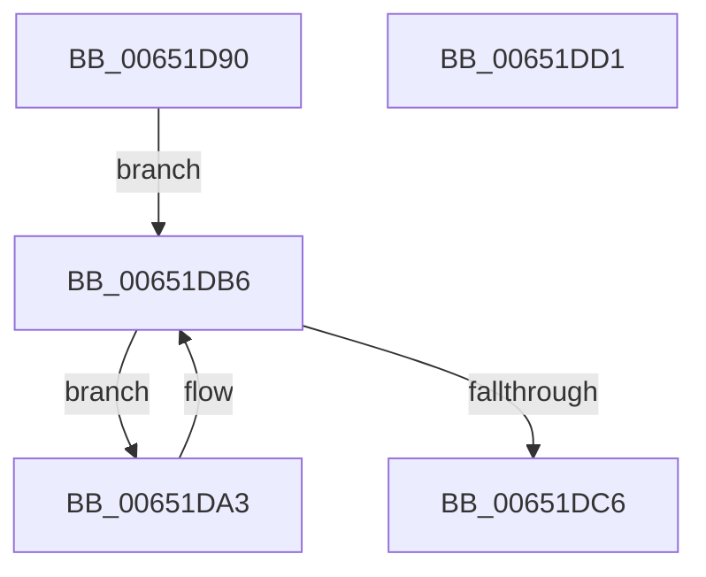

# EtwpStackDeleteProcessor

- RVA: `0x00651D90`–`0x00651DD2` (길이 `66` bytes)
- VA: `0x0000000140651D90`
- 실행 섹션: `.text`
- PDB 이름 있음: `예`; PDB Function 태그: `아니요`
- unwind 정보 RVA: `0x0005CAAC`
- 디코드: `20`개 명령, `66/66` bytes 표시
- 미해석 바이트: `0` (있으면 어셈블리에 `.byte`로 보존)

> 이 문서는 커널 이미지의 기계어와 PDB 기호를 분석해 생성했습니다. 4번과 5번은 함수 원형과 자료형을 바이너리 사용 방식에서 추정한 C 해석이며 원본 소스 복구 결과는 아닙니다.

## 1. Dependencies

- 직접 호출 지점: **3**; 고유 호출 대상: **3**
- 직접 호출자로 확인된 함수: **1**
- RIP 상대 이미지 참조: **0**

### Outgoing calls
- `0x00651DA7` → [KeFreeCalloutStack](../../page/A9/KeFreeCalloutStack_function_00A99AB0.md) (function, `0x00A99AB0`)
- `0x00651DB1` → [ExFreePoolWithTag](../../poolcode/B8/ExFreePoolWithTag_function_00B82870.md) (function, `0x00B82870`)
- `0x00651DB9` → [ExpInterlockedPopEntrySList](../6B/ExpInterlockedPopEntrySList_function_006BA570.md) (function, `0x006BA570`)

### Direct callers
- [EtwInitializeProcessor](../../page/7B/EtwInitializeProcessor_function_007B4EBC.md) at `0x007B4FA0`

### Static image references
- 디코드된 RIP-relative 메모리 참조가 없습니다.

## 2. Other-region calls and transfers

- 다른 실행 섹션으로 향하는 call: **2**
  - `0x00651DA7` → [KeFreeCalloutStack](../../page/A9/KeFreeCalloutStack_function_00A99AB0.md) (`.text` → `PAGE`)
  - `0x00651DB1` → [ExFreePoolWithTag](../../poolcode/B8/ExFreePoolWithTag_function_00B82870.md) (`.text` → `POOLCODE`)
- 별도 외부 분기/꼬리 이동을 확인하지 못했습니다.

## 3. Assembly (complete function range)

```asm
00651D90  48 89 5C 24 08                  mov qword ptr [rsp + 8], rbx
00651D95  57                              push rdi
00651D96  48 83 EC 20                     sub rsp, 0x20
00651D9A  48 8D B9 80 01 00 00            lea rdi, [rcx + 0x180]
00651DA1  EB 13                           jmp 0x140651db6
00651DA3  48 8B 4B 18                     mov rcx, qword ptr [rbx + 0x18]
00651DA7  E8 04 7D 44 00                  call 0x140a99ab0
00651DAC  33 D2                           xor edx, edx
00651DAE  48 8B CB                        mov rcx, rbx
00651DB1  E8 BA 0A 53 00                  call 0x140b82870
00651DB6  48 8B CF                        mov rcx, rdi
00651DB9  E8 B2 87 06 00                  call 0x1406ba570
00651DBE  48 8B D8                        mov rbx, rax
00651DC1  48 85 C0                        test rax, rax
00651DC4  75 DD                           jne 0x140651da3
00651DC6  48 8B 5C 24 30                  mov rbx, qword ptr [rsp + 0x30]
00651DCB  48 83 C4 20                     add rsp, 0x20
00651DCF  5F                              pop rdi
00651DD0  C3                              ret
00651DD1  CC                              int3
```

## 4. C-style interpretation (structured pseudocode)

```c
__int64 __fastcall EtwpStackDeleteProcessor(__int64 a1, int a2)
{
    __int64 result;
    __int64 v_rsp;
    unsigned __int64 v_stack_p8;

    v_stack_p8 = v_rbx;
    v_rsp = (v_rsp) - (32);
    goto loc_00651DB6;
loc_00651DA3:
    result = KeFreeCalloutStack(*(unsigned __int64 *)(v_rbx + 24), a2, a3, a4);
    a2 = 0;
    result = ExFreePoolWithTag(v_rbx, a2, a3, a4);
loc_00651DB6:
    result = ExpInterlockedPopEntrySList(a1 + 384, a2, a3, a4);
    if (result != 0) goto loc_00651DA3;
    v_rsp = (v_rsp) + (32);
    return result;
}
```

## 5. (Beta) C Style

```c
int64_t EtwpStackDeleteProcessor(void *Arg1, int32_t Arg2)
{
    uint8_t *arg1 = (uint8_t *)Arg1;

    int64_t result;
    int64_t local_rsp;
    uint64_t v_stack_p8;

    v_stack_p8 = local_rbx;
    local_rsp = (local_rsp) - (32);
    goto loc_00651DB6;
loc_00651DA3:
    result = KeFreeCalloutStack(*(uint64_t *)(local_rbx + 0x18), Arg2, a3, a4);
    Arg2 = 0;
    result = ExFreePoolWithTag(local_rbx, Arg2, a3, a4);
loc_00651DB6:
    result = ExpInterlockedPopEntrySList(Arg1 + 384, Arg2, a3, a4);
    if (result != 0) goto loc_00651DA3;
    local_rsp = (local_rsp) + (32);
    return result;
}
```

### 관측된 메모리 오프셋

구조체 형식이 확인되지 않은 접근은 인자 기준의 오프셋으로만 기록했습니다.

| 기준 인자 | 오프셋 표현 | 폭 (bit) | 접근 |
|---|---:|---:|---|
| `Arg1` | `+ 0x180` | `64` | `R` |

## 6. Execution-region graph

[열기: 2D/3D 그래프와 함수 탐색 컨트롤 패널](../../../control-panel.html?section=text&rva=0x00651D90&view=graph)

- 2D 그래프는 위에서 아래로 흐르고, 3D 그래프는 빈 공간을 드래그해 회전합니다. Shift+드래그는 이동, 휠은 확대·축소, 함수 노드 선택은 대상 보고서 이동입니다.

### Static fallback


