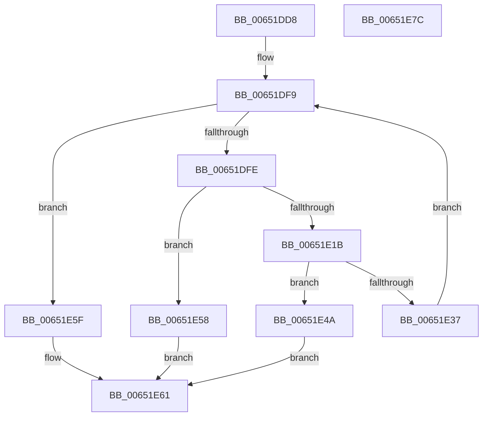

# EtwpStackInitializeProcessor

- RVA: `0x00651DD8`–`0x00651E7D` (길이 `165` bytes)
- VA: `0x0000000140651DD8`
- 실행 섹션: `.text`
- PDB 이름 있음: `예`; PDB Function 태그: `아니요`
- unwind 정보 RVA: `0x0005E6B4`
- 디코드: `49`개 명령, `165/165` bytes 표시
- 미해석 바이트: `0` (있으면 어셈블리에 `.byte`로 보존)

> 이 문서는 커널 이미지의 기계어와 PDB 기호를 분석해 생성했습니다. 4번과 5번은 함수 원형과 자료형을 바이너리 사용 방식에서 추정한 C 해석이며 원본 소스 복구 결과는 아닙니다.

## 1. Dependencies

- 직접 호출 지점: **4**; 고유 호출 대상: **4**
- 직접 호출자로 확인된 함수: **1**
- RIP 상대 이미지 참조: **0**

### Outgoing calls
- `0x00651E0E` → [ExAllocatePool2](../../poolcode/B8/ExAllocatePool2_function_00B820F0.md) (function, `0x00B820F0`)
- `0x00651E2C` → [KeAllocateCalloutStackEx](../../page/A7/KeAllocateCalloutStackEx_function_00A7F030.md) (function, `0x00A7F030`)
- `0x00651E41` → [ExpInterlockedPushEntrySList](../6B/ExpInterlockedPushEntrySList_function_006BA5B0.md) (function, `0x006BA5B0`)
- `0x00651E4F` → [ExFreePoolWithTag](../../poolcode/B8/ExFreePoolWithTag_function_00B82870.md) (function, `0x00B82870`)

### Direct callers
- [EtwInitializeProcessor](../../page/7B/EtwInitializeProcessor_function_007B4EBC.md) at `0x007B4FE3`

### Static image references
- 디코드된 RIP-relative 메모리 참조가 없습니다.

## 2. Other-region calls and transfers

- 다른 실행 섹션으로 향하는 call: **3**
  - `0x00651E0E` → [ExAllocatePool2](../../poolcode/B8/ExAllocatePool2_function_00B820F0.md) (`.text` → `POOLCODE`)
  - `0x00651E2C` → [KeAllocateCalloutStackEx](../../page/A7/KeAllocateCalloutStackEx_function_00A7F030.md) (`.text` → `PAGE`)
  - `0x00651E4F` → [ExFreePoolWithTag](../../poolcode/B8/ExFreePoolWithTag_function_00B82870.md) (`.text` → `POOLCODE`)
- 별도 외부 분기/꼬리 이동을 확인하지 못했습니다.

## 3. Assembly (complete function range)

```asm
00651DD8  48 8B C4                        mov rax, rsp
00651DDB  48 89 58 08                     mov qword ptr [rax + 8], rbx
00651DDF  48 89 68 10                     mov qword ptr [rax + 0x10], rbp
00651DE3  48 89 70 18                     mov qword ptr [rax + 0x18], rsi
00651DE7  48 89 78 20                     mov qword ptr [rax + 0x20], rdi
00651DEB  41 56                           push r14
00651DED  48 83 EC 20                     sub rsp, 0x20
00651DF1  44 8B F2                        mov r14d, edx
00651DF4  48 8B E9                        mov rbp, rcx
00651DF7  33 FF                           xor edi, edi
00651DF9  83 FF 02                        cmp edi, 2
00651DFC  73 61                           jae 0x140651e5f
00651DFE  BA 30 08 00 00                  mov edx, 0x830
00651E03  B9 40 00 00 00                  mov ecx, 0x40
00651E08  41 B8 45 74 77 6C               mov r8d, 0x6c777445
00651E0E  E8 DD 02 53 00                  call 0x140b820f0
00651E13  48 8B D8                        mov rbx, rax
00651E16  48 85 C0                        test rax, rax
00651E19  74 3D                           je 0x140651e58
00651E1B  45 33 C0                        xor r8d, r8d
00651E1E  44 89 70 10                     mov dword ptr [rax + 0x10], r14d
00651E22  4C 8D 48 18                     lea r9, [rax + 0x18]
00651E26  B2 01                           mov dl, 1
00651E28  41 8D 48 02                     lea ecx, [r8 + 2]
00651E2C  E8 FF D1 42 00                  call 0x140a7f030
00651E31  8B F0                           mov esi, eax
00651E33  85 C0                           test eax, eax
00651E35  78 13                           js 0x140651e4a
00651E37  48 8D 8D 80 01 00 00            lea rcx, [rbp + 0x180]
00651E3E  48 8B D3                        mov rdx, rbx
00651E41  E8 6A 87 06 00                  call 0x1406ba5b0
00651E46  FF C7                           inc edi
00651E48  EB AF                           jmp 0x140651df9
00651E4A  33 D2                           xor edx, edx
00651E4C  48 8B CB                        mov rcx, rbx
00651E4F  E8 1C 0A 53 00                  call 0x140b82870
00651E54  8B C6                           mov eax, esi
00651E56  EB 09                           jmp 0x140651e61
00651E58  B8 17 00 00 C0                  mov eax, 0xc0000017
00651E5D  EB 02                           jmp 0x140651e61
00651E5F  33 C0                           xor eax, eax
00651E61  48 8B 5C 24 30                  mov rbx, qword ptr [rsp + 0x30]
00651E66  48 8B 6C 24 38                  mov rbp, qword ptr [rsp + 0x38]
00651E6B  48 8B 74 24 40                  mov rsi, qword ptr [rsp + 0x40]
00651E70  48 8B 7C 24 48                  mov rdi, qword ptr [rsp + 0x48]
00651E75  48 83 C4 20                     add rsp, 0x20
00651E79  41 5E                           pop r14
00651E7B  C3                              ret
00651E7C  CC                              int3
```

## 4. C-style interpretation (structured pseudocode)

```c
__int64 __fastcall EtwpStackInitializeProcessor(__int64 a1, int a2)
{
    __int64 result;
    __int64 v_rdi;
    __int64 v_rsp;
    unsigned __int64 v_stack_p10;
    unsigned __int64 v_stack_p18;
    unsigned __int64 v_stack_p20;
    unsigned __int64 v_stack_p8;

    *(unsigned __int64 *)(v_rsp + 8) = v_rbx;
    *(unsigned __int64 *)(v_rsp + 16) = v_rbp;
    *(unsigned __int64 *)(v_rsp + 24) = v_rsi;
    *(unsigned __int64 *)(v_rsp + 32) = v_rdi;
    v_rsp = (v_rsp) - (32);
    v_rdi = 0;
loc_00651DF9:
    if (0 >= 2) goto loc_00651E5F;
    result = ExAllocatePool2(64, (unsigned int)(0x830ULL), (unsigned int)(0x6C777445ULL), a4);
    if (result == 0) goto loc_00651E58;
    a3 = 0;
    *(unsigned int *)(result + 16) = (unsigned int)((unsigned int)(a2));
    result = KeAllocateCalloutStackEx(a3 + 2, 1, a3, result + 24);
    if (sign_flag) goto loc_00651E4A;
    result = ExpInterlockedPushEntrySList(a1 + 384, result, a3, result + 24);
    v_rdi = (unsigned int)((v_rdi) + 1);
    goto loc_00651DF9;
loc_00651E4A:
    a2 = 0;
    result = ExFreePoolWithTag(result, a2, a3, result + 24);
    goto loc_00651E61;
loc_00651E58:
    goto loc_00651E61;
loc_00651E5F:
    result = 0;
loc_00651E61:
    v_rsp = (v_rsp) + (32);
    return result;
}
```

## 5. (Beta) C Style

```c
int64_t EtwpStackInitializeProcessor(void *Arg1, int32_t Arg2)
{
    uint8_t *arg1 = (uint8_t *)Arg1;

    int64_t result;
    int64_t local_rdi;
    int64_t local_rsp;
    uint64_t v_stack_p10;
    uint64_t v_stack_p18;
    uint64_t v_stack_p20;
    uint64_t v_stack_p8;

    *(uint64_t *)(local_rsp + 0x8) = local_rbx;
    *(uint64_t *)(local_rsp + 0x10) = local_rbp;
    *(uint64_t *)(local_rsp + 0x18) = local_rsi;
    *(uint64_t *)(local_rsp + 0x20) = local_rdi;
    local_rsp = (local_rsp) - (32);
    local_rdi = 0;
loc_00651DF9:
    if (0 >= 2) goto loc_00651E5F;
    result = ExAllocatePool2(64, (uint32_t)(0x830ULL), (uint32_t)(0x6C777445ULL), a4);
    if (result == 0) goto loc_00651E58;
    a3 = 0;
    *(uint32_t *)(result + 0x10) = (uint32_t)((uint32_t)(Arg2));
    result = KeAllocateCalloutStackEx(a3 + 2, 1, a3, result + 24);
    if (sign_flag) goto loc_00651E4A;
    result = ExpInterlockedPushEntrySList(Arg1 + 384, result, a3, result + 24);
    local_rdi = (uint32_t)((local_rdi) + 1);
    goto loc_00651DF9;
loc_00651E4A:
    Arg2 = 0;
    result = ExFreePoolWithTag(result, Arg2, a3, result + 24);
    goto loc_00651E61;
loc_00651E58:
    goto loc_00651E61;
loc_00651E5F:
    result = 0;
loc_00651E61:
    local_rsp = (local_rsp) + (32);
    return result;
}
```

### 관측된 메모리 오프셋

구조체 형식이 확인되지 않은 접근은 인자 기준의 오프셋으로만 기록했습니다.

| 기준 인자 | 오프셋 표현 | 폭 (bit) | 접근 |
|---|---:|---:|---|
| `Arg1` | `+ 0x180` | `64` | `R` |

## 6. Execution-region graph

[열기: 2D/3D 그래프와 함수 탐색 컨트롤 패널](../../../control-panel.html?section=text&rva=0x00651DD8&view=graph)

- 2D 그래프는 위에서 아래로 흐르고, 3D 그래프는 빈 공간을 드래그해 회전합니다. Shift+드래그는 이동, 휠은 확대·축소, 함수 노드 선택은 대상 보고서 이동입니다.

### Static fallback


