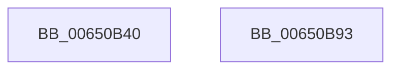

# EtwpSystemTraceWdf

- RVA: `0x00650B40`–`0x00650B94` (길이 `84` bytes)
- VA: `0x0000000140650B40`
- 실행 섹션: `.text`
- PDB 이름 있음: `예`; PDB Function 태그: `아니요`
- unwind 정보 RVA: `0x00060904`
- 디코드: `19`개 명령, `84/84` bytes 표시
- 미해석 바이트: `0` (있으면 어셈블리에 `.byte`로 보존)

> 이 문서는 커널 이미지의 기계어와 PDB 기호를 분석해 생성했습니다. 4번과 5번은 함수 원형과 자료형을 바이너리 사용 방식에서 추정한 C 해석이며 원본 소스 복구 결과는 아닙니다.

## 1. Dependencies

- 직접 호출 지점: **2**; 고유 호출 대상: **2**
- 직접 호출자로 확인된 함수: **0**
- RIP 상대 이미지 참조: **1**

### Outgoing calls
- `0x00650B7C` → [EtwTraceKernelEvent](../23/EtwTraceKernelEvent_function_00235350.md) (function, `0x00235350`)
- `0x00650B89` → [_security_check_cookie](../6A/_security_check_cookie_function_006AC640.md) (function, `0x006AC640`)

### Direct callers
- 이 함수 시작 RVA로 연결되는 직접 call은 확인되지 않았습니다. 간접 호출은 완전히 역산할 수 없습니다.

### Static image references
- `0x00650B44` → RVA `0x00E0A740` (`.data`; read)

## 2. Other-region calls and transfers

- 다른 실행 섹션으로 향하는 call: **0**
- 별도 외부 분기/꼬리 이동을 확인하지 못했습니다.

## 3. Assembly (complete function range)

```asm
00650B40  48 83 EC 58                     sub rsp, 0x58
00650B44  48 8B 05 F5 9B 7B 00            mov rax, qword ptr [rip + 0x7b9bf5]
00650B4B  48 33 C4                        xor rax, rsp
00650B4E  48 89 44 24 40                  mov qword ptr [rsp + 0x40], rax
00650B53  0F B6 84 24 80 00 00 00         movzx eax, byte ptr [rsp + 0x80]
00650B5B  83 64 24 3C 00                  and dword ptr [rsp + 0x3c], 0
00650B60  0D 03 19 50 00                  or eax, 0x501903
00650B65  48 89 4C 24 30                  mov qword ptr [rsp + 0x30], rcx
00650B6A  48 8D 4C 24 30                  lea rcx, [rsp + 0x30]
00650B6F  89 54 24 38                     mov dword ptr [rsp + 0x38], edx
00650B73  BA 01 00 00 00                  mov edx, 1
00650B78  89 44 24 20                     mov dword ptr [rsp + 0x20], eax
00650B7C  E8 CF 47 BE FF                  call 0x140235350
00650B81  48 8B 4C 24 40                  mov rcx, qword ptr [rsp + 0x40]
00650B86  48 33 CC                        xor rcx, rsp
00650B89  E8 B2 BA 05 00                  call 0x1406ac640
00650B8E  48 83 C4 58                     add rsp, 0x58
00650B92  C3                              ret
00650B93  CC                              int3
```

## 4. C-style interpretation (structured pseudocode)

```c
__int64 __fastcall EtwpSystemTraceWdf(__int64 a1, int a2, __int64 a3, __int64 a4, unsigned __int8 a5)
{
    __int64 result;
    __int64 v_rsp;
    unsigned __int64 v_stack_m18;
    unsigned int v_stack_m1C;
    unsigned int v_stack_m20;
    unsigned __int64 v_stack_m28;
    unsigned int v_stack_m38;

    v_rsp = (v_rsp) - (88);
    result = (*(unsigned __int64 *)(v_rip + 8100853)) ^ (v_rsp);
    v_stack_m18 = result;
    result = (unsigned int)((a5) | (0x501903ULL));
    v_stack_m28 = a1;
    v_stack_m20 = a2;
    v_stack_m38 = (unsigned int)(result);
    result = EtwTraceKernelEvent(v_stack_m28, 1, a3, a4);
    a1 = (v_stack_m18) ^ (v_rsp);
    result = _security_check_cookie(a1, 1, a3, a4);
    v_rsp = (v_rsp) + (88);
    return result;
}
```

## 5. (Beta) C Style

```c
int64_t EtwpSystemTraceWdf(int64_t Arg1, int32_t Arg2, int64_t Arg3, int64_t Arg4, uint8_t Arg5)
{
    int64_t result;
    int64_t local_rsp;
    uint64_t v_stack_m18;
    uint32_t v_stack_m1C;
    uint32_t v_stack_m20;
    uint64_t v_stack_m28;
    uint32_t v_stack_m38;

    local_rsp = (local_rsp) - (88);
    result = (*(uint64_t *)(v_rip + 0x7B9BF5)) ^ (local_rsp);
    v_stack_m18 = result;
    result = (uint32_t)((Arg5) | (0x501903ULL));
    v_stack_m28 = Arg1;
    v_stack_m20 = Arg2;
    v_stack_m38 = (uint32_t)(result);
    result = EtwTraceKernelEvent(v_stack_m28, 1, Arg3, Arg4);
    Arg1 = (v_stack_m18) ^ (local_rsp);
    result = _security_check_cookie(Arg1, 1, Arg3, Arg4);
    local_rsp = (local_rsp) + (88);
    return result;
}
```

## 6. Execution-region graph

[열기: 2D/3D 그래프와 함수 탐색 컨트롤 패널](../../../control-panel.html?section=text&rva=0x00650B40&view=graph)

- 2D 그래프는 위에서 아래로 흐르고, 3D 그래프는 빈 공간을 드래그해 회전합니다. Shift+드래그는 이동, 휠은 확대·축소, 함수 노드 선택은 대상 보고서 이동입니다.

### Static fallback


