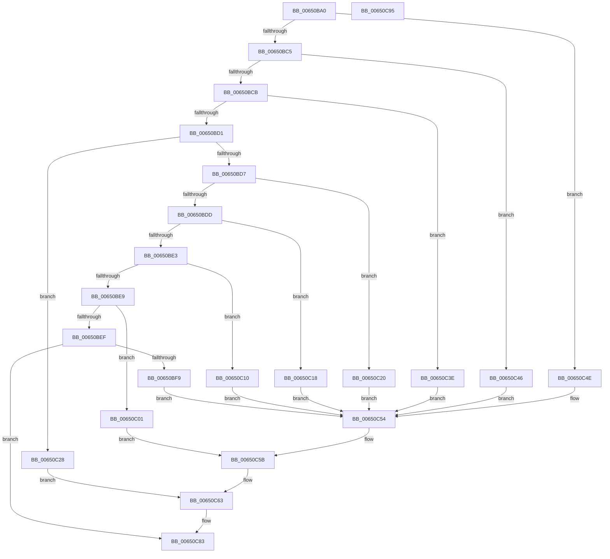

# EtwpTraceALPC

- RVA: `0x00650BA0`–`0x00650C96` (길이 `246` bytes)
- VA: `0x0000000140650BA0`
- 실행 섹션: `.text`
- PDB 이름 있음: `예`; PDB Function 태그: `아니요`
- unwind 정보 RVA: `0x000CA4B8`
- 디코드: `63`개 명령, `246/246` bytes 표시
- 미해석 바이트: `0` (있으면 어셈블리에 `.byte`로 보존)

> 이 문서는 커널 이미지의 기계어와 PDB 기호를 분석해 생성했습니다. 4번과 5번은 함수 원형과 자료형을 바이너리 사용 방식에서 추정한 C 해석이며 원본 소스 복구 결과는 아닙니다.

## 1. Dependencies

- 직접 호출 지점: **2**; 고유 호출 대상: **2**
- 직접 호출자로 확인된 함수: **0**
- RIP 상대 이미지 참조: **1**

### Outgoing calls
- `0x00650C7E` → [EtwTraceKernelEvent](../23/EtwTraceKernelEvent_function_00235350.md) (function, `0x00235350`)
- `0x00650C8A` → [_security_check_cookie](../6A/_security_check_cookie_function_006AC640.md) (function, `0x006AC640`)

### Direct callers
- 이 함수 시작 RVA로 연결되는 직접 call은 확인되지 않았습니다. 간접 호출은 완전히 역산할 수 없습니다.

### Static image references
- `0x00650BA9` → RVA `0x00E0A740` (`.data`; read)

## 2. Other-region calls and transfers

- 다른 실행 섹션으로 향하는 call: **0**
- 별도 외부 분기/꼬리 이동을 확인하지 못했습니다.

## 3. Assembly (complete function range)

```asm
00650BA0  40 55                           push rbp
00650BA2  48 8B EC                        mov rbp, rsp
00650BA5  48 83 EC 50                     sub rsp, 0x50
00650BA9  48 8B 05 90 9B 7B 00            mov rax, qword ptr [rip + 0x7b9b90]
00650BB0  48 33 C4                        xor rax, rsp
00650BB3  48 89 45 F0                     mov qword ptr [rbp - 0x10], rax
00650BB7  44 8B 41 10                     mov r8d, dword ptr [rcx + 0x10]
00650BBB  41 83 E8 01                     sub r8d, 1
00650BBF  0F 84 89 00 00 00               je 0x140650c4e
00650BC5  41 83 E8 01                     sub r8d, 1
00650BC9  74 7B                           je 0x140650c46
00650BCB  41 83 E8 01                     sub r8d, 1
00650BCF  74 6D                           je 0x140650c3e
00650BD1  41 83 E8 01                     sub r8d, 1
00650BD5  74 51                           je 0x140650c28
00650BD7  41 83 E8 01                     sub r8d, 1
00650BDB  74 43                           je 0x140650c20
00650BDD  41 83 E8 01                     sub r8d, 1
00650BE1  74 35                           je 0x140650c18
00650BE3  41 83 E8 01                     sub r8d, 1
00650BE7  74 27                           je 0x140650c10
00650BE9  41 83 E8 01                     sub r8d, 1
00650BED  74 12                           je 0x140650c01
00650BEF  41 83 F8 01                     cmp r8d, 1
00650BF3  0F 85 8A 00 00 00               jne 0x140650c83
00650BF9  41 B9 29 1A 00 00               mov r9d, 0x1a29
00650BFF  EB 53                           jmp 0x140650c54
00650C01  C7 45 E8 08 00 00 00            mov dword ptr [rbp - 0x18], 8
00650C08  41 B9 28 1A 00 00               mov r9d, 0x1a28
00650C0E  EB 4B                           jmp 0x140650c5b
00650C10  41 B9 27 1A 00 00               mov r9d, 0x1a27
00650C16  EB 3C                           jmp 0x140650c54
00650C18  41 B9 26 1A 00 00               mov r9d, 0x1a26
00650C1E  EB 34                           jmp 0x140650c54
00650C20  41 B9 25 1A 00 00               mov r9d, 0x1a25
00650C26  EB 2C                           jmp 0x140650c54
00650C28  48 8D 41 18                     lea rax, [rcx + 0x18]
00650C2C  41 B9 24 1A 00 00               mov r9d, 0x1a24
00650C32  48 89 45 E0                     mov qword ptr [rbp - 0x20], rax
00650C36  8D 42 E8                        lea eax, [rdx - 0x18]
00650C39  89 45 E8                        mov dword ptr [rbp - 0x18], eax
00650C3C  EB 25                           jmp 0x140650c63
00650C3E  41 B9 23 1A 00 00               mov r9d, 0x1a23
00650C44  EB 0E                           jmp 0x140650c54
00650C46  41 B9 22 1A 00 00               mov r9d, 0x1a22
00650C4C  EB 06                           jmp 0x140650c54
00650C4E  41 B9 21 1A 00 00               mov r9d, 0x1a21
00650C54  C7 45 E8 04 00 00 00            mov dword ptr [rbp - 0x18], 4
00650C5B  48 8D 41 18                     lea rax, [rcx + 0x18]
00650C5F  48 89 45 E0                     mov qword ptr [rbp - 0x20], rax
00650C63  83 65 EC 00                     and dword ptr [rbp - 0x14], 0
00650C67  48 8D 4D E0                     lea rcx, [rbp - 0x20]
00650C6B  41 B8 00 00 10 00               mov r8d, 0x100000
00650C71  C7 44 24 20 02 19 50 00         mov dword ptr [rsp + 0x20], 0x501902
00650C79  BA 01 00 00 00                  mov edx, 1
00650C7E  E8 CD 46 BE FF                  call 0x140235350
00650C83  48 8B 4D F0                     mov rcx, qword ptr [rbp - 0x10]
00650C87  48 33 CC                        xor rcx, rsp
00650C8A  E8 B1 B9 05 00                  call 0x1406ac640
00650C8F  48 83 C4 50                     add rsp, 0x50
00650C93  5D                              pop rbp
00650C94  C3                              ret
00650C95  CC                              int3
```

## 4. C-style interpretation (structured pseudocode)

```c
__int64 __fastcall EtwpTraceALPC(__int64 a1, __int64 a2)
{
    __int64 result;
    __int64 v_rsp;
    unsigned __int64 v_stack_m18;
    unsigned int v_stack_m1C;
    unsigned int v_stack_m20;
    unsigned __int64 v_stack_m28;
    unsigned int v_stack_m38;

    v_rsp = (v_rsp) - (80);
    result = (*(unsigned __int64 *)(v_rip + 8100752)) ^ (v_rsp);
    v_stack_m18 = result;
    a3 = (unsigned int)(((unsigned int)(*(unsigned int *)(a1 + 16))) - (1));
    if (condition_is_equal) goto loc_00650C4E;
    a3 = (unsigned int)((a3) - (1));
    if (condition_is_equal) goto loc_00650C46;
    a3 = (unsigned int)((a3) - (1));
    if (condition_is_equal) goto loc_00650C3E;
    a3 = (unsigned int)((a3) - (1));
    if (condition_is_equal) goto loc_00650C28;
    a3 = (unsigned int)((a3) - (1));
    if (condition_is_equal) goto loc_00650C20;
    a3 = (unsigned int)((a3) - (1));
    if (condition_is_equal) goto loc_00650C18;
    a3 = (unsigned int)((a3) - (1));
    if (condition_is_equal) goto loc_00650C10;
    a3 = (unsigned int)((a3) - (1));
    if (condition_is_equal) goto loc_00650C01;
    if (((unsigned int)(a3)) != 1) goto loc_00650C83;
    goto loc_00650C54;
loc_00650C01:
    v_stack_m20 = 8;
    goto loc_00650C5B;
loc_00650C10:
    goto loc_00650C54;
loc_00650C18:
    goto loc_00650C54;
loc_00650C20:
    goto loc_00650C54;
loc_00650C28:
    v_stack_m28 = a1 + 24;
    v_stack_m20 = (unsigned int)(a2 - 24);
    goto loc_00650C63;
loc_00650C3E:
    goto loc_00650C54;
loc_00650C46:
    goto loc_00650C54;
loc_00650C4E:
loc_00650C54:
    v_stack_m20 = 4;
loc_00650C5B:
    v_stack_m28 = a1 + 24;
loc_00650C63:
    v_stack_m38 = 0x501902ULL;
    result = EtwTraceKernelEvent(v_stack_m28, 1, (unsigned int)(0x100000ULL), (unsigned int)(0x1A21ULL));
loc_00650C83:
    a1 = (v_stack_m18) ^ (v_rsp);
    result = _security_check_cookie(a1, 1, (unsigned int)(0x100000ULL), (unsigned int)(0x1A21ULL));
    v_rsp = (v_rsp) + (80);
    return result;
}
```

## 5. (Beta) C Style

```c
int64_t EtwpTraceALPC(void *Arg1, void *Arg2)
{
    uint8_t *arg1 = (uint8_t *)Arg1;
    uint8_t *arg2 = (uint8_t *)Arg2;

    int64_t result;
    int64_t local_rsp;
    uint64_t v_stack_m18;
    uint32_t v_stack_m1C;
    uint32_t v_stack_m20;
    uint64_t v_stack_m28;
    uint32_t v_stack_m38;

    local_rsp = (local_rsp) - (80);
    result = (*(uint64_t *)(v_rip + 0x7B9B90)) ^ (local_rsp);
    v_stack_m18 = result;
    a3 = (uint32_t)(((uint32_t)(*(uint32_t *)(arg1 + 0x10))) - (1));
    if (condition_is_equal) goto loc_00650C4E;
    a3 = (uint32_t)((a3) - (1));
    if (condition_is_equal) goto loc_00650C46;
    a3 = (uint32_t)((a3) - (1));
    if (condition_is_equal) goto loc_00650C3E;
    a3 = (uint32_t)((a3) - (1));
    if (condition_is_equal) goto loc_00650C28;
    a3 = (uint32_t)((a3) - (1));
    if (condition_is_equal) goto loc_00650C20;
    a3 = (uint32_t)((a3) - (1));
    if (condition_is_equal) goto loc_00650C18;
    a3 = (uint32_t)((a3) - (1));
    if (condition_is_equal) goto loc_00650C10;
    a3 = (uint32_t)((a3) - (1));
    if (condition_is_equal) goto loc_00650C01;
    if (((uint32_t)(a3)) != 1) goto loc_00650C83;
    goto loc_00650C54;
loc_00650C01:
    v_stack_m20 = 8;
    goto loc_00650C5B;
loc_00650C10:
    goto loc_00650C54;
loc_00650C18:
    goto loc_00650C54;
loc_00650C20:
    goto loc_00650C54;
loc_00650C28:
    v_stack_m28 = Arg1 + 24;
    v_stack_m20 = (uint32_t)(Arg2 - 24);
    goto loc_00650C63;
loc_00650C3E:
    goto loc_00650C54;
loc_00650C46:
    goto loc_00650C54;
loc_00650C4E:
loc_00650C54:
    v_stack_m20 = 4;
loc_00650C5B:
    v_stack_m28 = Arg1 + 24;
loc_00650C63:
    v_stack_m38 = 0x501902ULL;
    result = EtwTraceKernelEvent(v_stack_m28, 1, (uint32_t)(0x100000ULL), (uint32_t)(0x1A21ULL));
loc_00650C83:
    Arg1 = (v_stack_m18) ^ (local_rsp);
    result = _security_check_cookie(Arg1, 1, (uint32_t)(0x100000ULL), (uint32_t)(0x1A21ULL));
    local_rsp = (local_rsp) + (80);
    return result;
}
```

### 관측된 메모리 오프셋

구조체 형식이 확인되지 않은 접근은 인자 기준의 오프셋으로만 기록했습니다.

| 기준 인자 | 오프셋 표현 | 폭 (bit) | 접근 |
|---|---:|---:|---|
| `Arg1` | `+ 0x10` | `32` | `R` |
| `Arg1` | `+ 0x18` | `64` | `R` |
| `Arg2` | `- 0x18` | `32` | `R` |

## 6. Execution-region graph

[열기: 2D/3D 그래프와 함수 탐색 컨트롤 패널](../../../control-panel.html?section=text&rva=0x00650BA0&view=graph)

- 2D 그래프는 위에서 아래로 흐르고, 3D 그래프는 빈 공간을 드래그해 회전합니다. Shift+드래그는 이동, 휠은 확대·축소, 함수 노드 선택은 대상 보고서 이동입니다.

### Static fallback


