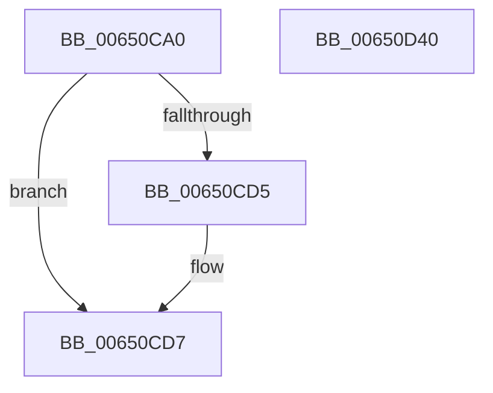

# EtwpTraceDebugPrint

- RVA: `0x00650CA0`–`0x00650D41` (길이 `161` bytes)
- VA: `0x0000000140650CA0`
- 실행 섹션: `.text`
- PDB 이름 있음: `예`; PDB Function 태그: `아니요`
- unwind 정보 RVA: `0x000886E8`
- 디코드: `38`개 명령, `161/161` bytes 표시
- 미해석 바이트: `0` (있으면 어셈블리에 `.byte`로 보존)

> 이 문서는 커널 이미지의 기계어와 PDB 기호를 분석해 생성했습니다. 4번과 5번은 함수 원형과 자료형을 바이너리 사용 방식에서 추정한 C 해석이며 원본 소스 복구 결과는 아닙니다.

## 1. Dependencies

- 직접 호출 지점: **2**; 고유 호출 대상: **2**
- 직접 호출자로 확인된 함수: **0**
- RIP 상대 이미지 참조: **2**

### Outgoing calls
- `0x00650D26` → [EtwTraceKernelEvent](../23/EtwTraceKernelEvent_function_00235350.md) (function, `0x00235350`)
- `0x00650D32` → [_security_check_cookie](../6A/_security_check_cookie_function_006AC640.md) (function, `0x006AC640`)

### Direct callers
- 이 함수 시작 RVA로 연결되는 직접 call은 확인되지 않았습니다. 간접 호출은 완전히 역산할 수 없습니다.

### Static image references
- `0x00650CAC` → RVA `0x00E0A740` (`.data`; read)
- `0x00650CF9` → RVA `0x000105E0` (`.rdata`; read)

## 2. Other-region calls and transfers

- 다른 실행 섹션으로 향하는 call: **0**
- 별도 외부 분기/꼬리 이동을 확인하지 못했습니다.

## 3. Assembly (complete function range)

```asm
00650CA0  40 55                           push rbp
00650CA2  48 8B EC                        mov rbp, rsp
00650CA5  48 81 EC 80 00 00 00            sub rsp, 0x80
00650CAC  48 8B 05 8D 9A 7B 00            mov rax, qword ptr [rip + 0x7b9a8d]
00650CB3  48 33 C4                        xor rax, rsp
00650CB6  48 89 45 F0                     mov qword ptr [rbp - 0x10], rax
00650CBA  0F B7 01                        movzx eax, word ptr [rcx]
00650CBD  45 33 C9                        xor r9d, r9d
00650CC0  89 55 B0                        mov dword ptr [rbp - 0x50], edx
00650CC3  BA 00 02 00 00                  mov edx, 0x200
00650CC8  44 89 4D B8                     mov dword ptr [rbp - 0x48], r9d
00650CCC  44 89 45 B4                     mov dword ptr [rbp - 0x4c], r8d
00650CD0  66 3B D0                        cmp dx, ax
00650CD3  72 02                           jb 0x140650cd7
00650CD5  8B D0                           mov edx, eax
00650CD7  48 8D 45 B0                     lea rax, [rbp - 0x50]
00650CDB  89 55 D8                        mov dword ptr [rbp - 0x28], edx
00650CDE  48 89 45 C0                     mov qword ptr [rbp - 0x40], rax
00650CE2  BA 03 00 00 00                  mov edx, 3
00650CE7  48 8B 41 08                     mov rax, qword ptr [rcx + 8]
00650CEB  41 B8 00 00 04 00               mov r8d, 0x40000
00650CF1  48 89 45 D0                     mov qword ptr [rbp - 0x30], rax
00650CF5  48 8D 4D C0                     lea rcx, [rbp - 0x40]
00650CF9  48 8D 05 E0 F8 9B FF            lea rax, [rip - 0x640720]
00650D00  44 89 4D DC                     mov dword ptr [rbp - 0x24], r9d
00650D04  41 B9 20 0A 00 00               mov r9d, 0xa20
00650D0A  48 89 45 E0                     mov qword ptr [rbp - 0x20], rax
00650D0E  48 C7 45 C8 08 00 00 00         mov qword ptr [rbp - 0x38], 8
00650D16  48 C7 45 E8 01 00 00 00         mov qword ptr [rbp - 0x18], 1
00650D1E  C7 44 24 20 02 19 60 00         mov dword ptr [rsp + 0x20], 0x601902
00650D26  E8 25 46 BE FF                  call 0x140235350
00650D2B  48 8B 4D F0                     mov rcx, qword ptr [rbp - 0x10]
00650D2F  48 33 CC                        xor rcx, rsp
00650D32  E8 09 B9 05 00                  call 0x1406ac640
00650D37  48 81 C4 80 00 00 00            add rsp, 0x80
00650D3E  5D                              pop rbp
00650D3F  C3                              ret
00650D40  CC                              int3
```

## 4. C-style interpretation (structured pseudocode)

```c
__int64 __fastcall EtwpTraceDebugPrint(__int64 a1, int a2, int a3, int a4)
{
    __int64 result;
    __int64 v_rsp;
    unsigned __int64 v_stack_m18;
    unsigned __int64 v_stack_m20;
    unsigned __int64 v_stack_m28;
    unsigned int v_stack_m2C;
    unsigned int v_stack_m30;
    unsigned __int64 v_stack_m38;
    unsigned __int64 v_stack_m40;
    unsigned __int64 v_stack_m48;
    unsigned int v_stack_m50;
    unsigned int v_stack_m54;
    unsigned int v_stack_m58;
    unsigned int v_stack_m68;

    v_rsp = (v_rsp) - (128);
    result = (*(unsigned __int64 *)(v_rip + 8100493)) ^ (v_rsp);
    v_stack_m18 = result;
    a4 = 0;
    v_stack_m58 = a2;
    v_stack_m50 = 0;
    v_stack_m54 = a3;
    if (512 >= ((unsigned __int16)(*(unsigned __int16 *)(a1)))) {
        a2 = (unsigned int)(*(unsigned __int16 *)(a1));
    }
    v_stack_m30 = a2;
    v_stack_m48 = v_stack_m58;
    v_stack_m38 = *(unsigned __int64 *)(a1 + 8);
    v_stack_m2C = 0;
    v_stack_m28 = v_rip - 6555424;
    v_stack_m40 = 8;
    v_stack_m20 = 1;
    v_stack_m68 = 0x601902ULL;
    result = EtwTraceKernelEvent(v_stack_m48, 3, (unsigned int)(0x40000ULL), (unsigned int)(0xA20ULL));
    a1 = (v_stack_m18) ^ (v_rsp);
    result = _security_check_cookie(a1, 3, (unsigned int)(0x40000ULL), (unsigned int)(0xA20ULL));
    v_rsp = (v_rsp) + (128);
    return result;
}
```

## 5. (Beta) C Style

```c
int64_t EtwpTraceDebugPrint(void *Arg1, int32_t Arg2, int32_t Arg3, int32_t Arg4)
{
    uint8_t *arg1 = (uint8_t *)Arg1;

    int64_t result;
    int64_t local_rsp;
    uint64_t v_stack_m18;
    uint64_t v_stack_m20;
    uint64_t v_stack_m28;
    uint32_t v_stack_m2C;
    uint32_t v_stack_m30;
    uint64_t v_stack_m38;
    uint64_t v_stack_m40;
    uint64_t v_stack_m48;
    uint32_t v_stack_m50;
    uint32_t v_stack_m54;
    uint32_t v_stack_m58;
    uint32_t v_stack_m68;

    local_rsp = (local_rsp) - (128);
    result = (*(uint64_t *)(v_rip + 0x7B9A8D)) ^ (local_rsp);
    v_stack_m18 = result;
    Arg4 = 0;
    v_stack_m58 = Arg2;
    v_stack_m50 = 0;
    v_stack_m54 = Arg3;
    if (512 >= ((uint16_t)(*(uint16_t *)(arg1)))) {
        Arg2 = (uint32_t)(*(uint16_t *)(arg1));
    }
    v_stack_m30 = Arg2;
    v_stack_m48 = v_stack_m58;
    v_stack_m38 = *(uint64_t *)(arg1 + 0x8);
    v_stack_m2C = 0;
    v_stack_m28 = v_rip - 6555424;
    v_stack_m40 = 8;
    v_stack_m20 = 1;
    v_stack_m68 = 0x601902ULL;
    result = EtwTraceKernelEvent(v_stack_m48, 3, (uint32_t)(0x40000ULL), (uint32_t)(0xA20ULL));
    Arg1 = (v_stack_m18) ^ (local_rsp);
    result = _security_check_cookie(Arg1, 3, (uint32_t)(0x40000ULL), (uint32_t)(0xA20ULL));
    local_rsp = (local_rsp) + (128);
    return result;
}
```

### 관측된 메모리 오프셋

구조체 형식이 확인되지 않은 접근은 인자 기준의 오프셋으로만 기록했습니다.

| 기준 인자 | 오프셋 표현 | 폭 (bit) | 접근 |
|---|---:|---:|---|
| `Arg1` | `+ 0x0` | `16` | `R` |
| `Arg1` | `+ 0x8` | `64` | `R` |

## 6. Execution-region graph

[열기: 2D/3D 그래프와 함수 탐색 컨트롤 패널](../../../control-panel.html?section=text&rva=0x00650CA0&view=graph)

- 2D 그래프는 위에서 아래로 흐르고, 3D 그래프는 빈 공간을 드래그해 회전합니다. Shift+드래그는 이동, 휠은 확대·축소, 함수 노드 선택은 대상 보고서 이동입니다.

### Static fallback


