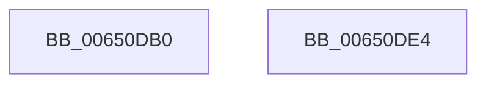

# EtwpTraceFltTimedIo

- RVA: `0x00650DB0`–`0x00650DE5` (길이 `53` bytes)
- VA: `0x0000000140650DB0`
- 실행 섹션: `.text`
- PDB 이름 있음: `예`; PDB Function 태그: `아니요`
- unwind 정보 RVA: `0x0005D2F4`
- 디코드: `14`개 명령, `53/53` bytes 표시
- 미해석 바이트: `0` (있으면 어셈블리에 `.byte`로 보존)

> 이 문서는 커널 이미지의 기계어와 PDB 기호를 분석해 생성했습니다. 4번과 5번은 함수 원형과 자료형을 바이너리 사용 방식에서 추정한 C 해석이며 원본 소스 복구 결과는 아닙니다.

## 1. Dependencies

- 직접 호출 지점: **1**; 고유 호출 대상: **1**
- 직접 호출자로 확인된 함수: **0**
- RIP 상대 이미지 참조: **0**

### Outgoing calls
- `0x00650DDA` → [EtwTraceTimedEvent](../3A/EtwTraceTimedEvent_function_003A3430.md) (function, `0x003A3430`)

### Direct callers
- 이 함수 시작 RVA로 연결되는 직접 call은 확인되지 않았습니다. 간접 호출은 완전히 역산할 수 없습니다.

### Static image references
- 디코드된 RIP-relative 메모리 참조가 없습니다.

## 2. Other-region calls and transfers

- 다른 실행 섹션으로 향하는 call: **0**
- 별도 외부 분기/꼬리 이동을 확인하지 못했습니다.

## 3. Assembly (complete function range)

```asm
00650DB0  48 83 EC 38                     sub rsp, 0x38
00650DB4  48 8B 44 24 60                  mov rax, qword ptr [rsp + 0x60]
00650DB9  45 0F B7 D9                     movzx r11d, r9w
00650DBD  45 8B D0                        mov r10d, r8d
00650DC0  48 89 44 24 28                  mov qword ptr [rsp + 0x28], rax
00650DC5  44 8B CA                        mov r9d, edx
00650DC8  C7 44 24 20 03 18 50 00         mov dword ptr [rsp + 0x20], 0x501803
00650DD0  4C 8B C1                        mov r8, rcx
00650DD3  41 8B D2                        mov edx, r10d
00650DD6  41 0F B7 CB                     movzx ecx, r11w
00650DDA  E8 51 26 D5 FF                  call 0x1403a3430
00650DDF  48 83 C4 38                     add rsp, 0x38
00650DE3  C3                              ret
00650DE4  CC                              int3
```

## 4. C-style interpretation (structured pseudocode)

```c
__int64 __fastcall EtwpTraceFltTimedIo(__int64 a1, int a2, int a3, unsigned __int16 a4, __int64 a5)
{
    __int64 result;
    __int64 v_rsp;
    unsigned __int64 v_stack_m10;
    unsigned int v_stack_m18;

    v_rsp = (v_rsp) - (56);
    v_stack_m10 = a5;
    v_stack_m18 = 0x501803ULL;
    result = EtwTraceTimedEvent(a4, (unsigned int)((unsigned int)((unsigned int)(a3))), a1, (unsigned int)(a2));
    v_rsp = (v_rsp) + (56);
    return result;
}
```

## 5. (Beta) C Style

```c
int64_t EtwpTraceFltTimedIo(int64_t Arg1, int32_t Arg2, int32_t Arg3, uint16_t Arg4, int64_t Arg5)
{
    int64_t result;
    int64_t local_rsp;
    uint64_t v_stack_m10;
    uint32_t v_stack_m18;

    local_rsp = (local_rsp) - (56);
    v_stack_m10 = Arg5;
    v_stack_m18 = 0x501803ULL;
    result = EtwTraceTimedEvent(Arg4, (uint32_t)((uint32_t)((uint32_t)(Arg3))), Arg1, (uint32_t)(Arg2));
    local_rsp = (local_rsp) + (56);
    return result;
}
```

## 6. Execution-region graph

[열기: 2D/3D 그래프와 함수 탐색 컨트롤 패널](../../../control-panel.html?section=text&rva=0x00650DB0&view=graph)

- 2D 그래프는 위에서 아래로 흐르고, 3D 그래프는 빈 공간을 드래그해 회전합니다. Shift+드래그는 이동, 휠은 확대·축소, 함수 노드 선택은 대상 보고서 이동입니다.

### Static fallback


