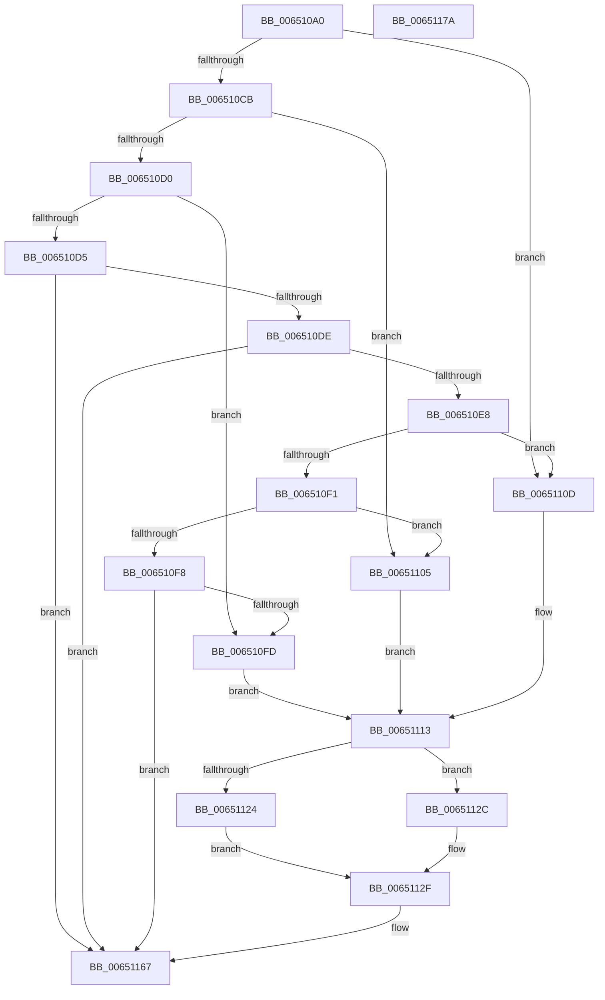

# EtwpTraceOpticalIoInit

- RVA: `0x006510A0`–`0x0065117B` (길이 `219` bytes)
- VA: `0x00000001406510A0`
- 실행 섹션: `.text`
- PDB 이름 있음: `예`; PDB Function 태그: `아니요`
- unwind 정보 RVA: `0x0005F638`
- 디코드: `58`개 명령, `219/219` bytes 표시
- 미해석 바이트: `0` (있으면 어셈블리에 `.byte`로 보존)

> 이 문서는 커널 이미지의 기계어와 PDB 기호를 분석해 생성했습니다. 4번과 5번은 함수 원형과 자료형을 바이너리 사용 방식에서 추정한 C 해석이며 원본 소스 복구 결과는 아닙니다.

## 1. Dependencies

- 직접 호출 지점: **3**; 고유 호출 대상: **3**
- 직접 호출자로 확인된 함수: **0**
- RIP 상대 이미지 참조: **1**

### Outgoing calls
- `0x006510DE` → [EtwpGetScsiPassThroughCdb](EtwpGetScsiPassThroughCdb_function_00650934.md) (function, `0x00650934`)
- `0x00651162` → [EtwTraceKernelEvent](../23/EtwTraceKernelEvent_function_00235350.md) (function, `0x00235350`)
- `0x0065116F` → [_security_check_cookie](../6A/_security_check_cookie_function_006AC640.md) (function, `0x006AC640`)

### Direct callers
- 이 함수 시작 RVA로 연결되는 직접 call은 확인되지 않았습니다. 간접 호출은 완전히 역산할 수 없습니다.

### Static image references
- `0x006510A6` → RVA `0x00E0A740` (`.data`; read)

## 2. Other-region calls and transfers

- 다른 실행 섹션으로 향하는 call: **0**
- 별도 외부 분기/꼬리 이동을 확인하지 못했습니다.

## 3. Assembly (complete function range)

```asm
006510A0  40 53                           push rbx
006510A2  48 83 EC 60                     sub rsp, 0x60
006510A6  48 8B 05 93 96 7B 00            mov rax, qword ptr [rip + 0x7b9693]
006510AD  48 33 C4                        xor rax, rsp
006510B0  48 89 44 24 50                  mov qword ptr [rsp + 0x50], rax
006510B5  83 64 24 3C 00                  and dword ptr [rsp + 0x3c], 0
006510BA  48 8B D9                        mov rbx, rcx
006510BD  48 8B 81 B8 00 00 00            mov rax, qword ptr [rcx + 0xb8]
006510C4  8A 10                           mov dl, byte ptr [rax]
006510C6  80 FA 03                        cmp dl, 3
006510C9  74 42                           je 0x14065110d
006510CB  80 FA 04                        cmp dl, 4
006510CE  74 35                           je 0x140651105
006510D0  80 FA 09                        cmp dl, 9
006510D3  74 28                           je 0x1406510fd
006510D5  80 FA 0E                        cmp dl, 0xe
006510D8  0F 85 89 00 00 00               jne 0x140651167
006510DE  E8 51 F8 FF FF                  call 0x140650934
006510E3  48 85 C0                        test rax, rax
006510E6  74 7F                           je 0x140651167
006510E8  8A 08                           mov cl, byte ptr [rax]
006510EA  8D 41 D8                        lea eax, [rcx - 0x28]
006510ED  A8 7F                           test al, 0x7f
006510EF  74 1C                           je 0x14065110d
006510F1  8D 41 D6                        lea eax, [rcx - 0x2a]
006510F4  A8 7F                           test al, 0x7f
006510F6  74 0D                           je 0x140651105
006510F8  80 F9 35                        cmp cl, 0x35
006510FB  75 6A                           jne 0x140651167
006510FD  41 B9 3C 01 00 00               mov r9d, 0x13c
00651103  EB 0E                           jmp 0x140651113
00651105  41 B9 3B 01 00 00               mov r9d, 0x13b
0065110B  EB 06                           jmp 0x140651113
0065110D  41 B9 3A 01 00 00               mov r9d, 0x13a
00651113  48 8B 83 98 00 00 00            mov rax, qword ptr [rbx + 0x98]
0065111A  48 89 5C 24 30                  mov qword ptr [rsp + 0x30], rbx
0065111F  48 85 C0                        test rax, rax
00651122  74 08                           je 0x14065112c
00651124  8B 88 10 05 00 00               mov ecx, dword ptr [rax + 0x510]
0065112A  EB 03                           jmp 0x14065112f
0065112C  83 C9 FF                        or ecx, 0xffffffff
0065112F  83 64 24 4C 00                  and dword ptr [rsp + 0x4c], 0
00651134  48 8D 44 24 30                  lea rax, [rsp + 0x30]
00651139  89 4C 24 38                     mov dword ptr [rsp + 0x38], ecx
0065113D  BA 01 00 00 00                  mov edx, 1
00651142  48 8D 4C 24 40                  lea rcx, [rsp + 0x40]
00651147  48 89 44 24 40                  mov qword ptr [rsp + 0x40], rax
0065114C  41 B8 02 00 00 80               mov r8d, 0x80000002
00651152  C7 44 24 48 0C 00 00 00         mov dword ptr [rsp + 0x48], 0xc
0065115A  C7 44 24 20 03 19 60 00         mov dword ptr [rsp + 0x20], 0x601903
00651162  E8 E9 41 BE FF                  call 0x140235350
00651167  48 8B 4C 24 50                  mov rcx, qword ptr [rsp + 0x50]
0065116C  48 33 CC                        xor rcx, rsp
0065116F  E8 CC B4 05 00                  call 0x1406ac640
00651174  48 83 C4 60                     add rsp, 0x60
00651178  5B                              pop rbx
00651179  C3                              ret
0065117A  CC                              int3
```

## 4. C-style interpretation (structured pseudocode)

```c
__int64 __fastcall EtwpTraceOpticalIoInit(__int64 a1)
{
    __int64 result;
    __int64 v_rsp;
    unsigned __int64 v_stack_m18;
    unsigned int v_stack_m1C;
    unsigned int v_stack_m20;
    unsigned __int64 v_stack_m28;
    unsigned int v_stack_m2C;
    unsigned int v_stack_m30;
    unsigned __int64 v_stack_m38;
    unsigned int v_stack_m48;

    v_rsp = (v_rsp) - (96);
    result = (*(unsigned __int64 *)(v_rip + 8099475)) ^ (v_rsp);
    v_stack_m18 = result;
    if (((unsigned __int8)(*(unsigned __int8 *)(*(unsigned __int64 *)(a1 + 184)))) == 3) goto loc_0065110D;
    if (((unsigned __int8)(*(unsigned __int8 *)(*(unsigned __int64 *)(a1 + 184)))) == 4) goto loc_00651105;
    if (((unsigned __int8)(*(unsigned __int8 *)(*(unsigned __int64 *)(a1 + 184)))) == 9) goto loc_006510FD;
    if (((unsigned __int8)(*(unsigned __int8 *)(*(unsigned __int64 *)(a1 + 184)))) != 14) goto loc_00651167;
    result = EtwpGetScsiPassThroughCdb(a1, *(unsigned __int8 *)(*(unsigned __int64 *)(a1 + 184)), a3, a4);
    if (result == 0) goto loc_00651167;
    if ((((unsigned __int8)(*(unsigned __int8 *)(result) - 40)) & (127)) == 0) goto loc_0065110D;
    if ((((unsigned __int8)(*(unsigned __int8 *)(result) - 42)) & (127)) == 0) goto loc_00651105;
    if (((unsigned __int8)(*(unsigned __int8 *)(result))) != 53) goto loc_00651167;
loc_006510FD:
    goto loc_00651113;
loc_00651105:
    goto loc_00651113;
loc_0065110D:
loc_00651113:
    v_stack_m38 = a1;
    if (*(unsigned __int64 *)(a1 + 152) == 0) goto loc_0065112C;
    goto loc_0065112F;
loc_0065112C:
    a1 = (unsigned int)(((unsigned int)(*(unsigned int *)(*(unsigned __int64 *)(a1 + 152) + 1296))) | (0xFFFFFFFFULL));
loc_0065112F:
    v_stack_m30 = (unsigned int)(a1);
    v_stack_m28 = v_stack_m38;
    v_stack_m20 = 12;
    v_stack_m48 = 0x601903ULL;
    result = EtwTraceKernelEvent(v_stack_m28, 1, (unsigned int)(0x80000002ULL), 314);
loc_00651167:
    a1 = (v_stack_m18) ^ (v_rsp);
    result = _security_check_cookie(a1, 1, (unsigned int)(0x80000002ULL), 314);
    v_rsp = (v_rsp) + (96);
    return result;
}
```

## 5. (Beta) C Style

```c
int64_t EtwpTraceOpticalIoInit(void *Arg1)
{
    uint8_t *arg1 = (uint8_t *)Arg1;

    int64_t result;
    int64_t local_rsp;
    uint64_t v_stack_m18;
    uint32_t v_stack_m1C;
    uint32_t v_stack_m20;
    uint64_t v_stack_m28;
    uint32_t v_stack_m2C;
    uint32_t v_stack_m30;
    uint64_t v_stack_m38;
    uint32_t v_stack_m48;

    local_rsp = (local_rsp) - (96);
    result = (*(uint64_t *)(v_rip + 0x7B9693)) ^ (local_rsp);
    v_stack_m18 = result;
    if (((uint8_t)(*(uint8_t *)(*(uint64_t *)(arg1 + 0xB8)))) == 3) goto loc_0065110D;
    if (((uint8_t)(*(uint8_t *)(*(uint64_t *)(arg1 + 0xB8)))) == 4) goto loc_00651105;
    if (((uint8_t)(*(uint8_t *)(*(uint64_t *)(arg1 + 0xB8)))) == 9) goto loc_006510FD;
    if (((uint8_t)(*(uint8_t *)(*(uint64_t *)(arg1 + 0xB8)))) != 14) goto loc_00651167;
    result = EtwpGetScsiPassThroughCdb(Arg1, *(uint8_t *)(*(uint64_t *)(arg1 + 0xB8)), a3, a4);
    if (result == 0) goto loc_00651167;
    if ((((uint8_t)(*(uint8_t *)(result) - 40)) & (127)) == 0) goto loc_0065110D;
    if ((((uint8_t)(*(uint8_t *)(result) - 42)) & (127)) == 0) goto loc_00651105;
    if (((uint8_t)(*(uint8_t *)(result))) != 53) goto loc_00651167;
loc_006510FD:
    goto loc_00651113;
loc_00651105:
    goto loc_00651113;
loc_0065110D:
loc_00651113:
    v_stack_m38 = Arg1;
    if (*(uint64_t *)(arg1 + 0x98) == 0) goto loc_0065112C;
    goto loc_0065112F;
loc_0065112C:
    Arg1 = (uint32_t)(((uint32_t)(*(uint32_t *)(*(uint64_t *)(arg1 + 0x98) + 0x510))) | (0xFFFFFFFFULL));
loc_0065112F:
    v_stack_m30 = (uint32_t)(Arg1);
    v_stack_m28 = v_stack_m38;
    v_stack_m20 = 12;
    v_stack_m48 = 0x601903ULL;
    result = EtwTraceKernelEvent(v_stack_m28, 1, (uint32_t)(0x80000002ULL), 314);
loc_00651167:
    Arg1 = (v_stack_m18) ^ (local_rsp);
    result = _security_check_cookie(Arg1, 1, (uint32_t)(0x80000002ULL), 314);
    local_rsp = (local_rsp) + (96);
    return result;
}
```

### 관측된 메모리 오프셋

구조체 형식이 확인되지 않은 접근은 인자 기준의 오프셋으로만 기록했습니다.

| 기준 인자 | 오프셋 표현 | 폭 (bit) | 접근 |
|---|---:|---:|---|
| `Arg1` | `+ 0x98` | `64` | `R` |
| `Arg1` | `+ 0xB8` | `64` | `R` |

## 6. Execution-region graph

[열기: 2D/3D 그래프와 함수 탐색 컨트롤 패널](../../../control-panel.html?section=text&rva=0x006510A0&view=graph)

- 2D 그래프는 위에서 아래로 흐르고, 3D 그래프는 빈 공간을 드래그해 회전합니다. Shift+드래그는 이동, 휠은 확대·축소, 함수 노드 선택은 대상 보고서 이동입니다.

### Static fallback


