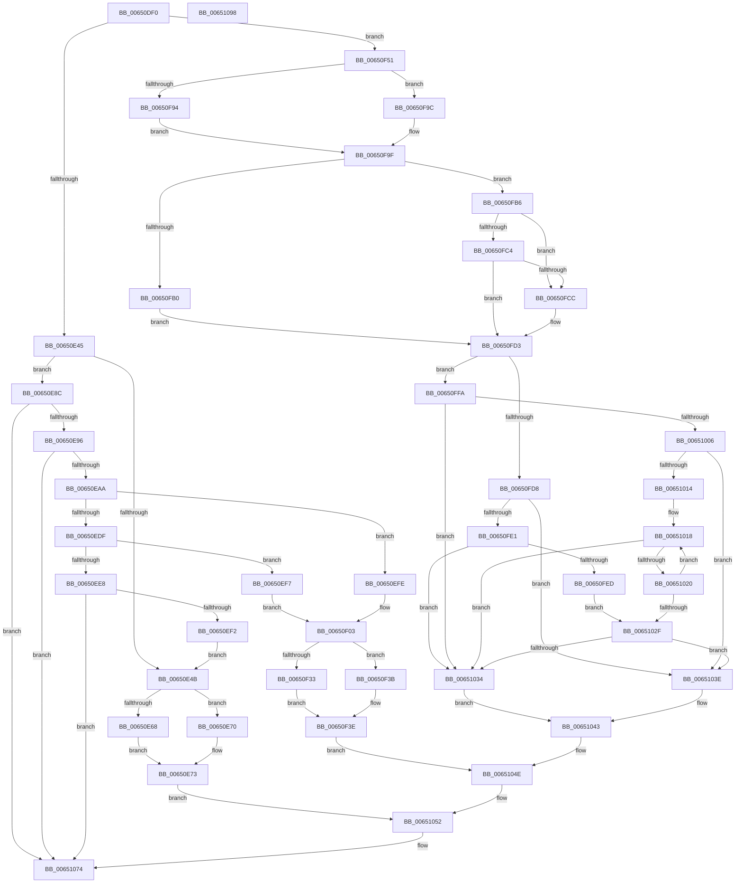

# EtwpTraceOpticalIo

- RVA: `0x00650DF0`–`0x00651099` (길이 `681` bytes)
- VA: `0x0000000140650DF0`
- 실행 섹션: `.text`
- PDB 이름 있음: `예`; PDB Function 태그: `아니요`
- unwind 정보 RVA: `0x000D3798`
- 디코드: `180`개 명령, `681/681` bytes 표시
- 미해석 바이트: `0` (있으면 어셈블리에 `.byte`로 보존)

> 이 문서는 커널 이미지의 기계어와 PDB 기호를 분석해 생성했습니다. 4번과 5번은 함수 원형과 자료형을 바이너리 사용 방식에서 추정한 C 해석이며 원본 소스 복구 결과는 아닙니다.

## 1. Dependencies

- 직접 호출 지점: **3**; 고유 호출 대상: **3**
- 직접 호출자로 확인된 함수: **0**
- RIP 상대 이미지 참조: **1**

### Outgoing calls
- `0x00650E99` → [EtwpGetScsiPassThroughCdb](EtwpGetScsiPassThroughCdb_function_00650934.md) (function, `0x00650934`)
- `0x0065106F` → [EtwTraceKernelEvent](../23/EtwTraceKernelEvent_function_00235350.md) (function, `0x00235350`)
- `0x0065107B` → [_security_check_cookie](../6A/_security_check_cookie_function_006AC640.md) (function, `0x006AC640`)

### Direct callers
- 이 함수 시작 RVA로 연결되는 직접 call은 확인되지 않았습니다. 간접 호출은 완전히 역산할 수 없습니다.

### Static image references
- `0x00650E0A` → RVA `0x00E0A740` (`.data`; read)

## 2. Other-region calls and transfers

- 다른 실행 섹션으로 향하는 call: **0**
- 별도 외부 분기/꼬리 이동을 확인하지 못했습니다.

## 3. Assembly (complete function range)

```asm
00650DF0  48 89 5C 24 08                  mov qword ptr [rsp + 8], rbx
00650DF5  48 89 74 24 10                  mov qword ptr [rsp + 0x10], rsi
00650DFA  55                              push rbp
00650DFB  57                              push rdi
00650DFC  41 57                           push r15
00650DFE  48 8D 6C 24 B9                  lea rbp, [rsp - 0x47]
00650E03  48 81 EC A0 00 00 00            sub rsp, 0xa0
00650E0A  48 8B 05 2F 99 7B 00            mov rax, qword ptr [rip + 0x7b992f]
00650E11  48 33 C4                        xor rax, rsp
00650E14  48 89 45 3F                     mov qword ptr [rbp + 0x3f], rax
00650E18  83 65 2B 00                     and dword ptr [rbp + 0x2b], 0
00650E1C  49 8B F8                        mov rdi, r8
00650E1F  83 65 0B 00                     and dword ptr [rbp + 0xb], 0
00650E23  41 BF 01 00 00 00               mov r15d, 1
00650E29  4D 8B 90 B8 00 00 00            mov r10, qword ptr [r8 + 0xb8]
00650E30  49 8B D9                        mov rbx, r9
00650E33  8B F2                           mov esi, edx
00650E35  45 8A 02                        mov r8b, byte ptr [r10]
00650E38  41 8D 40 FD                     lea eax, [r8 - 3]
00650E3C  41 3A C7                        cmp al, r15b
00650E3F  0F 86 0C 01 00 00               jbe 0x140650f51
00650E45  41 80 F8 09                     cmp r8b, 9
00650E49  75 41                           jne 0x140650e8c
00650E4B  8B 47 10                        mov eax, dword ptr [rdi + 0x10]
00650E4E  89 45 13                        mov dword ptr [rbp + 0x13], eax
00650E51  48 8B 87 98 00 00 00            mov rax, qword ptr [rdi + 0x98]
00650E58  89 75 0F                        mov dword ptr [rbp + 0xf], esi
00650E5B  48 89 5D 17                     mov qword ptr [rbp + 0x17], rbx
00650E5F  48 89 7D 1F                     mov qword ptr [rbp + 0x1f], rdi
00650E63  48 85 C0                        test rax, rax
00650E66  74 08                           je 0x140650e70
00650E68  8B 80 10 05 00 00               mov eax, dword ptr [rax + 0x510]
00650E6E  EB 03                           jmp 0x140650e73
00650E70  83 C8 FF                        or eax, 0xffffffff
00650E73  89 45 27                        mov dword ptr [rbp + 0x27], eax
00650E76  41 B9 39 01 00 00               mov r9d, 0x139
00650E7C  48 8D 45 0F                     lea rax, [rbp + 0xf]
00650E80  C7 45 37 1C 00 00 00            mov dword ptr [rbp + 0x37], 0x1c
00650E87  E9 C6 01 00 00                  jmp 0x140651052
00650E8C  41 80 F8 0E                     cmp r8b, 0xe
00650E90  0F 85 DE 01 00 00               jne 0x140651074
00650E96  48 8B CF                        mov rcx, rdi
00650E99  E8 96 FA FF FF                  call 0x140650934
00650E9E  4C 8B C0                        mov r8, rax
00650EA1  48 85 C0                        test rax, rax
00650EA4  0F 84 CA 01 00 00               je 0x140651074
00650EAA  44 8A 08                        mov r9b, byte ptr [rax]
00650EAD  0F B6 40 02                     movzx eax, byte ptr [rax + 2]
00650EB1  41 0F B6 48 03                  movzx ecx, byte ptr [r8 + 3]
00650EB6  C1 E0 08                        shl eax, 8
00650EB9  0B C1                           or eax, ecx
00650EBB  41 0F B6 48 04                  movzx ecx, byte ptr [r8 + 4]
00650EC0  C1 E0 08                        shl eax, 8
00650EC3  0B C1                           or eax, ecx
00650EC5  41 0F B6 48 05                  movzx ecx, byte ptr [r8 + 5]
00650ECA  C1 E0 08                        shl eax, 8
00650ECD  48 98                           cdqe
00650ECF  48 0B C1                        or rax, rcx
00650ED2  41 8D 49 D8                     lea ecx, [r9 - 0x28]
00650ED6  48 C1 E0 0B                     shl rax, 0xb
00650EDA  F6 C1 7F                        test cl, 0x7f
00650EDD  74 1F                           je 0x140650efe
00650EDF  41 8D 49 D6                     lea ecx, [r9 - 0x2a]
00650EE3  F6 C1 7F                        test cl, 0x7f
00650EE6  74 0F                           je 0x140650ef7
00650EE8  41 80 F9 35                     cmp r9b, 0x35
00650EEC  0F 85 82 01 00 00               jne 0x140651074
00650EF2  E9 54 FF FF FF                  jmp 0x140650e4b
00650EF7  BA 38 01 00 00                  mov edx, 0x138
00650EFC  EB 05                           jmp 0x140650f03
00650EFE  BA 37 01 00 00                  mov edx, 0x137
00650F03  8B 4F 10                        mov ecx, dword ptr [rdi + 0x10]
00650F06  83 65 E3 00                     and dword ptr [rbp - 0x1d], 0
00650F0A  48 83 65 EF 00                  and qword ptr [rbp - 0x11], 0
00650F0F  48 89 45 E7                     mov qword ptr [rbp - 0x19], rax
00650F13  48 8B 87 98 00 00 00            mov rax, qword ptr [rdi + 0x98]
00650F1A  89 4D DB                        mov dword ptr [rbp - 0x25], ecx
00650F1D  8B 4F 38                        mov ecx, dword ptr [rdi + 0x38]
00650F20  89 75 D7                        mov dword ptr [rbp - 0x29], esi
00650F23  48 89 7D F7                     mov qword ptr [rbp - 9], rdi
00650F27  89 4D DF                        mov dword ptr [rbp - 0x21], ecx
00650F2A  48 89 5D FF                     mov qword ptr [rbp - 1], rbx
00650F2E  48 85 C0                        test rax, rax
00650F31  74 08                           je 0x140650f3b
00650F33  8B 80 10 05 00 00               mov eax, dword ptr [rax + 0x510]
00650F39  EB 03                           jmp 0x140650f3e
00650F3B  83 C8 FF                        or eax, 0xffffffff
00650F3E  89 45 07                        mov dword ptr [rbp + 7], eax
00650F41  44 0F B7 CA                     movzx r9d, dx
00650F45  C7 45 37 1C 00 00 00            mov dword ptr [rbp + 0x37], 0x1c
00650F4C  E9 FD 00 00 00                  jmp 0x14065104e
00650F51  8B 47 38                        mov eax, dword ptr [rdi + 0x38]
00650F54  45 33 DB                        xor r11d, r11d
00650F57  41 80 F8 03                     cmp r8b, 3
00650F5B  89 45 DF                        mov dword ptr [rbp - 0x21], eax
00650F5E  BA 37 01 00 00                  mov edx, 0x137
00650F63  89 75 D7                        mov dword ptr [rbp - 0x29], esi
00650F66  41 0F 95 C3                     setne r11b
00650F6A  48 89 7D F7                     mov qword ptr [rbp - 9], rdi
00650F6E  66 44 03 DA                     add r11w, dx
00650F72  8B 57 10                        mov edx, dword ptr [rdi + 0x10]
00650F75  89 55 DB                        mov dword ptr [rbp - 0x25], edx
00650F78  49 8B 42 18                     mov rax, qword ptr [r10 + 0x18]
00650F7C  83 65 E3 00                     and dword ptr [rbp - 0x1d], 0
00650F80  48 89 45 E7                     mov qword ptr [rbp - 0x19], rax
00650F84  48 8B 87 98 00 00 00            mov rax, qword ptr [rdi + 0x98]
00650F8B  48 89 5D FF                     mov qword ptr [rbp - 1], rbx
00650F8F  48 85 C0                        test rax, rax
00650F92  74 08                           je 0x140650f9c
00650F94  8B 80 10 05 00 00               mov eax, dword ptr [rax + 0x510]
00650F9A  EB 03                           jmp 0x140650f9f
00650F9C  83 C8 FF                        or eax, 0xffffffff
00650F9F  89 45 07                        mov dword ptr [rbp + 7], eax
00650FA2  8B C1                           mov eax, ecx
00650FA4  25 00 00 FF FF                  and eax, 0xffff0000
00650FA9  3D 00 00 53 56                  cmp eax, 0x56530000
00650FAE  75 06                           jne 0x140650fb6
00650FB0  44 89 7D E3                     mov dword ptr [rbp - 0x1d], r15d
00650FB4  EB 1D                           jmp 0x140650fd3
00650FB6  81 E1 FF FF FF 00               and ecx, 0xffffff
00650FBC  81 F9 64 6D 53 00               cmp ecx, 0x536d64
00650FC2  74 08                           je 0x140650fcc
00650FC4  81 F9 42 52 53 00               cmp ecx, 0x535242
00650FCA  75 07                           jne 0x140650fd3
00650FCC  C7 45 E3 02 00 00 00            mov dword ptr [rbp - 0x1d], 2
00650FD3  F6 C2 08                        test dl, 8
00650FD6  74 22                           je 0x140650ffa
00650FD8  48 8B 47 18                     mov rax, qword ptr [rdi + 0x18]
00650FDC  48 85 C0                        test rax, rax
00650FDF  74 5D                           je 0x14065103e
00650FE1  48 8B 88 C0 00 00 00            mov rcx, qword ptr [rax + 0xc0]
00650FE8  48 85 C9                        test rcx, rcx
00650FEB  75 47                           jne 0x140651034
00650FED  48 8B 80 B8 00 00 00            mov rax, qword ptr [rax + 0xb8]
00650FF4  48 8B 48 30                     mov rcx, qword ptr [rax + 0x30]
00650FF8  EB 35                           jmp 0x14065102f
00650FFA  48 8B 8F C0 00 00 00            mov rcx, qword ptr [rdi + 0xc0]
00651001  48 85 C9                        test rcx, rcx
00651004  75 2E                           jne 0x140651034
00651006  0F B6 57 43                     movzx edx, byte ptr [rdi + 0x43]
0065100A  44 0F BE 4F 42                  movsx r9d, byte ptr [rdi + 0x42]
0065100F  41 3B D1                        cmp edx, r9d
00651012  7F 2A                           jg 0x14065103e
00651014  4D 8D 42 30                     lea r8, [r10 + 0x30]
00651018  49 8B 08                        mov rcx, qword ptr [r8]
0065101B  48 85 C9                        test rcx, rcx
0065101E  75 14                           jne 0x140651034
00651020  41 02 D7                        add dl, r15b
00651023  49 83 C0 48                     add r8, 0x48
00651027  0F B6 C2                        movzx eax, dl
0065102A  41 3B C1                        cmp eax, r9d
0065102D  7E E9                           jle 0x140651018
0065102F  48 85 C9                        test rcx, rcx
00651032  74 0A                           je 0x14065103e
00651034  48 8B 41 18                     mov rax, qword ptr [rcx + 0x18]
00651038  48 89 45 EF                     mov qword ptr [rbp - 0x11], rax
0065103C  EB 05                           jmp 0x140651043
0065103E  48 83 65 EF 00                  and qword ptr [rbp - 0x11], 0
00651043  C7 45 37 34 00 00 00            mov dword ptr [rbp + 0x37], 0x34
0065104A  45 0F B7 CB                     movzx r9d, r11w
0065104E  48 8D 45 D7                     lea rax, [rbp - 0x29]
00651052  83 65 3B 00                     and dword ptr [rbp + 0x3b], 0
00651056  48 8D 4D 2F                     lea rcx, [rbp + 0x2f]
0065105A  41 B8 01 00 00 80               mov r8d, 0x80000001
00651060  C7 44 24 20 03 18 50 00         mov dword ptr [rsp + 0x20], 0x501803
00651068  41 8B D7                        mov edx, r15d
0065106B  48 89 45 2F                     mov qword ptr [rbp + 0x2f], rax
0065106F  E8 DC 42 BE FF                  call 0x140235350
00651074  48 8B 4D 3F                     mov rcx, qword ptr [rbp + 0x3f]
00651078  48 33 CC                        xor rcx, rsp
0065107B  E8 C0 B5 05 00                  call 0x1406ac640
00651080  4C 8D 9C 24 A0 00 00 00         lea r11, [rsp + 0xa0]
00651088  49 8B 5B 20                     mov rbx, qword ptr [r11 + 0x20]
0065108C  49 8B 73 28                     mov rsi, qword ptr [r11 + 0x28]
00651090  49 8B E3                        mov rsp, r11
00651093  41 5F                           pop r15
00651095  5F                              pop rdi
00651096  5D                              pop rbp
00651097  C3                              ret
00651098  CC                              int3
```

## 4. C-style interpretation (structured pseudocode)

```c
__int64 __fastcall EtwpTraceOpticalIo(__int64 a1, int a2, __int64 a3, __int64 a4)
{
    __int64 result;
    __int64 v_r11;
    __int64 v_rsp;
    unsigned __int64 v_stack_m18;
    unsigned __int64 v_stack_m20;
    unsigned int v_stack_m24;
    unsigned int v_stack_m28;
    unsigned __int64 v_stack_m30;
    unsigned int v_stack_m34;
    unsigned int v_stack_m38;
    unsigned __int64 v_stack_m40;
    unsigned __int64 v_stack_m48;
    unsigned int v_stack_m4C;
    unsigned int v_stack_m50;
    unsigned int v_stack_m54;
    unsigned int v_stack_m58;
    unsigned __int64 v_stack_m5F;
    unsigned __int64 v_stack_m60;
    unsigned __int64 v_stack_m68;
    unsigned __int64 v_stack_m70;
    unsigned __int64 v_stack_m78;
    unsigned int v_stack_m7C;
    unsigned int v_stack_m80;
    unsigned int v_stack_m84;
    unsigned int v_stack_m88;
    unsigned int v_stack_m98;
    unsigned __int64 v_stack_p10;
    unsigned __int64 v_stack_p8;

    v_stack_p8 = v_rbx;
    v_stack_p10 = v_rsi;
    v_rsp = (v_rsp) - (160);
    result = (*(unsigned __int64 *)(v_rip + 8100143)) ^ (v_rsp);
    v_stack_m20 = result;
    if (((unsigned __int8)(*(unsigned __int8 *)(*(unsigned __int64 *)(a3 + 184)) - 3)) <= 1) goto loc_00650F51;
    if (((unsigned __int8)(*(unsigned __int8 *)(*(unsigned __int64 *)(a3 + 184)))) != 9) goto loc_00650E8C;
loc_00650E4B:
    v_stack_m4C = (unsigned int)((unsigned int)(*(unsigned int *)(a3 + 16)));
    v_stack_m50 = (unsigned int)((unsigned int)(a2));
    v_stack_m48 = a4;
    v_stack_m40 = a3;
    if (*(unsigned __int64 *)(a3 + 152) == 0) goto loc_00650E70;
    goto loc_00650E73;
loc_00650E70:
    result = (unsigned int)(((unsigned int)(*(unsigned int *)(*(unsigned __int64 *)(a3 + 152) + 1296))) | (0xFFFFFFFFULL));
loc_00650E73:
    v_stack_m38 = (unsigned int)(result);
    v_stack_m28 = 28;
    goto loc_00651052;
loc_00650E8C:
    if (((unsigned __int8)(*(unsigned __int8 *)(*(unsigned __int64 *)(a3 + 184)))) != 14) goto loc_00651074;
    result = EtwpGetScsiPassThroughCdb(a3, a2, *(unsigned __int8 *)(*(unsigned __int64 *)(a3 + 184)), 313);
    if (result == 0) goto loc_00651074;
    result = (unsigned int)((*(unsigned __int8 *)(result + 2)) << (8));
    result = (unsigned int)((result) | ((unsigned int)(*(unsigned __int8 *)(result + 3))));
    result = (unsigned int)((result) << (8));
    result = (unsigned int)((result) | ((unsigned int)(*(unsigned __int8 *)(result + 4))));
    result = (unsigned int)((result) << (8));
    result = (result) | (*(unsigned __int8 *)(result + 5));
    result = (result) << (11);
    if ((((unsigned __int8)(*(unsigned __int8 *)(result) - 40)) & (127)) == 0) goto loc_00650EFE;
    if ((((unsigned __int8)(*(unsigned __int8 *)(result) - 42)) & (127)) == 0) goto loc_00650EF7;
    if (((unsigned __int8)(*(unsigned __int8 *)(result))) != 53) goto loc_00651074;
    goto loc_00650E4B;
loc_00650EF7:
    goto loc_00650F03;
loc_00650EFE:
loc_00650F03:
    v_stack_m78 = result;
    v_stack_m84 = (unsigned int)((unsigned int)(*(unsigned int *)(a3 + 16)));
    v_stack_m88 = (unsigned int)((unsigned int)(a2));
    v_stack_m68 = a3;
    v_stack_m80 = (unsigned int)((unsigned int)(*(unsigned int *)(a3 + 56)));
    v_stack_m60 = a4;
    if (*(unsigned __int64 *)(a3 + 152) == 0) goto loc_00650F3B;
    goto loc_00650F3E;
loc_00650F3B:
    result = (unsigned int)(((unsigned int)(*(unsigned int *)(*(unsigned __int64 *)(a3 + 152) + 1296))) | (0xFFFFFFFFULL));
loc_00650F3E:
    v_stack_m58 = (unsigned int)(result);
    v_stack_m28 = 28;
    goto loc_0065104E;
loc_00650F51:
    v_r11 = 0;
    v_stack_m80 = (unsigned int)((unsigned int)(*(unsigned int *)(a3 + 56)));
    v_stack_m88 = (unsigned int)((unsigned int)(a2));
    v_r11 = (((unsigned __int8)(result)) != 3) ? 1 : 0;
    v_stack_m68 = a3;
    v_r11 = (unsigned __int16)((v_r11) + (311));
    v_stack_m84 = (unsigned int)((unsigned int)(*(unsigned int *)(a3 + 16)));
    v_stack_m78 = *(unsigned __int64 *)(*(unsigned __int64 *)(a3 + 184) + 24);
    v_stack_m60 = a4;
    if (*(unsigned __int64 *)(a3 + 152) == 0) goto loc_00650F9C;
    goto loc_00650F9F;
loc_00650F9C:
    result = (unsigned int)(((unsigned int)(*(unsigned int *)(*(unsigned __int64 *)(a3 + 152) + 1296))) | (0xFFFFFFFFULL));
loc_00650F9F:
    v_stack_m58 = (unsigned int)(result);
    result = (unsigned int)(((unsigned int)((unsigned int)((unsigned int)(*(unsigned int *)(a3 + 56))))) & (0xFFFF0000ULL));
    if (((unsigned int)(result)) != 0x56530000ULL) goto loc_00650FB6;
    v_stack_m7C = 1;
    goto loc_00650FD3;
loc_00650FB6:
    a1 = (unsigned int)(((unsigned int)(*(unsigned int *)(a3 + 56))) & (0xFFFFFFULL));
    if (((unsigned int)(a1)) == 0x536D64ULL) goto loc_00650FCC;
    if (((unsigned int)(a1)) == 0x535242ULL) {
        v_stack_m7C = 2;
    }
    if ((((unsigned __int8)((unsigned int)(*(unsigned int *)(a3 + 16)))) & (8)) == 0) goto loc_00650FFA;
    if (*(unsigned __int64 *)(a3 + 24) == 0) goto loc_0065103E;
    if (*(unsigned __int64 *)(*(unsigned __int64 *)(a3 + 24) + 192) != 0) goto loc_00651034;
    goto loc_0065102F;
loc_00650FFA:
    if (*(unsigned __int64 *)(a3 + 192) != 0) goto loc_00651034;
    if (((unsigned int)(*(unsigned __int8 *)(a3 + 67))) > ((unsigned int)((__int8)(*(unsigned __int8 *)(a3 + 66))))) goto loc_0065103E;
loc_00651018:
    if (*(unsigned __int64 *)(*(unsigned __int64 *)(a3 + 184) + 48) != 0) goto loc_00651034;
    a2 = (unsigned __int8)((*(unsigned __int8 *)(a3 + 67)) + (1));
    a3 = (*(unsigned __int64 *)(a3 + 184) + 48) + (72);
    if (((unsigned int)((unsigned __int8)(a2))) <= ((unsigned int)((__int8)(*(unsigned __int8 *)(a3 + 66))))) goto loc_00651018;
loc_0065102F:
    if (*(unsigned __int64 *)(*(unsigned __int64 *)(a3 + 184) + 48) == 0) goto loc_0065103E;
loc_00651034:
    v_stack_m70 = *(unsigned __int64 *)(*(unsigned __int64 *)(*(unsigned __int64 *)(a3 + 184) + 48) + 24);
    goto loc_00651043;
loc_0065103E:
loc_00651043:
    v_stack_m28 = 52;
loc_0065104E:
loc_00651052:
    v_stack_m98 = 0x501803ULL;
    v_stack_m30 = v_stack_m88;
    result = EtwTraceKernelEvent(v_stack_m30, 1, (unsigned int)(0x80000001ULL), (unsigned __int16)(v_r11));
loc_00651074:
    a1 = (v_stack_m20) ^ (v_rsp);
    result = _security_check_cookie(a1, 1, (unsigned int)(0x80000001ULL), (unsigned __int16)(v_r11));
    return result;
}
```

## 5. (Beta) C Style

```c
int64_t EtwpTraceOpticalIo(int64_t Arg1, int32_t Arg2, void *Arg3, int64_t Arg4)
{
    uint8_t *arg3 = (uint8_t *)Arg3;

    int64_t result;
    int64_t local_r11;
    int64_t local_rsp;
    uint64_t v_stack_m18;
    uint64_t v_stack_m20;
    uint32_t v_stack_m24;
    uint32_t v_stack_m28;
    uint64_t v_stack_m30;
    uint32_t v_stack_m34;
    uint32_t v_stack_m38;
    uint64_t v_stack_m40;
    uint64_t v_stack_m48;
    uint32_t v_stack_m4C;
    uint32_t v_stack_m50;
    uint32_t v_stack_m54;
    uint32_t v_stack_m58;
    uint64_t v_stack_m5F;
    uint64_t v_stack_m60;
    uint64_t v_stack_m68;
    uint64_t v_stack_m70;
    uint64_t v_stack_m78;
    uint32_t v_stack_m7C;
    uint32_t v_stack_m80;
    uint32_t v_stack_m84;
    uint32_t v_stack_m88;
    uint32_t v_stack_m98;
    uint64_t v_stack_p10;
    uint64_t v_stack_p8;

    v_stack_p8 = local_rbx;
    v_stack_p10 = local_rsi;
    local_rsp = (local_rsp) - (160);
    result = (*(uint64_t *)(v_rip + 0x7B992F)) ^ (local_rsp);
    v_stack_m20 = result;
    if (((uint8_t)(*(uint8_t *)(*(uint64_t *)(arg3 + 0xB8)) - 3)) <= 1) goto loc_00650F51;
    if (((uint8_t)(*(uint8_t *)(*(uint64_t *)(arg3 + 0xB8)))) != 9) goto loc_00650E8C;
loc_00650E4B:
    v_stack_m4C = (uint32_t)((uint32_t)(*(uint32_t *)(arg3 + 0x10)));
    v_stack_m50 = (uint32_t)((uint32_t)(Arg2));
    v_stack_m48 = Arg4;
    v_stack_m40 = Arg3;
    if (*(uint64_t *)(arg3 + 0x98) == 0) goto loc_00650E70;
    goto loc_00650E73;
loc_00650E70:
    result = (uint32_t)(((uint32_t)(*(uint32_t *)(*(uint64_t *)(arg3 + 0x98) + 0x510))) | (0xFFFFFFFFULL));
loc_00650E73:
    v_stack_m38 = (uint32_t)(result);
    v_stack_m28 = 28;
    goto loc_00651052;
loc_00650E8C:
    if (((uint8_t)(*(uint8_t *)(*(uint64_t *)(arg3 + 0xB8)))) != 14) goto loc_00651074;
    result = EtwpGetScsiPassThroughCdb(Arg3, Arg2, *(uint8_t *)(*(uint64_t *)(arg3 + 0xB8)), 313);
    if (result == 0) goto loc_00651074;
    result = (uint32_t)((*(uint8_t *)(result + 0x2)) << (8));
    result = (uint32_t)((result) | ((uint32_t)(*(uint8_t *)(result + 0x3))));
    result = (uint32_t)((result) << (8));
    result = (uint32_t)((result) | ((uint32_t)(*(uint8_t *)(result + 0x4))));
    result = (uint32_t)((result) << (8));
    result = (result) | (*(uint8_t *)(result + 0x5));
    result = (result) << (11);
    if ((((uint8_t)(*(uint8_t *)(result) - 40)) & (127)) == 0) goto loc_00650EFE;
    if ((((uint8_t)(*(uint8_t *)(result) - 42)) & (127)) == 0) goto loc_00650EF7;
    if (((uint8_t)(*(uint8_t *)(result))) != 53) goto loc_00651074;
    goto loc_00650E4B;
loc_00650EF7:
    goto loc_00650F03;
loc_00650EFE:
loc_00650F03:
    v_stack_m78 = result;
    v_stack_m84 = (uint32_t)((uint32_t)(*(uint32_t *)(arg3 + 0x10)));
    v_stack_m88 = (uint32_t)((uint32_t)(Arg2));
    v_stack_m68 = Arg3;
    v_stack_m80 = (uint32_t)((uint32_t)(*(uint32_t *)(arg3 + 0x38)));
    v_stack_m60 = Arg4;
    if (*(uint64_t *)(arg3 + 0x98) == 0) goto loc_00650F3B;
    goto loc_00650F3E;
loc_00650F3B:
    result = (uint32_t)(((uint32_t)(*(uint32_t *)(*(uint64_t *)(arg3 + 0x98) + 0x510))) | (0xFFFFFFFFULL));
loc_00650F3E:
    v_stack_m58 = (uint32_t)(result);
    v_stack_m28 = 28;
    goto loc_0065104E;
loc_00650F51:
    local_r11 = 0;
    v_stack_m80 = (uint32_t)((uint32_t)(*(uint32_t *)(arg3 + 0x38)));
    v_stack_m88 = (uint32_t)((uint32_t)(Arg2));
    local_r11 = (((uint8_t)(result)) != 3) ? 1 : 0;
    v_stack_m68 = Arg3;
    local_r11 = (uint16_t)((local_r11) + (311));
    v_stack_m84 = (uint32_t)((uint32_t)(*(uint32_t *)(arg3 + 0x10)));
    v_stack_m78 = *(uint64_t *)(*(uint64_t *)(arg3 + 0xB8) + 0x18);
    v_stack_m60 = Arg4;
    if (*(uint64_t *)(arg3 + 0x98) == 0) goto loc_00650F9C;
    goto loc_00650F9F;
loc_00650F9C:
    result = (uint32_t)(((uint32_t)(*(uint32_t *)(*(uint64_t *)(arg3 + 0x98) + 0x510))) | (0xFFFFFFFFULL));
loc_00650F9F:
    v_stack_m58 = (uint32_t)(result);
    result = (uint32_t)(((uint32_t)((uint32_t)((uint32_t)(*(uint32_t *)(arg3 + 0x38))))) & (0xFFFF0000ULL));
    if (((uint32_t)(result)) != 0x56530000ULL) goto loc_00650FB6;
    v_stack_m7C = 1;
    goto loc_00650FD3;
loc_00650FB6:
    Arg1 = (uint32_t)(((uint32_t)(*(uint32_t *)(arg3 + 0x38))) & (0xFFFFFFULL));
    if (((uint32_t)(Arg1)) == 0x536D64ULL) goto loc_00650FCC;
    if (((uint32_t)(Arg1)) == 0x535242ULL) {
        v_stack_m7C = 2;
    }
    if ((((uint8_t)((uint32_t)(*(uint32_t *)(arg3 + 0x10)))) & (8)) == 0) goto loc_00650FFA;
    if (*(uint64_t *)(arg3 + 0x18) == 0) goto loc_0065103E;
    if (*(uint64_t *)(*(uint64_t *)(arg3 + 0x18) + 0xC0) != 0) goto loc_00651034;
    goto loc_0065102F;
loc_00650FFA:
    if (*(uint64_t *)(arg3 + 0xC0) != 0) goto loc_00651034;
    if (((uint32_t)(*(uint8_t *)(arg3 + 0x43))) > ((uint32_t)((int8_t)(*(uint8_t *)(arg3 + 0x42))))) goto loc_0065103E;
loc_00651018:
    if (*(uint64_t *)(*(uint64_t *)(arg3 + 0xB8) + 0x30) != 0) goto loc_00651034;
    Arg2 = (uint8_t)((*(uint8_t *)(arg3 + 0x43)) + (1));
    Arg3 = (*(uint64_t *)(arg3 + 0xB8) + 48) + (72);
    if (((uint32_t)((uint8_t)(Arg2))) <= ((uint32_t)((int8_t)(*(uint8_t *)(arg3 + 0x42))))) goto loc_00651018;
loc_0065102F:
    if (*(uint64_t *)(*(uint64_t *)(arg3 + 0xB8) + 0x30) == 0) goto loc_0065103E;
loc_00651034:
    v_stack_m70 = *(uint64_t *)(*(uint64_t *)(*(uint64_t *)(arg3 + 0xB8) + 0x30) + 0x18);
    goto loc_00651043;
loc_0065103E:
loc_00651043:
    v_stack_m28 = 52;
loc_0065104E:
loc_00651052:
    v_stack_m98 = 0x501803ULL;
    v_stack_m30 = v_stack_m88;
    result = EtwTraceKernelEvent(v_stack_m30, 1, (uint32_t)(0x80000001ULL), (uint16_t)(local_r11));
loc_00651074:
    Arg1 = (v_stack_m20) ^ (local_rsp);
    result = _security_check_cookie(Arg1, 1, (uint32_t)(0x80000001ULL), (uint16_t)(local_r11));
    return result;
}
```

### 관측된 메모리 오프셋

구조체 형식이 확인되지 않은 접근은 인자 기준의 오프셋으로만 기록했습니다.

| 기준 인자 | 오프셋 표현 | 폭 (bit) | 접근 |
|---|---:|---:|---|
| `Arg3` | `+ 0x10` | `32` | `R` |
| `Arg3` | `+ 0x18` | `64` | `R` |
| `Arg3` | `+ 0x38` | `32` | `R` |
| `Arg3` | `+ 0x42` | `8` | `R` |
| `Arg3` | `+ 0x43` | `8` | `R` |
| `Arg3` | `+ 0x98` | `64` | `R` |
| `Arg3` | `+ 0xB8` | `64` | `R` |
| `Arg3` | `+ 0xC0` | `64` | `R` |

## 6. Execution-region graph

[열기: 2D/3D 그래프와 함수 탐색 컨트롤 패널](../../../control-panel.html?section=text&rva=0x00650DF0&view=graph)

- 2D 그래프는 위에서 아래로 흐르고, 3D 그래프는 빈 공간을 드래그해 회전합니다. Shift+드래그는 이동, 휠은 확대·축소, 함수 노드 선택은 대상 보고서 이동입니다.

### Static fallback


