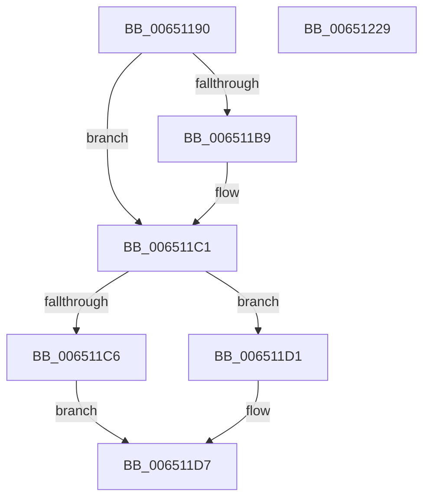

# EtwpTraceRedirectedIo

- RVA: `0x00651190`–`0x0065122A` (길이 `154` bytes)
- VA: `0x0000000140651190`
- 실행 섹션: `.text`
- PDB 이름 있음: `예`; PDB Function 태그: `아니요`
- unwind 정보 RVA: `0x0005F638`
- 디코드: `36`개 명령, `154/154` bytes 표시
- 미해석 바이트: `0` (있으면 어셈블리에 `.byte`로 보존)

> 이 문서는 커널 이미지의 기계어와 PDB 기호를 분석해 생성했습니다. 4번과 5번은 함수 원형과 자료형을 바이너리 사용 방식에서 추정한 C 해석이며 원본 소스 복구 결과는 아닙니다.

## 1. Dependencies

- 직접 호출 지점: **3**; 고유 호출 대상: **3**
- 직접 호출자로 확인된 함수: **0**
- RIP 상대 이미지 참조: **1**

### Outgoing calls
- `0x006511BC` → [PsGetThreadServerSilo](../22/PsGetThreadServerSilo_function_002247B0.md) (function, `0x002247B0`)
- `0x00651211` → [EtwTraceSiloKernelEvent](../22/EtwTraceSiloKernelEvent_function_002242A0.md) (function, `0x002242A0`)
- `0x0065121E` → [_security_check_cookie](../6A/_security_check_cookie_function_006AC640.md) (function, `0x006AC640`)

### Direct callers
- 이 함수 시작 RVA로 연결되는 직접 call은 확인되지 않았습니다. 간접 호출은 완전히 역산할 수 없습니다.

### Static image references
- `0x00651196` → RVA `0x00E0A740` (`.data`; read)

## 2. Other-region calls and transfers

- 다른 실행 섹션으로 향하는 call: **0**
- 별도 외부 분기/꼬리 이동을 확인하지 못했습니다.

## 3. Assembly (complete function range)

```asm
00651190  40 53                           push rbx
00651192  48 83 EC 60                     sub rsp, 0x60
00651196  48 8B 05 A3 95 7B 00            mov rax, qword ptr [rip + 0x7b95a3]
0065119D  48 33 C4                        xor rax, rsp
006511A0  48 89 44 24 50                  mov qword ptr [rsp + 0x50], rax
006511A5  48 8B 81 98 00 00 00            mov rax, qword ptr [rcx + 0x98]
006511AC  48 8B DA                        mov rbx, rdx
006511AF  48 89 4C 24 30                  mov qword ptr [rsp + 0x30], rcx
006511B4  48 85 C0                        test rax, rax
006511B7  74 08                           je 0x1406511c1
006511B9  48 8B C8                        mov rcx, rax
006511BC  E8 EF 35 BD FF                  call 0x1402247b0
006511C1  48 85 DB                        test rbx, rbx
006511C4  74 0B                           je 0x1406511d1
006511C6  48 8B 4B 18                     mov rcx, qword ptr [rbx + 0x18]
006511CA  48 89 4C 24 38                  mov qword ptr [rsp + 0x38], rcx
006511CF  EB 06                           jmp 0x1406511d7
006511D1  48 83 64 24 38 00               and qword ptr [rsp + 0x38], 0
006511D7  83 64 24 4C 00                  and dword ptr [rsp + 0x4c], 0
006511DC  48 8D 4C 24 30                  lea rcx, [rsp + 0x30]
006511E1  48 89 4C 24 40                  mov qword ptr [rsp + 0x40], rcx
006511E6  48 8D 54 24 40                  lea rdx, [rsp + 0x40]
006511EB  48 8B C8                        mov rcx, rax
006511EE  C7 44 24 28 02 19 60 11         mov dword ptr [rsp + 0x28], 0x11601902
006511F6  41 B9 00 03 00 00               mov r9d, 0x300
006511FC  C7 44 24 48 10 00 00 00         mov dword ptr [rsp + 0x48], 0x10
00651204  41 B8 01 00 00 00               mov r8d, 1
0065120A  66 C7 44 24 20 10 01            mov word ptr [rsp + 0x20], 0x110
00651211  E8 8A 30 BD FF                  call 0x1402242a0
00651216  48 8B 4C 24 50                  mov rcx, qword ptr [rsp + 0x50]
0065121B  48 33 CC                        xor rcx, rsp
0065121E  E8 1D B4 05 00                  call 0x1406ac640
00651223  48 83 C4 60                     add rsp, 0x60
00651227  5B                              pop rbx
00651228  C3                              ret
00651229  CC                              int3
```

## 4. C-style interpretation (structured pseudocode)

```c
__int64 __fastcall EtwpTraceRedirectedIo(__int64 a1, __int64 a2)
{
    __int64 result;
    __int64 v_rsp;
    unsigned __int64 v_stack_m18;
    unsigned int v_stack_m1C;
    unsigned int v_stack_m20;
    unsigned __int64 v_stack_m28;
    unsigned __int64 v_stack_m30;
    unsigned __int64 v_stack_m38;
    unsigned int v_stack_m40;
    unsigned __int16 v_stack_m48;

    v_rsp = (v_rsp) - (96);
    result = (*(unsigned __int64 *)(v_rip + 8099235)) ^ (v_rsp);
    v_stack_m18 = result;
    v_stack_m38 = a1;
    result = *(unsigned __int64 *)(a1 + 152);
    if (*(unsigned __int64 *)(a1 + 152) != 0) {
        a1 = *(unsigned __int64 *)(a1 + 152);
        result = PsGetThreadServerSilo(a1, a2, a3, a4);
    }
    if (a2 == 0) goto loc_006511D1;
    v_stack_m30 = *(unsigned __int64 *)(a2 + 24);
    goto loc_006511D7;
loc_006511D1:
loc_006511D7:
    v_stack_m28 = v_stack_m38;
    v_stack_m40 = 0x11601902ULL;
    v_stack_m20 = 16;
    v_stack_m48 = 272;
    result = EtwTraceSiloKernelEvent(result, v_stack_m28, 1, 768);
    a1 = (v_stack_m18) ^ (v_rsp);
    result = _security_check_cookie(a1, v_stack_m28, 1, 768);
    v_rsp = (v_rsp) + (96);
    return result;
}
```

## 5. (Beta) C Style

```c
int64_t EtwpTraceRedirectedIo(void *Arg1, int64_t Arg2)
{
    uint8_t *arg1 = (uint8_t *)Arg1;

    int64_t result;
    int64_t local_rsp;
    uint64_t v_stack_m18;
    uint32_t v_stack_m1C;
    uint32_t v_stack_m20;
    uint64_t v_stack_m28;
    uint64_t v_stack_m30;
    uint64_t v_stack_m38;
    uint32_t v_stack_m40;
    uint16_t v_stack_m48;

    local_rsp = (local_rsp) - (96);
    result = (*(uint64_t *)(v_rip + 0x7B95A3)) ^ (local_rsp);
    v_stack_m18 = result;
    v_stack_m38 = Arg1;
    result = *(uint64_t *)(arg1 + 0x98);
    if (*(uint64_t *)(arg1 + 0x98) != 0) {
        Arg1 = *(uint64_t *)(arg1 + 0x98);
        result = PsGetThreadServerSilo(Arg1, Arg2, a3, a4);
    }
    if (Arg2 == 0) goto loc_006511D1;
    v_stack_m30 = *(uint64_t *)(Arg2 + 0x18);
    goto loc_006511D7;
loc_006511D1:
loc_006511D7:
    v_stack_m28 = v_stack_m38;
    v_stack_m40 = 0x11601902ULL;
    v_stack_m20 = 16;
    v_stack_m48 = 272;
    result = EtwTraceSiloKernelEvent(result, v_stack_m28, 1, 768);
    Arg1 = (v_stack_m18) ^ (local_rsp);
    result = _security_check_cookie(Arg1, v_stack_m28, 1, 768);
    local_rsp = (local_rsp) + (96);
    return result;
}
```

### 관측된 메모리 오프셋

구조체 형식이 확인되지 않은 접근은 인자 기준의 오프셋으로만 기록했습니다.

| 기준 인자 | 오프셋 표현 | 폭 (bit) | 접근 |
|---|---:|---:|---|
| `Arg1` | `+ 0x98` | `64` | `R` |

## 6. Execution-region graph

[열기: 2D/3D 그래프와 함수 탐색 컨트롤 패널](../../../control-panel.html?section=text&rva=0x00651190&view=graph)

- 2D 그래프는 위에서 아래로 흐르고, 3D 그래프는 빈 공간을 드래그해 회전합니다. Shift+드래그는 이동, 휠은 확대·축소, 함수 노드 선택은 대상 보고서 이동입니다.

### Static fallback


