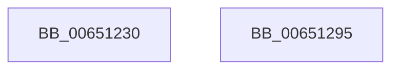

# EtwpTraceSplitIo

- RVA: `0x00651230`–`0x00651296` (길이 `102` bytes)
- VA: `0x0000000140651230`
- 실행 섹션: `.text`
- PDB 이름 있음: `예`; PDB Function 태그: `아니요`
- unwind 정보 RVA: `0x0006F9F8`
- 디코드: `23`개 명령, `102/102` bytes 표시
- 미해석 바이트: `0` (있으면 어셈블리에 `.byte`로 보존)

> 이 문서는 커널 이미지의 기계어와 PDB 기호를 분석해 생성했습니다. 4번과 5번은 함수 원형과 자료형을 바이너리 사용 방식에서 추정한 C 해석이며 원본 소스 복구 결과는 아닙니다.

## 1. Dependencies

- 직접 호출 지점: **2**; 고유 호출 대상: **2**
- 직접 호출자로 확인된 함수: **0**
- RIP 상대 이미지 참조: **1**

### Outgoing calls
- `0x0065127E` → [EtwTraceKernelEvent](../23/EtwTraceKernelEvent_function_00235350.md) (function, `0x00235350`)
- `0x0065128B` → [_security_check_cookie](../6A/_security_check_cookie_function_006AC640.md) (function, `0x006AC640`)

### Direct callers
- 이 함수 시작 RVA로 연결되는 직접 call은 확인되지 않았습니다. 간접 호출은 완전히 역산할 수 없습니다.

### Static image references
- `0x00651234` → RVA `0x00E0A740` (`.data`; read)

## 2. Other-region calls and transfers

- 다른 실행 섹션으로 향하는 call: **0**
- 별도 외부 분기/꼬리 이동을 확인하지 못했습니다.

## 3. Assembly (complete function range)

```asm
00651230  48 83 EC 68                     sub rsp, 0x68
00651234  48 8B 05 05 95 7B 00            mov rax, qword ptr [rip + 0x7b9505]
0065123B  48 33 C4                        xor rax, rsp
0065123E  48 89 44 24 50                  mov qword ptr [rsp + 0x50], rax
00651243  83 64 24 3C 00                  and dword ptr [rsp + 0x3c], 0
00651248  B8 08 00 00 00                  mov eax, 8
0065124D  83 64 24 4C 00                  and dword ptr [rsp + 0x4c], 0
00651252  45 0F B7 C8                     movzx r9d, r8w
00651256  48 89 4C 24 30                  mov qword ptr [rsp + 0x30], rcx
0065125B  41 B8 00 00 20 00               mov r8d, 0x200000
00651261  48 89 54 24 40                  mov qword ptr [rsp + 0x40], rdx
00651266  48 8D 4C 24 30                  lea rcx, [rsp + 0x30]
0065126B  8D 50 FA                        lea edx, [rax - 6]
0065126E  89 44 24 38                     mov dword ptr [rsp + 0x38], eax
00651272  89 44 24 48                     mov dword ptr [rsp + 0x48], eax
00651276  C7 44 24 20 02 18 50 00         mov dword ptr [rsp + 0x20], 0x501802
0065127E  E8 CD 40 BE FF                  call 0x140235350
00651283  48 8B 4C 24 50                  mov rcx, qword ptr [rsp + 0x50]
00651288  48 33 CC                        xor rcx, rsp
0065128B  E8 B0 B3 05 00                  call 0x1406ac640
00651290  48 83 C4 68                     add rsp, 0x68
00651294  C3                              ret
00651295  CC                              int3
```

## 4. C-style interpretation (structured pseudocode)

```c
__int64 __fastcall EtwpTraceSplitIo(__int64 a1, __int64 a2, unsigned __int16 a3)
{
    __int64 result;
    __int64 v_rsp;
    unsigned __int64 v_stack_m18;
    unsigned int v_stack_m1C;
    unsigned int v_stack_m20;
    unsigned __int64 v_stack_m28;
    unsigned int v_stack_m2C;
    unsigned int v_stack_m30;
    unsigned __int64 v_stack_m38;
    unsigned int v_stack_m48;

    v_rsp = (v_rsp) - (104);
    result = (*(unsigned __int64 *)(v_rip + 8099077)) ^ (v_rsp);
    v_stack_m18 = result;
    v_stack_m38 = a1;
    v_stack_m28 = a2;
    v_stack_m30 = 8;
    v_stack_m20 = 8;
    v_stack_m48 = 0x501802ULL;
    result = EtwTraceKernelEvent(v_stack_m38, 8 - 6, (unsigned int)(0x200000ULL), a3);
    a1 = (v_stack_m18) ^ (v_rsp);
    result = _security_check_cookie(a1, 8 - 6, (unsigned int)(0x200000ULL), a3);
    v_rsp = (v_rsp) + (104);
    return result;
}
```

## 5. (Beta) C Style

```c
int64_t EtwpTraceSplitIo(int64_t Arg1, int64_t Arg2, uint16_t Arg3)
{
    int64_t result;
    int64_t local_rsp;
    uint64_t v_stack_m18;
    uint32_t v_stack_m1C;
    uint32_t v_stack_m20;
    uint64_t v_stack_m28;
    uint32_t v_stack_m2C;
    uint32_t v_stack_m30;
    uint64_t v_stack_m38;
    uint32_t v_stack_m48;

    local_rsp = (local_rsp) - (104);
    result = (*(uint64_t *)(v_rip + 0x7B9505)) ^ (local_rsp);
    v_stack_m18 = result;
    v_stack_m38 = Arg1;
    v_stack_m28 = Arg2;
    v_stack_m30 = 8;
    v_stack_m20 = 8;
    v_stack_m48 = 0x501802ULL;
    result = EtwTraceKernelEvent(v_stack_m38, 8 - 6, (uint32_t)(0x200000ULL), Arg3);
    Arg1 = (v_stack_m18) ^ (local_rsp);
    result = _security_check_cookie(Arg1, 8 - 6, (uint32_t)(0x200000ULL), Arg3);
    local_rsp = (local_rsp) + (104);
    return result;
}
```

## 6. Execution-region graph

[열기: 2D/3D 그래프와 함수 탐색 컨트롤 패널](../../../control-panel.html?section=text&rva=0x00651230&view=graph)

- 2D 그래프는 위에서 아래로 흐르고, 3D 그래프는 빈 공간을 드래그해 회전합니다. Shift+드래그는 이동, 휠은 확대·축소, 함수 노드 선택은 대상 보고서 이동입니다.

### Static fallback


