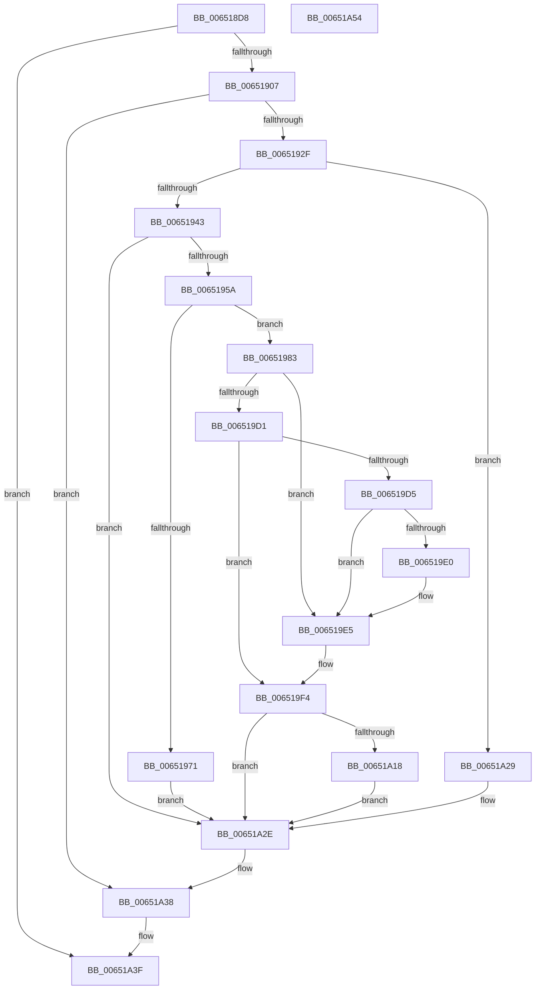

# EtwpTransitionToRealtime

- RVA: `0x006518D8`–`0x00651A55` (길이 `381` bytes)
- VA: `0x00000001406518D8`
- 실행 섹션: `.text`
- PDB 이름 있음: `예`; PDB Function 태그: `아니요`
- unwind 정보 RVA: `0x000AEEA8`
- 디코드: `96`개 명령, `381/381` bytes 표시
- 미해석 바이트: `0` (있으면 어셈블리에 `.byte`로 보존)

> 이 문서는 커널 이미지의 기계어와 PDB 기호를 분석해 생성했습니다. 4번과 5번은 함수 원형과 자료형을 바이너리 사용 방식에서 추정한 C 해석이며 원본 소스 복구 결과는 아닙니다.

## 1. Dependencies

- 직접 호출 지점: **13**; 고유 호출 대상: **10**
- 직접 호출자로 확인된 함수: **1**
- RIP 상대 이미지 참조: **2**

### Outgoing calls
- `0x006518FA` → [EtwpValidateLoggerInfo](../../page/8B/EtwpValidateLoggerInfo_function_008BF9B0.md) (function, `0x008BF9B0`)
- `0x00651920` → [EtwpAcquireLoggerContext](../../page/93/EtwpAcquireLoggerContext_function_009326AC.md) (function, `0x009326AC`)
- `0x0065194B` → [EtwpCheckLoggerControlAccess](../../page/8C/EtwpCheckLoggerControlAccess_function_008C0AE0.md) (function, `0x008C0AE0`)
- `0x00651962` → [EtwpSynchronizeWithLogger](../../page/A6/EtwpSynchronizeWithLogger_function_00A66250.md) (function, `0x00A66250`)
- `0x0065198A` → [RtlFreeAnsiString](../../page/9C/RtlFreeAnsiString_function_009C0800.md) (function, `0x009C0800`)
- `0x00651996` → [RtlFreeAnsiString](../../page/9C/RtlFreeAnsiString_function_009C0800.md) (function, `0x009C0800`)
- `0x006519A2` → [RtlFreeAnsiString](../../page/9C/RtlFreeAnsiString_function_009C0800.md) (function, `0x009C0800`)
- `0x006519EF` → [EtwpSynchronizeWithLogger](../../page/A6/EtwpSynchronizeWithLogger_function_00A66250.md) (function, `0x00A66250`)
- `0x006519FA` → [EtwpGetLoggerInfoFromContext](../../page/8B/EtwpGetLoggerInfoFromContext_function_008BEF90.md) (function, `0x008BEF90`)
- `0x00651A0F` → [EtwEventEnabled](../39/EtwEventEnabled_function_00392450.md) (function, `0x00392450`)
- `0x00651A22` → [EtwpEventWriteTemplateSession](../../page/9B/EtwpEventWriteTemplateSession_function_009BD120.md) (function, `0x009BD120`)
- `0x00651A33` → [EtwpReleaseLoggerContext](../../page/A0/EtwpReleaseLoggerContext_function_00A04160.md) (function, `0x00A04160`)
- `0x00651A38` → [KeLeaveCriticalRegion](../25/KeLeaveCriticalRegion_function_0025D8B0.md) (function, `0x0025D8B0`)

### Direct callers
- [NtTraceControl](../../page/A9/NtTraceControl_function_00A9ED40.md) at `0x00A9F075`

### Static image references
- `0x006519FF` → RVA `0x00EFF840` (`.data`; read)
- `0x00651A06` → RVA `0x00022E70` (`.rdata`; read)

## 2. Other-region calls and transfers

- 다른 실행 섹션으로 향하는 call: **11**
  - `0x006518FA` → [EtwpValidateLoggerInfo](../../page/8B/EtwpValidateLoggerInfo_function_008BF9B0.md) (`.text` → `PAGE`)
  - `0x00651920` → [EtwpAcquireLoggerContext](../../page/93/EtwpAcquireLoggerContext_function_009326AC.md) (`.text` → `PAGE`)
  - `0x0065194B` → [EtwpCheckLoggerControlAccess](../../page/8C/EtwpCheckLoggerControlAccess_function_008C0AE0.md) (`.text` → `PAGE`)
  - `0x00651962` → [EtwpSynchronizeWithLogger](../../page/A6/EtwpSynchronizeWithLogger_function_00A66250.md) (`.text` → `PAGE`)
  - `0x0065198A` → [RtlFreeAnsiString](../../page/9C/RtlFreeAnsiString_function_009C0800.md) (`.text` → `PAGE`)
  - `0x00651996` → [RtlFreeAnsiString](../../page/9C/RtlFreeAnsiString_function_009C0800.md) (`.text` → `PAGE`)
  - `0x006519A2` → [RtlFreeAnsiString](../../page/9C/RtlFreeAnsiString_function_009C0800.md) (`.text` → `PAGE`)
  - `0x006519EF` → [EtwpSynchronizeWithLogger](../../page/A6/EtwpSynchronizeWithLogger_function_00A66250.md) (`.text` → `PAGE`)
  - `0x006519FA` → [EtwpGetLoggerInfoFromContext](../../page/8B/EtwpGetLoggerInfoFromContext_function_008BEF90.md) (`.text` → `PAGE`)
  - `0x00651A22` → [EtwpEventWriteTemplateSession](../../page/9B/EtwpEventWriteTemplateSession_function_009BD120.md) (`.text` → `PAGE`)
  - `0x00651A33` → [EtwpReleaseLoggerContext](../../page/A0/EtwpReleaseLoggerContext_function_00A04160.md) (`.text` → `PAGE`)
- 별도 외부 분기/꼬리 이동을 확인하지 못했습니다.

## 3. Assembly (complete function range)

```asm
006518D8  48 8B C4                        mov rax, rsp
006518DB  48 89 58 08                     mov qword ptr [rax + 8], rbx
006518DF  48 89 68 10                     mov qword ptr [rax + 0x10], rbp
006518E3  48 89 70 20                     mov qword ptr [rax + 0x20], rsi
006518E7  57                              push rdi
006518E8  48 83 EC 20                     sub rsp, 0x20
006518EC  48 83 60 18 00                  and qword ptr [rax + 0x18], 0
006518F1  4C 8B C9                        mov r9, rcx
006518F4  48 8B CA                        mov rcx, rdx
006518F7  48 8B EA                        mov rbp, rdx
006518FA  E8 B1 E0 26 00                  call 0x1408bf9b0
006518FF  85 C0                           test eax, eax
00651901  0F 88 38 01 00 00               js 0x140651a3f
00651907  65 48 8B 04 25 88 01 00 00      mov rax, qword ptr gs:[0x188]
00651910  4C 8D 44 24 40                  lea r8, [rsp + 0x40]
00651915  49 8B C9                        mov rcx, r9
00651918  66 FF 88 E4 01 00 00            dec word ptr [rax + 0x1e4]
0065191F  90                              nop
00651920  E8 87 0D 2E 00                  call 0x1409326ac
00651925  8B F8                           mov edi, eax
00651927  85 C0                           test eax, eax
00651929  0F 88 09 01 00 00               js 0x140651a38
0065192F  48 8B 5C 24 40                  mov rbx, qword ptr [rsp + 0x40]
00651934  8B 73 0C                        mov esi, dword ptr [rbx + 0xc]
00651937  F7 C6 40 05 00 00               test esi, 0x540
0065193D  0F 85 E6 00 00 00               jne 0x140651a29
00651943  48 8B D3                        mov rdx, rbx
00651946  B9 A0 00 00 00                  mov ecx, 0xa0
0065194B  E8 90 F1 26 00                  call 0x1408c0ae0
00651950  8B F8                           mov edi, eax
00651952  85 C0                           test eax, eax
00651954  0F 88 D4 00 00 00               js 0x140651a2e
0065195A  BA 04 10 00 00                  mov edx, 0x1004
0065195F  48 8B CB                        mov rcx, rbx
00651962  E8 E9 48 41 00                  call 0x140a66250
00651967  48 83 BB 20 03 00 00 00         cmp qword ptr [rbx + 0x320], 0
0065196F  74 12                           je 0x140651983
00651971  8B 43 28                        mov eax, dword ptr [rbx + 0x28]
00651974  BF 01 00 00 C0                  mov edi, 0xc0000001
00651979  85 C0                           test eax, eax
0065197B  0F 45 F8                        cmovne edi, eax
0065197E  E9 AB 00 00 00                  jmp 0x140651a2e
00651983  48 8D 8B 98 00 00 00            lea rcx, [rbx + 0x98]
0065198A  E8 71 EE 36 00                  call 0x1409c0800
0065198F  48 8D 8B A8 00 00 00            lea rcx, [rbx + 0xa8]
00651996  E8 65 EE 36 00                  call 0x1409c0800
0065199B  48 8D 8B B8 00 00 00            lea rcx, [rbx + 0xb8]
006519A2  E8 59 EE 36 00                  call 0x1409c0800
006519A7  81 E6 D0 FD FF FB               and esi, 0xfbfffdd0
006519AD  0F BA EE 08                     bts esi, 8
006519B1  8B C6                           mov eax, esi
006519B3  83 CE 10                        or esi, 0x10
006519B6  83 E0 EF                        and eax, 0xffffffef
006519B9  F6 45 40 10                     test byte ptr [rbp + 0x40], 0x10
006519BD  0F 44 F0                        cmove esi, eax
006519C0  48 8D 83 D0 00 00 00            lea rax, [rbx + 0xd0]
006519C7  89 73 0C                        mov dword ptr [rbx + 0xc], esi
006519CA  8B 4D 44                        mov ecx, dword ptr [rbp + 0x44]
006519CD  85 C9                           test ecx, ecx
006519CF  75 14                           jne 0x1406519e5
006519D1  39 08                           cmp dword ptr [rax], ecx
006519D3  75 1F                           jne 0x1406519f4
006519D5  B9 E8 03 00 00                  mov ecx, 0x3e8
006519DA  40 F6 C6 10                     test sil, 0x10
006519DE  75 05                           jne 0x1406519e5
006519E0  B9 01 00 00 00                  mov ecx, 1
006519E5  89 08                           mov dword ptr [rax], ecx
006519E7  BA 04 00 00 00                  mov edx, 4
006519EC  48 8B CB                        mov rcx, rbx
006519EF  E8 5C 48 41 00                  call 0x140a66250
006519F4  48 8B D3                        mov rdx, rbx
006519F7  48 8B CD                        mov rcx, rbp
006519FA  E8 91 D5 26 00                  call 0x1408bef90
006519FF  48 8B 0D 3A DE 8A 00            mov rcx, qword ptr [rip + 0x8ade3a]
00651A06  48 8D 15 63 14 9D FF            lea rdx, [rip - 0x62eb9d]
00651A0D  8B F8                           mov edi, eax
00651A0F  E8 3C 0A D4 FF                  call 0x140392450
00651A14  84 C0                           test al, al
00651A16  74 16                           je 0x140651a2e
00651A18  4C 8B C3                        mov r8, rbx
00651A1B  48 8D 15 4E 14 9D FF            lea rdx, [rip - 0x62ebb2]
00651A22  E8 F9 B6 36 00                  call 0x1409bd120
00651A27  EB 05                           jmp 0x140651a2e
00651A29  BF BB 00 00 C0                  mov edi, 0xc00000bb
00651A2E  B2 01                           mov dl, 1
00651A30  48 8B CB                        mov rcx, rbx
00651A33  E8 28 27 3B 00                  call 0x140a04160
00651A38  E8 73 BE C0 FF                  call 0x14025d8b0
00651A3D  8B C7                           mov eax, edi
00651A3F  48 8B 5C 24 30                  mov rbx, qword ptr [rsp + 0x30]
00651A44  48 8B 6C 24 38                  mov rbp, qword ptr [rsp + 0x38]
00651A49  48 8B 74 24 48                  mov rsi, qword ptr [rsp + 0x48]
00651A4E  48 83 C4 20                     add rsp, 0x20
00651A52  5F                              pop rdi
00651A53  C3                              ret
00651A54  CC                              int3
```

## 4. C-style interpretation (structured pseudocode)

```c
__int64 __fastcall EtwpTransitionToRealtime(__int64 a1, __int64 a2)
{
    __int64 result;
    __int64 v_rdi;
    __int64 v_rsi;
    __int64 v_rsp;
    unsigned __int64 v_stack_p10;
    unsigned __int64 v_stack_p18;
    unsigned __int64 v_stack_p20;
    unsigned __int64 v_stack_p8;

    *(unsigned __int64 *)(v_rsp + 8) = v_rbx;
    *(unsigned __int64 *)(v_rsp + 16) = v_rbp;
    *(unsigned __int64 *)(v_rsp + 32) = v_rsi;
    v_rsp = (v_rsp) - (32);
    result = EtwpValidateLoggerInfo(a2, a2, a3, a1);
    if (sign_flag) goto loc_00651A3F;
    result = EtwpAcquireLoggerContext(a1, a2, v_stack_p18, a1);
    if (sign_flag) goto loc_00651A38;
    if ((((unsigned int)((unsigned int)(*(unsigned int *)(v_stack_p18 + 12)))) & (0x540ULL)) != 0) goto loc_00651A29;
    result = EtwpCheckLoggerControlAccess(160, v_stack_p18, v_stack_p18, a1);
    if (sign_flag) goto loc_00651A2E;
    result = EtwpSynchronizeWithLogger(v_stack_p18, (unsigned int)(0x1004ULL), v_stack_p18, a1);
    if ((*(unsigned __int64 *)(v_stack_p18 + 800)) == 0) goto loc_00651983;
    v_rdi = (unsigned int)(0xC0000001ULL);
    if ((unsigned int)((unsigned int)(*(unsigned int *)(v_stack_p18 + 40))) != 0) { v_rdi = (unsigned int)((unsigned int)(*(unsigned int *)(v_stack_p18 + 40))); }
    goto loc_00651A2E;
loc_00651983:
    result = RtlFreeAnsiString(v_stack_p18 + 152, (unsigned int)(0x1004ULL), v_stack_p18, a1);
    result = RtlFreeAnsiString(v_stack_p18 + 168, (unsigned int)(0x1004ULL), v_stack_p18, a1);
    result = RtlFreeAnsiString(v_stack_p18 + 184, (unsigned int)(0x1004ULL), v_stack_p18, a1);
    v_rsi = (unsigned int)(((unsigned int)(*(unsigned int *)(v_stack_p18 + 12))) & (0xFBFFFDD0ULL));
    v_rsi = (unsigned int)((v_rsi) | (16));
    result = (unsigned int)(((unsigned int)((unsigned int)(v_rsi))) & (0xFFFFFFEFULL));
    if (((*(unsigned __int8 *)(a2 + 64)) & (16)) == 0) { v_rsi = (unsigned int)(result); }
    *(unsigned int *)(v_stack_p18 + 12) = (unsigned int)(v_rsi);
    if ((unsigned int)((unsigned int)(*(unsigned int *)(a2 + 68))) != 0) goto loc_006519E5;
    if ((*(unsigned int *)(v_stack_p18 + 208)) != ((unsigned int)((unsigned int)(*(unsigned int *)(a2 + 68))))) goto loc_006519F4;
    if ((((unsigned __int8)(v_rsi)) & (16)) == 0) {
        a1 = 1;
    }
    *(unsigned int *)(v_stack_p18 + 208) = (unsigned int)(a1);
    result = EtwpSynchronizeWithLogger(v_stack_p18, 4, v_stack_p18, a1);
loc_006519F4:
    result = EtwpGetLoggerInfoFromContext(a2, v_stack_p18, v_stack_p18, a1);
    result = EtwEventEnabled(*(unsigned __int64 *)(v_rip + 9100858), v_rip - 6482845, v_stack_p18, a1);
    if ((unsigned __int8)(result) == 0) goto loc_00651A2E;
    result = EtwpEventWriteTemplateSession(*(unsigned __int64 *)(v_rip + 9100858), v_rip - 6482866, v_stack_p18, a1);
    goto loc_00651A2E;
loc_00651A29:
loc_00651A2E:
    result = EtwpReleaseLoggerContext(v_stack_p18, 1, v_stack_p18, a1);
loc_00651A38:
    result = KeLeaveCriticalRegion(v_stack_p18, 1, v_stack_p18, a1);
loc_00651A3F:
    v_rsp = (v_rsp) + (32);
    return (unsigned int)((unsigned int)((unsigned int)(0xC00000BBULL)));
}
```

## 5. (Beta) C Style

```c
int64_t EtwpTransitionToRealtime(int64_t Arg1, void *Arg2)
{
    uint8_t *arg2 = (uint8_t *)Arg2;

    int64_t result;
    int64_t local_rdi;
    int64_t local_rsi;
    int64_t local_rsp;
    uint64_t v_stack_p10;
    uint64_t v_stack_p18;
    uint64_t v_stack_p20;
    uint64_t v_stack_p8;

    *(uint64_t *)(local_rsp + 0x8) = local_rbx;
    *(uint64_t *)(local_rsp + 0x10) = local_rbp;
    *(uint64_t *)(local_rsp + 0x20) = local_rsi;
    local_rsp = (local_rsp) - (32);
    result = EtwpValidateLoggerInfo(Arg2, Arg2, a3, Arg1);
    if (sign_flag) goto loc_00651A3F;
    result = EtwpAcquireLoggerContext(Arg1, Arg2, v_stack_p18, Arg1);
    if (sign_flag) goto loc_00651A38;
    if ((((uint32_t)((uint32_t)(*(uint32_t *)(v_stack_p18 + 0xC)))) & (0x540ULL)) != 0) goto loc_00651A29;
    result = EtwpCheckLoggerControlAccess(160, v_stack_p18, v_stack_p18, Arg1);
    if (sign_flag) goto loc_00651A2E;
    result = EtwpSynchronizeWithLogger(v_stack_p18, (uint32_t)(0x1004ULL), v_stack_p18, Arg1);
    if ((*(uint64_t *)(v_stack_p18 + 0x320)) == 0) goto loc_00651983;
    local_rdi = (uint32_t)(0xC0000001ULL);
    if ((uint32_t)((uint32_t)(*(uint32_t *)(v_stack_p18 + 0x28))) != 0) { local_rdi = (uint32_t)((uint32_t)(*(uint32_t *)(v_stack_p18 + 0x28))); }
    goto loc_00651A2E;
loc_00651983:
    result = RtlFreeAnsiString(v_stack_p18 + 152, (uint32_t)(0x1004ULL), v_stack_p18, Arg1);
    result = RtlFreeAnsiString(v_stack_p18 + 168, (uint32_t)(0x1004ULL), v_stack_p18, Arg1);
    result = RtlFreeAnsiString(v_stack_p18 + 184, (uint32_t)(0x1004ULL), v_stack_p18, Arg1);
    local_rsi = (uint32_t)(((uint32_t)(*(uint32_t *)(v_stack_p18 + 0xC))) & (0xFBFFFDD0ULL));
    local_rsi = (uint32_t)((local_rsi) | (16));
    result = (uint32_t)(((uint32_t)((uint32_t)(local_rsi))) & (0xFFFFFFEFULL));
    if (((*(uint8_t *)(arg2 + 0x40)) & (16)) == 0) { local_rsi = (uint32_t)(result); }
    *(uint32_t *)(v_stack_p18 + 0xC) = (uint32_t)(local_rsi);
    if ((uint32_t)((uint32_t)(*(uint32_t *)(arg2 + 0x44))) != 0) goto loc_006519E5;
    if ((*(uint32_t *)(v_stack_p18 + 0xD0)) != ((uint32_t)((uint32_t)(*(uint32_t *)(arg2 + 0x44))))) goto loc_006519F4;
    if ((((uint8_t)(local_rsi)) & (16)) == 0) {
        Arg1 = 1;
    }
    *(uint32_t *)(v_stack_p18 + 0xD0) = (uint32_t)(Arg1);
    result = EtwpSynchronizeWithLogger(v_stack_p18, 4, v_stack_p18, Arg1);
loc_006519F4:
    result = EtwpGetLoggerInfoFromContext(Arg2, v_stack_p18, v_stack_p18, Arg1);
    result = EtwEventEnabled(*(uint64_t *)(v_rip + 0x8ADE3A), v_rip - 6482845, v_stack_p18, Arg1);
    if ((uint8_t)(result) == 0) goto loc_00651A2E;
    result = EtwpEventWriteTemplateSession(*(uint64_t *)(v_rip + 0x8ADE3A), v_rip - 6482866, v_stack_p18, Arg1);
    goto loc_00651A2E;
loc_00651A29:
loc_00651A2E:
    result = EtwpReleaseLoggerContext(v_stack_p18, 1, v_stack_p18, Arg1);
loc_00651A38:
    result = KeLeaveCriticalRegion(v_stack_p18, 1, v_stack_p18, Arg1);
loc_00651A3F:
    local_rsp = (local_rsp) + (32);
    return (uint32_t)((uint32_t)((uint32_t)(0xC00000BBULL)));
}
```

### 관측된 메모리 오프셋

구조체 형식이 확인되지 않은 접근은 인자 기준의 오프셋으로만 기록했습니다.

| 기준 인자 | 오프셋 표현 | 폭 (bit) | 접근 |
|---|---:|---:|---|
| `Arg2` | `+ 0x40` | `8` | `R` |
| `Arg2` | `+ 0x44` | `32` | `R` |

## 6. Execution-region graph

[열기: 2D/3D 그래프와 함수 탐색 컨트롤 패널](../../../control-panel.html?section=text&rva=0x006518D8&view=graph)

- 2D 그래프는 위에서 아래로 흐르고, 3D 그래프는 빈 공간을 드래그해 회전합니다. Shift+드래그는 이동, 휠은 확대·축소, 함수 노드 선택은 대상 보고서 이동입니다.

### Static fallback


