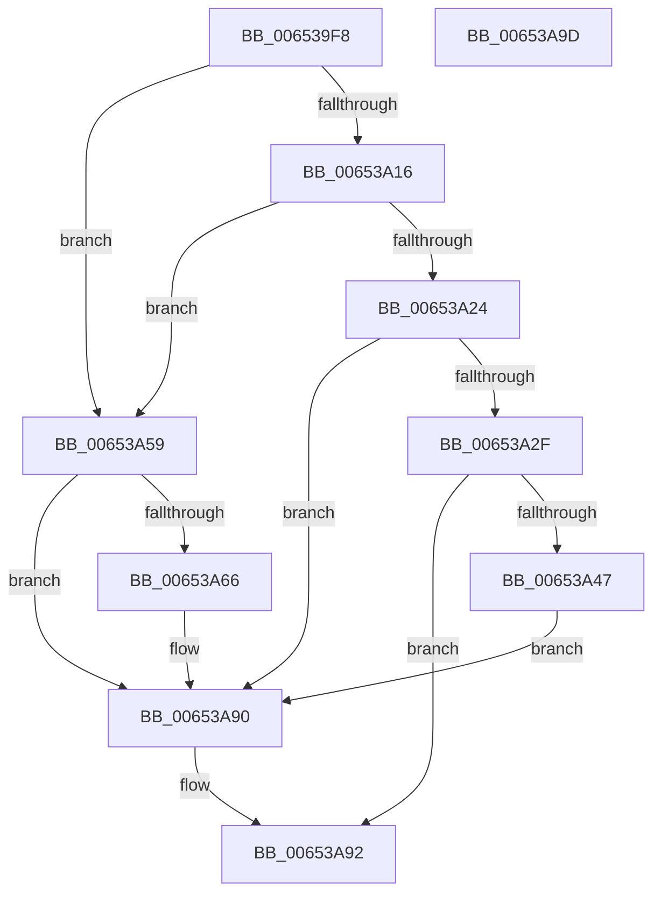

# EtwpUpdateLastBranchTracingHalState

- RVA: `0x006539F8`–`0x00653A9E` (길이 `166` bytes)
- VA: `0x00000001406539F8`
- 실행 섹션: `.text`
- PDB 이름 있음: `예`; PDB Function 태그: `아니요`
- unwind 정보 RVA: `0x0005CAAC`
- 디코드: `43`개 명령, `166/166` bytes 표시
- 미해석 바이트: `0` (있으면 어셈블리에 `.byte`로 보존)

> 이 문서는 커널 이미지의 기계어와 PDB 기호를 분석해 생성했습니다. 4번과 5번은 함수 원형과 자료형을 바이너리 사용 방식에서 추정한 C 해석이며 원본 소스 복구 결과는 아닙니다.

## 1. Dependencies

- 직접 호출 지점: **3**; 고유 호출 대상: **2**
- 직접 호출자로 확인된 함수: **2**
- RIP 상대 이미지 참조: **3**

### Outgoing calls
- `0x00653A3C` → [guard_dispatch_icall](../6B/guard_dispatch_icall_function_006BAAD0.md) (function, `0x006BAAD0`)
- `0x00653A47` → [EtwpReferenceLastBranchLookasideList](../../page/7C/EtwpReferenceLastBranchLookasideList_function_007C0E7C.md) (function, `0x007C0E7C`)
- `0x00653A6D` → [guard_dispatch_icall](../6B/guard_dispatch_icall_function_006BAAD0.md) (function, `0x006BAAD0`)

### Direct callers
- [EtwpUpdateLastBranchTracingConfiguration](../../page/7C/EtwpUpdateLastBranchTracingConfiguration_function_007C0EFC.md) at `0x007C0F8A`
- [EtwpUpdateLastBranchTracingEvents](../../page/7C/EtwpUpdateLastBranchTracingEvents_function_007C0FA8.md) at `0x007C1025`

### Static image references
- `0x00653A2F` → RVA `0x00E00C10` (`.data`; read)
- `0x00653A66` → RVA `0x00E00C18` (`.data`; read)
- `0x00653A7E` → RVA `0x00E28FC0` (`.data`; read/write)

## 2. Other-region calls and transfers

- 다른 실행 섹션으로 향하는 call: **1**
  - `0x00653A47` → [EtwpReferenceLastBranchLookasideList](../../page/7C/EtwpReferenceLastBranchLookasideList_function_007C0E7C.md) (`.text` → `PAGE`)
- 별도 외부 분기/꼬리 이동을 확인하지 못했습니다.

## 3. Assembly (complete function range)

```asm
006539F8  48 89 5C 24 08                  mov qword ptr [rsp + 8], rbx
006539FD  57                              push rdi
006539FE  48 83 EC 20                     sub rsp, 0x20
00653A02  48 8B 81 30 04 00 00            mov rax, qword ptr [rcx + 0x430]
00653A09  33 FF                           xor edi, edi
00653A0B  48 8B D9                        mov rbx, rcx
00653A0E  8B 50 04                        mov edx, dword ptr [rax + 4]
00653A11  83 FA FF                        cmp edx, -1
00653A14  74 43                           je 0x140653a59
00653A16  48 8B 81 30 04 00 00            mov rax, qword ptr [rcx + 0x430]
00653A1D  8B 50 08                        mov edx, dword ptr [rax + 8]
00653A20  85 D2                           test edx, edx
00653A22  74 35                           je 0x140653a59
00653A24  48 8B 89 30 04 00 00            mov rcx, qword ptr [rcx + 0x430]
00653A2B  39 39                           cmp dword ptr [rcx], edi
00653A2D  75 61                           jne 0x140653a90
00653A2F  48 8B 05 DA D1 7A 00            mov rax, qword ptr [rip + 0x7ad1da]
00653A36  48 8B D1                        mov rdx, rcx
00653A39  8B 49 04                        mov ecx, dword ptr [rcx + 4]
00653A3C  E8 8F 70 06 00                  call 0x1406baad0
00653A41  8B F8                           mov edi, eax
00653A43  85 C0                           test eax, eax
00653A45  78 4B                           js 0x140653a92
00653A47  E8 30 D4 16 00                  call 0x1407c0e7c
00653A4C  F0 81 8B 30 03 00 00 00 80 00 00  lock or dword ptr [rbx + 0x330], 0x8000
00653A57  EB 37                           jmp 0x140653a90
00653A59  48 8B 81 30 04 00 00            mov rax, qword ptr [rcx + 0x430]
00653A60  8B 08                           mov ecx, dword ptr [rax]
00653A62  85 C9                           test ecx, ecx
00653A64  74 2A                           je 0x140653a90
00653A66  48 8B 05 AB D1 7A 00            mov rax, qword ptr [rip + 0x7ad1ab]
00653A6D  E8 5E 70 06 00                  call 0x1406baad0
00653A72  8B F8                           mov edi, eax
00653A74  48 8B 83 30 04 00 00            mov rax, qword ptr [rbx + 0x430]
00653A7B  83 20 00                        and dword ptr [rax], 0
00653A7E  F0 FF 0D 3B 55 7D 00            lock dec dword ptr [rip + 0x7d553b]
00653A85  F0 81 A3 30 03 00 00 FF 7F FF FF  lock and dword ptr [rbx + 0x330], 0xffff7fff
00653A90  8B C7                           mov eax, edi
00653A92  48 8B 5C 24 30                  mov rbx, qword ptr [rsp + 0x30]
00653A97  48 83 C4 20                     add rsp, 0x20
00653A9B  5F                              pop rdi
00653A9C  C3                              ret
00653A9D  CC                              int3
```

## 4. C-style interpretation (structured pseudocode)

```c
__int64 __fastcall EtwpUpdateLastBranchTracingHalState(__int64 a1)
{
    __int64 result;
    __int64 v_rdi;
    __int64 v_rsp;
    unsigned __int64 v_stack_p8;

    v_stack_p8 = v_rbx;
    v_rsp = (v_rsp) - (32);
    v_rdi = 0;
    if (((unsigned int)((unsigned int)(*(unsigned int *)(*(unsigned __int64 *)(a1 + 1072) + 4)))) == -1) goto loc_00653A59;
    if ((unsigned int)((unsigned int)(*(unsigned int *)(*(unsigned __int64 *)(a1 + 1072) + 8))) == 0) goto loc_00653A59;
    if ((*(unsigned int *)(*(unsigned __int64 *)(a1 + 1072))) != 0) goto loc_00653A90;
    result = guard_dispatch_icall((unsigned int)(*(unsigned int *)(*(unsigned __int64 *)(a1 + 1072) + 4)), *(unsigned __int64 *)(a1 + 1072), a3, a4);
    if (sign_flag) goto loc_00653A92;
    result = EtwpReferenceLastBranchLookasideList((unsigned int)(*(unsigned int *)(*(unsigned __int64 *)(a1 + 1072) + 4)), *(unsigned __int64 *)(a1 + 1072), a3, a4);
    goto loc_00653A90;
loc_00653A59:
    result = *(unsigned __int64 *)((unsigned int)(*(unsigned int *)(*(unsigned __int64 *)(a1 + 1072) + 4)) + 1072);
    v_rdi = (unsigned int)((unsigned int)(result));
    if ((unsigned int)((unsigned int)(*(unsigned int *)(*(unsigned __int64 *)((unsigned int)(*(unsigned int *)(*(unsigned __int64 *)(a1 + 1072) + 4)) + 1072)))) != 0) {
        result = *(unsigned __int64 *)(v_rip + 8049067);
        result = guard_dispatch_icall((unsigned int)(*(unsigned int *)(*(unsigned __int64 *)((unsigned int)(*(unsigned int *)(*(unsigned __int64 *)(a1 + 1072) + 4)) + 1072))), *(unsigned __int64 *)(a1 + 1072), a3, a4);
        v_rdi = (unsigned int)(result);
        result = *(unsigned __int64 *)(a1 + 1072);
    }
loc_00653A92:
    v_rsp = (v_rsp) + (32);
    return (unsigned int)((unsigned int)(v_rdi));
}
```

## 5. (Beta) C Style

```c
int64_t EtwpUpdateLastBranchTracingHalState(void *Arg1)
{
    uint8_t *arg1 = (uint8_t *)Arg1;

    int64_t result;
    int64_t local_rdi;
    int64_t local_rsp;
    uint64_t v_stack_p8;

    v_stack_p8 = local_rbx;
    local_rsp = (local_rsp) - (32);
    local_rdi = 0;
    if (((uint32_t)((uint32_t)(*(uint32_t *)(*(uint64_t *)(arg1 + 0x430) + 0x4)))) == -1) goto loc_00653A59;
    if ((uint32_t)((uint32_t)(*(uint32_t *)(*(uint64_t *)(arg1 + 0x430) + 0x8))) == 0) goto loc_00653A59;
    if ((*(uint32_t *)(*(uint64_t *)(arg1 + 0x430))) != 0) goto loc_00653A90;
    result = guard_dispatch_icall((uint32_t)(*(uint32_t *)(*(uint64_t *)(arg1 + 0x430) + 0x4)), *(uint64_t *)(arg1 + 0x430), a3, a4);
    if (sign_flag) goto loc_00653A92;
    result = EtwpReferenceLastBranchLookasideList((uint32_t)(*(uint32_t *)(*(uint64_t *)(arg1 + 0x430) + 0x4)), *(uint64_t *)(arg1 + 0x430), a3, a4);
    goto loc_00653A90;
loc_00653A59:
    result = *(uint64_t *)((uint32_t)(*(uint32_t *)(*(uint64_t *)(arg1 + 0x430) + 0x4)) + 0x430);
    local_rdi = (uint32_t)((uint32_t)(result));
    if ((uint32_t)((uint32_t)(*(uint32_t *)(*(uint64_t *)((uint32_t)(*(uint32_t *)(*(uint64_t *)(arg1 + 0x430) + 0x4)) + 0x430)))) != 0) {
        result = *(uint64_t *)(v_rip + 0x7AD1AB);
        result = guard_dispatch_icall((uint32_t)(*(uint32_t *)(*(uint64_t *)((uint32_t)(*(uint32_t *)(*(uint64_t *)(arg1 + 0x430) + 0x4)) + 0x430))), *(uint64_t *)(arg1 + 0x430), a3, a4);
        local_rdi = (uint32_t)(result);
        result = *(uint64_t *)(arg1 + 0x430);
    }
loc_00653A92:
    local_rsp = (local_rsp) + (32);
    return (uint32_t)((uint32_t)(local_rdi));
}
```

### 관측된 메모리 오프셋

구조체 형식이 확인되지 않은 접근은 인자 기준의 오프셋으로만 기록했습니다.

| 기준 인자 | 오프셋 표현 | 폭 (bit) | 접근 |
|---|---:|---:|---|
| `Arg1` | `+ 0x330` | `32` | `R/W` |
| `Arg1` | `+ 0x430` | `64` | `R` |

## 6. Execution-region graph

[열기: 2D/3D 그래프와 함수 탐색 컨트롤 패널](../../../control-panel.html?section=text&rva=0x006539F8&view=graph)

- 2D 그래프는 위에서 아래로 흐르고, 3D 그래프는 빈 공간을 드래그해 회전합니다. Shift+드래그는 이동, 휠은 확대·축소, 함수 노드 선택은 대상 보고서 이동입니다.

### Static fallback


