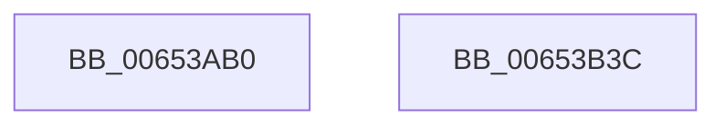

# EtwpWriteProcessorTrace

- RVA: `0x00653AB0`–`0x00653B3D` (길이 `141` bytes)
- VA: `0x0000000140653AB0`
- 실행 섹션: `.text`
- PDB 이름 있음: `예`; PDB Function 태그: `아니요`
- unwind 정보 RVA: `0x00065FB8`
- 디코드: `32`개 명령, `141/141` bytes 표시
- 미해석 바이트: `0` (있으면 어셈블리에 `.byte`로 보존)

> 이 문서는 커널 이미지의 기계어와 PDB 기호를 분석해 생성했습니다. 4번과 5번은 함수 원형과 자료형을 바이너리 사용 방식에서 추정한 C 해석이며 원본 소스 복구 결과는 아닙니다.

## 1. Dependencies

- 직접 호출 지점: **2**; 고유 호출 대상: **2**
- 직접 호출자로 확인된 함수: **0**
- RIP 상대 이미지 참조: **1**

### Outgoing calls
- `0x00653B25` → [EtwpLogKernelEvent](../25/EtwpLogKernelEvent_function_0025CC00.md) (function, `0x0025CC00`)
- `0x00653B32` → [_security_check_cookie](../6A/_security_check_cookie_function_006AC640.md) (function, `0x006AC640`)

### Direct callers
- 이 함수 시작 RVA로 연결되는 직접 call은 확인되지 않았습니다. 간접 호출은 완전히 역산할 수 없습니다.

### Static image references
- `0x00653AB7` → RVA `0x00E0A740` (`.data`; read)

## 2. Other-region calls and transfers

- 다른 실행 섹션으로 향하는 call: **0**
- 별도 외부 분기/꼬리 이동을 확인하지 못했습니다.

## 3. Assembly (complete function range)

```asm
00653AB0  4C 8B DC                        mov r11, rsp
00653AB3  48 83 EC 68                     sub rsp, 0x68
00653AB7  48 8B 05 82 6C 7B 00            mov rax, qword ptr [rip + 0x7b6c82]
00653ABE  48 33 C4                        xor rax, rsp
00653AC1  48 89 44 24 50                  mov qword ptr [rsp + 0x50], rax
00653AC6  44 8B 51 30                     mov r10d, dword ptr [rcx + 0x30]
00653ACA  48 8D 41 08                     lea rax, [rcx + 8]
00653ACE  44 89 49 24                     mov dword ptr [rcx + 0x24], r9d
00653AD2  41 81 E2 02 E6 FF FF            and r10d, 0xffffe602
00653AD9  49 89 43 C8                     mov qword ptr [r11 - 0x38], rax
00653ADD  41 83 CA 02                     or r10d, 2
00653AE1  83 64 24 3C 00                  and dword ptr [rsp + 0x3c], 0
00653AE6  41 B9 02 00 00 00               mov r9d, 2
00653AEC  44 89 51 30                     mov dword ptr [rcx + 0x30], r10d
00653AF0  44 89 41 20                     mov dword ptr [rcx + 0x20], r8d
00653AF4  C7 44 24 38 20 00 00 00         mov dword ptr [rsp + 0x38], 0x20
00653AFC  49 89 53 D8                     mov qword ptr [r11 - 0x28], rdx
00653B00  48 8B 11                        mov rdx, qword ptr [rcx]
00653B03  49 8D 4B C8                     lea rcx, [r11 - 0x38]
00653B07  45 89 43 E0                     mov dword ptr [r11 - 0x20], r8d
00653B0B  83 64 24 4C 00                  and dword ptr [rsp + 0x4c], 0
00653B10  45 89 53 C0                     mov dword ptr [r11 - 0x40], r10d
00653B14  44 8B 02                        mov r8d, dword ptr [rdx]
00653B17  48 8B 92 50 05 00 00            mov rdx, qword ptr [rdx + 0x550]
00653B1E  66 C7 44 24 20 20 1F            mov word ptr [rsp + 0x20], 0x1f20
00653B25  E8 D6 90 C0 FF                  call 0x14025cc00
00653B2A  48 8B 4C 24 50                  mov rcx, qword ptr [rsp + 0x50]
00653B2F  48 33 CC                        xor rcx, rsp
00653B32  E8 09 8B 05 00                  call 0x1406ac640
00653B37  48 83 C4 68                     add rsp, 0x68
00653B3B  C3                              ret
00653B3C  CC                              int3
```

## 4. C-style interpretation (structured pseudocode)

```c
__int64 __fastcall EtwpWriteProcessorTrace(__int64 a1, __int64 a2, int a3, int a4)
{
    __int64 result;
    __int64 v_r10;
    __int64 v_rsp;
    unsigned __int64 v_stack_m18;
    unsigned int v_stack_m1C;
    unsigned int v_stack_m2C;
    unsigned int v_stack_m30;
    unsigned __int16 v_stack_m48;

    v_rsp = (v_rsp) - (104);
    result = (*(unsigned __int64 *)(v_rip + 8088706)) ^ (v_rsp);
    v_stack_m18 = result;
    *(unsigned int *)(a1 + 36) = a4;
    v_r10 = (unsigned int)(((unsigned int)(*(unsigned int *)(a1 + 48))) & (0xFFFFE602ULL));
    *(unsigned __int64 *)(v_rsp - 56) = a1 + 8;
    v_r10 = (unsigned int)((v_r10) | (2));
    *(unsigned int *)(a1 + 48) = (unsigned int)(v_r10);
    *(unsigned int *)(a1 + 32) = a3;
    v_stack_m30 = 32;
    *(unsigned __int64 *)(v_rsp - 40) = a2;
    *(unsigned int *)(v_rsp - 32) = a3;
    *(unsigned int *)(v_rsp - 64) = (unsigned int)(v_r10);
    v_stack_m48 = 0x1F20ULL;
    result = EtwpLogKernelEvent(v_rsp - 56, *(unsigned __int64 *)(*(unsigned __int64 *)(a1) + 1360), (unsigned int)(*(unsigned int *)(*(unsigned __int64 *)(a1))), 2);
    a1 = (v_stack_m18) ^ (v_rsp);
    result = _security_check_cookie(a1, *(unsigned __int64 *)(*(unsigned __int64 *)(a1) + 1360), (unsigned int)(*(unsigned int *)(*(unsigned __int64 *)(a1))), 2);
    v_rsp = (v_rsp) + (104);
    return result;
}
```

## 5. (Beta) C Style

```c
int64_t EtwpWriteProcessorTrace(void *Arg1, int64_t Arg2, int32_t Arg3, int32_t Arg4)
{
    uint8_t *arg1 = (uint8_t *)Arg1;

    int64_t result;
    int64_t local_r10;
    int64_t local_rsp;
    uint64_t v_stack_m18;
    uint32_t v_stack_m1C;
    uint32_t v_stack_m2C;
    uint32_t v_stack_m30;
    uint16_t v_stack_m48;

    local_rsp = (local_rsp) - (104);
    result = (*(uint64_t *)(v_rip + 0x7B6C82)) ^ (local_rsp);
    v_stack_m18 = result;
    *(uint32_t *)(arg1 + 0x24) = Arg4;
    local_r10 = (uint32_t)(((uint32_t)(*(uint32_t *)(arg1 + 0x30))) & (0xFFFFE602ULL));
    *(void **)(local_rsp - 0x38) = Arg1 + 8;
    local_r10 = (uint32_t)((local_r10) | (2));
    *(uint32_t *)(arg1 + 0x30) = (uint32_t)(local_r10);
    *(uint32_t *)(arg1 + 0x20) = Arg3;
    v_stack_m30 = 32;
    *(uint64_t *)(local_rsp - 0x28) = Arg2;
    *(uint32_t *)(local_rsp - 0x20) = Arg3;
    *(uint32_t *)(local_rsp - 0x40) = (uint32_t)(local_r10);
    v_stack_m48 = 0x1F20ULL;
    result = EtwpLogKernelEvent(local_rsp - 56, *(uint64_t *)(*(uint64_t *)(arg1) + 0x550), (uint32_t)(*(uint32_t *)(*(uint64_t *)(arg1))), 2);
    Arg1 = (v_stack_m18) ^ (local_rsp);
    result = _security_check_cookie(Arg1, *(uint64_t *)(*(uint64_t *)(arg1) + 0x550), (uint32_t)(*(uint32_t *)(*(uint64_t *)(arg1))), 2);
    local_rsp = (local_rsp) + (104);
    return result;
}
```

### 관측된 메모리 오프셋

구조체 형식이 확인되지 않은 접근은 인자 기준의 오프셋으로만 기록했습니다.

| 기준 인자 | 오프셋 표현 | 폭 (bit) | 접근 |
|---|---:|---:|---|
| `Arg1` | `+ 0x0` | `64` | `R` |
| `Arg1` | `+ 0x8` | `64` | `R` |
| `Arg1` | `+ 0x20` | `32` | `W` |
| `Arg1` | `+ 0x24` | `32` | `W` |
| `Arg1` | `+ 0x30` | `32` | `R` |
| `Arg1` | `+ 0x30` | `32` | `W` |

## 6. Execution-region graph

[열기: 2D/3D 그래프와 함수 탐색 컨트롤 패널](../../../control-panel.html?section=text&rva=0x00653AB0&view=graph)

- 2D 그래프는 위에서 아래로 흐르고, 3D 그래프는 빈 공간을 드래그해 회전합니다. Shift+드래그는 이동, 휠은 확대·축소, 함수 노드 선택은 대상 보고서 이동입니다.

### Static fallback


