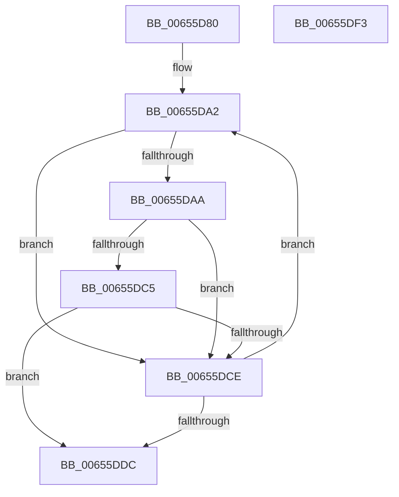

# ExAddPrivateDataToCrashDump

- RVA: `0x00655D80`–`0x00655DF4` (길이 `116` bytes)
- VA: `0x0000000140655D80`
- 실행 섹션: `.text`
- PDB 이름 있음: `예`; PDB Function 태그: `아니요`
- unwind 정보 RVA: `0x0005C954`
- 디코드: `34`개 명령, `116/116` bytes 표시
- 미해석 바이트: `0` (있으면 어셈블리에 `.byte`로 보존)

> 이 문서는 커널 이미지의 기계어와 PDB 기호를 분석해 생성했습니다. 4번과 5번은 함수 원형과 자료형을 바이너리 사용 방식에서 추정한 C 해석이며 원본 소스 복구 결과는 아닙니다.

## 1. Dependencies

- 직접 호출 지점: **1**; 고유 호출 대상: **1**
- 직접 호출자로 확인된 함수: **2**
- RIP 상대 이미지 참조: **2**

### Outgoing calls
- `0x00655DBC` → [MmAddRangeToCrashDump](../67/MmAddRangeToCrashDump_function_0067D8B0.md) (function, `0x0067D8B0`)

### Direct callers
- [IopLiveDumpAddPoolTrackTables](../59/IopLiveDumpAddPoolTrackTables_function_00598FF0.md) at `0x00598FF7`
- [IopAddLiveDumpPagesToPartialKernelDump](../5A/IopAddLiveDumpPagesToPartialKernelDump_function_005A13AC.md) at `0x005A1618`

### Static image references
- `0x00655D96` → RVA `0x00EFAD20` (`.data`; read)
- `0x00655DAA` → RVA `0x00EFED50` (`.data`; read)

## 2. Other-region calls and transfers

- 다른 실행 섹션으로 향하는 call: **0**
- 별도 외부 분기/꼬리 이동을 확인하지 못했습니다.

## 3. Assembly (complete function range)

```asm
00655D80  48 89 5C 24 08                  mov qword ptr [rsp + 8], rbx
00655D85  48 89 6C 24 10                  mov qword ptr [rsp + 0x10], rbp
00655D8A  48 89 74 24 18                  mov qword ptr [rsp + 0x18], rsi
00655D8F  57                              push rdi
00655D90  48 83 EC 20                     sub rsp, 0x20
00655D94  33 F6                           xor esi, esi
00655D96  48 8D 3D 83 4F 8A 00            lea rdi, [rip + 0x8a4f83]
00655D9D  33 DB                           xor ebx, ebx
00655D9F  48 8B E9                        mov rbp, rcx
00655DA2  48 8B 17                        mov rdx, qword ptr [rdi]
00655DA5  48 85 D2                        test rdx, rdx
00655DA8  74 24                           je 0x140655dce
00655DAA  48 8B 05 9F 8F 8A 00            mov rax, qword ptr [rip + 0x8a8f9f]
00655DB1  48 8B CD                        mov rcx, rbp
00655DB4  4C 8D 04 80                     lea r8, [rax + rax*4]
00655DB8  49 C1 E0 04                     shl r8, 4
00655DBC  E8 EF 7A 02 00                  call 0x14067d8b0
00655DC1  85 C0                           test eax, eax
00655DC3  79 09                           jns 0x140655dce
00655DC5  8B F0                           mov esi, eax
00655DC7  3D 23 00 00 C0                  cmp eax, 0xc0000023
00655DCC  74 0E                           je 0x140655ddc
00655DCE  FF C3                           inc ebx
00655DD0  48 83 C7 08                     add rdi, 8
00655DD4  81 FB 00 08 00 00               cmp ebx, 0x800
00655DDA  72 C6                           jb 0x140655da2
00655DDC  48 8B 5C 24 30                  mov rbx, qword ptr [rsp + 0x30]
00655DE1  8B C6                           mov eax, esi
00655DE3  48 8B 74 24 40                  mov rsi, qword ptr [rsp + 0x40]
00655DE8  48 8B 6C 24 38                  mov rbp, qword ptr [rsp + 0x38]
00655DED  48 83 C4 20                     add rsp, 0x20
00655DF1  5F                              pop rdi
00655DF2  C3                              ret
00655DF3  CC                              int3
```

## 4. C-style interpretation (structured pseudocode)

```c
__int64 __fastcall ExAddPrivateDataToCrashDump(__int64 a1)
{
    __int64 result;
    __int64 v_rbx;
    __int64 v_rdi;
    __int64 v_rsi;
    __int64 v_rsp;
    unsigned __int64 v_stack_p10;
    unsigned __int64 v_stack_p18;
    unsigned __int64 v_stack_p8;

    v_stack_p8 = v_rbx;
    v_stack_p10 = v_rbp;
    v_stack_p18 = v_rsi;
    v_rsp = (v_rsp) - (32);
    v_rsi = 0;
    v_rbx = 0;
loc_00655DA2:
    if (*(unsigned __int64 *)(v_rip + 9064323) == 0) goto loc_00655DCE;
    a3 = (*(unsigned __int64 *)(v_rip + 9080735) + *(unsigned __int64 *)(v_rip + 9080735) * 4) << (4);
    result = MmAddRangeToCrashDump(a1, *(unsigned __int64 *)(v_rip + 9064323), a3, a4);
    if (!sign_flag) goto loc_00655DCE;
    if (((unsigned int)(result)) == 0xC0000023ULL) goto loc_00655DDC;
loc_00655DCE:
    v_rbx = (unsigned int)((v_rbx) + 1);
    v_rdi = (v_rip + 9064323) + (8);
    if (((unsigned int)(v_rbx)) < 0x800ULL) goto loc_00655DA2;
loc_00655DDC:
    v_rsp = (v_rsp) + (32);
    return (unsigned int)((unsigned int)((unsigned int)((unsigned int)(result))));
}
```

## 5. (Beta) C Style

```c
int64_t ExAddPrivateDataToCrashDump(int64_t Arg1)
{
    int64_t result;
    int64_t local_rbx;
    int64_t local_rdi;
    int64_t local_rsi;
    int64_t local_rsp;
    uint64_t v_stack_p10;
    uint64_t v_stack_p18;
    uint64_t v_stack_p8;

    v_stack_p8 = local_rbx;
    v_stack_p10 = local_rbp;
    v_stack_p18 = local_rsi;
    local_rsp = (local_rsp) - (32);
    local_rsi = 0;
    local_rbx = 0;
loc_00655DA2:
    if (*(uint64_t *)(v_rip + 0x8A4F83) == 0) goto loc_00655DCE;
    a3 = (*(uint64_t *)(v_rip + 0x8A8F9F) + *(uint64_t *)(v_rip + 0x8A8F9F) * 4) << (4);
    result = MmAddRangeToCrashDump(Arg1, *(uint64_t *)(v_rip + 0x8A4F83), a3, a4);
    if (!sign_flag) goto loc_00655DCE;
    if (((uint32_t)(result)) == 0xC0000023ULL) goto loc_00655DDC;
loc_00655DCE:
    local_rbx = (uint32_t)((local_rbx) + 1);
    local_rdi = (v_rip + 9064323) + (8);
    if (((uint32_t)(local_rbx)) < 0x800ULL) goto loc_00655DA2;
loc_00655DDC:
    local_rsp = (local_rsp) + (32);
    return (uint32_t)((uint32_t)((uint32_t)((uint32_t)(result))));
}
```

## 6. Execution-region graph

[열기: 2D/3D 그래프와 함수 탐색 컨트롤 패널](../../../control-panel.html?section=text&rva=0x00655D80&view=graph)

- 2D 그래프는 위에서 아래로 흐르고, 3D 그래프는 빈 공간을 드래그해 회전합니다. Shift+드래그는 이동, 휠은 확대·축소, 함수 노드 선택은 대상 보고서 이동입니다.

### Static fallback


