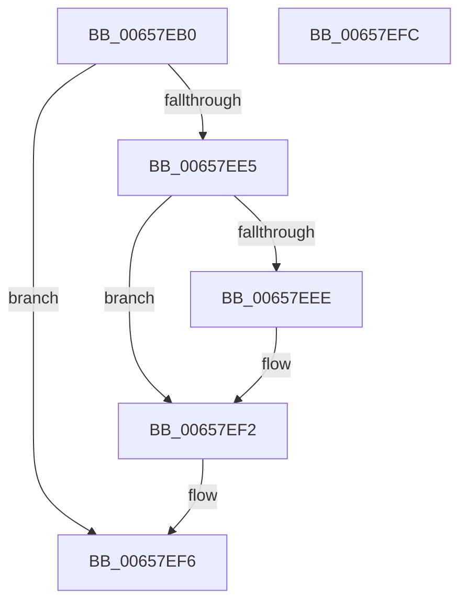

# ExAllocateAutoExpandPushLock

- RVA: `0x00657EB0`–`0x00657EFD` (길이 `77` bytes)
- VA: `0x0000000140657EB0`
- 실행 섹션: `.text`
- PDB 이름 있음: `예`; PDB Function 태그: `아니요`
- unwind 정보 RVA: `0x0005CF00`
- 디코드: `23`개 명령, `77/77` bytes 표시
- 미해석 바이트: `0` (있으면 어셈블리에 `.byte`로 보존)

> 이 문서는 커널 이미지의 기계어와 PDB 기호를 분석해 생성했습니다. 4번과 5번은 함수 원형과 자료형을 바이너리 사용 방식에서 추정한 C 해석이며 원본 소스 복구 결과는 아닙니다.

## 1. Dependencies

- 직접 호출 지점: **1**; 고유 호출 대상: **1**
- 직접 호출자로 확인된 함수: **0**
- RIP 상대 이미지 참조: **0**

### Outgoing calls
- `0x00657EDB` → [ExAllocatePool2](../../poolcode/B8/ExAllocatePool2_function_00B820F0.md) (function, `0x00B820F0`)

### Direct callers
- 이 함수 시작 RVA로 연결되는 직접 call은 확인되지 않았습니다. 간접 호출은 완전히 역산할 수 없습니다.

### Static image references
- 디코드된 RIP-relative 메모리 참조가 없습니다.

## 2. Other-region calls and transfers

- 다른 실행 섹션으로 향하는 call: **1**
  - `0x00657EDB` → [ExAllocatePool2](../../poolcode/B8/ExAllocatePool2_function_00B820F0.md) (`.text` → `POOLCODE`)
- 별도 외부 분기/꼬리 이동을 확인하지 못했습니다.

## 3. Assembly (complete function range)

```asm
00657EB0  40 53                           push rbx
00657EB2  48 83 EC 20                     sub rsp, 0x20
00657EB6  8B D9                           mov ebx, ecx
00657EB8  BA 10 00 00 00                  mov edx, 0x10
00657EBD  83 E3 01                        and ebx, 1
00657EC0  41 B8 41 65 70 6C               mov r8d, 0x6c706541
00657EC6  8B C3                           mov eax, ebx
00657EC8  F7 D8                           neg eax
00657ECA  48 1B C9                        sbb rcx, rcx
00657ECD  48 81 E1 40 FF FF FF            and rcx, 0xffffffffffffff40
00657ED4  48 81 C1 00 01 00 00            add rcx, 0x100
00657EDB  E8 10 A2 52 00                  call 0x140b820f0
00657EE0  48 85 C0                        test rax, rax
00657EE3  74 11                           je 0x140657ef6
00657EE5  48 83 60 08 00                  and qword ptr [rax + 8], 0
00657EEA  85 DB                           test ebx, ebx
00657EEC  75 04                           jne 0x140657ef2
00657EEE  83 48 08 04                     or dword ptr [rax + 8], 4
00657EF2  48 83 20 00                     and qword ptr [rax], 0
00657EF6  48 83 C4 20                     add rsp, 0x20
00657EFA  5B                              pop rbx
00657EFB  C3                              ret
00657EFC  CC                              int3
```

## 4. C-style interpretation (structured pseudocode)

```c
__int64 __fastcall ExAllocateAutoExpandPushLock(__int64 a1)
{
    __int64 result;
    __int64 v_rbx;
    __int64 v_rsp;

    v_rsp = (v_rsp) - (32);
    v_rbx = (unsigned int)(((unsigned int)((unsigned int)(a1))) & (1));
    result = (unsigned int)(-((unsigned int)((unsigned int)(v_rbx))));
    a1 = (a1) & (-192);
    a1 = (a1) + (256);
    result = ExAllocatePool2(a1, 16, (unsigned int)(0x6C706541ULL), a4);
    if (result == 0) goto loc_00657EF6;
    if ((unsigned int)(v_rbx) == 0) {
    }
loc_00657EF6:
    v_rsp = (v_rsp) + (32);
    return result;
}
```

## 5. (Beta) C Style

```c
int64_t ExAllocateAutoExpandPushLock(int64_t Arg1)
{
    int64_t result;
    int64_t local_rbx;
    int64_t local_rsp;

    local_rsp = (local_rsp) - (32);
    local_rbx = (uint32_t)(((uint32_t)((uint32_t)(Arg1))) & (1));
    result = (uint32_t)(-((uint32_t)((uint32_t)(local_rbx))));
    Arg1 = (Arg1) & (-192);
    Arg1 = (Arg1) + (256);
    result = ExAllocatePool2(Arg1, 16, (uint32_t)(0x6C706541ULL), a4);
    if (result == 0) goto loc_00657EF6;
    if ((uint32_t)(local_rbx) == 0) {
    }
loc_00657EF6:
    local_rsp = (local_rsp) + (32);
    return result;
}
```

## 6. Execution-region graph

[열기: 2D/3D 그래프와 함수 탐색 컨트롤 패널](../../../control-panel.html?section=text&rva=0x00657EB0&view=graph)

- 2D 그래프는 위에서 아래로 흐르고, 3D 그래프는 빈 공간을 드래그해 회전합니다. Shift+드래그는 이동, 휠은 확대·축소, 함수 노드 선택은 대상 보고서 이동입니다.

### Static fallback


