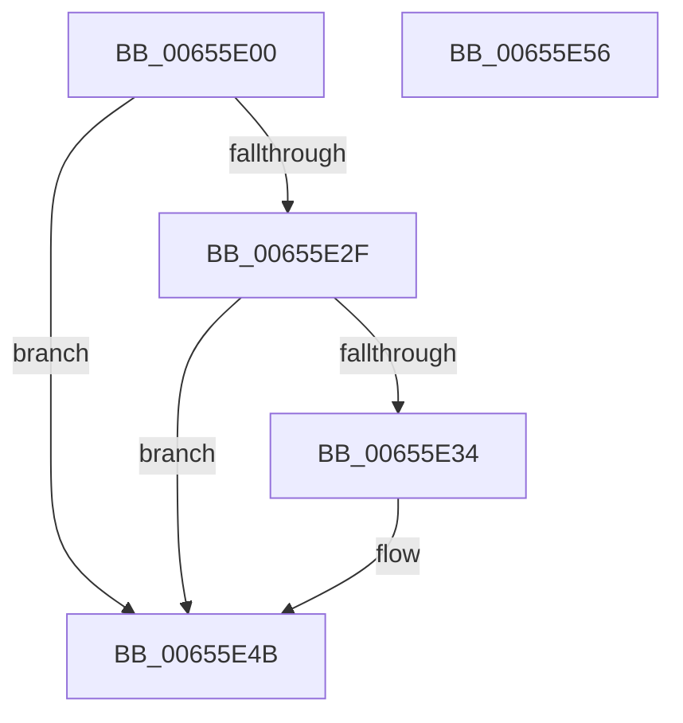

# ExAllocatePoolWithQuota

- RVA: `0x00655E00`–`0x00655E57` (길이 `87` bytes)
- VA: `0x0000000140655E00`
- 실행 섹션: `.text`
- PDB 이름 있음: `예`; PDB Function 태그: `아니요`
- unwind 정보 RVA: `0x0006E5F8`
- 디코드: `27`개 명령, `87/87` bytes 표시
- 미해석 바이트: `0` (있으면 어셈블리에 `.byte`로 보존)

> 이 문서는 커널 이미지의 기계어와 PDB 기호를 분석해 생성했습니다. 4번과 5번은 함수 원형과 자료형을 바이너리 사용 방식에서 추정한 C 해석이며 원본 소스 복구 결과는 아닙니다.

## 1. Dependencies

- 직접 호출 지점: **3**; 고유 호출 대상: **3**
- 직접 호출자로 확인된 함수: **1**
- RIP 상대 이미지 참조: **0**

### Outgoing calls
- `0x00655E14` → [ExpPoolTypeToPoolFlags](../../poolcode/B8/ExpPoolTypeToPoolFlags_function_00B841C0.md) (function, `0x00B841C0`)
- `0x00655E25` → [ExAllocatePool2](../../poolcode/B8/ExAllocatePool2_function_00B820F0.md) (function, `0x00B820F0`)
- `0x00655E45` → [KeBugCheckEx](../4F/KeBugCheckEx_function_004FD660.md) (function, `0x004FD660`)

### Direct callers
- [VerifierExAllocatePoolWithQuota](../../pagevrfy/BA/VerifierExAllocatePoolWithQuota_function_00BA1470.md) at `0x00BA14E4`

### Static image references
- 디코드된 RIP-relative 메모리 참조가 없습니다.

## 2. Other-region calls and transfers

- 다른 실행 섹션으로 향하는 call: **2**
  - `0x00655E14` → [ExpPoolTypeToPoolFlags](../../poolcode/B8/ExpPoolTypeToPoolFlags_function_00B841C0.md) (`.text` → `POOLCODE`)
  - `0x00655E25` → [ExAllocatePool2](../../poolcode/B8/ExAllocatePool2_function_00B820F0.md) (`.text` → `POOLCODE`)
- 별도 외부 분기/꼬리 이동을 확인하지 못했습니다.

## 3. Assembly (complete function range)

```asm
00655E00  48 89 5C 24 08                  mov qword ptr [rsp + 8], rbx
00655E05  57                              push rdi
00655E06  48 83 EC 30                     sub rsp, 0x30
00655E0A  48 8B FA                        mov rdi, rdx
00655E0D  8B D9                           mov ebx, ecx
00655E0F  BA 01 00 00 00                  mov edx, 1
00655E14  E8 A7 E3 52 00                  call 0x140b841c0
00655E19  48 8B C8                        mov rcx, rax
00655E1C  41 B8 4E 6F 6E 65               mov r8d, 0x656e6f4e
00655E22  48 8B D7                        mov rdx, rdi
00655E25  E8 C6 C2 52 00                  call 0x140b820f0
00655E2A  48 85 C0                        test rax, rax
00655E2D  75 1C                           jne 0x140655e4b
00655E2F  F6 C3 02                        test bl, 2
00655E32  74 17                           je 0x140655e4b
00655E34  48 21 44 24 20                  and qword ptr [rsp + 0x20], rax
00655E39  8D 48 41                        lea ecx, [rax + 0x41]
00655E3C  45 33 C9                        xor r9d, r9d
00655E3F  45 33 C0                        xor r8d, r8d
00655E42  48 8B D7                        mov rdx, rdi
00655E45  E8 16 78 EA FF                  call 0x1404fd660
00655E4A  CC                              int3
00655E4B  48 8B 5C 24 40                  mov rbx, qword ptr [rsp + 0x40]
00655E50  48 83 C4 30                     add rsp, 0x30
00655E54  5F                              pop rdi
00655E55  C3                              ret
00655E56  CC                              int3
```

## 4. C-style interpretation (structured pseudocode)

```c
__int64 __fastcall ExAllocatePoolWithQuota(int a1, __int64 a2, __int64 a3, int a4)
{
    __int64 result;
    __int64 v_rsp;
    unsigned __int64 v_stack_m18;
    unsigned __int64 v_stack_p8;

    v_stack_p8 = v_rbx;
    v_rsp = (v_rsp) - (48);
    result = ExpPoolTypeToPoolFlags(a1, 1, a3, a4);
    result = ExAllocatePool2(result, a2, (unsigned int)(0x656E6F4EULL), a4);
    if (result != 0) goto loc_00655E4B;
    if ((((unsigned __int8)((unsigned int)(a1))) & (2)) != 0) {
        a1 = result + 65;
        a4 = 0;
        a3 = 0;
        a2 = a2;
        result = KeBugCheckEx(a1, a2, a3, a4);
    }
    v_rsp = (v_rsp) + (48);
    return result;
}
```

## 5. (Beta) C Style

```c
int64_t ExAllocatePoolWithQuota(int32_t Arg1, int64_t Arg2, int64_t Arg3, int32_t Arg4)
{
    int64_t result;
    int64_t local_rsp;
    uint64_t v_stack_m18;
    uint64_t v_stack_p8;

    v_stack_p8 = local_rbx;
    local_rsp = (local_rsp) - (48);
    result = ExpPoolTypeToPoolFlags(Arg1, 1, Arg3, Arg4);
    result = ExAllocatePool2(result, Arg2, (uint32_t)(0x656E6F4EULL), Arg4);
    if (result != 0) goto loc_00655E4B;
    if ((((uint8_t)((uint32_t)(Arg1))) & (2)) != 0) {
        Arg1 = result + 65;
        Arg4 = 0;
        Arg3 = 0;
        Arg2 = Arg2;
        result = KeBugCheckEx(Arg1, Arg2, Arg3, Arg4);
    }
    local_rsp = (local_rsp) + (48);
    return result;
}
```

## 6. Execution-region graph

[열기: 2D/3D 그래프와 함수 탐색 컨트롤 패널](../../../control-panel.html?section=text&rva=0x00655E00&view=graph)

- 2D 그래프는 위에서 아래로 흐르고, 3D 그래프는 빈 공간을 드래그해 회전합니다. Shift+드래그는 이동, 휠은 확대·축소, 함수 노드 선택은 대상 보고서 이동입니다.

### Static fallback


