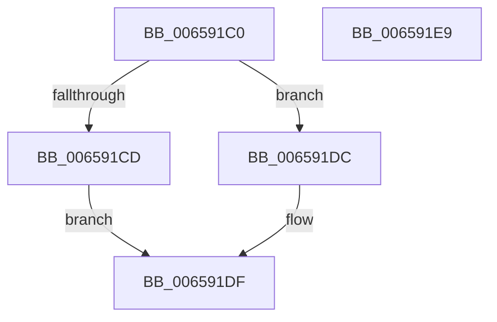

# ExAllocateTimerInternal

- RVA: `0x006591C0`–`0x006591EA` (길이 `42` bytes)
- VA: `0x00000001406591C0`
- 실행 섹션: `.text`
- PDB 이름 있음: `예`; PDB Function 태그: `아니요`
- unwind 정보 RVA: `0x0005C788`
- 디코드: `12`개 명령, `42/42` bytes 표시
- 미해석 바이트: `0` (있으면 어셈블리에 `.byte`로 보존)

> 이 문서는 커널 이미지의 기계어와 PDB 기호를 분석해 생성했습니다. 4번과 5번은 함수 원형과 자료형을 바이너리 사용 방식에서 추정한 C 해석이며 원본 소스 복구 결과는 아닙니다.

## 1. Dependencies

- 직접 호출 지점: **1**; 고유 호출 대상: **1**
- 직접 호출자로 확인된 함수: **0**
- RIP 상대 이미지 참조: **0**

### Outgoing calls
- `0x006591DF` → [ExAllocateTimerInternal2](../3A/ExAllocateTimerInternal2_function_003A3110.md) (function, `0x003A3110`)

### Direct callers
- 이 함수 시작 RVA로 연결되는 직접 call은 확인되지 않았습니다. 간접 호출은 완전히 역산할 수 없습니다.

### Static image references
- 디코드된 RIP-relative 메모리 참조가 없습니다.

## 2. Other-region calls and transfers

- 다른 실행 섹션으로 향하는 call: **0**
- 별도 외부 분기/꼬리 이동을 확인하지 못했습니다.

## 3. Assembly (complete function range)

```asm
006591C0  48 83 EC 28                     sub rsp, 0x28
006591C4  45 8B C8                        mov r9d, r8d
006591C7  41 F6 C0 02                     test r8b, 2
006591CB  74 0F                           je 0x1406591dc
006591CD  C7 44 24 40 01 00 00 00         mov dword ptr [rsp + 0x40], 1
006591D5  4C 8D 44 24 40                  lea r8, [rsp + 0x40]
006591DA  EB 03                           jmp 0x1406591df
006591DC  45 33 C0                        xor r8d, r8d
006591DF  E8 2C 9F D4 FF                  call 0x1403a3110
006591E4  48 83 C4 28                     add rsp, 0x28
006591E8  C3                              ret
006591E9  CC                              int3
```

## 4. C-style interpretation (structured pseudocode)

```c
__int64 __fastcall ExAllocateTimerInternal(__int64 a1, __int64 a2, int a3)
{
    __int64 result;
    __int64 v_rsp;
    unsigned int v_stack_p18;

    v_rsp = (v_rsp) - (40);
    if ((((unsigned __int8)(a3)) & (2)) == 0) goto loc_006591DC;
    v_stack_p18 = 1;
    goto loc_006591DF;
loc_006591DC:
    a3 = 0;
loc_006591DF:
    result = ExAllocateTimerInternal2(a1, a2, a3, (unsigned int)(a3));
    v_rsp = (v_rsp) + (40);
    return result;
}
```

## 5. (Beta) C Style

```c
int64_t ExAllocateTimerInternal(int64_t Arg1, int64_t Arg2, int32_t Arg3)
{
    int64_t result;
    int64_t local_rsp;
    uint32_t v_stack_p18;

    local_rsp = (local_rsp) - (40);
    if ((((uint8_t)(Arg3)) & (2)) == 0) goto loc_006591DC;
    v_stack_p18 = 1;
    goto loc_006591DF;
loc_006591DC:
    Arg3 = 0;
loc_006591DF:
    result = ExAllocateTimerInternal2(Arg1, Arg2, Arg3, (uint32_t)(Arg3));
    local_rsp = (local_rsp) + (40);
    return result;
}
```

## 6. Execution-region graph

[열기: 2D/3D 그래프와 함수 탐색 컨트롤 패널](../../../control-panel.html?section=text&rva=0x006591C0&view=graph)

- 2D 그래프는 위에서 아래로 흐르고, 3D 그래프는 빈 공간을 드래그해 회전합니다. Shift+드래그는 이동, 휠은 확대·축소, 함수 노드 선택은 대상 보고서 이동입니다.

### Static fallback


