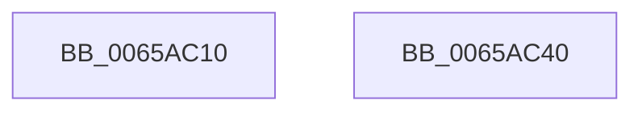

# ExAtsSvmDevicePowerCallback

- RVA: `0x0065AC10`–`0x0065AC41` (길이 `49` bytes)
- VA: `0x000000014065AC10`
- 실행 섹션: `.text`
- PDB 이름 있음: `예`; PDB Function 태그: `아니요`
- unwind 정보 RVA: `0x0005C788`
- 디코드: `12`개 명령, `49/49` bytes 표시
- 미해석 바이트: `0` (있으면 어셈블리에 `.byte`로 보존)

> 이 문서는 커널 이미지의 기계어와 PDB 기호를 분석해 생성했습니다. 4번과 5번은 함수 원형과 자료형을 바이너리 사용 방식에서 추정한 C 해석이며 원본 소스 복구 결과는 아닙니다.

## 1. Dependencies

- 직접 호출 지점: **1**; 고유 호출 대상: **1**
- 직접 호출자로 확인된 함수: **0**
- RIP 상대 이미지 참조: **2**

### Outgoing calls
- `0x0065AC36` → [guard_dispatch_icall](../6B/guard_dispatch_icall_function_006BAAD0.md) (function, `0x006BAAD0`)

### Direct callers
- 이 함수 시작 RVA로 연결되는 직접 call은 확인되지 않았습니다. 간접 호출은 완전히 역산할 수 없습니다.

### Static image references
- `0x0065AC14` → RVA `0x00E06D28` (`.data`; read)
- `0x0065AC1E` → RVA `0x00EFA8E0` (`.data`; read)

## 2. Other-region calls and transfers

- 다른 실행 섹션으로 향하는 call: **0**
- 별도 외부 분기/꼬리 이동을 확인하지 못했습니다.

## 3. Assembly (complete function range)

```asm
0065AC10  48 83 EC 28                     sub rsp, 0x28
0065AC14  48 8B 05 0D C1 7A 00            mov rax, qword ptr [rip + 0x7ac10d]
0065AC1B  83 FA 01                        cmp edx, 1
0065AC1E  48 8B 0D BB FC 89 00            mov rcx, qword ptr [rip + 0x89fcbb]
0065AC25  4D 8B C8                        mov r9, r8
0065AC28  41 0F 94 C0                     sete r8b
0065AC2C  49 8B D1                        mov rdx, r9
0065AC2F  48 8B 80 80 00 00 00            mov rax, qword ptr [rax + 0x80]
0065AC36  E8 95 FE 05 00                  call 0x1406baad0
0065AC3B  48 83 C4 28                     add rsp, 0x28
0065AC3F  C3                              ret
0065AC40  CC                              int3
```

## 4. C-style interpretation (structured pseudocode)

```c
__int64 __fastcall ExAtsSvmDevicePowerCallback(__int64 a1, int a2, __int64 a3)
{
    __int64 result;
    __int64 v_rsp;

    v_rsp = (v_rsp) - (40);
    a3 = (a2 == 1) ? 1 : 0;
    result = guard_dispatch_icall(*(unsigned __int64 *)(v_rip + 9043131), a3, a3, a3);
    v_rsp = (v_rsp) + (40);
    return result;
}
```

## 5. (Beta) C Style

```c
int64_t ExAtsSvmDevicePowerCallback(int64_t Arg1, int32_t Arg2, int64_t Arg3)
{
    int64_t result;
    int64_t local_rsp;

    local_rsp = (local_rsp) - (40);
    Arg3 = (Arg2 == 1) ? 1 : 0;
    result = guard_dispatch_icall(*(uint64_t *)(v_rip + 0x89FCBB), Arg3, Arg3, Arg3);
    local_rsp = (local_rsp) + (40);
    return result;
}
```

## 6. Execution-region graph

[열기: 2D/3D 그래프와 함수 탐색 컨트롤 패널](../../../control-panel.html?section=text&rva=0x0065AC10&view=graph)

- 2D 그래프는 위에서 아래로 흐르고, 3D 그래프는 빈 공간을 드래그해 회전합니다. Shift+드래그는 이동, 휠은 확대·축소, 함수 노드 선택은 대상 보고서 이동입니다.

### Static fallback


