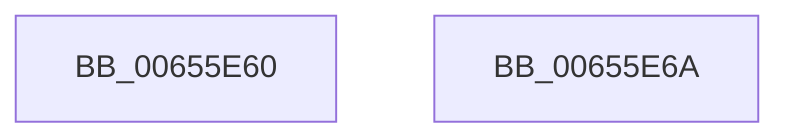

# ExClearPoolFlags

- RVA: `0x00655E60`–`0x00655E6B` (길이 `11` bytes)
- VA: `0x0000000140655E60`
- 실행 섹션: `.text`
- PDB 이름 있음: `예`; PDB Function 태그: `아니요`
- unwind 정보 RVA: `0x000DB714`
- 디코드: `4`개 명령, `11/11` bytes 표시
- 미해석 바이트: `0` (있으면 어셈블리에 `.byte`로 보존)

> 이 문서는 커널 이미지의 기계어와 PDB 기호를 분석해 생성했습니다. 4번과 5번은 함수 원형과 자료형을 바이너리 사용 방식에서 추정한 C 해석이며 원본 소스 복구 결과는 아닙니다.

## 1. Dependencies

- 직접 호출 지점: **0**; 고유 호출 대상: **0**
- 직접 호출자로 확인된 함수: **3**
- RIP 상대 이미지 참조: **1**

### Outgoing calls
- 직접 디코드된 call 명령이 없습니다.

### Direct callers
- [VfDriverRemoveDifVerification](../../pagevrfy/B9/VfDriverRemoveDifVerification_function_00B9A4E0.md) at `0x00B9A52A`
- [ViPtPluginUnload](../../pagevrfy/B9/ViPtPluginUnload_function_00B9CA40.md) at `0x00B9CA49`
- [VfSettingsApplyMiscellaneousChecks](../../pagevrfy/BA/VfSettingsApplyMiscellaneousChecks_function_00BAB210.md) at `0x00BAB23E`

### Static image references
- `0x00655E62` → RVA `0x00FC6BD0` (`ALMOSTRO`; read/write)

## 2. Other-region calls and transfers

- 다른 실행 섹션으로 향하는 call: **0**
- 별도 외부 분기/꼬리 이동을 확인하지 못했습니다.

## 3. Assembly (complete function range)

```asm
00655E60  F7 D1                           not ecx
00655E62  F0 21 0D 67 0D 97 00            lock and dword ptr [rip + 0x970d67], ecx
00655E69  C3                              ret
00655E6A  CC                              int3
```

## 4. C-style interpretation (structured pseudocode)

```c
void __fastcall ExClearPoolFlags(int a1)
{
    a1 = (unsigned int)(~(a1));
    return;
}
```

## 5. (Beta) C Style

```c
void ExClearPoolFlags(int32_t Arg1)
{
    Arg1 = (uint32_t)(~(Arg1));
    return;
}
```

## 6. Execution-region graph

[열기: 2D/3D 그래프와 함수 탐색 컨트롤 패널](../../../control-panel.html?section=text&rva=0x00655E60&view=graph)

- 2D 그래프는 위에서 아래로 흐르고, 3D 그래프는 빈 공간을 드래그해 회전합니다. Shift+드래그는 이동, 휠은 확대·축소, 함수 노드 선택은 대상 보고서 이동입니다.

### Static fallback


