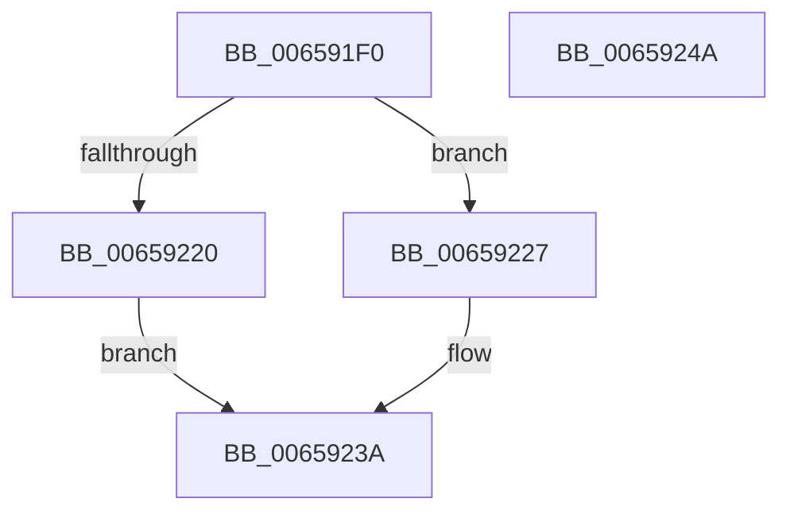

# ExCopyWakeTimerInfo

- RVA: `0x006591F0`–`0x0065924B` (길이 `91` bytes)
- VA: `0x00000001406591F0`
- 실행 섹션: `.text`
- PDB 이름 있음: `예`; PDB Function 태그: `아니요`
- unwind 정보 RVA: `0x00060BC4`
- 디코드: `27`개 명령, `91/91` bytes 표시
- 미해석 바이트: `0` (있으면 어셈블리에 `.byte`로 보존)

> 이 문서는 커널 이미지의 기계어와 PDB 기호를 분석해 생성했습니다. 4번과 5번은 함수 원형과 자료형을 바이너리 사용 방식에서 추정한 C 해석이며 원본 소스 복구 결과는 아닙니다.

## 1. Dependencies

- 직접 호출 지점: **2**; 고유 호출 대상: **2**
- 직접 호출자로 확인된 함수: **1**
- RIP 상대 이미지 참조: **0**

### Outgoing calls
- `0x00659213` → [ExAllocatePool2](../../poolcode/B8/ExAllocatePool2_function_00B820F0.md) (function, `0x00B820F0`)
- `0x00659230` → [memcpy](../6C/memcpy_function_006C6840.md) (function, `0x006C6840`)

### Direct callers
- [PopHandleWakeSources](../../pagelk/B6/PopHandleWakeSources_function_00B6C264.md) at `0x00B6C3C6`

### Static image references
- 디코드된 RIP-relative 메모리 참조가 없습니다.

## 2. Other-region calls and transfers

- 다른 실행 섹션으로 향하는 call: **1**
  - `0x00659213` → [ExAllocatePool2](../../poolcode/B8/ExAllocatePool2_function_00B820F0.md) (`.text` → `POOLCODE`)
- 별도 외부 분기/꼬리 이동을 확인하지 못했습니다.

## 3. Assembly (complete function range)

```asm
006591F0  48 89 5C 24 08                  mov qword ptr [rsp + 8], rbx
006591F5  48 89 74 24 10                  mov qword ptr [rsp + 0x10], rsi
006591FA  57                              push rdi
006591FB  48 83 EC 20                     sub rsp, 0x20
006591FF  48 8B F2                        mov rsi, rdx
00659202  48 8B D9                        mov rbx, rcx
00659205  48 8B 11                        mov rdx, qword ptr [rcx]
00659208  41 B8 54 72 57 53               mov r8d, 0x53577254
0065920E  B9 00 01 00 00                  mov ecx, 0x100
00659213  E8 D8 8E 52 00                  call 0x140b820f0
00659218  48 8B F8                        mov rdi, rax
0065921B  48 85 C0                        test rax, rax
0065921E  75 07                           jne 0x140659227
00659220  B8 9A 00 00 C0                  mov eax, 0xc000009a
00659225  EB 13                           jmp 0x14065923a
00659227  4C 8B 03                        mov r8, qword ptr [rbx]
0065922A  48 8B D3                        mov rdx, rbx
0065922D  48 8B CF                        mov rcx, rdi
00659230  E8 0B D6 06 00                  call 0x1406c6840
00659235  33 C0                           xor eax, eax
00659237  48 89 3E                        mov qword ptr [rsi], rdi
0065923A  48 8B 5C 24 30                  mov rbx, qword ptr [rsp + 0x30]
0065923F  48 8B 74 24 38                  mov rsi, qword ptr [rsp + 0x38]
00659244  48 83 C4 20                     add rsp, 0x20
00659248  5F                              pop rdi
00659249  C3                              ret
0065924A  CC                              int3
```

## 4. C-style interpretation (structured pseudocode)

```c
__int64 __fastcall ExCopyWakeTimerInfo(__int64 a1, __int64 a2)
{
    __int64 result;
    __int64 v_rsp;
    unsigned __int64 v_stack_p10;
    unsigned __int64 v_stack_p8;

    v_stack_p8 = v_rbx;
    v_stack_p10 = v_rsi;
    v_rsp = (v_rsp) - (32);
    result = ExAllocatePool2(256, *(unsigned __int64 *)(a1), (unsigned int)(0x53577254ULL), a4);
    if (result != 0) goto loc_00659227;
    goto loc_0065923A;
loc_00659227:
    result = memcpy(result, a1, *(unsigned __int64 *)(a1), a4);
    result = 0;
    *(unsigned __int64 *)(a2) = 0;
loc_0065923A:
    v_rsp = (v_rsp) + (32);
    return result;
}
```

## 5. (Beta) C Style

```c
int64_t ExCopyWakeTimerInfo(void *Arg1, void *Arg2)
{
    uint8_t *arg1 = (uint8_t *)Arg1;
    uint8_t *arg2 = (uint8_t *)Arg2;

    int64_t result;
    int64_t local_rsp;
    uint64_t v_stack_p10;
    uint64_t v_stack_p8;

    v_stack_p8 = local_rbx;
    v_stack_p10 = local_rsi;
    local_rsp = (local_rsp) - (32);
    result = ExAllocatePool2(256, *(uint64_t *)(arg1), (uint32_t)(0x53577254ULL), a4);
    if (result != 0) goto loc_00659227;
    goto loc_0065923A;
loc_00659227:
    result = memcpy(result, Arg1, *(uint64_t *)(arg1), a4);
    result = 0;
    *(uint64_t *)(arg2) = 0;
loc_0065923A:
    local_rsp = (local_rsp) + (32);
    return result;
}
```

### 관측된 메모리 오프셋

구조체 형식이 확인되지 않은 접근은 인자 기준의 오프셋으로만 기록했습니다.

| 기준 인자 | 오프셋 표현 | 폭 (bit) | 접근 |
|---|---:|---:|---|
| `Arg1` | `+ 0x0` | `64` | `R` |
| `Arg2` | `+ 0x0` | `64` | `W` |

## 6. Execution-region graph

[열기: 2D/3D 그래프와 함수 탐색 컨트롤 패널](../../../control-panel.html?section=text&rva=0x006591F0&view=graph)

- 2D 그래프는 위에서 아래로 흐르고, 3D 그래프는 빈 공간을 드래그해 회전합니다. Shift+드래그는 이동, 휠은 확대·축소, 함수 노드 선택은 대상 보고서 이동입니다.

### Static fallback


