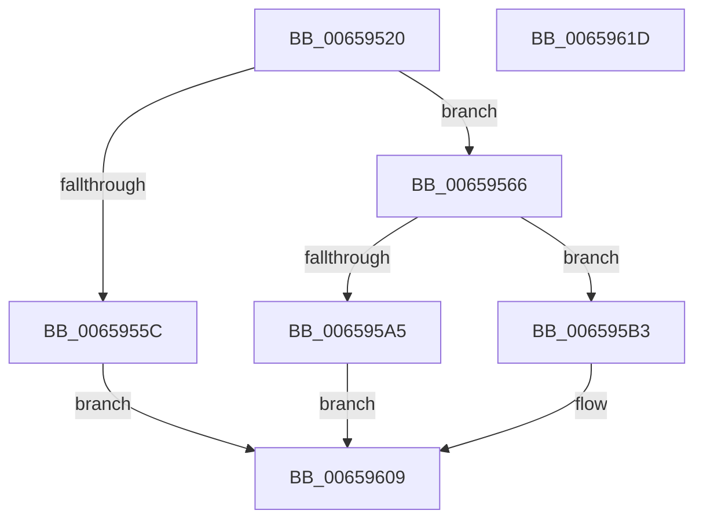

# ExCreateDpcEvent

- RVA: `0x00659520`–`0x0065961E` (길이 `254` bytes)
- VA: `0x0000000140659520`
- 실행 섹션: `.text`
- PDB 이름 있음: `예`; PDB Function 태그: `아니요`
- unwind 정보 RVA: `0x000D50C4`
- 디코드: `68`개 명령, `254/254` bytes 표시
- 미해석 바이트: `0` (있으면 어셈블리에 `.byte`로 보존)

> 이 문서는 커널 이미지의 기계어와 PDB 기호를 분석해 생성했습니다. 4번과 5번은 함수 원형과 자료형을 바이너리 사용 방식에서 추정한 C 해석이며 원본 소스 복구 결과는 아닙니다.

## 1. Dependencies

- 직접 호출 지점: **6**; 고유 호출 대상: **6**
- 직접 호출자로 확인된 함수: **0**
- RIP 상대 이미지 참조: **1**

### Outgoing calls
- `0x0065954F` → [ExAllocatePool2](../../poolcode/B8/ExAllocatePool2_function_00B820F0.md) (function, `0x00B820F0`)
- `0x0065959A` → [ObCreateObject](../../page/87/ObCreateObject_function_00872CB0.md) (function, `0x00872CB0`)
- `0x006595AA` → [ExFreePoolWithTag](../../poolcode/B8/ExFreePoolWithTag_function_00B82870.md) (function, `0x00B82870`)
- `0x006595D6` → [ObDeleteCapturedInsertInfo](../../page/87/ObDeleteCapturedInsertInfo_function_00876E90.md) (function, `0x00876E90`)
- `0x006595E3` → [ObfReferenceObjectWithTag](../21/ObfReferenceObjectWithTag_function_00210710.md) (function, `0x00210710`)
- `0x006595F0` → [ObfDereferenceObjectWithTag](../2F/ObfDereferenceObjectWithTag_function_002F78E0.md) (function, `0x002F78E0`)

### Direct callers
- 이 함수 시작 RVA로 연결되는 직접 call은 확인되지 않았습니다. 간접 호출은 완전히 역산할 수 없습니다.

### Static image references
- `0x00659566` → RVA `0x00FC6B80` (`ALMOSTRO`; read)

## 2. Other-region calls and transfers

- 다른 실행 섹션으로 향하는 call: **4**
  - `0x0065954F` → [ExAllocatePool2](../../poolcode/B8/ExAllocatePool2_function_00B820F0.md) (`.text` → `POOLCODE`)
  - `0x0065959A` → [ObCreateObject](../../page/87/ObCreateObject_function_00872CB0.md) (`.text` → `PAGE`)
  - `0x006595AA` → [ExFreePoolWithTag](../../poolcode/B8/ExFreePoolWithTag_function_00B82870.md) (`.text` → `POOLCODE`)
  - `0x006595D6` → [ObDeleteCapturedInsertInfo](../../page/87/ObDeleteCapturedInsertInfo_function_00876E90.md) (`.text` → `PAGE`)
- 별도 외부 분기/꼬리 이동을 확인하지 못했습니다.

## 3. Assembly (complete function range)

```asm
00659520  48 8B C4                        mov rax, rsp
00659523  48 89 58 08                     mov qword ptr [rax + 8], rbx
00659527  48 89 70 10                     mov qword ptr [rax + 0x10], rsi
0065952B  57                              push rdi
0065952C  41 56                           push r14
0065952E  41 57                           push r15
00659530  48 83 EC 50                     sub rsp, 0x50
00659534  48 83 60 20 00                  and qword ptr [rax + 0x20], 0
00659539  4C 8B F9                        mov r15, rcx
0065953C  B9 40 00 00 00                  mov ecx, 0x40
00659541  49 8B F0                        mov rsi, r8
00659544  4C 8B F2                        mov r14, rdx
00659547  41 B8 44 70 63 57               mov r8d, 0x57637044
0065954D  8B D1                           mov edx, ecx
0065954F  E8 9C 8B 52 00                  call 0x140b820f0
00659554  48 8B F8                        mov rdi, rax
00659557  48 85 C0                        test rax, rax
0065955A  75 0A                           jne 0x140659566
0065955C  B8 9A 00 00 C0                  mov eax, 0xc000009a
00659561  E9 A3 00 00 00                  jmp 0x140659609
00659566  48 8B 15 13 D6 96 00            mov rdx, qword ptr [rip + 0x96d613]
0065956D  48 8D 84 24 88 00 00 00         lea rax, [rsp + 0x88]
00659575  48 89 44 24 40                  mov qword ptr [rsp + 0x40], rax
0065957A  45 33 C9                        xor r9d, r9d
0065957D  83 64 24 38 00                  and dword ptr [rsp + 0x38], 0
00659582  45 33 C0                        xor r8d, r8d
00659585  83 64 24 30 00                  and dword ptr [rsp + 0x30], 0
0065958A  33 C9                           xor ecx, ecx
0065958C  C7 44 24 28 18 00 00 00         mov dword ptr [rsp + 0x28], 0x18
00659594  48 83 64 24 20 00               and qword ptr [rsp + 0x20], 0
0065959A  E8 11 97 21 00                  call 0x140872cb0
0065959F  8B D8                           mov ebx, eax
006595A1  85 C0                           test eax, eax
006595A3  79 0E                           jns 0x1406595b3
006595A5  33 D2                           xor edx, edx
006595A7  48 8B CF                        mov rcx, rdi
006595AA  E8 C1 92 52 00                  call 0x140b82870
006595AF  8B C3                           mov eax, ebx
006595B1  EB 56                           jmp 0x140659609
006595B3  48 8B 9C 24 88 00 00 00         mov rbx, qword ptr [rsp + 0x88]
006595BB  48 8B CB                        mov rcx, rbx
006595BE  83 63 04 00                     and dword ptr [rbx + 4], 0
006595C2  48 8D 43 08                     lea rax, [rbx + 8]
006595C6  66 C7 03 01 00                  mov word ptr [rbx], 1
006595CB  C6 43 02 06                     mov byte ptr [rbx + 2], 6
006595CF  48 89 40 08                     mov qword ptr [rax + 8], rax
006595D3  48 89 00                        mov qword ptr [rax], rax
006595D6  E8 B5 D8 21 00                  call 0x140876e90
006595DB  BA 45 78 44 65                  mov edx, 0x65447845
006595E0  48 8B CB                        mov rcx, rbx
006595E3  E8 28 71 BB FF                  call 0x140210710
006595E8  BA 44 66 6C 74                  mov edx, 0x746c6644
006595ED  48 8B CB                        mov rcx, rbx
006595F0  E8 EB E2 C9 FF                  call 0x1402f78e0
006595F5  48 89 77 30                     mov qword ptr [rdi + 0x30], rsi
006595F9  33 C0                           xor eax, eax
006595FB  48 89 5F 38                     mov qword ptr [rdi + 0x38], rbx
006595FF  C6 47 11 05                     mov byte ptr [rdi + 0x11], 5
00659603  49 89 3F                        mov qword ptr [r15], rdi
00659606  49 89 1E                        mov qword ptr [r14], rbx
00659609  48 8B 5C 24 70                  mov rbx, qword ptr [rsp + 0x70]
0065960E  48 8B 74 24 78                  mov rsi, qword ptr [rsp + 0x78]
00659613  48 83 C4 50                     add rsp, 0x50
00659617  41 5F                           pop r15
00659619  41 5E                           pop r14
0065961B  5F                              pop rdi
0065961C  C3                              ret
0065961D  CC                              int3
```

## 4. C-style interpretation (structured pseudocode)

```c
__int64 __fastcall ExCreateDpcEvent(__int64 a1, __int64 a2, __int64 a3, int a4)
{
    __int64 result;
    __int64 v_rsp;
    unsigned __int64 v_stack_m28;
    unsigned int v_stack_m30;
    unsigned int v_stack_m38;
    unsigned int v_stack_m40;
    unsigned __int64 v_stack_m48;
    unsigned __int64 v_stack_p10;
    unsigned __int64 v_stack_p20;
    unsigned __int64 v_stack_p8;

    *(unsigned __int64 *)(v_rsp + 8) = v_rbx;
    *(unsigned __int64 *)(v_rsp + 16) = v_rsi;
    v_rsp = (v_rsp) - (80);
    result = ExAllocatePool2(64, 64, (unsigned int)(0x57637044ULL), a4);
    if (result != 0) goto loc_00659566;
    goto loc_00659609;
loc_00659566:
    v_stack_m28 = v_stack_p20;
    a4 = 0;
    a3 = 0;
    a1 = 0;
    v_stack_m40 = 24;
    result = ObCreateObject(a1, *(unsigned __int64 *)(v_rip + 9885203), a3, a4);
    if (!sign_flag) goto loc_006595B3;
    a2 = 0;
    result = ExFreePoolWithTag(result, a2, a3, a4);
    goto loc_00659609;
loc_006595B3:
    *(unsigned __int16 *)(v_stack_p20) = 1;
    *(unsigned __int8 *)(v_stack_p20 + 2) = 6;
    *(unsigned __int64 *)(v_stack_p20 + 8 + 8) = v_stack_p20 + 8;
    *(unsigned __int64 *)(v_stack_p20 + 8) = v_stack_p20 + 8;
    result = ObDeleteCapturedInsertInfo(v_stack_p20, a2, a3, a4);
    result = ObfReferenceObjectWithTag(v_stack_p20, (unsigned int)(0x65447845ULL), a3, a4);
    result = ObfDereferenceObjectWithTag(v_stack_p20, (unsigned int)(0x746C6644ULL), a3, a4);
    *(unsigned __int64 *)(result + 48) = 0;
    result = 0;
    *(unsigned __int64 *)(result + 56) = v_stack_p20;
    *(unsigned __int8 *)(result + 17) = 5;
    *(unsigned __int64 *)(a1) = 0;
    *(unsigned __int64 *)(a2) = v_stack_p20;
loc_00659609:
    v_rsp = (v_rsp) + (80);
    return result;
}
```

## 5. (Beta) C Style

```c
int64_t ExCreateDpcEvent(void *Arg1, void *Arg2, int64_t Arg3, int32_t Arg4)
{
    uint8_t *arg1 = (uint8_t *)Arg1;
    uint8_t *arg2 = (uint8_t *)Arg2;

    int64_t result;
    int64_t local_rsp;
    uint64_t v_stack_m28;
    uint32_t v_stack_m30;
    uint32_t v_stack_m38;
    uint32_t v_stack_m40;
    uint64_t v_stack_m48;
    uint64_t v_stack_p10;
    uint64_t v_stack_p20;
    uint64_t v_stack_p8;

    *(uint64_t *)(local_rsp + 0x8) = local_rbx;
    *(uint64_t *)(local_rsp + 0x10) = local_rsi;
    local_rsp = (local_rsp) - (80);
    result = ExAllocatePool2(64, 64, (uint32_t)(0x57637044ULL), Arg4);
    if (result != 0) goto loc_00659566;
    goto loc_00659609;
loc_00659566:
    v_stack_m28 = v_stack_p20;
    Arg4 = 0;
    Arg3 = 0;
    Arg1 = 0;
    v_stack_m40 = 24;
    result = ObCreateObject(Arg1, *(uint64_t *)(v_rip + 0x96D613), Arg3, Arg4);
    if (!sign_flag) goto loc_006595B3;
    Arg2 = 0;
    result = ExFreePoolWithTag(result, Arg2, Arg3, Arg4);
    goto loc_00659609;
loc_006595B3:
    *(uint16_t *)(v_stack_p20) = 1;
    *(uint8_t *)(v_stack_p20 + 0x2) = 6;
    *(uint64_t *)(v_stack_p20 + 0x8 + 0x8) = v_stack_p20 + 8;
    *(uint64_t *)(v_stack_p20 + 0x8) = v_stack_p20 + 8;
    result = ObDeleteCapturedInsertInfo(v_stack_p20, Arg2, Arg3, Arg4);
    result = ObfReferenceObjectWithTag(v_stack_p20, (uint32_t)(0x65447845ULL), Arg3, Arg4);
    result = ObfDereferenceObjectWithTag(v_stack_p20, (uint32_t)(0x746C6644ULL), Arg3, Arg4);
    *(uint64_t *)(result + 0x30) = 0;
    result = 0;
    *(uint64_t *)(result + 0x38) = v_stack_p20;
    *(uint8_t *)(result + 0x11) = 5;
    *(uint64_t *)(arg1) = 0;
    *(uint64_t *)(arg2) = v_stack_p20;
loc_00659609:
    local_rsp = (local_rsp) + (80);
    return result;
}
```

### 관측된 메모리 오프셋

구조체 형식이 확인되지 않은 접근은 인자 기준의 오프셋으로만 기록했습니다.

| 기준 인자 | 오프셋 표현 | 폭 (bit) | 접근 |
|---|---:|---:|---|
| `Arg1` | `+ 0x0` | `64` | `W` |
| `Arg2` | `+ 0x0` | `64` | `W` |

## 6. Execution-region graph

[열기: 2D/3D 그래프와 함수 탐색 컨트롤 패널](../../../control-panel.html?section=text&rva=0x00659520&view=graph)

- 2D 그래프는 위에서 아래로 흐르고, 3D 그래프는 빈 공간을 드래그해 회전합니다. Shift+드래그는 이동, 휠은 확대·축소, 함수 노드 선택은 대상 보고서 이동입니다.

### Static fallback


