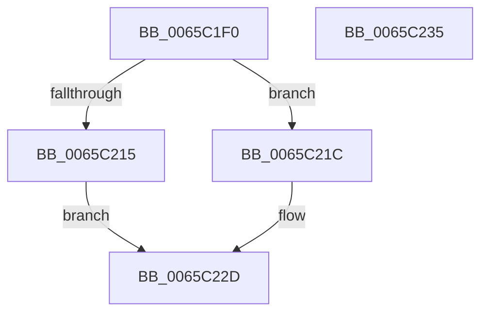

# ExCreateHeap

- RVA: `0x0065C1F0`–`0x0065C236` (길이 `70` bytes)
- VA: `0x000000014065C1F0`
- 실행 섹션: `.text`
- PDB 이름 있음: `예`; PDB Function 태그: `아니요`
- unwind 정보 RVA: `0x00064C80`
- 디코드: `21`개 명령, `70/70` bytes 표시
- 미해석 바이트: `0` (있으면 어셈블리에 `.byte`로 보존)

> 이 문서는 커널 이미지의 기계어와 PDB 기호를 분석해 생성했습니다. 4번과 5번은 함수 원형과 자료형을 바이너리 사용 방식에서 추정한 C 해석이며 원본 소스 복구 결과는 아닙니다.

## 1. Dependencies

- 직접 호출 지점: **1**; 고유 호출 대상: **1**
- 직접 호출자로 확인된 함수: **2**
- RIP 상대 이미지 참조: **0**

### Outgoing calls
- `0x0065C209` → [RtlpHpHeapCreate](../60/RtlpHpHeapCreate_function_00602FDC.md) (function, `0x00602FDC`)

### Direct callers
- [ExInitializePagedHeaps](ExInitializePagedHeaps_function_0065C23C.md) at `0x0065C29F`
- [ExInitializePagedHeaps](ExInitializePagedHeaps_function_0065C23C.md) at `0x0065C30C`
- [ExInitializePagedHeaps](ExInitializePagedHeaps_function_0065C23C.md) at `0x0065C345`
- [ExInitializePagedHeaps](ExInitializePagedHeaps_function_0065C23C.md) at `0x0065C38A`
- [ExInitializePoolHeapManagement](ExInitializePoolHeapManagement_function_0065C3D0.md) at `0x0065C48E`
- [ExInitializePoolHeapManagement](ExInitializePoolHeapManagement_function_0065C3D0.md) at `0x0065C51F`
- [ExInitializePoolHeapManagement](ExInitializePoolHeapManagement_function_0065C3D0.md) at `0x0065C577`
- [ExInitializePoolHeapManagement](ExInitializePoolHeapManagement_function_0065C3D0.md) at `0x0065C5B4`

### Static image references
- 디코드된 RIP-relative 메모리 참조가 없습니다.

## 2. Other-region calls and transfers

- 다른 실행 섹션으로 향하는 call: **0**
- 별도 외부 분기/꼬리 이동을 확인하지 못했습니다.

## 3. Assembly (complete function range)

```asm
0065C1F0  40 53                           push rbx
0065C1F2  48 83 EC 30                     sub rsp, 0x30
0065C1F6  0F 28 01                        movaps xmm0, xmmword ptr [rcx]
0065C1F9  4C 8D 4C 24 20                  lea r9, [rsp + 0x20]
0065C1FE  8B CA                           mov ecx, edx
0065C200  66 0F 7F 44 24 20               movdqa xmmword ptr [rsp + 0x20], xmm0
0065C206  49 8B D8                        mov rbx, r8
0065C209  E8 CE 6D FA FF                  call 0x140602fdc
0065C20E  33 C9                           xor ecx, ecx
0065C210  48 85 C0                        test rax, rax
0065C213  75 07                           jne 0x14065c21c
0065C215  B9 17 00 00 C0                  mov ecx, 0xc0000017
0065C21A  EB 11                           jmp 0x14065c22d
0065C21C  80 88 4D 01 00 00 10            or byte ptr [rax + 0x14d], 0x10
0065C223  80 88 0D 02 00 00 10            or byte ptr [rax + 0x20d], 0x10
0065C22A  48 89 03                        mov qword ptr [rbx], rax
0065C22D  8B C1                           mov eax, ecx
0065C22F  48 83 C4 30                     add rsp, 0x30
0065C233  5B                              pop rbx
0065C234  C3                              ret
0065C235  CC                              int3
```

## 4. C-style interpretation (structured pseudocode)

```c
__int64 __fastcall ExCreateHeap(__int64 a1, int a2, __int64 a3)
{
    __int64 result;
    __int64 v_rsp;
    unsigned __int64 v_stack_m18;

    v_rsp = (v_rsp) - (48);
    v_stack_m18 = v_xmm0;
    result = RtlpHpHeapCreate((unsigned int)(a2), a2, a3, v_stack_m18);
    a1 = 0;
    if (result != 0) goto loc_0065C21C;
    goto loc_0065C22D;
loc_0065C21C:
    *(unsigned __int64 *)(a3) = result;
loc_0065C22D:
    v_rsp = (v_rsp) + (48);
    return (unsigned int)((unsigned int)((unsigned int)(0xC0000017ULL)));
}
```

## 5. (Beta) C Style

```c
int64_t ExCreateHeap(void *Arg1, int32_t Arg2, void *Arg3)
{
    uint8_t *arg1 = (uint8_t *)Arg1;
    uint8_t *arg3 = (uint8_t *)Arg3;

    int64_t result;
    int64_t local_rsp;
    uint64_t v_stack_m18;

    local_rsp = (local_rsp) - (48);
    v_stack_m18 = v_xmm0;
    result = RtlpHpHeapCreate((uint32_t)(Arg2), Arg2, Arg3, v_stack_m18);
    Arg1 = 0;
    if (result != 0) goto loc_0065C21C;
    goto loc_0065C22D;
loc_0065C21C:
    *(uint64_t *)(arg3) = result;
loc_0065C22D:
    local_rsp = (local_rsp) + (48);
    return (uint32_t)((uint32_t)((uint32_t)(0xC0000017ULL)));
}
```

### 관측된 메모리 오프셋

구조체 형식이 확인되지 않은 접근은 인자 기준의 오프셋으로만 기록했습니다.

| 기준 인자 | 오프셋 표현 | 폭 (bit) | 접근 |
|---|---:|---:|---|
| `Arg1` | `+ 0x0` | `128` | `R` |
| `Arg3` | `+ 0x0` | `64` | `W` |

## 6. Execution-region graph

[열기: 2D/3D 그래프와 함수 탐색 컨트롤 패널](../../../control-panel.html?section=text&rva=0x0065C1F0&view=graph)

- 2D 그래프는 위에서 아래로 흐르고, 3D 그래프는 빈 공간을 드래그해 회전합니다. Shift+드래그는 이동, 휠은 확대·축소, 함수 노드 선택은 대상 보고서 이동입니다.

### Static fallback


