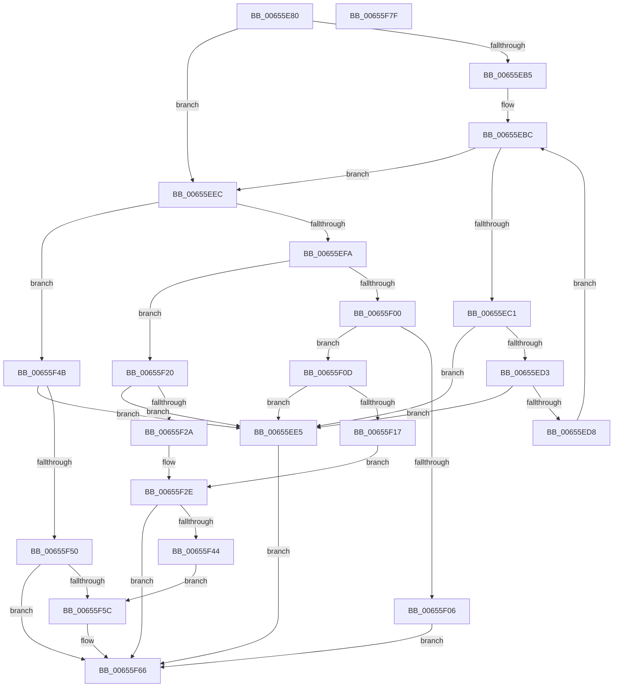

# ExCreatePool

- RVA: `0x00655E80`–`0x00655F80` (길이 `256` bytes)
- VA: `0x0000000140655E80`
- 실행 섹션: `.text`
- PDB 이름 있음: `예`; PDB Function 태그: `아니요`
- unwind 정보 RVA: `0x000BDA48`
- 디코드: `81`개 명령, `256/256` bytes 표시
- 미해석 바이트: `0` (있으면 어셈블리에 `.byte`로 보존)

> 이 문서는 커널 이미지의 기계어와 PDB 기호를 분석해 생성했습니다. 4번과 5번은 함수 원형과 자료형을 바이너리 사용 방식에서 추정한 C 해석이며 원본 소스 복구 결과는 아닙니다.

## 1. Dependencies

- 직접 호출 지점: **2**; 고유 호출 대상: **2**
- 직접 호출자로 확인된 함수: **0**
- RIP 상대 이미지 참조: **1**

### Outgoing calls
- `0x00655F3B` → [ExpPrivatePoolCreate](../../page/7D/ExpPrivatePoolCreate_function_007D5F98.md) (function, `0x007D5F98`)
- `0x00655F53` → [ExpSecurePoolCreate](ExpSecurePoolCreate_function_0065AB70.md) (function, `0x0065AB70`)

### Direct callers
- 이 함수 시작 RVA로 연결되는 직접 call은 확인되지 않았습니다. 간접 호출은 완전히 역산할 수 없습니다.

### Static image references
- `0x00655F5C` → RVA `0x00E6BF08` (`.data`; read)

## 2. Other-region calls and transfers

- 다른 실행 섹션으로 향하는 call: **1**
  - `0x00655F3B` → [ExpPrivatePoolCreate](../../page/7D/ExpPrivatePoolCreate_function_007D5F98.md) (`.text` → `PAGE`)
- 별도 외부 분기/꼬리 이동을 확인하지 못했습니다.

## 3. Assembly (complete function range)

```asm
00655E80  48 89 5C 24 08                  mov qword ptr [rsp + 8], rbx
00655E85  48 89 6C 24 10                  mov qword ptr [rsp + 0x10], rbp
00655E8A  48 89 74 24 20                  mov qword ptr [rsp + 0x20], rsi
00655E8F  57                              push rdi
00655E90  41 56                           push r14
00655E92  41 57                           push r15
00655E94  48 83 EC 30                     sub rsp, 0x30
00655E98  33 DB                           xor ebx, ebx
00655E9A  44 8B D1                        mov r10d, ecx
00655E9D  41 83 E2 0D                     and r10d, 0xd
00655EA1  4D 8B F9                        mov r15, r9
00655EA4  49 8B F8                        mov rdi, r8
00655EA7  48 8B F2                        mov rsi, rdx
00655EAA  44 8B F1                        mov r14d, ecx
00655EAD  44 8B CB                        mov r9d, ebx
00655EB0  4D 85 C0                        test r8, r8
00655EB3  74 37                           je 0x140655eec
00655EB5  41 8B 68 04                     mov ebp, dword ptr [r8 + 4]
00655EB9  44 8B DB                        mov r11d, ebx
00655EBC  44 3B DD                        cmp r11d, ebp
00655EBF  73 2B                           jae 0x140655eec
00655EC1  4C 8B 47 08                     mov r8, qword ptr [rdi + 8]
00655EC5  41 8B C3                        mov eax, r11d
00655EC8  48 8D 14 40                     lea rdx, [rax + rax*2]
00655ECC  41 83 3C D0 01                  cmp dword ptr [r8 + rdx*8], 1
00655ED1  75 12                           jne 0x140655ee5
00655ED3  4D 85 C9                        test r9, r9
00655ED6  75 0D                           jne 0x140655ee5
00655ED8  4D 8D 48 08                     lea r9, [r8 + 8]
00655EDC  41 FF C3                        inc r11d
00655EDF  4D 8D 0C D1                     lea r9, [r9 + rdx*8]
00655EE3  EB D7                           jmp 0x140655ebc
00655EE5  B8 F1 00 00 C0                  mov eax, 0xc00000f1
00655EEA  EB 7A                           jmp 0x140655f66
00655EEC  41 8B CA                        mov ecx, r10d
00655EEF  F7 D1                           not ecx
00655EF1  41 23 CE                        and ecx, r14d
00655EF4  41 83 EA 01                     sub r10d, 1
00655EF8  74 51                           je 0x140655f4b
00655EFA  41 83 EA 03                     sub r10d, 3
00655EFE  74 20                           je 0x140655f20
00655F00  41 83 FA 04                     cmp r10d, 4
00655F04  74 07                           je 0x140655f0d
00655F06  B8 EF 00 00 C0                  mov eax, 0xc00000ef
00655F0B  EB 59                           jmp 0x140655f66
00655F0D  48 89 5C 24 60                  mov qword ptr [rsp + 0x60], rbx
00655F12  4D 85 C9                        test r9, r9
00655F15  74 CE                           je 0x140655ee5
00655F17  8B D1                           mov edx, ecx
00655F19  B9 01 00 00 00                  mov ecx, 1
00655F1E  EB 0E                           jmp 0x140655f2e
00655F20  48 89 5C 24 60                  mov qword ptr [rsp + 0x60], rbx
00655F25  4D 85 C9                        test r9, r9
00655F28  74 BB                           je 0x140655ee5
00655F2A  8B D1                           mov edx, ecx
00655F2C  33 C9                           xor ecx, ecx
00655F2E  48 8D 44 24 60                  lea rax, [rsp + 0x60]
00655F33  4C 8B C6                        mov r8, rsi
00655F36  48 89 44 24 20                  mov qword ptr [rsp + 0x20], rax
00655F3B  E8 58 00 18 00                  call 0x1407d5f98
00655F40  85 C0                           test eax, eax
00655F42  78 22                           js 0x140655f66
00655F44  48 8B 5C 24 60                  mov rbx, qword ptr [rsp + 0x60]
00655F49  EB 11                           jmp 0x140655f5c
00655F4B  4D 85 C9                        test r9, r9
00655F4E  75 95                           jne 0x140655ee5
00655F50  48 8B D6                        mov rdx, rsi
00655F53  E8 18 4C 00 00                  call 0x14065ab70
00655F58  85 C0                           test eax, eax
00655F5A  78 0A                           js 0x140655f66
00655F5C  48 33 1D A5 5F 81 00            xor rbx, qword ptr [rip + 0x815fa5]
00655F63  49 89 1F                        mov qword ptr [r15], rbx
00655F66  48 8B 5C 24 50                  mov rbx, qword ptr [rsp + 0x50]
00655F6B  48 8B 6C 24 58                  mov rbp, qword ptr [rsp + 0x58]
00655F70  48 8B 74 24 68                  mov rsi, qword ptr [rsp + 0x68]
00655F75  48 83 C4 30                     add rsp, 0x30
00655F79  41 5F                           pop r15
00655F7B  41 5E                           pop r14
00655F7D  5F                              pop rdi
00655F7E  C3                              ret
00655F7F  CC                              int3
```

## 4. C-style interpretation (structured pseudocode)

```c
__int64 __fastcall ExCreatePool(int a1, __int64 a2, __int64 a3, __int64 a4)
{
    __int64 result;
    __int64 v_r10;
    __int64 v_r11;
    __int64 v_rbx;
    __int64 v_rsp;
    unsigned __int64 v_stack_m28;
    unsigned __int64 v_stack_p10;
    unsigned __int64 v_stack_p18;
    unsigned __int64 v_stack_p20;
    unsigned __int64 v_stack_p8;

    v_stack_p8 = v_rbx;
    v_stack_p10 = v_rbp;
    v_stack_p20 = v_rsi;
    v_rsp = (v_rsp) - (48);
    v_rbx = 0;
    v_r10 = (unsigned int)(((unsigned int)(a1)) & (13));
    if (a3 == 0) goto loc_00655EEC;
loc_00655EBC:
    if (0 >= ((unsigned int)((unsigned int)(*(unsigned int *)(a3 + 4))))) goto loc_00655EEC;
    if ((*(unsigned int *)(*(unsigned __int64 *)(a3 + 8) + 0 + 0 * 2 * 8)) != 1) goto loc_00655EE5;
    if (0 != 0) goto loc_00655EE5;
    v_r11 = (unsigned int)((0) + 1);
    goto loc_00655EBC;
loc_00655EE5:
    goto loc_00655F66;
loc_00655EEC:
    a1 = (unsigned int)(~((unsigned int)((unsigned int)(v_r10))));
    a1 = (unsigned int)((a1) & ((unsigned int)((unsigned int)(a1))));
    v_r10 = (unsigned int)((v_r10) - (1));
    if (condition_is_equal) goto loc_00655F4B;
    v_r10 = (unsigned int)((v_r10) - (3));
    if (condition_is_equal) goto loc_00655F20;
    if (((unsigned int)(v_r10)) == 4) goto loc_00655F0D;
    goto loc_00655F66;
loc_00655F0D:
    v_stack_p18 = 0;
    if (*(unsigned __int64 *)(a3 + 8) + 8 + 0 + 0 * 2 * 8 == 0) goto loc_00655EE5;
    goto loc_00655F2E;
loc_00655F20:
    v_stack_p18 = 0;
    if (*(unsigned __int64 *)(a3 + 8) + 8 + 0 + 0 * 2 * 8 == 0) goto loc_00655EE5;
    a1 = 0;
loc_00655F2E:
    v_stack_m28 = v_stack_p18;
    result = ExpPrivatePoolCreate(a1, 1, a2, *(unsigned __int64 *)(a3 + 8) + 8 + 0 + 0 * 2 * 8);
    if (sign_flag) goto loc_00655F66;
    goto loc_00655F5C;
loc_00655F4B:
    if (*(unsigned __int64 *)(a3 + 8) + 8 + 0 + 0 * 2 * 8 != 0) goto loc_00655EE5;
    result = ExpSecurePoolCreate(a1, a2, a2, *(unsigned __int64 *)(a3 + 8) + 8 + 0 + 0 * 2 * 8);
    v_rbx = v_stack_p18;
    if (!(sign_flag)) {
        v_rbx = (v_stack_p18) ^ (*(unsigned __int64 *)(v_rip + 8478629));
        *(unsigned __int64 *)(a4) = v_rbx;
    }
    v_rsp = (v_rsp) + (48);
    return result;
}
```

## 5. (Beta) C Style

```c
int64_t ExCreatePool(int32_t Arg1, int64_t Arg2, void *Arg3, void *Arg4)
{
    uint8_t *arg3 = (uint8_t *)Arg3;
    uint8_t *arg4 = (uint8_t *)Arg4;

    int64_t result;
    int64_t local_r10;
    int64_t local_r11;
    int64_t local_rbx;
    int64_t local_rsp;
    uint64_t v_stack_m28;
    uint64_t v_stack_p10;
    uint64_t v_stack_p18;
    uint64_t v_stack_p20;
    uint64_t v_stack_p8;

    v_stack_p8 = local_rbx;
    v_stack_p10 = local_rbp;
    v_stack_p20 = local_rsi;
    local_rsp = (local_rsp) - (48);
    local_rbx = 0;
    local_r10 = (uint32_t)(((uint32_t)(Arg1)) & (13));
    if (Arg3 == NULL) goto loc_00655EEC;
loc_00655EBC:
    if (0 >= ((uint32_t)((uint32_t)(*(uint32_t *)(arg3 + 0x4))))) goto loc_00655EEC;
    if ((*(uint32_t *)(*(uint64_t *)(arg3 + 0x8) + 0x0 + 0x0 * 2 * 8)) != 1) goto loc_00655EE5;
    if (0 != 0) goto loc_00655EE5;
    local_r11 = (uint32_t)((0) + 1);
    goto loc_00655EBC;
loc_00655EE5:
    goto loc_00655F66;
loc_00655EEC:
    Arg1 = (uint32_t)(~((uint32_t)((uint32_t)(local_r10))));
    Arg1 = (uint32_t)((Arg1) & ((uint32_t)((uint32_t)(Arg1))));
    local_r10 = (uint32_t)((local_r10) - (1));
    if (condition_is_equal) goto loc_00655F4B;
    local_r10 = (uint32_t)((local_r10) - (3));
    if (condition_is_equal) goto loc_00655F20;
    if (((uint32_t)(local_r10)) == 4) goto loc_00655F0D;
    goto loc_00655F66;
loc_00655F0D:
    v_stack_p18 = 0;
    if (*(uint64_t *)(arg3 + 0x8) + 8 + 0 + 0 * 2 * 8 == 0) goto loc_00655EE5;
    goto loc_00655F2E;
loc_00655F20:
    v_stack_p18 = 0;
    if (*(uint64_t *)(arg3 + 0x8) + 8 + 0 + 0 * 2 * 8 == 0) goto loc_00655EE5;
    Arg1 = 0;
loc_00655F2E:
    v_stack_m28 = v_stack_p18;
    result = ExpPrivatePoolCreate(Arg1, 1, Arg2, *(uint64_t *)(arg3 + 0x8) + 8 + 0 + 0 * 2 * 8);
    if (sign_flag) goto loc_00655F66;
    goto loc_00655F5C;
loc_00655F4B:
    if (*(uint64_t *)(arg3 + 0x8) + 8 + 0 + 0 * 2 * 8 != 0) goto loc_00655EE5;
    result = ExpSecurePoolCreate(Arg1, Arg2, Arg2, *(uint64_t *)(arg3 + 0x8) + 8 + 0 + 0 * 2 * 8);
    local_rbx = v_stack_p18;
    if (!(sign_flag)) {
        local_rbx = (v_stack_p18) ^ (*(uint64_t *)(v_rip + 0x815FA5));
        *(uint64_t *)(arg4) = local_rbx;
    }
    local_rsp = (local_rsp) + (48);
    return result;
}
```

### 관측된 메모리 오프셋

구조체 형식이 확인되지 않은 접근은 인자 기준의 오프셋으로만 기록했습니다.

| 기준 인자 | 오프셋 표현 | 폭 (bit) | 접근 |
|---|---:|---:|---|
| `Arg3` | `+ 0x8` | `64` | `R` |
| `Arg4` | `+ 0x0` | `64` | `W` |

## 6. Execution-region graph

[열기: 2D/3D 그래프와 함수 탐색 컨트롤 패널](../../../control-panel.html?section=text&rva=0x00655E80&view=graph)

- 2D 그래프는 위에서 아래로 흐르고, 3D 그래프는 빈 공간을 드래그해 회전합니다. Shift+드래그는 이동, 휠은 확대·축소, 함수 노드 선택은 대상 보고서 이동입니다.

### Static fallback


