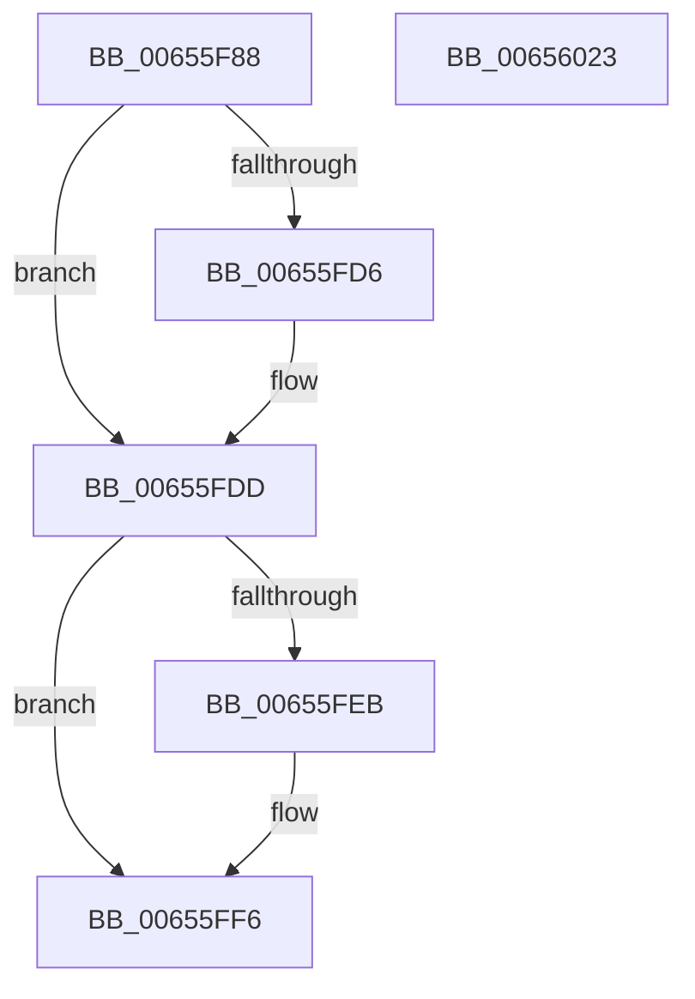

# ExDeletePoolTagTable

- RVA: `0x00655F88`–`0x00656024` (길이 `156` bytes)
- VA: `0x0000000140655F88`
- 실행 섹션: `.text`
- PDB 이름 있음: `예`; PDB Function 태그: `아니요`
- unwind 정보 RVA: `0x0008FC44`
- 디코드: `40`개 명령, `156/156` bytes 표시
- 미해석 바이트: `0` (있으면 어셈블리에 `.byte`로 보존)

> 이 문서는 커널 이미지의 기계어와 PDB 기호를 분석해 생성했습니다. 4번과 5번은 함수 원형과 자료형을 바이너리 사용 방식에서 추정한 C 해석이며 원본 소스 복구 결과는 아닙니다.

## 1. Dependencies

- 직접 호출 지점: **3**; 고유 호출 대상: **3**
- 직접 호출자로 확인된 함수: **2**
- RIP 상대 이미지 참조: **3**

### Outgoing calls
- `0x00655FD8` → [KiRaiseIrqlProcessIrqlFlags](../4F/KiRaiseIrqlProcessIrqlFlags_function_004F56FC.md) (function, `0x004F56FC`)
- `0x00655FF1` → [KiLowerIrqlProcessIrqlFlags](../4F/KiLowerIrqlProcessIrqlFlags_function_004F5698.md) (function, `0x004F5698`)
- `0x00656003` → [MmFreeIndependentPages](../2A/MmFreeIndependentPages_function_002A2510.md) (function, `0x002A2510`)

### Direct callers
- [KiStartDynamicProcessor](../../page/74/KiStartDynamicProcessor_function_007456C8.md) at `0x00745CDD`
- [KeStartAllProcessors](../../init/C3/KeStartAllProcessors_function_00C36F78.md) at `0x00C37475`

### Static image references
- `0x00655FA1` → RVA `0x00EFED50` (`.data`; read)
- `0x00655FA8` → RVA `0x00EFAD20` (`.data`; read)
- `0x00655FCD` → RVA `0x00FC6D20` (`ALMOSTRO`; read)

## 2. Other-region calls and transfers

- 다른 실행 섹션으로 향하는 call: **0**
- 별도 외부 분기/꼬리 이동을 확인하지 못했습니다.

## 3. Assembly (complete function range)

```asm
00655F88  48 8B C4                        mov rax, rsp
00655F8B  48 89 58 08                     mov qword ptr [rax + 8], rbx
00655F8F  48 89 68 10                     mov qword ptr [rax + 0x10], rbp
00655F93  48 89 70 18                     mov qword ptr [rax + 0x18], rsi
00655F97  48 89 78 20                     mov qword ptr [rax + 0x20], rdi
00655F9B  41 57                           push r15
00655F9D  48 83 EC 20                     sub rsp, 0x20
00655FA1  48 8B 3D A8 8D 8A 00            mov rdi, qword ptr [rip + 0x8a8da8]
00655FA8  4C 8D 3D 71 4D 8A 00            lea r15, [rip + 0x8a4d71]
00655FAF  48 FF C7                        inc rdi
00655FB2  8B F1                           mov esi, ecx
00655FB4  49 8B 2C F7                     mov rbp, qword ptr [r15 + rsi*8]
00655FB8  48 8D 3C BF                     lea rdi, [rdi + rdi*4]
00655FBC  48 C1 E7 04                     shl rdi, 4
00655FC0  44 0F 20 C3                     mov rbx, cr8
00655FC4  BA 02 00 00 00                  mov edx, 2
00655FC9  44 0F 22 C2                     mov cr8, rdx
00655FCD  83 3D 4C 0D 97 00 00            cmp dword ptr [rip + 0x970d4c], 0
00655FD4  74 07                           je 0x140655fdd
00655FD6  8A CB                           mov cl, bl
00655FD8  E8 1F F7 E9 FF                  call 0x1404f56fc
00655FDD  49 83 24 F7 00                  and qword ptr [r15 + rsi*8], 0
00655FE2  83 3D 37 0D 97 00 00            cmp dword ptr [rip + 0x970d37], 0
00655FE9  74 0B                           je 0x140655ff6
00655FEB  44 0F 20 C1                     mov rcx, cr8
00655FEF  8A D3                           mov dl, bl
00655FF1  E8 A2 F6 E9 FF                  call 0x1404f5698
00655FF6  0F B6 C3                        movzx eax, bl
00655FF9  44 0F 22 C0                     mov cr8, rax
00655FFD  48 8B D7                        mov rdx, rdi
00656000  48 8B CD                        mov rcx, rbp
00656003  E8 08 C5 C4 FF                  call 0x1402a2510
00656008  48 8B 5C 24 30                  mov rbx, qword ptr [rsp + 0x30]
0065600D  48 8B 6C 24 38                  mov rbp, qword ptr [rsp + 0x38]
00656012  48 8B 74 24 40                  mov rsi, qword ptr [rsp + 0x40]
00656017  48 8B 7C 24 48                  mov rdi, qword ptr [rsp + 0x48]
0065601C  48 83 C4 20                     add rsp, 0x20
00656020  41 5F                           pop r15
00656022  C3                              ret
00656023  CC                              int3
```

## 4. C-style interpretation (structured pseudocode)

```c
__int64 __fastcall ExDeletePoolTagTable(int a1)
{
    __int64 result;
    __int64 v_rdi;
    __int64 v_rsp;
    unsigned __int64 v_stack_p10;
    unsigned __int64 v_stack_p18;
    unsigned __int64 v_stack_p20;
    unsigned __int64 v_stack_p8;

    *(unsigned __int64 *)(v_rsp + 8) = v_rbx;
    *(unsigned __int64 *)(v_rsp + 16) = v_rbp;
    *(unsigned __int64 *)(v_rsp + 24) = v_rsi;
    *(unsigned __int64 *)(v_rsp + 32) = v_rdi;
    v_rsp = (v_rsp) - (32);
    v_rdi = (*(unsigned __int64 *)(v_rip + 9080232)) + 1;
    v_rdi = (v_rdi + v_rdi * 4) << (4);
    result = v_rsp;
    if ((*(unsigned int *)(v_rip + 9899340)) != 0) {
        a1 = (unsigned __int8)(v_cr8);
        result = KiRaiseIrqlProcessIrqlFlags(a1, 2, a3, a4);
    }
    if ((*(unsigned int *)(v_rip + 9899319)) != 0) {
        a1 = 2;
        a2 = (unsigned __int8)(v_cr8);
        result = KiLowerIrqlProcessIrqlFlags(a1, a2, a3, a4);
    }
    result = MmFreeIndependentPages(*(unsigned __int64 *)(v_rip + 9063793 + (unsigned int)(a1) * 8), v_rdi, a3, a4);
    v_rsp = (v_rsp) + (32);
    return result;
}
```

## 5. (Beta) C Style

```c
int64_t ExDeletePoolTagTable(int32_t Arg1)
{
    int64_t result;
    int64_t local_rdi;
    int64_t local_rsp;
    uint64_t v_stack_p10;
    uint64_t v_stack_p18;
    uint64_t v_stack_p20;
    uint64_t v_stack_p8;

    *(uint64_t *)(local_rsp + 0x8) = local_rbx;
    *(uint64_t *)(local_rsp + 0x10) = local_rbp;
    *(uint64_t *)(local_rsp + 0x18) = local_rsi;
    *(uint64_t *)(local_rsp + 0x20) = local_rdi;
    local_rsp = (local_rsp) - (32);
    local_rdi = (*(uint64_t *)(v_rip + 0x8A8DA8)) + 1;
    local_rdi = (local_rdi + local_rdi * 4) << (4);
    result = local_rsp;
    if ((*(uint32_t *)(v_rip + 0x970D4C)) != 0) {
        Arg1 = (uint8_t)(v_cr8);
        result = KiRaiseIrqlProcessIrqlFlags(Arg1, 2, a3, a4);
    }
    if ((*(uint32_t *)(v_rip + 0x970D37)) != 0) {
        Arg1 = 2;
        a2 = (uint8_t)(v_cr8);
        result = KiLowerIrqlProcessIrqlFlags(Arg1, a2, a3, a4);
    }
    result = MmFreeIndependentPages(*(uint64_t *)(v_rip + 0x8A4D71 + (uint32_t)(Arg1) * 8), local_rdi, a3, a4);
    local_rsp = (local_rsp) + (32);
    return result;
}
```

## 6. Execution-region graph

[열기: 2D/3D 그래프와 함수 탐색 컨트롤 패널](../../../control-panel.html?section=text&rva=0x00655F88&view=graph)

- 2D 그래프는 위에서 아래로 흐르고, 3D 그래프는 빈 공간을 드래그해 회전합니다. Shift+드래그는 이동, 휠은 확대·축소, 함수 노드 선택은 대상 보고서 이동입니다.

### Static fallback


