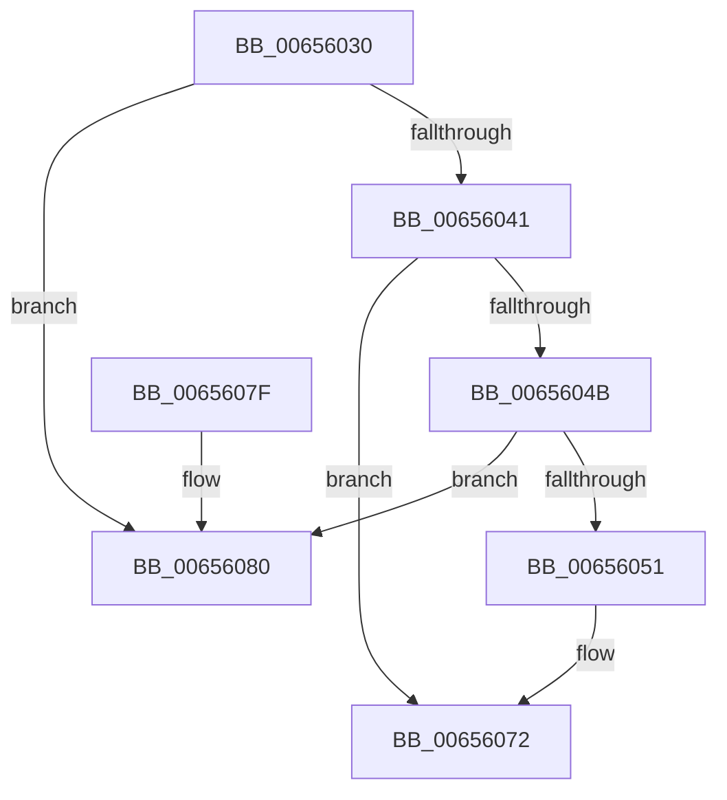

# ExDestroyPool

- RVA: `0x00656030`–`0x0065609A` (길이 `106` bytes)
- VA: `0x0000000140656030`
- 실행 섹션: `.text`
- PDB 이름 있음: `예`; PDB Function 태그: `아니요`
- unwind 정보 RVA: `0x00069AC4`
- 디코드: `29`개 명령, `106/106` bytes 표시
- 미해석 바이트: `0` (있으면 어셈블리에 `.byte`로 보존)

> 이 문서는 커널 이미지의 기계어와 PDB 기호를 분석해 생성했습니다. 4번과 5번은 함수 원형과 자료형을 바이너리 사용 방식에서 추정한 C 해석이며 원본 소스 복구 결과는 아닙니다.

## 1. Dependencies

- 직접 호출 지점: **4**; 고유 호출 대상: **3**
- 직접 호출자로 확인된 함수: **0**
- RIP 상대 이미지 참조: **0**

### Outgoing calls
- `0x00656037` → [ExpPoolContextHeaderFromHandle](../4F/ExpPoolContextHeaderFromHandle_function_004F6D70.md) (function, `0x004F6D70`)
- `0x0065606C` → [KeBugCheckEx](../4F/KeBugCheckEx_function_004FD660.md) (function, `0x004FD660`)
- `0x00656075` → [ExpPrivatePoolDestroy](../../page/7D/ExpPrivatePoolDestroy_function_007D61C4.md) (function, `0x007D61C4`)
- `0x00656094` → [KeBugCheckEx](../4F/KeBugCheckEx_function_004FD660.md) (function, `0x004FD660`)

### Direct callers
- 이 함수 시작 RVA로 연결되는 직접 call은 확인되지 않았습니다. 간접 호출은 완전히 역산할 수 없습니다.

### Static image references
- 디코드된 RIP-relative 메모리 참조가 없습니다.

## 2. Other-region calls and transfers

- 다른 실행 섹션으로 향하는 call: **1**
  - `0x00656075` → [ExpPrivatePoolDestroy](../../page/7D/ExpPrivatePoolDestroy_function_007D61C4.md) (`.text` → `PAGE`)
- 별도 외부 분기/꼬리 이동을 확인하지 못했습니다.

## 3. Assembly (complete function range)

```asm
00656030  48 83 EC 38                     sub rsp, 0x38
00656034  4C 8B D1                        mov r10, rcx
00656037  E8 34 0D EA FF                  call 0x1404f6d70
0065603C  48 85 C0                        test rax, rax
0065603F  74 3F                           je 0x140656080
00656041  44 8B 40 04                     mov r8d, dword ptr [rax + 4]
00656045  41 83 E8 01                     sub r8d, 1
00656049  74 27                           je 0x140656072
0065604B  41 83 F8 01                     cmp r8d, 1
0065604F  75 2F                           jne 0x140656080
00656051  48 83 64 24 20 00               and qword ptr [rsp + 0x20], 0
00656057  49 C7 C1 BB 00 00 C0            mov r9, 0xffffffffc00000bb
0065605E  4C 8B 40 08                     mov r8, qword ptr [rax + 8]
00656062  BA 10 00 00 00                  mov edx, 0x10
00656067  B9 C2 00 00 00                  mov ecx, 0xc2
0065606C  E8 EF 75 EA FF                  call 0x1404fd660
00656071  CC                              int3
00656072  48 8B C8                        mov rcx, rax
00656075  E8 4A 01 18 00                  call 0x1407d61c4
0065607A  48 83 C4 38                     add rsp, 0x38
0065607E  C3                              ret
0065607F  CC                              int3
00656080  48 83 64 24 20 00               and qword ptr [rsp + 0x20], 0
00656086  BA 9E 00 00 00                  mov edx, 0x9e
0065608B  45 33 C9                        xor r9d, r9d
0065608E  4D 8B C2                        mov r8, r10
00656091  8D 4A 24                        lea ecx, [rdx + 0x24]
00656094  E8 C7 75 EA FF                  call 0x1404fd660
00656099  CC                              int3
```

## 4. C-style interpretation (structured pseudocode)

```c
__int64 __fastcall ExDestroyPool(__int64 a1)
{
    __int64 result;
    __int64 v_rsp;
    unsigned __int64 v_stack_m18;
    unsigned __int64 v_stack_p20;

    v_rsp = (v_rsp) - (56);
    result = ExpPoolContextHeaderFromHandle(a1, a2, a3, a4);
    if (result == 0) goto loc_00656080;
    a3 = (unsigned int)(((unsigned int)(*(unsigned int *)(result + 4))) - (1));
    if (condition_is_equal) goto loc_00656072;
    if (((unsigned int)(a3)) != 1) goto loc_00656080;
    result = KeBugCheckEx(194, 16, *(unsigned __int64 *)(result + 8), 0xFFFFFFFFC00000BBULL);
loc_00656072:
    result = ExpPrivatePoolDestroy(result, 16, *(unsigned __int64 *)(result + 8), 0xFFFFFFFFC00000BBULL);
    v_rsp = (v_rsp) + (56);
    return result;
loc_00656080:
    a4 = 0;
    result = KeBugCheckEx(158 + 36, 158, a1, a4);
    return result;
}
```

## 5. (Beta) C Style

```c
int64_t ExDestroyPool(int64_t Arg1)
{
    int64_t result;
    int64_t local_rsp;
    uint64_t v_stack_m18;
    uint64_t v_stack_p20;

    local_rsp = (local_rsp) - (56);
    result = ExpPoolContextHeaderFromHandle(Arg1, a2, a3, a4);
    if (result == 0) goto loc_00656080;
    a3 = (uint32_t)(((uint32_t)(*(uint32_t *)(result + 0x4))) - (1));
    if (condition_is_equal) goto loc_00656072;
    if (((uint32_t)(a3)) != 1) goto loc_00656080;
    result = KeBugCheckEx(194, 16, *(uint64_t *)(result + 0x8), 0xFFFFFFFFC00000BBULL);
loc_00656072:
    result = ExpPrivatePoolDestroy(result, 16, *(uint64_t *)(result + 0x8), 0xFFFFFFFFC00000BBULL);
    local_rsp = (local_rsp) + (56);
    return result;
loc_00656080:
    a4 = 0;
    result = KeBugCheckEx(158 + 36, 158, Arg1, a4);
    return result;
}
```

## 6. Execution-region graph

[열기: 2D/3D 그래프와 함수 탐색 컨트롤 패널](../../../control-panel.html?section=text&rva=0x00656030&view=graph)

- 2D 그래프는 위에서 아래로 흐르고, 3D 그래프는 빈 공간을 드래그해 회전합니다. Shift+드래그는 이동, 휠은 확대·축소, 함수 노드 선택은 대상 보고서 이동입니다.

### Static fallback


