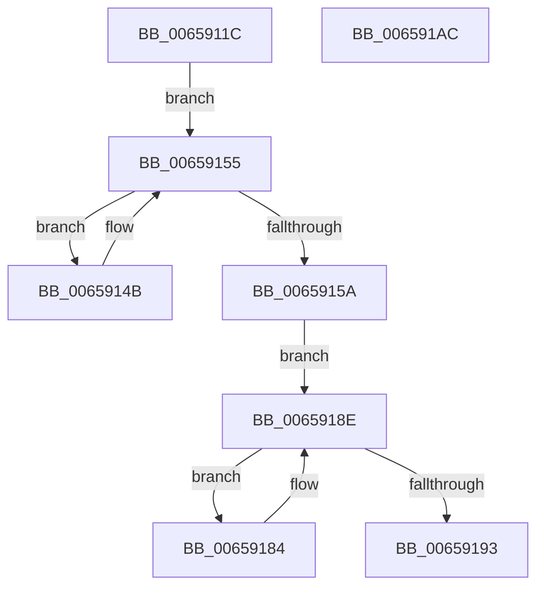

# ExDisableAllLookasideLists

- RVA: `0x0065911C`–`0x006591AD` (길이 `145` bytes)
- VA: `0x000000014065911C`
- 실행 섹션: `.text`
- PDB 이름 있음: `예`; PDB Function 태그: `아니요`
- unwind 정보 RVA: `0x0005CAAC`
- 디코드: `34`개 명령, `145/145` bytes 표시
- 미해석 바이트: `0` (있으면 어셈블리에 `.byte`로 보존)

> 이 문서는 커널 이미지의 기계어와 PDB 기호를 분석해 생성했습니다. 4번과 5번은 함수 원형과 자료형을 바이너리 사용 방식에서 추정한 C 해석이며 원본 소스 복구 결과는 아닙니다.

## 1. Dependencies

- 직접 호출 지점: **4**; 고유 호출 대상: **2**
- 직접 호출자로 확인된 함수: **1**
- RIP 상대 이미지 참조: **5**

### Outgoing calls
- `0x00659136` → [KeAcquireSpinLockRaiseToDpc](../20/KeAcquireSpinLockRaiseToDpc_function_00208470.md) (function, `0x00208470`)
- `0x00659163` → [KeReleaseSpinLock](../39/KeReleaseSpinLock_function_00392BA0.md) (function, `0x00392BA0`)
- `0x0065916F` → [KeAcquireSpinLockRaiseToDpc](../20/KeAcquireSpinLockRaiseToDpc_function_00208470.md) (function, `0x00208470`)
- `0x0065919C` → [KeReleaseSpinLock](../39/KeReleaseSpinLock_function_00392BA0.md) (function, `0x00392BA0`)

### Direct callers
- [VfInitSystemNoRebootNeeded](../../pagevrfy/B9/VfInitSystemNoRebootNeeded_function_00B93970.md) at `0x00B939D7`

### Static image references
- `0x00659128` → RVA `0x00EFABC0` (`.data`; read)
- `0x0065912F` → RVA `0x00E0EBA8` (`.data`; write)
- `0x0065913B` → RVA `0x00EFABF0` (`.data`; read)
- `0x00659168` → RVA `0x00EFABE0` (`.data`; read)
- `0x00659174` → RVA `0x00EFABB0` (`.data`; read)

## 2. Other-region calls and transfers

- 다른 실행 섹션으로 향하는 call: **0**
- 별도 외부 분기/꼬리 이동을 확인하지 못했습니다.

## 3. Assembly (complete function range)

```asm
0065911C  48 89 5C 24 08                  mov qword ptr [rsp + 8], rbx
00659121  57                              push rdi
00659122  48 83 EC 20                     sub rsp, 0x20
00659126  33 DB                           xor ebx, ebx
00659128  48 8D 0D 91 1A 8A 00            lea rcx, [rip + 0x8a1a91]
0065912F  66 89 1D 72 5A 7B 00            mov word ptr [rip + 0x7b5a72], bx
00659136  E8 35 F3 BA FF                  call 0x140208470
0065913B  48 8B 15 AE 1A 8A 00            mov rdx, qword ptr [rip + 0x8a1aae]
00659142  4C 8D 05 A7 1A 8A 00            lea r8, [rip + 0x8a1aa7]
00659149  EB 0A                           jmp 0x140659155
0065914B  C7 42 D0 00 00 FF FF            mov dword ptr [rdx - 0x30], 0xffff0000
00659152  48 8B 12                        mov rdx, qword ptr [rdx]
00659155  49 3B D0                        cmp rdx, r8
00659158  75 F1                           jne 0x14065914b
0065915A  8A D0                           mov dl, al
0065915C  48 8D 0D 5D 1A 8A 00            lea rcx, [rip + 0x8a1a5d]
00659163  E8 38 9A D3 FF                  call 0x140392ba0
00659168  48 8D 0D 71 1A 8A 00            lea rcx, [rip + 0x8a1a71]
0065916F  E8 FC F2 BA FF                  call 0x140208470
00659174  48 8B 15 35 1A 8A 00            mov rdx, qword ptr [rip + 0x8a1a35]
0065917B  48 8D 0D 2E 1A 8A 00            lea rcx, [rip + 0x8a1a2e]
00659182  EB 0A                           jmp 0x14065918e
00659184  C7 42 D0 00 00 FF FF            mov dword ptr [rdx - 0x30], 0xffff0000
0065918B  48 8B 12                        mov rdx, qword ptr [rdx]
0065918E  48 3B D1                        cmp rdx, rcx
00659191  75 F1                           jne 0x140659184
00659193  8A D0                           mov dl, al
00659195  48 8D 0D 44 1A 8A 00            lea rcx, [rip + 0x8a1a44]
0065919C  E8 FF 99 D3 FF                  call 0x140392ba0
006591A1  48 8B 5C 24 30                  mov rbx, qword ptr [rsp + 0x30]
006591A6  48 83 C4 20                     add rsp, 0x20
006591AA  5F                              pop rdi
006591AB  C3                              ret
006591AC  CC                              int3
```

## 4. C-style interpretation (structured pseudocode)

```c
__int64 __fastcall ExDisableAllLookasideLists(void)
{
    __int64 result;
    __int64 v_rbx;
    __int64 v_rsp;
    unsigned __int64 v_stack_p8;

    v_stack_p8 = v_rbx;
    v_rsp = (v_rsp) - (32);
    v_rbx = 0;
    *(unsigned __int16 *)(v_rip + 8084082) = 0;
    result = KeAcquireSpinLockRaiseToDpc(v_rip + 9050769, a2, a3, a4);
    goto loc_00659155;
loc_0065914B:
    *(unsigned int *)(*(unsigned __int64 *)(v_rip + 9050798) - 48) = 0xFFFF0000ULL;
loc_00659155:
    if ((*(unsigned __int64 *)(*(unsigned __int64 *)(v_rip + 9050798))) != (v_rip + 9050791)) goto loc_0065914B;
    result = KeReleaseSpinLock(v_rip + 9050717, (unsigned __int8)(result), v_rip + 9050791, a4);
    result = KeAcquireSpinLockRaiseToDpc(v_rip + 9050737, (unsigned __int8)(result), v_rip + 9050791, a4);
    goto loc_0065918E;
loc_00659184:
    *(unsigned int *)(*(unsigned __int64 *)(v_rip + 9050677) - 48) = 0xFFFF0000ULL;
loc_0065918E:
    if ((*(unsigned __int64 *)(*(unsigned __int64 *)(v_rip + 9050677))) != (v_rip + 9050670)) goto loc_00659184;
    result = KeReleaseSpinLock(v_rip + 9050692, (unsigned __int8)(result), v_rip + 9050791, a4);
    v_rsp = (v_rsp) + (32);
    return result;
}
```

## 5. (Beta) C Style

```c
void ExDisableAllLookasideLists(void)
{
    int64_t result;
    int64_t local_rbx;
    int64_t local_rsp;
    uint64_t v_stack_p8;

    v_stack_p8 = local_rbx;
    local_rsp = (local_rsp) - (32);
    local_rbx = 0;
    *(uint16_t *)(v_rip + 0x7B5A72) = 0;
    result = KeAcquireSpinLockRaiseToDpc(v_rip + 9050769, a2, a3, a4);
    goto loc_00659155;
loc_0065914B:
    *(uint32_t *)(*(uint64_t *)(v_rip + 0x8A1AAE) - 0x30) = 0xFFFF0000ULL;
loc_00659155:
    if ((*(uint64_t *)(*(uint64_t *)(v_rip + 0x8A1AAE))) != (v_rip + 9050791)) goto loc_0065914B;
    result = KeReleaseSpinLock(v_rip + 9050717, (uint8_t)(result), v_rip + 9050791, a4);
    result = KeAcquireSpinLockRaiseToDpc(v_rip + 9050737, (uint8_t)(result), v_rip + 9050791, a4);
    goto loc_0065918E;
loc_00659184:
    *(uint32_t *)(*(uint64_t *)(v_rip + 0x8A1A35) - 0x30) = 0xFFFF0000ULL;
loc_0065918E:
    if ((*(uint64_t *)(*(uint64_t *)(v_rip + 0x8A1A35))) != (v_rip + 9050670)) goto loc_00659184;
    result = KeReleaseSpinLock(v_rip + 9050692, (uint8_t)(result), v_rip + 9050791, a4);
    local_rsp = (local_rsp) + (32);
    return result;
}
```

## 6. Execution-region graph

[열기: 2D/3D 그래프와 함수 탐색 컨트롤 패널](../../../control-panel.html?section=text&rva=0x0065911C&view=graph)

- 2D 그래프는 위에서 아래로 흐르고, 3D 그래프는 빈 공간을 드래그해 회전합니다. Shift+드래그는 이동, 휠은 확대·축소, 함수 노드 선택은 대상 보고서 이동입니다.

### Static fallback


