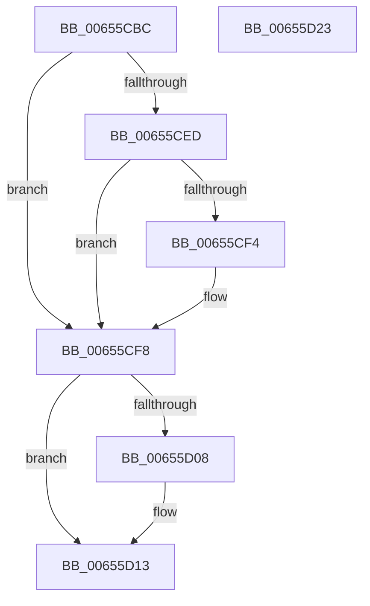

# ExDisableHandleTracing

- RVA: `0x00655CBC`–`0x00655D24` (길이 `104` bytes)
- VA: `0x0000000140655CBC`
- 실행 섹션: `.text`
- PDB 이름 있음: `예`; PDB Function 태그: `아니요`
- unwind 정보 RVA: `0x00060BC4`
- 디코드: `30`개 명령, `104/104` bytes 표시
- 미해석 바이트: `0` (있으면 어셈블리에 `.byte`로 보존)

> 이 문서는 커널 이미지의 기계어와 PDB 기호를 분석해 생성했습니다. 4번과 5번은 함수 원형과 자료형을 바이너리 사용 방식에서 추정한 C 해석이며 원본 소스 복구 결과는 아닙니다.

## 1. Dependencies

- 직접 호출 지점: **3**; 고유 호출 대상: **3**
- 직접 호출자로 확인된 함수: **1**
- RIP 상대 이미지 참조: **0**

### Outgoing calls
- `0x00655CDA` → [ExpLockHandleTableExclusive](../45/ExpLockHandleTableExclusive_function_00458B08.md) (function, `0x00458B08`)
- `0x00655CFE` → [ExpUnlockHandleTableExclusive](../46/ExpUnlockHandleTableExclusive_function_004608A8.md) (function, `0x004608A8`)
- `0x00655D0E` → [ExDereferenceHandleDebugInfo](../../page/A1/ExDereferenceHandleDebugInfo_function_00A17430.md) (function, `0x00A17430`)

### Direct callers
- [PsSetProcessHandleTracingInformation](../../page/78/PsSetProcessHandleTracingInformation_function_00781BB8.md) at `0x00781BF0`

### Static image references
- 디코드된 RIP-relative 메모리 참조가 없습니다.

## 2. Other-region calls and transfers

- 다른 실행 섹션으로 향하는 call: **1**
  - `0x00655D0E` → [ExDereferenceHandleDebugInfo](../../page/A1/ExDereferenceHandleDebugInfo_function_00A17430.md) (`.text` → `PAGE`)
- 별도 외부 분기/꼬리 이동을 확인하지 못했습니다.

## 3. Assembly (complete function range)

```asm
00655CBC  48 89 5C 24 08                  mov qword ptr [rsp + 8], rbx
00655CC1  48 89 74 24 10                  mov qword ptr [rsp + 0x10], rsi
00655CC6  57                              push rdi
00655CC7  48 83 EC 20                     sub rsp, 0x20
00655CCB  65 48 8B 34 25 88 01 00 00      mov rsi, qword ptr gs:[0x188]
00655CD4  48 8B D9                        mov rbx, rcx
00655CD7  48 8B D6                        mov rdx, rsi
00655CDA  E8 29 2E E0 FF                  call 0x140458b08
00655CDF  48 8B 7B 60                     mov rdi, qword ptr [rbx + 0x60]
00655CE3  48 83 63 60 00                  and qword ptr [rbx + 0x60], 0
00655CE8  48 85 FF                        test rdi, rdi
00655CEB  74 0B                           je 0x140655cf8
00655CED  8B 47 08                        mov eax, dword ptr [rdi + 8]
00655CF0  A8 08                           test al, 8
00655CF2  75 04                           jne 0x140655cf8
00655CF4  80 63 2C FD                     and byte ptr [rbx + 0x2c], 0xfd
00655CF8  48 8B D6                        mov rdx, rsi
00655CFB  48 8B CB                        mov rcx, rbx
00655CFE  E8 A5 AB E0 FF                  call 0x1404608a8
00655D03  48 85 FF                        test rdi, rdi
00655D06  74 0B                           je 0x140655d13
00655D08  48 8B D7                        mov rdx, rdi
00655D0B  48 8B CB                        mov rcx, rbx
00655D0E  E8 1D 17 3C 00                  call 0x140a17430
00655D13  48 8B 5C 24 30                  mov rbx, qword ptr [rsp + 0x30]
00655D18  48 8B 74 24 38                  mov rsi, qword ptr [rsp + 0x38]
00655D1D  48 83 C4 20                     add rsp, 0x20
00655D21  5F                              pop rdi
00655D22  C3                              ret
00655D23  CC                              int3
```

## 4. C-style interpretation (structured pseudocode)

```c
__int64 __fastcall ExDisableHandleTracing(__int64 a1)
{
    __int64 result;
    __int64 v_rsp;
    unsigned __int64 v_stack_p10;
    unsigned __int64 v_stack_p8;

    v_stack_p8 = v_rbx;
    v_stack_p10 = v_rsi;
    v_rsp = (v_rsp) - (32);
    result = ExpLockHandleTableExclusive(a1, *(unsigned __int64 *)(gs_base + (0 + 392)), a3, a4);
    if (*(unsigned __int64 *)(a1 + 96) == 0) goto loc_00655CF8;
    if ((((unsigned __int8)((unsigned int)(*(unsigned int *)(*(unsigned __int64 *)(a1 + 96) + 8)))) & (8)) == 0) {
    }
    result = ExpUnlockHandleTableExclusive(a1, *(unsigned __int64 *)(gs_base + (0 + 392)), a3, a4);
    if (*(unsigned __int64 *)(a1 + 96) != 0) {
        a2 = *(unsigned __int64 *)(a1 + 96);
        a1 = a1;
        result = ExDereferenceHandleDebugInfo(a1, a2, a3, a4);
    }
    v_rsp = (v_rsp) + (32);
    return result;
}
```

## 5. (Beta) C Style

```c
int64_t ExDisableHandleTracing(void *Arg1)
{
    uint8_t *arg1 = (uint8_t *)Arg1;

    int64_t result;
    int64_t local_rsp;
    uint64_t v_stack_p10;
    uint64_t v_stack_p8;

    v_stack_p8 = local_rbx;
    v_stack_p10 = local_rsi;
    local_rsp = (local_rsp) - (32);
    result = ExpLockHandleTableExclusive(Arg1, *(uint64_t *)(gs_base + (0 + 0x188)), a3, a4);
    if (*(uint64_t *)(arg1 + 0x60) == 0) goto loc_00655CF8;
    if ((((uint8_t)((uint32_t)(*(uint32_t *)(*(uint64_t *)(arg1 + 0x60) + 0x8)))) & (8)) == 0) {
    }
    result = ExpUnlockHandleTableExclusive(Arg1, *(uint64_t *)(gs_base + (0 + 0x188)), a3, a4);
    if (*(uint64_t *)(arg1 + 0x60) != 0) {
        a2 = *(uint64_t *)(arg1 + 0x60);
        Arg1 = Arg1;
        result = ExDereferenceHandleDebugInfo(Arg1, a2, a3, a4);
    }
    local_rsp = (local_rsp) + (32);
    return result;
}
```

### 관측된 메모리 오프셋

구조체 형식이 확인되지 않은 접근은 인자 기준의 오프셋으로만 기록했습니다.

| 기준 인자 | 오프셋 표현 | 폭 (bit) | 접근 |
|---|---:|---:|---|
| `Arg1` | `+ 0x2C` | `8` | `R/W` |
| `Arg1` | `+ 0x60` | `64` | `R` |
| `Arg1` | `+ 0x60` | `64` | `R/W` |

## 6. Execution-region graph

[열기: 2D/3D 그래프와 함수 탐색 컨트롤 패널](../../../control-panel.html?section=text&rva=0x00655CBC&view=graph)

- 2D 그래프는 위에서 아래로 흐르고, 3D 그래프는 빈 공간을 드래그해 회전합니다. Shift+드래그는 이동, 휠은 확대·축소, 함수 노드 선택은 대상 보고서 이동입니다.

### Static fallback


