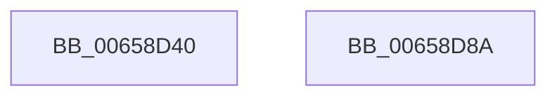

# ExEnterPriorityRegionAndAcquireResourceExclusive

- RVA: `0x00658D40`–`0x00658D8B` (길이 `75` bytes)
- VA: `0x0000000140658D40`
- 실행 섹션: `.text`
- PDB 이름 있음: `예`; PDB Function 태그: `아니요`
- unwind 정보 RVA: `0x0005CAAC`
- 디코드: `21`개 명령, `75/75` bytes 표시
- 미해석 바이트: `0` (있으면 어셈블리에 `.byte`로 보존)

> 이 문서는 커널 이미지의 기계어와 PDB 기호를 분석해 생성했습니다. 4번과 5번은 함수 원형과 자료형을 바이너리 사용 방식에서 추정한 C 해석이며 원본 소스 복구 결과는 아닙니다.

## 1. Dependencies

- 직접 호출 지점: **2**; 고유 호출 대상: **2**
- 직접 호출자로 확인된 함수: **1**
- RIP 상대 이미지 참조: **0**

### Outgoing calls
- `0x00658D61` → [PsBoostThreadIoEx](../39/PsBoostThreadIoEx_function_00392C00.md) (function, `0x00392C00`)
- `0x00658D73` → [ExAcquireResourceExclusiveLite](../21/ExAcquireResourceExclusiveLite_function_00214E20.md) (function, `0x00214E20`)

### Direct callers
- [DifExEnterPriorityRegionAndAcquireResourceExclusiveWrapper](../62/DifExEnterPriorityRegionAndAcquireResourceExclusiveWrapper_function_00620140.md) at `0x0062020D`

### Static image references
- 디코드된 RIP-relative 메모리 참조가 없습니다.

## 2. Other-region calls and transfers

- 다른 실행 섹션으로 향하는 call: **0**
- 별도 외부 분기/꼬리 이동을 확인하지 못했습니다.

## 3. Assembly (complete function range)

```asm
00658D40  48 89 5C 24 08                  mov qword ptr [rsp + 8], rbx
00658D45  57                              push rdi
00658D46  48 83 EC 20                     sub rsp, 0x20
00658D4A  65 48 8B 3C 25 88 01 00 00      mov rdi, qword ptr gs:[0x188]
00658D53  48 8B D9                        mov rbx, rcx
00658D56  48 8B CF                        mov rcx, rdi
00658D59  45 33 C9                        xor r9d, r9d
00658D5C  45 33 C0                        xor r8d, r8d
00658D5F  33 D2                           xor edx, edx
00658D61  E8 9A 9E D3 FF                  call 0x140392c00
00658D66  66 FF 8F E4 01 00 00            dec word ptr [rdi + 0x1e4]
00658D6D  B2 01                           mov dl, 1
00658D6F  48 8B CB                        mov rcx, rbx
00658D72  90                              nop
00658D73  E8 A8 C0 BB FF                  call 0x140214e20
00658D78  48 8B 87 C8 01 00 00            mov rax, qword ptr [rdi + 0x1c8]
00658D7F  48 8B 5C 24 30                  mov rbx, qword ptr [rsp + 0x30]
00658D84  48 83 C4 20                     add rsp, 0x20
00658D88  5F                              pop rdi
00658D89  C3                              ret
00658D8A  CC                              int3
```

## 4. C-style interpretation (structured pseudocode)

```c
__int64 __fastcall ExEnterPriorityRegionAndAcquireResourceExclusive(__int64 a1, int a2, int a3, int a4)
{
    __int64 result;
    __int64 v_rsp;
    unsigned __int64 v_stack_p8;

    v_stack_p8 = v_rbx;
    v_rsp = (v_rsp) - (32);
    a4 = 0;
    a3 = 0;
    a2 = 0;
    result = PsBoostThreadIoEx(*(unsigned __int64 *)(gs_base + (0 + 392)), a2, a3, a4);
    result = ExAcquireResourceExclusiveLite(a1, 1, a3, a4);
    v_rsp = (v_rsp) + (32);
    return *(unsigned __int64 *)(*(unsigned __int64 *)(gs_base + (0 + 392)) + 456);
}
```

## 5. (Beta) C Style

```c
int64_t ExEnterPriorityRegionAndAcquireResourceExclusive(int64_t Arg1, int32_t Arg2, int32_t Arg3, int32_t Arg4)
{
    int64_t result;
    int64_t local_rsp;
    uint64_t v_stack_p8;

    v_stack_p8 = local_rbx;
    local_rsp = (local_rsp) - (32);
    Arg4 = 0;
    Arg3 = 0;
    Arg2 = 0;
    result = PsBoostThreadIoEx(*(uint64_t *)(gs_base + (0 + 0x188)), Arg2, Arg3, Arg4);
    result = ExAcquireResourceExclusiveLite(Arg1, 1, Arg3, Arg4);
    local_rsp = (local_rsp) + (32);
    return *(uint64_t *)(*(uint64_t *)(gs_base + (0 + 0x188)) + 0x1C8);
}
```

## 6. Execution-region graph

[열기: 2D/3D 그래프와 함수 탐색 컨트롤 패널](../../../control-panel.html?section=text&rva=0x00658D40&view=graph)

- 2D 그래프는 위에서 아래로 흐르고, 3D 그래프는 빈 공간을 드래그해 회전합니다. Shift+드래그는 이동, 휠은 확대·축소, 함수 노드 선택은 대상 보고서 이동입니다.

### Static fallback


