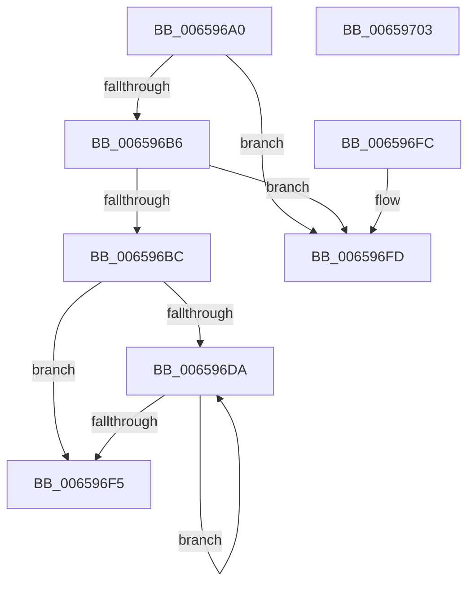

# ExExtendZone

- RVA: `0x006596A0`–`0x00659704` (길이 `100` bytes)
- VA: `0x00000001406596A0`
- 실행 섹션: `.text`
- PDB 이름 있음: `예`; PDB Function 태그: `아니요`
- unwind 정보 RVA: `0x000DB714`
- 디코드: `35`개 명령, `100/100` bytes 표시
- 미해석 바이트: `0` (있으면 어셈블리에 `.byte`로 보존)

> 이 문서는 커널 이미지의 기계어와 PDB 기호를 분석해 생성했습니다. 4번과 5번은 함수 원형과 자료형을 바이너리 사용 방식에서 추정한 C 해석이며 원본 소스 복구 결과는 아닙니다.

## 1. Dependencies

- 직접 호출 지점: **0**; 고유 호출 대상: **0**
- 직접 호출자로 확인된 함수: **1**
- RIP 상대 이미지 참조: **0**

### Outgoing calls
- 직접 디코드된 call 명령이 없습니다.

### Direct callers
- [ExInterlockedExtendZone](ExInterlockedExtendZone_function_00659790.md) at `0x006597C9`

### Static image references
- 디코드된 RIP-relative 메모리 참조가 없습니다.

## 2. Other-region calls and transfers

- 다른 실행 섹션으로 향하는 call: **0**
- 별도 외부 분기/꼬리 이동을 확인하지 못했습니다.

## 3. Assembly (complete function range)

```asm
006596A0  F6 C2 07                        test dl, 7
006596A3  4C 8B D1                        mov r10, rcx
006596A6  41 0F 94 C1                     sete r9b
006596AA  41 F6 C0 07                     test r8b, 7
006596AE  0F 94 C0                        sete al
006596B1  44 84 C8                        test al, r9b
006596B4  74 47                           je 0x1406596fd
006596B6  44 39 41 10                     cmp dword ptr [rcx + 0x10], r8d
006596BA  77 41                           ja 0x1406596fd
006596BC  48 8B 41 08                     mov rax, qword ptr [rcx + 8]
006596C0  4C 8D 4A 10                     lea r9, [rdx + 0x10]
006596C4  48 89 02                        mov qword ptr [rdx], rax
006596C7  41 8B C0                        mov eax, r8d
006596CA  2B 41 10                        sub eax, dword ptr [rcx + 0x10]
006596CD  48 89 51 08                     mov qword ptr [rcx + 8], rdx
006596D1  BA 10 00 00 00                  mov edx, 0x10
006596D6  3B C2                           cmp eax, edx
006596D8  72 1B                           jb 0x1406596f5
006596DA  49 8B 02                        mov rax, qword ptr [r10]
006596DD  49 89 01                        mov qword ptr [r9], rax
006596E0  41 8B C0                        mov eax, r8d
006596E3  41 8B 4A 10                     mov ecx, dword ptr [r10 + 0x10]
006596E7  4D 89 0A                        mov qword ptr [r10], r9
006596EA  03 D1                           add edx, ecx
006596EC  4C 03 C9                        add r9, rcx
006596EF  2B C1                           sub eax, ecx
006596F1  3B D0                           cmp edx, eax
006596F3  76 E5                           jbe 0x1406596da
006596F5  41 01 52 14                     add dword ptr [r10 + 0x14], edx
006596F9  33 C0                           xor eax, eax
006596FB  C3                              ret
006596FC  CC                              int3
006596FD  B8 01 00 00 C0                  mov eax, 0xc0000001
00659702  C3                              ret
00659703  CC                              int3
```

## 4. C-style interpretation (structured pseudocode)

```c
__int64 __fastcall ExExtendZone(__int64 a1, __int64 a2, int a3)
{
    __int64 result;

    a4 = ((((unsigned __int8)(a2)) & (7)) == 0) ? 1 : 0;
    result = ((((unsigned __int8)(a3)) & (7)) == 0) ? 1 : 0;
    if ((((unsigned __int8)(result)) & ((unsigned __int8)(a4))) == 0) goto loc_006596FD;
    if ((*(unsigned int *)(a1 + 16)) > a3) goto loc_006596FD;
    *(unsigned __int64 *)(a2) = *(unsigned __int64 *)(a1 + 8);
    result = (unsigned int)(((unsigned int)(a3)) - (*(unsigned int *)(a1 + 16)));
    *(unsigned __int64 *)(a1 + 8) = a2;
    if (((unsigned int)(result)) < 16) goto loc_006596F5;
loc_006596DA:
    *(unsigned __int64 *)(a2 + 16) = *(unsigned __int64 *)(a1);
    *(unsigned __int64 *)(a1) = a2 + 16;
    a2 = (unsigned int)((16) + ((unsigned int)((unsigned int)(*(unsigned int *)(a1 + 16)))));
    a4 = (a2 + 16) + ((unsigned int)(*(unsigned int *)(a1 + 16)));
    result = (unsigned int)(((unsigned int)(a3)) - ((unsigned int)((unsigned int)(*(unsigned int *)(a1 + 16)))));
    if (((unsigned int)(a2)) <= ((unsigned int)(result))) goto loc_006596DA;
loc_006596F5:
    result = 0;
    return result;
loc_006596FD:
    return (unsigned int)(0xC0000001ULL);
}
```

## 5. (Beta) C Style

```c
int64_t ExExtendZone(void *Arg1, int64_t Arg2, int32_t Arg3)
{
    uint8_t *arg1 = (uint8_t *)Arg1;

    int64_t result;

    a4 = ((((uint8_t)(Arg2)) & (7)) == 0) ? 1 : 0;
    result = ((((uint8_t)(Arg3)) & (7)) == 0) ? 1 : 0;
    if ((((uint8_t)(result)) & ((uint8_t)(a4))) == 0) goto loc_006596FD;
    if ((*(uint32_t *)(arg1 + 0x10)) > Arg3) goto loc_006596FD;
    *(uint64_t *)(Arg2) = *(uint64_t *)(arg1 + 0x8);
    result = (uint32_t)(((uint32_t)(Arg3)) - (*(uint32_t *)(arg1 + 0x10)));
    *(uint64_t *)(arg1 + 0x8) = Arg2;
    if (((uint32_t)(result)) < 16) goto loc_006596F5;
loc_006596DA:
    *(uint64_t *)(Arg2 + 0x10) = *(uint64_t *)(arg1);
    *(uint64_t *)(arg1) = Arg2 + 16;
    Arg2 = (uint32_t)((16) + ((uint32_t)((uint32_t)(*(uint32_t *)(arg1 + 0x10)))));
    a4 = (Arg2 + 16) + ((uint32_t)(*(uint32_t *)(arg1 + 0x10)));
    result = (uint32_t)(((uint32_t)(Arg3)) - ((uint32_t)((uint32_t)(*(uint32_t *)(arg1 + 0x10)))));
    if (((uint32_t)(Arg2)) <= ((uint32_t)(result))) goto loc_006596DA;
loc_006596F5:
    result = 0;
    return result;
loc_006596FD:
    return (uint32_t)(0xC0000001ULL);
}
```

### 관측된 메모리 오프셋

구조체 형식이 확인되지 않은 접근은 인자 기준의 오프셋으로만 기록했습니다.

| 기준 인자 | 오프셋 표현 | 폭 (bit) | 접근 |
|---|---:|---:|---|
| `Arg1` | `+ 0x0` | `64` | `R` |
| `Arg1` | `+ 0x0` | `64` | `W` |
| `Arg1` | `+ 0x8` | `64` | `R` |
| `Arg1` | `+ 0x8` | `64` | `W` |
| `Arg1` | `+ 0x10` | `32` | `R` |
| `Arg1` | `+ 0x14` | `32` | `R/W` |

## 6. Execution-region graph

[열기: 2D/3D 그래프와 함수 탐색 컨트롤 패널](../../../control-panel.html?section=text&rva=0x006596A0&view=graph)

- 2D 그래프는 위에서 아래로 흐르고, 3D 그래프는 빈 공간을 드래그해 회전합니다. Shift+드래그는 이동, 휠은 확대·축소, 함수 노드 선택은 대상 보고서 이동입니다.

### Static fallback


