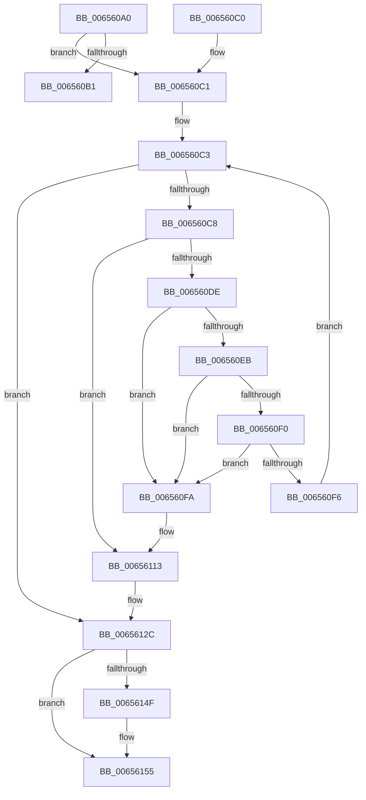

# ExFreePool2

- RVA: `0x006560A0`–`0x0065615B` (길이 `187` bytes)
- VA: `0x00000001406560A0`
- 실행 섹션: `.text`
- PDB 이름 있음: `예`; PDB Function 태그: `아니요`
- unwind 정보 RVA: `0x000D4CD8`
- 디코드: `60`개 명령, `187/187` bytes 표시
- 미해석 바이트: `0` (있으면 어셈블리에 `.byte`로 보존)

> 이 문서는 커널 이미지의 기계어와 PDB 기호를 분석해 생성했습니다. 4번과 5번은 함수 원형과 자료형을 바이너리 사용 방식에서 추정한 C 해석이며 원본 소스 복구 결과는 아닙니다.

## 1. Dependencies

- 직접 호출 지점: **6**; 고유 호출 대상: **3**
- 직접 호출자로 확인된 함수: **0**
- RIP 상대 이미지 참조: **0**

### Outgoing calls
- `0x006560B6` → [ExFreePoolWithTag](../../poolcode/B8/ExFreePoolWithTag_function_00B82870.md) (function, `0x00B82870`)
- `0x0065610D` → [KeBugCheckEx](../4F/KeBugCheckEx_function_004FD660.md) (function, `0x004FD660`)
- `0x00656126` → [KeBugCheckEx](../4F/KeBugCheckEx_function_004FD660.md) (function, `0x004FD660`)
- `0x00656132` → [ExpSecurePoolFromHandle](../4F/ExpSecurePoolFromHandle_function_004F6D48.md) (function, `0x004F6D48`)
- `0x0065614F` → [KeBugCheckEx](../4F/KeBugCheckEx_function_004FD660.md) (function, `0x004FD660`)
- `0x00656155` → [KeBugCheckEx](../4F/KeBugCheckEx_function_004FD660.md) (function, `0x004FD660`)

### Direct callers
- 이 함수 시작 RVA로 연결되는 직접 call은 확인되지 않았습니다. 간접 호출은 완전히 역산할 수 없습니다.

### Static image references
- 디코드된 RIP-relative 메모리 참조가 없습니다.

## 2. Other-region calls and transfers

- 다른 실행 섹션으로 향하는 call: **1**
  - `0x006560B6` → [ExFreePoolWithTag](../../poolcode/B8/ExFreePoolWithTag_function_00B82870.md) (`.text` → `POOLCODE`)
- 별도 외부 분기/꼬리 이동을 확인하지 못했습니다.

## 3. Assembly (complete function range)

```asm
006560A0  48 83 EC 38                     sub rsp, 0x38
006560A4  4C 8B D1                        mov r10, rcx
006560A7  4D 8B D8                        mov r11, r8
006560AA  33 C9                           xor ecx, ecx
006560AC  45 85 C9                        test r9d, r9d
006560AF  75 10                           jne 0x1406560c1
006560B1  33 D2                           xor edx, edx
006560B3  49 8B CA                        mov rcx, r10
006560B6  E8 B5 C7 52 00                  call 0x140b82870
006560BB  48 83 C4 38                     add rsp, 0x38
006560BF  C3                              ret
006560C0  CC                              int3
006560C1  33 C0                           xor eax, eax
006560C3  41 3B C1                        cmp eax, r9d
006560C6  73 64                           jae 0x14065612c
006560C8  44 8B C0                        mov r8d, eax
006560CB  49 C1 E0 04                     shl r8, 4
006560CF  4D 03 C3                        add r8, r11
006560D2  49 8B 08                        mov rcx, qword ptr [r8]
006560D5  0F B6 C9                        movzx ecx, cl
006560D8  48 83 F9 02                     cmp rcx, 2
006560DC  75 35                           jne 0x140656113
006560DE  49 8B 48 08                     mov rcx, qword ptr [r8 + 8]
006560E2  48 8B 51 08                     mov rdx, qword ptr [rcx + 8]
006560E6  48 85 D2                        test rdx, rdx
006560E9  75 0F                           jne 0x1406560fa
006560EB  39 51 18                        cmp dword ptr [rcx + 0x18], edx
006560EE  75 0A                           jne 0x1406560fa
006560F0  41 83 F9 01                     cmp r9d, 1
006560F4  75 04                           jne 0x1406560fa
006560F6  FF C0                           inc eax
006560F8  EB C9                           jmp 0x1406560c3
006560FA  8B 41 18                        mov eax, dword ptr [rcx + 0x18]
006560FD  4C 8B CA                        mov r9, rdx
00656100  BA A1 00 00 00                  mov edx, 0xa1
00656105  48 89 44 24 20                  mov qword ptr [rsp + 0x20], rax
0065610A  8D 4A 21                        lea ecx, [rdx + 0x21]
0065610D  E8 4E 75 EA FF                  call 0x1404fd660
00656112  CC                              int3
00656113  BA A0 00 00 00                  mov edx, 0xa0
00656118  48 89 4C 24 20                  mov qword ptr [rsp + 0x20], rcx
0065611D  4D 8B CB                        mov r9, r11
00656120  4D 8B C2                        mov r8, r10
00656123  8D 4A 22                        lea ecx, [rdx + 0x22]
00656126  E8 35 75 EA FF                  call 0x1404fd660
0065612B  CC                              int3
0065612C  48 8B 09                        mov rcx, qword ptr [rcx]
0065612F  45 8B C1                        mov r8d, r9d
00656132  E8 11 0C EA FF                  call 0x1404f6d48
00656137  4C 89 44 24 20                  mov qword ptr [rsp + 0x20], r8
0065613C  BA A3 00 00 00                  mov edx, 0xa3
00656141  4D 8B CB                        mov r9, r11
00656144  4D 8B C2                        mov r8, r10
00656147  8D 4A 1F                        lea ecx, [rdx + 0x1f]
0065614A  48 85 C0                        test rax, rax
0065614D  75 06                           jne 0x140656155
0065614F  E8 0C 75 EA FF                  call 0x1404fd660
00656154  CC                              int3
00656155  E8 06 75 EA FF                  call 0x1404fd660
0065615A  CC                              int3
```

## 4. C-style interpretation (structured pseudocode)

```c
__int64 __fastcall ExFreePool2(__int64 a1, int a2, __int64 a3, int a4)
{
    __int64 result;
    __int64 v_rsp;
    unsigned __int64 v_stack_p20;

    v_rsp = (v_rsp) - (56);
    a1 = 0;
    if (a4 != 0) goto loc_006560C1;
    a2 = 0;
    result = ExFreePoolWithTag(0, a2, a3, a4);
    v_rsp = (v_rsp) + (56);
    return result;
loc_006560C1:
    result = 0;
loc_006560C3:
    if (0 >= a4) goto loc_0065612C;
    a3 = (0) << (4);
    a3 = (a3) + (a3);
    if (((unsigned __int8)(*(unsigned __int64 *)(a3))) != 2) goto loc_00656113;
    if (*(unsigned __int64 *)(*(unsigned __int64 *)(a3 + 8) + 8) != 0) goto loc_006560FA;
    if ((*(unsigned int *)(*(unsigned __int64 *)(a3 + 8) + 24)) != ((unsigned int)(*(unsigned __int64 *)(*(unsigned __int64 *)(a3 + 8) + 8)))) goto loc_006560FA;
    if (a4 != 1) goto loc_006560FA;
    result = (unsigned int)((result) + 1);
    goto loc_006560C3;
loc_006560FA:
    v_stack_p20 = (unsigned int)(*(unsigned int *)(*(unsigned __int64 *)(a3 + 8) + 24));
    result = KeBugCheckEx(161 + 33, 161, a3, *(unsigned __int64 *)(*(unsigned __int64 *)(a3 + 8) + 8));
loc_00656113:
    v_stack_p20 = 161 + 33;
    result = KeBugCheckEx(160 + 34, 160, 0, a3);
loc_0065612C:
    result = ExpSecurePoolFromHandle(*(unsigned __int64 *)(160 + 34), 160, (unsigned int)((unsigned int)(a3)), a3);
    v_stack_p20 = (unsigned int)((unsigned int)(a3));
    if (result == 0) {
        result = KeBugCheckEx(163 + 31, 163, 0, a3);
    }
    result = KeBugCheckEx(163 + 31, 163, 0, a3);
    return result;
}
```

## 5. (Beta) C Style

```c
int64_t ExFreePool2(int64_t Arg1, int32_t Arg2, int64_t Arg3, int32_t Arg4)
{
    int64_t result;
    int64_t local_rsp;
    uint64_t v_stack_p20;

    local_rsp = (local_rsp) - (56);
    Arg1 = 0;
    if (Arg4 != 0) goto loc_006560C1;
    Arg2 = 0;
    result = ExFreePoolWithTag(0, Arg2, Arg3, Arg4);
    local_rsp = (local_rsp) + (56);
    return result;
loc_006560C1:
    result = 0;
loc_006560C3:
    if (0 >= Arg4) goto loc_0065612C;
    Arg3 = (0) << (4);
    Arg3 = (Arg3) + (Arg3);
    if (((uint8_t)(*(uint64_t *)(Arg3))) != 2) goto loc_00656113;
    if (*(uint64_t *)(*(uint64_t *)(Arg3 + 0x8) + 0x8) != 0) goto loc_006560FA;
    if ((*(uint32_t *)(*(uint64_t *)(Arg3 + 0x8) + 0x18)) != ((uint32_t)(*(uint64_t *)(*(uint64_t *)(Arg3 + 0x8) + 0x8)))) goto loc_006560FA;
    if (Arg4 != 1) goto loc_006560FA;
    result = (uint32_t)((result) + 1);
    goto loc_006560C3;
loc_006560FA:
    v_stack_p20 = (uint32_t)(*(uint32_t *)(*(uint64_t *)(Arg3 + 0x8) + 0x18));
    result = KeBugCheckEx(161 + 33, 161, Arg3, *(uint64_t *)(*(uint64_t *)(Arg3 + 0x8) + 0x8));
loc_00656113:
    v_stack_p20 = 161 + 33;
    result = KeBugCheckEx(160 + 34, 160, 0, Arg3);
loc_0065612C:
    result = ExpSecurePoolFromHandle(*(uint64_t *)(160 + 0x22), 160, (uint32_t)((uint32_t)(Arg3)), Arg3);
    v_stack_p20 = (uint32_t)((uint32_t)(Arg3));
    if (result == 0) {
        result = KeBugCheckEx(163 + 31, 163, 0, Arg3);
    }
    result = KeBugCheckEx(163 + 31, 163, 0, Arg3);
    return result;
}
```

## 6. Execution-region graph

[열기: 2D/3D 그래프와 함수 탐색 컨트롤 패널](../../../control-panel.html?section=text&rva=0x006560A0&view=graph)

- 2D 그래프는 위에서 아래로 흐르고, 3D 그래프는 빈 공간을 드래그해 회전합니다. Shift+드래그는 이동, 휠은 확대·축소, 함수 노드 선택은 대상 보고서 이동입니다.

### Static fallback


