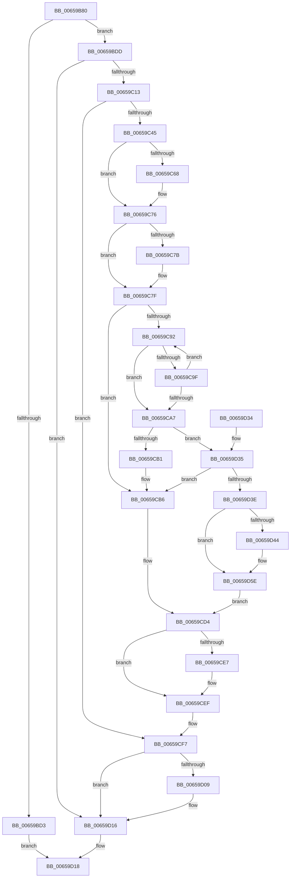

# ExInitializeDeviceAts

- RVA: `0x00659B80`–`0x00659D66` (길이 `486` bytes)
- VA: `0x0000000140659B80`
- 실행 섹션: `.text`
- PDB 이름 있음: `예`; PDB Function 태그: `아니요`
- unwind 정보 RVA: `0x000D5440`
- 디코드: `131`개 명령, `486/486` bytes 표시
- 미해석 바이트: `0` (있으면 어셈블리에 `.byte`로 보존)

> 이 문서는 커널 이미지의 기계어와 PDB 기호를 분석해 생성했습니다. 4번과 5번은 함수 원형과 자료형을 바이너리 사용 방식에서 추정한 C 해석이며 원본 소스 복구 결과는 아닙니다.

## 1. Dependencies

- 직접 호출 지점: **11**; 고유 호출 대상: **9**
- 직접 호출자로 확인된 함수: **0**
- RIP 상대 이미지 참조: **5**

### Outgoing calls
- `0x00659BC1` → [memset](../6C/memset_function_006C6C40.md) (function, `0x006C6C40`)
- `0x00659C04` → [IoQueryInterface](../../page/72/IoQueryInterface_function_00729930.md) (function, `0x00729930`)
- `0x00659C36` → [IoQueryInterface](../../page/72/IoQueryInterface_function_00729930.md) (function, `0x00729930`)
- `0x00659C57` → [KeAbPreAcquire](../21/KeAbPreAcquire_function_00210230.md) (function, `0x00210230`)
- `0x00659C71` → [ExfAcquirePushLockExclusiveEx](../20/ExfAcquirePushLockExclusiveEx_function_0020FC90.md) (function, `0x0020FC90`)
- `0x00659CCD` → [ExpPrepareNewAtsDevice](ExpPrepareNewAtsDevice_function_00659FB0.md) (function, `0x00659FB0`)
- `0x00659CEA` → [ExfTryToWakePushLock](../26/ExfTryToWakePushLock_function_00265DD0.md) (function, `0x00265DD0`)
- `0x00659CF2` → [KeAbPostRelease](../2E/KeAbPostRelease_function_002E1600.md) (function, `0x002E1600`)
- `0x00659CFF` → [guard_dispatch_icall](../6B/guard_dispatch_icall_function_006BAAD0.md) (function, `0x006BAAD0`)
- `0x00659D11` → [guard_dispatch_icall](../6B/guard_dispatch_icall_function_006BAAD0.md) (function, `0x006BAAD0`)
- `0x00659D58` → [KeBugCheckEx](../4F/KeBugCheckEx_function_004FD660.md) (function, `0x004FD660`)

### Direct callers
- 이 함수 시작 RVA로 연결되는 직접 call은 확인되지 않았습니다. 간접 호출은 완전히 역산할 수 없습니다.

### Static image references
- `0x00659BEB` → RVA `0x00019F50` (`.rdata`; read)
- `0x00659C27` → RVA `0x00024078` (`.rdata`; read)
- `0x00659C45` → RVA `0x00EFA8E8` (`.data`; read)
- `0x00659C7F` → RVA `0x00EFA8F0` (`.data`; read)
- `0x00659CD8` → RVA `0x00EFA8E8` (`.data`; read/write)

## 2. Other-region calls and transfers

- 다른 실행 섹션으로 향하는 call: **2**
  - `0x00659C04` → [IoQueryInterface](../../page/72/IoQueryInterface_function_00729930.md) (`.text` → `PAGE`)
  - `0x00659C36` → [IoQueryInterface](../../page/72/IoQueryInterface_function_00729930.md) (`.text` → `PAGE`)
- 별도 외부 분기/꼬리 이동을 확인하지 못했습니다.

## 3. Assembly (complete function range)

```asm
00659B80  48 89 5C 24 10                  mov qword ptr [rsp + 0x10], rbx
00659B85  48 89 74 24 18                  mov qword ptr [rsp + 0x18], rsi
00659B8A  55                              push rbp
00659B8B  57                              push rdi
00659B8C  41 55                           push r13
00659B8E  41 56                           push r14
00659B90  41 57                           push r15
00659B92  48 8D 6C 24 C9                  lea rbp, [rsp - 0x37]
00659B97  48 81 EC C0 00 00 00            sub rsp, 0xc0
00659B9E  0F 57 C0                        xorps xmm0, xmm0
00659BA1  44 8B FA                        mov r15d, edx
00659BA4  48 8B D9                        mov rbx, rcx
00659BA7  BE 50 00 00 00                  mov esi, 0x50
00659BAC  44 8B C6                        mov r8d, esi
00659BAF  48 8D 4D E7                     lea rcx, [rbp - 0x19]
00659BB3  33 D2                           xor edx, edx
00659BB5  0F 11 45 B7                     movups xmmword ptr [rbp - 0x49], xmm0
00659BB9  0F 11 45 C7                     movups xmmword ptr [rbp - 0x39], xmm0
00659BBD  0F 11 45 D7                     movups xmmword ptr [rbp - 0x29], xmm0
00659BC1  E8 7A D0 06 00                  call 0x1406c6c40
00659BC6  48 83 65 67 00                  and qword ptr [rbp + 0x67], 0
00659BCB  45 32 F6                        xor r14b, r14b
00659BCE  48 85 DB                        test rbx, rbx
00659BD1  75 0A                           jne 0x140659bdd
00659BD3  B8 0D 00 00 C0                  mov eax, 0xc000000d
00659BD8  E9 3B 01 00 00                  jmp 0x140659d18
00659BDD  48 8D 45 E7                     lea rax, [rbp - 0x19]
00659BE1  BF 01 00 00 00                  mov edi, 1
00659BE6  48 89 44 24 30                  mov qword ptr [rsp + 0x30], rax
00659BEB  4C 8D 05 5E 03 9C FF            lea r8, [rip - 0x63fca2]
00659BF2  48 89 5C 24 28                  mov qword ptr [rsp + 0x28], rbx
00659BF7  44 8B CE                        mov r9d, esi
00659BFA  33 D2                           xor edx, edx
00659BFC  66 89 7C 24 20                  mov word ptr [rsp + 0x20], di
00659C01  48 8B CB                        mov rcx, rbx
00659C04  E8 27 FD 0C 00                  call 0x140729930
00659C09  8B F0                           mov esi, eax
00659C0B  85 C0                           test eax, eax
00659C0D  0F 88 03 01 00 00               js 0x140659d16
00659C13  48 8D 45 B7                     lea rax, [rbp - 0x49]
00659C17  33 D2                           xor edx, edx
00659C19  48 89 44 24 30                  mov qword ptr [rsp + 0x30], rax
00659C1E  44 8D 4F 2F                     lea r9d, [rdi + 0x2f]
00659C22  48 89 5C 24 28                  mov qword ptr [rsp + 0x28], rbx
00659C27  4C 8D 05 4A A4 9C FF            lea r8, [rip - 0x635bb6]
00659C2E  48 8B CB                        mov rcx, rbx
00659C31  66 89 7C 24 20                  mov word ptr [rsp + 0x20], di
00659C36  E8 F5 FC 0C 00                  call 0x140729930
00659C3B  8B F0                           mov esi, eax
00659C3D  85 C0                           test eax, eax
00659C3F  0F 88 B2 00 00 00               js 0x140659cf7
00659C45  4C 8D 2D 9C 0C 8A 00            lea r13, [rip + 0x8a0c9c]
00659C4C  45 33 C0                        xor r8d, r8d
00659C4F  49 8B CD                        mov rcx, r13
00659C52  33 D2                           xor edx, edx
00659C54  44 8A F7                        mov r14b, dil
00659C57  E8 D4 65 BB FF                  call 0x140210230
00659C5C  F0 49 0F BA 6D 00 00            lock bts qword ptr [r13], 0
00659C63  48 8B F8                        mov rdi, rax
00659C66  73 0E                           jae 0x140659c76
00659C68  4D 8B C5                        mov r8, r13
00659C6B  48 8B D0                        mov rdx, rax
00659C6E  49 8B CD                        mov rcx, r13
00659C71  E8 1A 60 BB FF                  call 0x14020fc90
00659C76  48 85 FF                        test rdi, rdi
00659C79  74 04                           je 0x140659c7f
00659C7B  44 88 77 0A                     mov byte ptr [rdi + 0xa], r14b
00659C7F  48 8B 05 6A 0C 8A 00            mov rax, qword ptr [rip + 0x8a0c6a]
00659C86  48 8D 15 63 0C 8A 00            lea rdx, [rip + 0x8a0c63]
00659C8D  48 3B C2                        cmp rax, rdx
00659C90  74 24                           je 0x140659cb6
00659C92  48 8B C8                        mov rcx, rax
00659C95  48 89 45 67                     mov qword ptr [rbp + 0x67], rax
00659C99  48 39 58 18                     cmp qword ptr [rax + 0x18], rbx
00659C9D  74 08                           je 0x140659ca7
00659C9F  48 8B 00                        mov rax, qword ptr [rax]
00659CA2  48 3B C2                        cmp rax, rdx
00659CA5  75 EB                           jne 0x140659c92
00659CA7  48 39 59 18                     cmp qword ptr [rcx + 0x18], rbx
00659CAB  0F 84 84 00 00 00               je 0x140659d35
00659CB1  48 83 65 67 00                  and qword ptr [rbp + 0x67], 0
00659CB6  48 8D 45 67                     lea rax, [rbp + 0x67]
00659CBA  41 8B D7                        mov edx, r15d
00659CBD  4C 8D 4D B7                     lea r9, [rbp - 0x49]
00659CC1  48 89 44 24 20                  mov qword ptr [rsp + 0x20], rax
00659CC6  4C 8D 45 E7                     lea r8, [rbp - 0x19]
00659CCA  48 8B CB                        mov rcx, rbx
00659CCD  E8 DE 02 00 00                  call 0x140659fb0
00659CD2  8B F0                           mov esi, eax
00659CD4  48 83 C8 FF                     or rax, 0xffffffffffffffff
00659CD8  F0 48 0F C1 05 07 0C 8A 00      lock xadd qword ptr [rip + 0x8a0c07], rax
00659CE1  24 06                           and al, 6
00659CE3  3C 02                           cmp al, 2
00659CE5  75 08                           jne 0x140659cef
00659CE7  49 8B CD                        mov rcx, r13
00659CEA  E8 E1 C0 C0 FF                  call 0x140265dd0
00659CEF  49 8B CD                        mov rcx, r13
00659CF2  E8 09 79 C8 FF                  call 0x1402e1600
00659CF7  48 8B 4D EF                     mov rcx, qword ptr [rbp - 0x11]
00659CFB  48 8B 45 FF                     mov rax, qword ptr [rbp - 1]
00659CFF  E8 CC 0D 06 00                  call 0x1406baad0
00659D04  45 84 F6                        test r14b, r14b
00659D07  74 0D                           je 0x140659d16
00659D09  48 8B 4D BF                     mov rcx, qword ptr [rbp - 0x41]
00659D0D  48 8B 45 CF                     mov rax, qword ptr [rbp - 0x31]
00659D11  E8 BA 0D 06 00                  call 0x1406baad0
00659D16  8B C6                           mov eax, esi
00659D18  4C 8D 9C 24 C0 00 00 00         lea r11, [rsp + 0xc0]
00659D20  49 8B 5B 38                     mov rbx, qword ptr [r11 + 0x38]
00659D24  49 8B 73 40                     mov rsi, qword ptr [r11 + 0x40]
00659D28  49 8B E3                        mov rsp, r11
00659D2B  41 5F                           pop r15
00659D2D  41 5E                           pop r14
00659D2F  41 5D                           pop r13
00659D31  5F                              pop rdi
00659D32  5D                              pop rbp
00659D33  C3                              ret
00659D34  CC                              int3
00659D35  48 85 C9                        test rcx, rcx
00659D38  0F 84 78 FF FF FF               je 0x140659cb6
00659D3E  83 79 24 00                     cmp dword ptr [rcx + 0x24], 0
00659D42  74 1A                           je 0x140659d5e
00659D44  48 83 64 24 20 00               and qword ptr [rsp + 0x20], 0
00659D4A  45 33 C9                        xor r9d, r9d
00659D4D  45 33 C0                        xor r8d, r8d
00659D50  48 8B D3                        mov rdx, rbx
00659D53  B9 E9 01 00 00                  mov ecx, 0x1e9
00659D58  E8 03 39 EA FF                  call 0x1404fd660
00659D5D  CC                              int3
00659D5E  FF 41 20                        inc dword ptr [rcx + 0x20]
00659D61  E9 6E FF FF FF                  jmp 0x140659cd4
```

## 4. C-style interpretation (structured pseudocode)

```c
__int64 __fastcall ExInitializeDeviceAts(__int64 a1, int a2)
{
    __int64 result;
    __int64 v_r14;
    __int64 v_rsp;
    unsigned __int64 v_stack_m28;
    unsigned __int64 v_stack_m5F;
    unsigned __int64 v_stack_m60;
    unsigned __int64 v_stack_m70;
    unsigned __int64 v_stack_m78;
    unsigned __int64 v_stack_m88;
    unsigned __int64 v_stack_m90;
    unsigned __int64 v_stack_m98;
    unsigned __int64 v_stack_mA0;
    unsigned __int64 v_stack_mA8;
    unsigned __int64 v_stack_mB8;
    unsigned __int64 v_stack_mC0;
    unsigned __int16 v_stack_mC8;
    unsigned __int64 v_stack_p10;
    unsigned __int64 v_stack_p18;
    unsigned __int64 v_stack_p8;

    v_stack_p10 = v_rbx;
    v_stack_p18 = v_rsi;
    v_rsp = (v_rsp) - (192);
    a2 = 0;
    v_stack_mA8 = v_xmm0;
    v_stack_m98 = v_xmm0;
    v_stack_m88 = v_xmm0;
    result = memset(v_stack_m78, a2, 80, a4);
    v_r14 = 0;
    if (a1 != 0) goto loc_00659BDD;
    goto loc_00659D18;
loc_00659BDD:
    v_stack_mB8 = v_stack_m78;
    v_stack_mC0 = a1;
    a2 = 0;
    v_stack_mC8 = 1;
    result = IoQueryInterface(a1, a2, v_rip - 6552738, 80);
    if (sign_flag) goto loc_00659D16;
    a2 = 0;
    v_stack_mB8 = v_stack_mA8;
    v_stack_mC0 = a1;
    v_stack_mC8 = 1;
    result = IoQueryInterface(a1, a2, v_rip - 6511542, 1 + 47);
    if (sign_flag) goto loc_00659CF7;
    a3 = 0;
    a2 = 0;
    result = KeAbPreAcquire(v_rip + 9047196, a2, a3, 1 + 47);
    if (!(condition_is_above_or_equal)) {
        a3 = v_rip + 9047196;
        a2 = result;
        a1 = v_rip + 9047196;
        result = ExfAcquirePushLockExclusiveEx(a1, a2, a3, 1 + 47);
    }
    if (result != 0) {
        *(unsigned __int8 *)(result + 10) = 1;
    }
    if ((*(unsigned __int64 *)(v_rip + 9047146)) == (v_rip + 9047139)) goto loc_00659CB6;
loc_00659C92:
    v_stack_p8 = *(unsigned __int64 *)(v_rip + 9047146);
    if ((*(unsigned __int64 *)(*(unsigned __int64 *)(v_rip + 9047146) + 24)) == a1) goto loc_00659CA7;
    if ((*(unsigned __int64 *)(*(unsigned __int64 *)(v_rip + 9047146))) != (v_rip + 9047139)) goto loc_00659C92;
loc_00659CA7:
    if ((*(unsigned __int64 *)(*(unsigned __int64 *)(v_rip + 9047146) + 24)) == a1) goto loc_00659D35;
loc_00659CB6:
    v_stack_mC8 = v_stack_p8;
    result = ExpPrepareNewAtsDevice(a1, (unsigned int)((unsigned int)((unsigned int)(a2))), v_stack_m78, v_stack_mA8);
loc_00659CD4:
    result = (result) | (-1);
    result = (unsigned __int8)((result) & (6));
    if (((unsigned __int8)(result)) == 2) {
        a1 = v_rip + 9047196;
        result = ExfTryToWakePushLock(a1, (unsigned int)((unsigned int)((unsigned int)(a2))), v_stack_m78, v_stack_mA8);
    }
    result = KeAbPostRelease(v_rip + 9047196, (unsigned int)((unsigned int)((unsigned int)(a2))), v_stack_m78, v_stack_mA8);
loc_00659CF7:
    result = guard_dispatch_icall(v_stack_m70, (unsigned int)((unsigned int)((unsigned int)(a2))), v_stack_m78, v_stack_mA8);
    if (1 != 0) {
        a1 = v_stack_mA0;
        result = v_stack_m90;
        result = guard_dispatch_icall(a1, (unsigned int)((unsigned int)((unsigned int)(a2))), v_stack_m78, v_stack_mA8);
    }
loc_00659D18:
    return (unsigned int)((unsigned int)((unsigned int)((unsigned int)(result))));
loc_00659D35:
    if (a1 == 0) goto loc_00659CB6;
    result = (unsigned int)((unsigned int)((unsigned int)((unsigned int)(result))));
    if ((*(unsigned int *)(a1 + 36)) != 0) {
        a4 = 0;
        a3 = 0;
        a2 = *(unsigned __int64 *)(v_stack_m28 + 56);
        a1 = 489;
        result = KeBugCheckEx(a1, a2, a3, a4);
    }
    goto loc_00659CD4;
}
```

## 5. (Beta) C Style

```c
int64_t ExInitializeDeviceAts(int64_t Arg1, int32_t Arg2)
{
    int64_t result;
    int64_t local_r14;
    int64_t local_rsp;
    uint64_t v_stack_m28;
    uint64_t v_stack_m5F;
    uint64_t v_stack_m60;
    uint64_t v_stack_m70;
    uint64_t v_stack_m78;
    uint64_t v_stack_m88;
    uint64_t v_stack_m90;
    uint64_t v_stack_m98;
    uint64_t v_stack_mA0;
    uint64_t v_stack_mA8;
    uint64_t v_stack_mB8;
    uint64_t v_stack_mC0;
    uint16_t v_stack_mC8;
    uint64_t v_stack_p10;
    uint64_t v_stack_p18;
    uint64_t v_stack_p8;

    v_stack_p10 = local_rbx;
    v_stack_p18 = local_rsi;
    local_rsp = (local_rsp) - (192);
    Arg2 = 0;
    v_stack_mA8 = v_xmm0;
    v_stack_m98 = v_xmm0;
    v_stack_m88 = v_xmm0;
    result = memset(v_stack_m78, Arg2, 80, a4);
    local_r14 = 0;
    if (Arg1 != 0) goto loc_00659BDD;
    goto loc_00659D18;
loc_00659BDD:
    v_stack_mB8 = v_stack_m78;
    v_stack_mC0 = Arg1;
    Arg2 = 0;
    v_stack_mC8 = 1;
    result = IoQueryInterface(Arg1, Arg2, v_rip - 6552738, 80);
    if (sign_flag) goto loc_00659D16;
    Arg2 = 0;
    v_stack_mB8 = v_stack_mA8;
    v_stack_mC0 = Arg1;
    v_stack_mC8 = 1;
    result = IoQueryInterface(Arg1, Arg2, v_rip - 6511542, 1 + 47);
    if (sign_flag) goto loc_00659CF7;
    a3 = 0;
    Arg2 = 0;
    result = KeAbPreAcquire(v_rip + 9047196, Arg2, a3, 1 + 47);
    if (!(condition_is_above_or_equal)) {
        a3 = v_rip + 9047196;
        Arg2 = result;
        Arg1 = v_rip + 9047196;
        result = ExfAcquirePushLockExclusiveEx(Arg1, Arg2, a3, 1 + 47);
    }
    if (result != 0) {
        *(uint8_t *)(result + 0xA) = 1;
    }
    if ((*(uint64_t *)(v_rip + 0x8A0C6A)) == (v_rip + 9047139)) goto loc_00659CB6;
loc_00659C92:
    v_stack_p8 = *(uint64_t *)(v_rip + 0x8A0C6A);
    if ((*(uint64_t *)(*(uint64_t *)(v_rip + 0x8A0C6A) + 0x18)) == Arg1) goto loc_00659CA7;
    if ((*(uint64_t *)(*(uint64_t *)(v_rip + 0x8A0C6A))) != (v_rip + 9047139)) goto loc_00659C92;
loc_00659CA7:
    if ((*(uint64_t *)(*(uint64_t *)(v_rip + 0x8A0C6A) + 0x18)) == Arg1) goto loc_00659D35;
loc_00659CB6:
    v_stack_mC8 = v_stack_p8;
    result = ExpPrepareNewAtsDevice(Arg1, (uint32_t)((uint32_t)((uint32_t)(Arg2))), v_stack_m78, v_stack_mA8);
loc_00659CD4:
    result = (result) | (-1);
    result = (uint8_t)((result) & (6));
    if (((uint8_t)(result)) == 2) {
        Arg1 = v_rip + 9047196;
        result = ExfTryToWakePushLock(Arg1, (uint32_t)((uint32_t)((uint32_t)(Arg2))), v_stack_m78, v_stack_mA8);
    }
    result = KeAbPostRelease(v_rip + 9047196, (uint32_t)((uint32_t)((uint32_t)(Arg2))), v_stack_m78, v_stack_mA8);
loc_00659CF7:
    result = guard_dispatch_icall(v_stack_m70, (uint32_t)((uint32_t)((uint32_t)(Arg2))), v_stack_m78, v_stack_mA8);
    if (1 != 0) {
        Arg1 = v_stack_mA0;
        result = v_stack_m90;
        result = guard_dispatch_icall(Arg1, (uint32_t)((uint32_t)((uint32_t)(Arg2))), v_stack_m78, v_stack_mA8);
    }
loc_00659D18:
    return (uint32_t)((uint32_t)((uint32_t)((uint32_t)(result))));
loc_00659D35:
    if (Arg1 == 0) goto loc_00659CB6;
    result = (uint32_t)((uint32_t)((uint32_t)((uint32_t)(result))));
    if ((*(uint32_t *)(Arg1 + 0x24)) != 0) {
        a4 = 0;
        a3 = 0;
        Arg2 = *(uint64_t *)(v_stack_m28 + 0x38);
        Arg1 = 489;
        result = KeBugCheckEx(Arg1, Arg2, a3, a4);
    }
    goto loc_00659CD4;
}
```

## 6. Execution-region graph

[열기: 2D/3D 그래프와 함수 탐색 컨트롤 패널](../../../control-panel.html?section=text&rva=0x00659B80&view=graph)

- 2D 그래프는 위에서 아래로 흐르고, 3D 그래프는 빈 공간을 드래그해 회전합니다. Shift+드래그는 이동, 휠은 확대·축소, 함수 노드 선택은 대상 보고서 이동입니다.

### Static fallback


