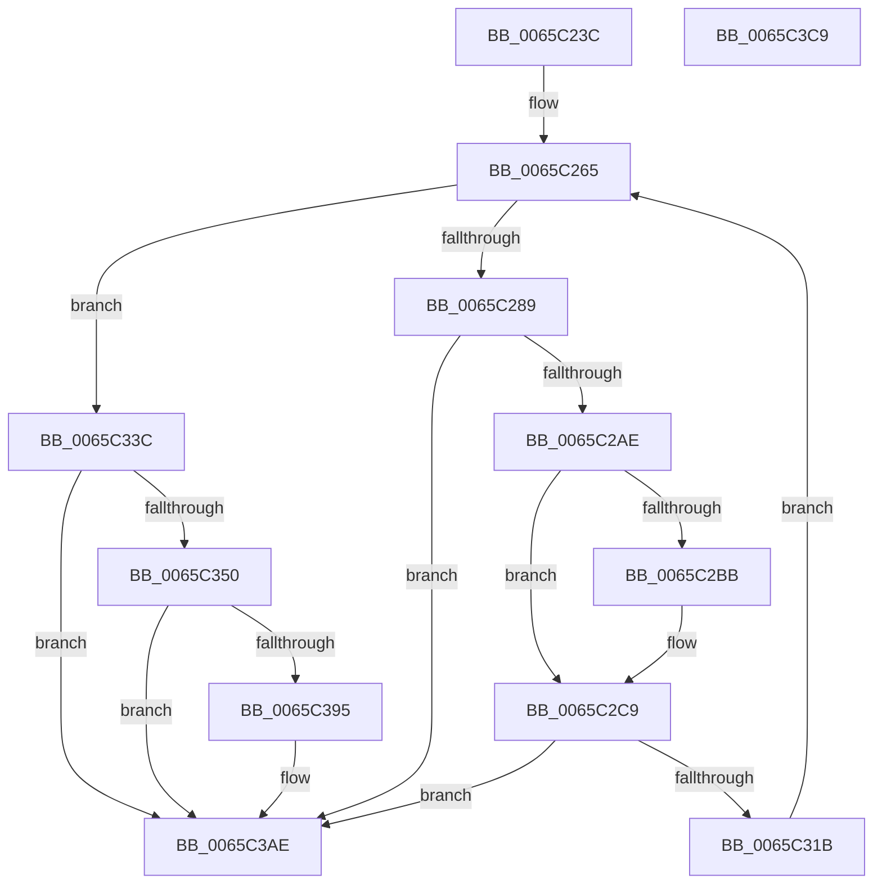

# ExInitializePagedHeaps

- RVA: `0x0065C23C`–`0x0065C3CA` (길이 `398` bytes)
- VA: `0x000000014065C23C`
- 실행 섹션: `.text`
- PDB 이름 있음: `예`; PDB Function 태그: `아니요`
- unwind 정보 RVA: `0x000D5814`
- 디코드: `94`개 명령, `398/398` bytes 표시
- 미해석 바이트: `0` (있으면 어셈블리에 `.byte`로 보존)

> 이 문서는 커널 이미지의 기계어와 PDB 기호를 분석해 생성했습니다. 4번과 5번은 함수 원형과 자료형을 바이너리 사용 방식에서 추정한 C 해석이며 원본 소스 복구 결과는 아닙니다.

## 1. Dependencies

- 직접 호출 지점: **5**; 고유 호출 대상: **2**
- 직접 호출자로 확인된 함수: **1**
- RIP 상대 이미지 참조: **5**

### Outgoing calls
- `0x0065C29F` → [ExCreateHeap](ExCreateHeap_function_0065C1F0.md) (function, `0x0065C1F0`)
- `0x0065C2DE` → [RtlpDynamicLookasideInitialize](../6A/RtlpDynamicLookasideInitialize_function_006A88E8.md) (function, `0x006A88E8`)
- `0x0065C30C` → [ExCreateHeap](ExCreateHeap_function_0065C1F0.md) (function, `0x0065C1F0`)
- `0x0065C345` → [ExCreateHeap](ExCreateHeap_function_0065C1F0.md) (function, `0x0065C1F0`)
- `0x0065C38A` → [ExCreateHeap](ExCreateHeap_function_0065C1F0.md) (function, `0x0065C1F0`)

### Direct callers
- [MiInitSystem](../../init/C5/MiInitSystem_function_00C5E6C0.md) at `0x00C5E799`

### Static image references
- `0x0065C25C` → RVA `0x00E68600` (`.data`; read)
- `0x0065C265` → RVA `0x00E6BF10` (`.data`; read)
- `0x0065C2AE` → RVA `0x00EFA834` (`.data`; read)
- `0x0065C37E` → RVA `0x00EEEF50` (`.data`; write)
- `0x0065C3A7` → RVA `0x00EEEF58` (`.data`; write)

## 2. Other-region calls and transfers

- 다른 실행 섹션으로 향하는 call: **0**
- 별도 외부 분기/꼬리 이동을 확인하지 못했습니다.

## 3. Assembly (complete function range)

```asm
0065C23C  48 89 5C 24 10                  mov qword ptr [rsp + 0x10], rbx
0065C241  48 89 74 24 18                  mov qword ptr [rsp + 0x18], rsi
0065C246  48 89 7C 24 20                  mov qword ptr [rsp + 0x20], rdi
0065C24B  55                              push rbp
0065C24C  41 55                           push r13
0065C24E  41 56                           push r14
0065C250  48 8B EC                        mov rbp, rsp
0065C253  48 83 EC 30                     sub rsp, 0x30
0065C257  48 83 65 20 00                  and qword ptr [rbp + 0x20], 0
0065C25C  4C 8D 2D 9D C3 80 00            lea r13, [rip + 0x80c39d]
0065C263  33 FF                           xor edi, edi
0065C265  3B 3D A5 FC 80 00               cmp edi, dword ptr [rip + 0x80fca5]
0065C26B  4C 8D 45 20                     lea r8, [rbp + 0x20]
0065C26F  0F 57 C0                        xorps xmm0, xmm0
0065C272  48 8D 4D F0                     lea rcx, [rbp - 0x10]
0065C276  0F 11 45 F0                     movups xmmword ptr [rbp - 0x10], xmm0
0065C27A  C6 45 F0 02                     mov byte ptr [rbp - 0x10], 2
0065C27E  BA 00 00 40 00                  mov edx, 0x400000
0065C283  0F 83 B3 00 00 00               jae 0x14065c33c
0065C289  40 88 7D F2                     mov byte ptr [rbp - 0xe], dil
0065C28D  0F 28 45 F0                     movaps xmm0, xmmword ptr [rbp - 0x10]
0065C291  8B C7                           mov eax, edi
0065C293  66 0F 7F 45 F0                  movdqa xmmword ptr [rbp - 0x10], xmm0
0065C298  4C 69 F0 C0 20 00 00            imul r14, rax, 0x20c0
0065C29F  E8 4C FF FF FF                  call 0x14065c1f0
0065C2A4  8B C8                           mov ecx, eax
0065C2A6  85 C0                           test eax, eax
0065C2A8  0F 88 00 01 00 00               js 0x14065c3ae
0065C2AE  83 3D 7F E5 89 00 00            cmp dword ptr [rip + 0x89e57f], 0
0065C2B5  48 8B 75 20                     mov rsi, qword ptr [rbp + 0x20]
0065C2B9  74 0E                           je 0x14065c2c9
0065C2BB  80 8E 4D 01 00 00 08            or byte ptr [rsi + 0x14d], 8
0065C2C2  80 8E 0D 02 00 00 08            or byte ptr [rsi + 0x20d], 8
0065C2C9  49 8D 9D 80 39 00 00            lea rbx, [r13 + 0x3980]
0065C2D0  4B 89 B4 2E 50 39 00 00         mov qword ptr [r14 + r13 + 0x3950], rsi
0065C2D8  49 03 DE                        add rbx, r14
0065C2DB  48 8B CB                        mov rcx, rbx
0065C2DE  E8 05 C6 04 00                  call 0x1406a88e8
0065C2E3  0F 57 C0                        xorps xmm0, xmm0
0065C2E6  48 89 5E 38                     mov qword ptr [rsi + 0x38], rbx
0065C2EA  0F 11 45 F0                     movups xmmword ptr [rbp - 0x10], xmm0
0065C2EE  40 88 7D F2                     mov byte ptr [rbp - 0xe], dil
0065C2F2  4C 8D 45 20                     lea r8, [rbp + 0x20]
0065C2F6  C6 45 F0 0A                     mov byte ptr [rbp - 0x10], 0xa
0065C2FA  48 8D 4D F0                     lea rcx, [rbp - 0x10]
0065C2FE  0F 28 45 F0                     movaps xmm0, xmmword ptr [rbp - 0x10]
0065C302  BA 00 00 40 00                  mov edx, 0x400000
0065C307  66 0F 7F 45 F0                  movdqa xmmword ptr [rbp - 0x10], xmm0
0065C30C  E8 DF FE FF FF                  call 0x14065c1f0
0065C311  8B C8                           mov ecx, eax
0065C313  85 C0                           test eax, eax
0065C315  0F 88 93 00 00 00               js 0x14065c3ae
0065C31B  48 8B 45 20                     mov rax, qword ptr [rbp + 0x20]
0065C31F  4B 89 84 2E 58 39 00 00         mov qword ptr [r14 + r13 + 0x3958], rax
0065C327  80 88 4D 01 00 00 08            or byte ptr [rax + 0x14d], 8
0065C32E  80 88 0D 02 00 00 08            or byte ptr [rax + 0x20d], 8
0065C335  FF C7                           inc edi
0065C337  E9 29 FF FF FF                  jmp 0x14065c265
0065C33C  0F 28 4D F0                     movaps xmm1, xmmword ptr [rbp - 0x10]
0065C340  66 0F 7F 4D F0                  movdqa xmmword ptr [rbp - 0x10], xmm1
0065C345  E8 A6 FE FF FF                  call 0x14065c1f0
0065C34A  8B C8                           mov ecx, eax
0065C34C  85 C0                           test eax, eax
0065C34E  78 5E                           js 0x14065c3ae
0065C350  48 8B 45 20                     mov rax, qword ptr [rbp + 0x20]
0065C354  4C 8D 45 20                     lea r8, [rbp + 0x20]
0065C358  0F 57 C0                        xorps xmm0, xmm0
0065C35B  48 8D 4D F0                     lea rcx, [rbp - 0x10]
0065C35F  0F 11 45 F0                     movups xmmword ptr [rbp - 0x10], xmm0
0065C363  C6 45 F0 0A                     mov byte ptr [rbp - 0x10], 0xa
0065C367  BA 00 00 40 00                  mov edx, 0x400000
0065C36C  0F 28 4D F0                     movaps xmm1, xmmword ptr [rbp - 0x10]
0065C370  80 88 4D 01 00 00 08            or byte ptr [rax + 0x14d], 8
0065C377  80 88 0D 02 00 00 08            or byte ptr [rax + 0x20d], 8
0065C37E  48 89 05 CB 2B 89 00            mov qword ptr [rip + 0x892bcb], rax
0065C385  66 0F 7F 4D F0                  movdqa xmmword ptr [rbp - 0x10], xmm1
0065C38A  E8 61 FE FF FF                  call 0x14065c1f0
0065C38F  8B C8                           mov ecx, eax
0065C391  85 C0                           test eax, eax
0065C393  78 19                           js 0x14065c3ae
0065C395  48 8B 45 20                     mov rax, qword ptr [rbp + 0x20]
0065C399  80 88 4D 01 00 00 08            or byte ptr [rax + 0x14d], 8
0065C3A0  80 88 0D 02 00 00 08            or byte ptr [rax + 0x20d], 8
0065C3A7  48 89 05 AA 2B 89 00            mov qword ptr [rip + 0x892baa], rax
0065C3AE  48 8B 5C 24 58                  mov rbx, qword ptr [rsp + 0x58]
0065C3B3  8B C1                           mov eax, ecx
0065C3B5  48 8B 74 24 60                  mov rsi, qword ptr [rsp + 0x60]
0065C3BA  48 8B 7C 24 68                  mov rdi, qword ptr [rsp + 0x68]
0065C3BF  48 83 C4 30                     add rsp, 0x30
0065C3C3  41 5E                           pop r14
0065C3C5  41 5D                           pop r13
0065C3C7  5D                              pop rbp
0065C3C8  C3                              ret
0065C3C9  CC                              int3
```

## 4. C-style interpretation (structured pseudocode)

```c
__int64 __fastcall ExInitializePagedHeaps(void)
{
    __int64 result;
    __int64 v_r14;
    __int64 v_rbx;
    __int64 v_rdi;
    __int64 v_rsp;
    unsigned __int8 v_stack_m26;
    unsigned __int64 v_stack_m28;
    unsigned __int64 v_stack_p10;
    unsigned __int64 v_stack_p18;
    unsigned __int64 v_stack_p20;
    unsigned __int64 v_stack_p8;

    v_stack_p10 = v_rbx;
    v_stack_p18 = v_rsi;
    v_stack_p20 = v_rdi;
    v_rsp = (v_rsp) - (48);
    v_rdi = 0;
loc_0065C265:
    v_stack_m28 = v_xmm0;
    v_stack_m28 = 2;
    if (0 >= (*(unsigned int *)(v_rip + 8453285))) goto loc_0065C33C;
    v_stack_m26 = 0;
    v_stack_m28 = v_xmm0;
    v_r14 = (v_r14) * (0);
    result = ExCreateHeap(v_stack_m28, (unsigned int)(0x400000ULL), v_stack_p8, a4);
    if (sign_flag) goto loc_0065C3AE;
    if ((*(unsigned int *)(v_rip + 9037183)) != 0) {
    }
    *(unsigned __int64 *)(v_r14 + v_rip + 8438685 * 1 + 14672) = v_stack_p8;
    v_rbx = (v_rip + 8438685 + 14720) + (v_r14);
    result = RtlpDynamicLookasideInitialize(v_rbx, (unsigned int)(0x400000ULL), v_stack_p8, a4);
    *(unsigned __int64 *)(v_stack_p8 + 56) = v_rbx;
    v_stack_m28 = v_xmm0;
    v_stack_m26 = 0;
    v_stack_m28 = 10;
    v_stack_m28 = v_xmm0;
    result = ExCreateHeap(v_stack_m28, (unsigned int)(0x400000ULL), v_stack_p8, a4);
    if (sign_flag) goto loc_0065C3AE;
    *(unsigned __int64 *)(v_r14 + v_rip + 8438685 * 1 + 14680) = v_stack_p8;
    v_rdi = (unsigned int)((v_rdi) + 1);
    goto loc_0065C265;
loc_0065C33C:
    v_stack_m28 = v_xmm1;
    result = ExCreateHeap((unsigned int)((unsigned int)(result)), (unsigned int)(0x400000ULL), v_stack_p8, a4);
    if (sign_flag) goto loc_0065C3AE;
    v_stack_m28 = v_xmm0;
    v_stack_m28 = 10;
    *(unsigned __int64 *)(v_rip + 8989643) = v_stack_p8;
    v_stack_m28 = v_xmm1;
    result = ExCreateHeap(v_stack_m28, (unsigned int)(0x400000ULL), v_stack_p8, a4);
    if (!(sign_flag)) {
        result = v_stack_p8;
        *(unsigned __int64 *)(v_rip + 8989610) = result;
    }
    v_rsp = (v_rsp) + (48);
    return (unsigned int)((unsigned int)((unsigned int)((unsigned int)(result))));
}
```

## 5. (Beta) C Style

```c
void ExInitializePagedHeaps(void)
{
    int64_t result;
    int64_t local_r14;
    int64_t local_rbx;
    int64_t local_rdi;
    int64_t local_rsp;
    uint8_t v_stack_m26;
    uint64_t v_stack_m28;
    uint64_t v_stack_p10;
    uint64_t v_stack_p18;
    uint64_t v_stack_p20;
    uint64_t v_stack_p8;

    v_stack_p10 = local_rbx;
    v_stack_p18 = local_rsi;
    v_stack_p20 = local_rdi;
    local_rsp = (local_rsp) - (48);
    local_rdi = 0;
loc_0065C265:
    v_stack_m28 = v_xmm0;
    v_stack_m28 = 2;
    if (0 >= (*(uint32_t *)(v_rip + 0x80FCA5))) goto loc_0065C33C;
    v_stack_m26 = 0;
    v_stack_m28 = v_xmm0;
    local_r14 = (local_r14) * (0);
    result = ExCreateHeap(v_stack_m28, (uint32_t)(0x400000ULL), v_stack_p8, a4);
    if (sign_flag) goto loc_0065C3AE;
    if ((*(uint32_t *)(v_rip + 0x89E57F)) != 0) {
    }
    *(uint64_t *)(local_r14 + v_rip + 0x80C39D * 1 + 0x3950) = v_stack_p8;
    local_rbx = (v_rip + 8438685 + 14720) + (local_r14);
    result = RtlpDynamicLookasideInitialize(local_rbx, (uint32_t)(0x400000ULL), v_stack_p8, a4);
    *(uint64_t *)(v_stack_p8 + 0x38) = local_rbx;
    v_stack_m28 = v_xmm0;
    v_stack_m26 = 0;
    v_stack_m28 = 10;
    v_stack_m28 = v_xmm0;
    result = ExCreateHeap(v_stack_m28, (uint32_t)(0x400000ULL), v_stack_p8, a4);
    if (sign_flag) goto loc_0065C3AE;
    *(uint64_t *)(local_r14 + v_rip + 0x80C39D * 1 + 0x3958) = v_stack_p8;
    local_rdi = (uint32_t)((local_rdi) + 1);
    goto loc_0065C265;
loc_0065C33C:
    v_stack_m28 = v_xmm1;
    result = ExCreateHeap((uint32_t)((uint32_t)(result)), (uint32_t)(0x400000ULL), v_stack_p8, a4);
    if (sign_flag) goto loc_0065C3AE;
    v_stack_m28 = v_xmm0;
    v_stack_m28 = 10;
    *(uint64_t *)(v_rip + 0x892BCB) = v_stack_p8;
    v_stack_m28 = v_xmm1;
    result = ExCreateHeap(v_stack_m28, (uint32_t)(0x400000ULL), v_stack_p8, a4);
    if (!(sign_flag)) {
        result = v_stack_p8;
        *(uint64_t *)(v_rip + 0x892BAA) = result;
    }
    local_rsp = (local_rsp) + (48);
    return (uint32_t)((uint32_t)((uint32_t)((uint32_t)(result))));
}
```

## 6. Execution-region graph

[열기: 2D/3D 그래프와 함수 탐색 컨트롤 패널](../../../control-panel.html?section=text&rva=0x0065C23C&view=graph)

- 2D 그래프는 위에서 아래로 흐르고, 3D 그래프는 빈 공간을 드래그해 회전합니다. Shift+드래그는 이동, 휠은 확대·축소, 함수 노드 선택은 대상 보고서 이동입니다.

### Static fallback


