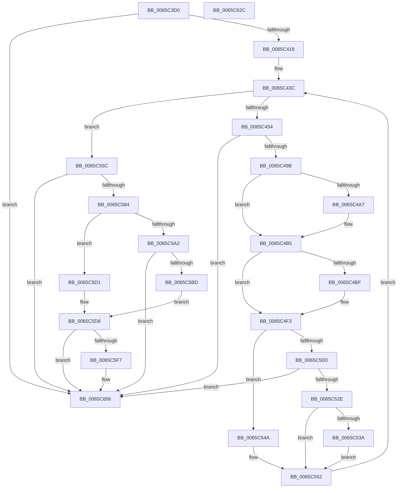

# ExInitializePoolHeapManagement

- RVA: `0x0065C3D0`–`0x0065C62D` (길이 `605` bytes)
- VA: `0x000000014065C3D0`
- 실행 섹션: `.text`
- PDB 이름 있음: `예`; PDB Function 태그: `아니요`
- unwind 정보 RVA: `0x000D5830`
- 디코드: `145`개 명령, `605/605` bytes 표시
- 미해석 바이트: `0` (있으면 어셈블리에 `.byte`로 보존)

> 이 문서는 커널 이미지의 기계어와 PDB 기호를 분석해 생성했습니다. 4번과 5번은 함수 원형과 자료형을 바이너리 사용 방식에서 추정한 C 해석이며 원본 소스 복구 결과는 아닙니다.

## 1. Dependencies

- 직접 호출 지점: **9**; 고유 호출 대상: **6**
- 직접 호출자로 확인된 함수: **1**
- RIP 상대 이미지 참조: **9**

### Outgoing calls
- `0x0065C40C` → [RtlHpKInitializeHeapManager](RtlHpKInitializeHeapManager_function_0065C9A0.md) (function, `0x0065C9A0`)
- `0x0065C427` → [ExpDetermineLargePagePolicy](ExpDetermineLargePagePolicy_function_0065C634.md) (function, `0x0065C634`)
- `0x0065C48E` → [ExCreateHeap](ExCreateHeap_function_0065C1F0.md) (function, `0x0065C1F0`)
- `0x0065C4FD` → [RtlpDynamicLookasideInitialize](../6A/RtlpDynamicLookasideInitialize_function_006A88E8.md) (function, `0x006A88E8`)
- `0x0065C51F` → [ExCreateHeap](ExCreateHeap_function_0065C1F0.md) (function, `0x0065C1F0`)
- `0x0065C577` → [ExCreateHeap](ExCreateHeap_function_0065C1F0.md) (function, `0x0065C1F0`)
- `0x0065C5B4` → [ExCreateHeap](ExCreateHeap_function_0065C1F0.md) (function, `0x0065C1F0`)
- `0x0065C5EE` → [ExInitializePoolTracker](../../init/C5/ExInitializePoolTracker_function_00C52F10.md) (function, `0x00C52F10`)
- `0x0065C5F7` → [ExpInitializePrivatePools](../../init/C5/ExpInitializePrivatePools_function_00C54B80.md) (function, `0x00C54B80`)

### Direct callers
- [MiInitNucleus](../../init/C5/MiInitNucleus_function_00C5FD38.md) at `0x00C601C8`

### Static image references
- `0x0065C41D` → RVA `0x00F059A0` (`.data`; write)
- `0x0065C43C` → RVA `0x00E6BF10` (`.data`; read)
- `0x0065C465` → RVA `0x00E6BF40` (`.data`; read)
- `0x0065C49B` → RVA `0x00EFA834` (`.data`; read)
- `0x0065C596` → RVA `0x00EEEF48` (`.data`; write)
- `0x0065C5D8` → RVA `0x00E29080` (`.data`; read/write)
- `0x0065C5E0` → RVA `0x00EEEF40` (`.data`; write)
- `0x0065C5E7` → RVA `0x00E29088` (`.data`; write)
- `0x0065C5FC` → RVA `0x00FC6BD0` (`ALMOSTRO`; read/write)

## 2. Other-region calls and transfers

- 다른 실행 섹션으로 향하는 call: **2**
  - `0x0065C5EE` → [ExInitializePoolTracker](../../init/C5/ExInitializePoolTracker_function_00C52F10.md) (`.text` → `INIT`)
  - `0x0065C5F7` → [ExpInitializePrivatePools](../../init/C5/ExpInitializePrivatePools_function_00C54B80.md) (`.text` → `INIT`)
- 별도 외부 분기/꼬리 이동을 확인하지 못했습니다.

## 3. Assembly (complete function range)

```asm
0065C3D0  48 8B C4                        mov rax, rsp
0065C3D3  48 89 58 08                     mov qword ptr [rax + 8], rbx
0065C3D7  48 89 70 18                     mov qword ptr [rax + 0x18], rsi
0065C3DB  55                              push rbp
0065C3DC  57                              push rdi
0065C3DD  41 54                           push r12
0065C3DF  41 56                           push r14
0065C3E1  41 57                           push r15
0065C3E3  48 8D 68 A1                     lea rbp, [rax - 0x5f]
0065C3E7  48 81 EC C0 00 00 00            sub rsp, 0xc0
0065C3EE  0F 29 70 C8                     movaps xmmword ptr [rax - 0x38], xmm6
0065C3F2  0F 57 C0                        xorps xmm0, xmm0
0065C3F5  0F 29 78 B8                     movaps xmmword ptr [rax - 0x48], xmm7
0065C3F9  33 DB                           xor ebx, ebx
0065C3FB  33 C0                           xor eax, eax
0065C3FD  48 89 5D 6F                     mov qword ptr [rbp + 0x6f], rbx
0065C401  48 89 45 07                     mov qword ptr [rbp + 7], rax
0065C405  44 8B F1                        mov r14d, ecx
0065C408  0F 11 45 F7                     movups xmmword ptr [rbp - 9], xmm0
0065C40C  E8 8F 05 00 00                  call 0x14065c9a0
0065C411  85 C0                           test eax, eax
0065C413  0F 88 ED 01 00 00               js 0x14065c606
0065C419  48 8D 4D F7                     lea rcx, [rbp - 9]
0065C41D  C7 05 79 95 8A 00 8B 24 00 00   mov dword ptr [rip + 0x8a9579], 0x248b
0065C427  E8 08 02 00 00                  call 0x14065c634
0065C42C  0F 10 7D F7                     movups xmm7, xmmword ptr [rbp - 9]
0065C430  45 8B E6                        mov r12d, r14d
0065C433  8B F3                           mov esi, ebx
0065C435  41 81 E4 00 04 00 00            and r12d, 0x400
0065C43C  3B 35 CE FA 80 00               cmp esi, dword ptr [rip + 0x80face]
0065C442  4C 8D 45 6F                     lea r8, [rbp + 0x6f]
0065C446  0F 57 C0                        xorps xmm0, xmm0
0065C449  BA 00 00 40 00                  mov edx, 0x400000
0065C44E  0F 83 08 01 00 00               jae 0x14065c55c
0065C454  0F 11 45 97                     movups xmmword ptr [rbp - 0x69], xmm0
0065C458  8B C6                           mov eax, esi
0065C45A  48 8D 4D B7                     lea rcx, [rbp - 0x49]
0065C45E  4C 69 F8 C0 20 00 00            imul r15, rax, 0x20c0
0065C465  48 8D 05 D4 FA 80 00            lea rax, [rip + 0x80fad4]
0065C46C  66 C7 45 97 03 01               mov word ptr [rbp - 0x69], 0x103
0065C472  4C 03 F8                        add r15, rax
0065C475  40 88 75 99                     mov byte ptr [rbp - 0x67], sil
0065C479  48 39 5D FF                     cmp qword ptr [rbp - 1], rbx
0065C47D  B8 00 00 40 04                  mov eax, 0x4400000
0065C482  0F 28 75 97                     movaps xmm6, xmmword ptr [rbp - 0x69]
0065C486  0F 47 D0                        cmova edx, eax
0065C489  66 0F 7F 75 B7                  movdqa xmmword ptr [rbp - 0x49], xmm6
0065C48E  E8 5D FD FF FF                  call 0x14065c1f0
0065C493  85 C0                           test eax, eax
0065C495  0F 88 6B 01 00 00               js 0x14065c606
0065C49B  39 1D 93 E3 89 00               cmp dword ptr [rip + 0x89e393], ebx
0065C4A1  48 8B 7D 6F                     mov rdi, qword ptr [rbp + 0x6f]
0065C4A5  74 0E                           je 0x14065c4b5
0065C4A7  80 8F 4D 01 00 00 08            or byte ptr [rdi + 0x14d], 8
0065C4AE  80 8F 0D 02 00 00 08            or byte ptr [rdi + 0x20d], 8
0065C4B5  49 89 7F 08                     mov qword ptr [r15 + 8], rdi
0065C4B9  48 39 5D FF                     cmp qword ptr [rbp - 1], rbx
0065C4BD  76 34                           jbe 0x14065c4f3
0065C4BF  F2 0F 10 45 07                  movsd xmm0, qword ptr [rbp + 7]
0065C4C4  0F 11 BF C8 00 00 00            movups xmmword ptr [rdi + 0xc8], xmm7
0065C4CB  F2 0F 11 87 D8 00 00 00         movsd qword ptr [rdi + 0xd8], xmm0
0065C4D3  8A 87 4D 01 00 00               mov al, byte ptr [rdi + 0x14d]
0065C4D9  24 F9                           and al, 0xf9
0065C4DB  0C 01                           or al, 1
0065C4DD  88 87 4D 01 00 00               mov byte ptr [rdi + 0x14d], al
0065C4E3  8A 87 0D 02 00 00               mov al, byte ptr [rdi + 0x20d]
0065C4E9  24 F9                           and al, 0xf9
0065C4EB  0C 01                           or al, 1
0065C4ED  88 87 0D 02 00 00               mov byte ptr [rdi + 0x20d], al
0065C4F3  49 8D 9F 80 10 00 00            lea rbx, [r15 + 0x1080]
0065C4FA  48 8B CB                        mov rcx, rbx
0065C4FD  E8 E6 C3 04 00                  call 0x1406a88e8
0065C502  48 89 5F 38                     mov qword ptr [rdi + 0x38], rbx
0065C506  41 0F BA E6 0A                  bt r14d, 0xa
0065C50B  72 3D                           jb 0x14065c54a
0065C50D  4C 8D 45 6F                     lea r8, [rbp + 0x6f]
0065C511  66 0F 7F 75 C7                  movdqa xmmword ptr [rbp - 0x39], xmm6
0065C516  BA 00 00 40 40                  mov edx, 0x40400000
0065C51B  48 8D 4D C7                     lea rcx, [rbp - 0x39]
0065C51F  E8 CC FC FF FF                  call 0x14065c1f0
0065C524  33 DB                           xor ebx, ebx
0065C526  85 C0                           test eax, eax
0065C528  0F 88 D8 00 00 00               js 0x14065c606
0065C52E  39 1D 00 E3 89 00               cmp dword ptr [rip + 0x89e300], ebx
0065C534  48 8B 45 6F                     mov rax, qword ptr [rbp + 0x6f]
0065C538  74 18                           je 0x14065c552
0065C53A  80 88 4D 01 00 00 08            or byte ptr [rax + 0x14d], 8
0065C541  80 88 0D 02 00 00 08            or byte ptr [rax + 0x20d], 8
0065C548  EB 08                           jmp 0x14065c552
0065C54A  33 DB                           xor ebx, ebx
0065C54C  8B C3                           mov eax, ebx
0065C54E  48 89 5D 6F                     mov qword ptr [rbp + 0x6f], rbx
0065C552  49 89 07                        mov qword ptr [r15], rax
0065C555  FF C6                           inc esi
0065C557  E9 E0 FE FF FF                  jmp 0x14065c43c
0065C55C  0F 11 45 A7                     movups xmmword ptr [rbp - 0x59], xmm0
0065C560  66 C7 45 A8 01 00               mov word ptr [rbp - 0x58], 1
0065C566  48 8D 4D D7                     lea rcx, [rbp - 0x29]
0065C56A  C6 45 A7 03                     mov byte ptr [rbp - 0x59], 3
0065C56E  0F 28 75 A7                     movaps xmm6, xmmword ptr [rbp - 0x59]
0065C572  66 0F 7F 75 D7                  movdqa xmmword ptr [rbp - 0x29], xmm6
0065C577  E8 74 FC FF FF                  call 0x14065c1f0
0065C57C  85 C0                           test eax, eax
0065C57E  0F 88 82 00 00 00               js 0x14065c606
0065C584  48 8B 45 6F                     mov rax, qword ptr [rbp + 0x6f]
0065C588  80 88 4D 01 00 00 08            or byte ptr [rax + 0x14d], 8
0065C58F  80 88 0D 02 00 00 08            or byte ptr [rax + 0x20d], 8
0065C596  48 89 05 AB 29 89 00            mov qword ptr [rip + 0x8929ab], rax
0065C59D  45 85 E4                        test r12d, r12d
0065C5A0  75 2F                           jne 0x14065c5d1
0065C5A2  4C 8D 45 6F                     lea r8, [rbp + 0x6f]
0065C5A6  66 0F 7F 75 E7                  movdqa xmmword ptr [rbp - 0x19], xmm6
0065C5AB  BA 00 00 40 40                  mov edx, 0x40400000
0065C5B0  48 8D 4D E7                     lea rcx, [rbp - 0x19]
0065C5B4  E8 37 FC FF FF                  call 0x14065c1f0
0065C5B9  85 C0                           test eax, eax
0065C5BB  78 49                           js 0x14065c606
0065C5BD  48 8B 45 6F                     mov rax, qword ptr [rbp + 0x6f]
0065C5C1  80 88 4D 01 00 00 08            or byte ptr [rax + 0x14d], 8
0065C5C8  80 88 0D 02 00 00 08            or byte ptr [rax + 0x20d], 8
0065C5CF  EB 07                           jmp 0x14065c5d8
0065C5D1  48 8B C3                        mov rax, rbx
0065C5D4  48 89 5D 6F                     mov qword ptr [rbp + 0x6f], rbx
0065C5D8  48 83 25 A0 CA 7C 00 00         and qword ptr [rip + 0x7ccaa0], 0
0065C5E0  48 89 05 59 29 89 00            mov qword ptr [rip + 0x892959], rax
0065C5E7  48 89 1D 9A CA 7C 00            mov qword ptr [rip + 0x7cca9a], rbx
0065C5EE  E8 1D 69 5F 00                  call 0x140c52f10
0065C5F3  85 C0                           test eax, eax
0065C5F5  78 0F                           js 0x14065c606
0065C5F7  E8 84 85 5F 00                  call 0x140c54b80
0065C5FC  F0 44 09 35 CC A5 96 00         lock or dword ptr [rip + 0x96a5cc], r14d
0065C604  8B C3                           mov eax, ebx
0065C606  4C 8D 9C 24 C0 00 00 00         lea r11, [rsp + 0xc0]
0065C60E  49 8B 5B 30                     mov rbx, qword ptr [r11 + 0x30]
0065C612  49 8B 73 40                     mov rsi, qword ptr [r11 + 0x40]
0065C616  41 0F 28 73 F0                  movaps xmm6, xmmword ptr [r11 - 0x10]
0065C61B  41 0F 28 7B E0                  movaps xmm7, xmmword ptr [r11 - 0x20]
0065C620  49 8B E3                        mov rsp, r11
0065C623  41 5F                           pop r15
0065C625  41 5E                           pop r14
0065C627  41 5C                           pop r12
0065C629  5F                              pop rdi
0065C62A  5D                              pop rbp
0065C62B  C3                              ret
0065C62C  CC                              int3
```

## 4. C-style interpretation (structured pseudocode)

```c
__int64 __fastcall ExInitializePoolHeapManagement(int a1)
{
    __int64 result;
    __int64 v_r12;
    __int64 v_r15;
    __int64 v_rbx;
    __int64 v_rsi;
    __int64 v_rsp;
    unsigned __int64 v_stack_m28;

    *(unsigned __int64 *)(v_rsp + 8) = v_rbx;
    *(unsigned __int64 *)(v_rsp + 24) = v_rsi;
    v_rsp = (v_rsp) - (192);
    *(unsigned __int64 *)(v_rsp - 56) = v_xmm6;
    *(unsigned __int64 *)(v_rsp - 72) = v_xmm7;
    v_rbx = 0;
    result = 0;
    *(unsigned __int64 *)(v_rsp - 95 + 111) = 0;
    *(unsigned __int64 *)(v_rsp - 95 + 7) = 0;
    *(unsigned __int64 *)(v_rsp - 95 - 9) = v_xmm0;
    result = RtlHpKInitializeHeapManager(a1, a2, a3, a4);
    if (sign_flag) goto loc_0065C606;
    *(unsigned int *)(v_rip + 9082233) = 0x248BULL;
    result = ExpDetermineLargePagePolicy(v_rsp - 95 - 9, a2, a3, a4);
    v_r12 = (unsigned int)(((unsigned int)((unsigned int)((unsigned int)(a1)))) & (0x400ULL));
loc_0065C43C:
    if (0 >= (*(unsigned int *)(v_rip + 8452814))) goto loc_0065C55C;
    *(unsigned __int64 *)(v_rsp - 95 - 105) = v_xmm0;
    v_r15 = (v_r15) * (0);
    *(unsigned __int16 *)(v_rsp - 95 - 105) = 259;
    v_r15 = (v_r15) + (v_rip + 8452820);
    *(unsigned __int8 *)(v_rsp - 95 - 103) = 0;
    a2 = (unsigned int)(0x400000ULL);
    if ((*(unsigned __int64 *)(v_rsp - 95 - 1)) > 0) { a2 = (unsigned int)((unsigned int)(0x4400000ULL)); }
    *(unsigned __int64 *)(v_rsp - 95 - 73) = v_xmm6;
    result = ExCreateHeap(v_rsp - 95 - 73, a2, v_rsp - 95 + 111, a4);
    if (sign_flag) goto loc_0065C606;
    if ((*(unsigned int *)(v_rip + 9036691)) != 0) {
    }
    *(unsigned __int64 *)(v_r15 + 8) = *(unsigned __int64 *)(v_rsp - 95 + 111);
    if ((*(unsigned __int64 *)(v_rsp - 95 - 1)) >= = 0) {
        *(unsigned __int64 *)(*(unsigned __int64 *)(v_rsp - 95 + 111) + 200) = v_xmm7;
        *(unsigned __int64 *)(*(unsigned __int64 *)(v_rsp - 95 + 111) + 216) = v_xmm0;
        result = *(unsigned __int8 *)(*(unsigned __int64 *)(v_rsp - 95 + 111) + 333);
        result = (unsigned __int8)((result) & (249));
        result = (unsigned __int8)((result) | (1));
        *(unsigned __int8 *)(*(unsigned __int64 *)(v_rsp - 95 + 111) + 333) = (unsigned __int8)(result);
        result = *(unsigned __int8 *)(*(unsigned __int64 *)(v_rsp - 95 + 111) + 525);
        result = (unsigned __int8)((result) & (249));
        result = (unsigned __int8)((result) | (1));
        *(unsigned __int8 *)(*(unsigned __int64 *)(v_rsp - 95 + 111) + 525) = (unsigned __int8)(result);
    }
    result = RtlpDynamicLookasideInitialize(v_r15 + 4224, a2, v_rsp - 95 + 111, a4);
    *(unsigned __int64 *)(*(unsigned __int64 *)(v_rsp - 95 + 111) + 56) = v_r15 + 4224;
    if (condition_is_below) goto loc_0065C54A;
    *(unsigned __int64 *)(v_rsp - 95 - 57) = v_xmm6;
    result = ExCreateHeap(v_rsp - 95 - 57, (unsigned int)(0x40400000ULL), v_rsp - 95 + 111, a4);
    v_rbx = 0;
    if (sign_flag) goto loc_0065C606;
    if ((*(unsigned int *)(v_rip + 9036544)) == 0) goto loc_0065C552;
    goto loc_0065C552;
loc_0065C54A:
    v_rbx = 0;
    *(unsigned __int64 *)(v_rsp - 95 + 111) = 0;
loc_0065C552:
    *(unsigned __int64 *)(v_r15) = 0;
    v_rsi = (unsigned int)((0) + 1);
    goto loc_0065C43C;
loc_0065C55C:
    *(unsigned __int64 *)(v_rsp - 95 - 89) = v_xmm0;
    *(unsigned __int16 *)(v_rsp - 95 - 88) = 1;
    *(unsigned __int8 *)(v_rsp - 95 - 89) = 3;
    *(unsigned __int64 *)(v_rsp - 95 - 41) = v_xmm6;
    result = ExCreateHeap(v_rsp - 95 - 41, (unsigned int)(0x40400000ULL), v_rsp - 95 + 111, a4);
    if (sign_flag) goto loc_0065C606;
    *(unsigned __int64 *)(v_rip + 8989099) = *(unsigned __int64 *)(v_rsp - 95 + 111);
    if ((unsigned int)(v_r12) != 0) goto loc_0065C5D1;
    *(unsigned __int64 *)(v_rsp - 95 - 25) = v_xmm6;
    result = ExCreateHeap(v_rsp - 95 - 25, (unsigned int)(0x40400000ULL), v_rsp - 95 + 111, a4);
    if (sign_flag) goto loc_0065C606;
    goto loc_0065C5D8;
loc_0065C5D1:
    *(unsigned __int64 *)(v_rsp - 95 + 111) = 0;
loc_0065C5D8:
    *(unsigned __int64 *)(v_rip + 8989017) = 0;
    *(unsigned __int64 *)(v_rip + 8178330) = 0;
    result = ExInitializePoolTracker(v_rsp - 95 - 25, (unsigned int)(0x40400000ULL), v_rsp - 95 + 111, a4);
    if (!(sign_flag)) {
        result = ExpInitializePrivatePools(v_rsp - 95 - 25, (unsigned int)(0x40400000ULL), v_rsp - 95 + 111, a4);
        result = 0;
    }
    return result;
}
```

## 5. (Beta) C Style

```c
int64_t ExInitializePoolHeapManagement(int32_t Arg1)
{
    int64_t result;
    int64_t local_r12;
    int64_t local_r15;
    int64_t local_rbx;
    int64_t local_rsi;
    int64_t local_rsp;
    uint64_t v_stack_m28;

    *(uint64_t *)(local_rsp + 0x8) = local_rbx;
    *(uint64_t *)(local_rsp + 0x18) = local_rsi;
    local_rsp = (local_rsp) - (192);
    *(uint64_t *)(local_rsp - 0x38) = v_xmm6;
    *(uint64_t *)(local_rsp - 0x48) = v_xmm7;
    local_rbx = 0;
    result = 0;
    *(uint64_t *)(local_rsp - 0x5F + 0x6F) = 0;
    *(uint64_t *)(local_rsp - 0x5F + 0x7) = 0;
    *(uint64_t *)(local_rsp - 0x5F - 0x9) = v_xmm0;
    result = RtlHpKInitializeHeapManager(Arg1, a2, a3, a4);
    if (sign_flag) goto loc_0065C606;
    *(uint32_t *)(v_rip + 0x8A9579) = 0x248BULL;
    result = ExpDetermineLargePagePolicy(local_rsp - 95 - 9, a2, a3, a4);
    local_r12 = (uint32_t)(((uint32_t)((uint32_t)((uint32_t)(Arg1)))) & (0x400ULL));
loc_0065C43C:
    if (0 >= (*(uint32_t *)(v_rip + 0x80FACE))) goto loc_0065C55C;
    *(uint64_t *)(local_rsp - 0x5F - 0x69) = v_xmm0;
    local_r15 = (local_r15) * (0);
    *(uint16_t *)(local_rsp - 0x5F - 0x69) = 259;
    local_r15 = (local_r15) + (v_rip + 8452820);
    *(uint8_t *)(local_rsp - 0x5F - 0x67) = 0;
    a2 = (uint32_t)(0x400000ULL);
    if ((*(uint64_t *)(local_rsp - 0x5F - 0x1)) > 0) { a2 = (uint32_t)((uint32_t)(0x4400000ULL)); }
    *(uint64_t *)(local_rsp - 0x5F - 0x49) = v_xmm6;
    result = ExCreateHeap(local_rsp - 95 - 73, a2, local_rsp - 95 + 111, a4);
    if (sign_flag) goto loc_0065C606;
    if ((*(uint32_t *)(v_rip + 0x89E393)) != 0) {
    }
    *(uint64_t *)(local_r15 + 0x8) = *(uint64_t *)(local_rsp - 0x5F + 0x6F);
    if ((*(uint64_t *)(local_rsp - 0x5F - 0x1)) >= = 0) {
        *(uint64_t *)(*(uint64_t *)(local_rsp - 0x5F + 0x6F) + 0xC8) = v_xmm7;
        *(uint64_t *)(*(uint64_t *)(local_rsp - 0x5F + 0x6F) + 0xD8) = v_xmm0;
        result = *(uint8_t *)(*(uint64_t *)(local_rsp - 0x5F + 0x6F) + 0x14D);
        result = (uint8_t)((result) & (249));
        result = (uint8_t)((result) | (1));
        *(uint8_t *)(*(uint64_t *)(local_rsp - 0x5F + 0x6F) + 0x14D) = (uint8_t)(result);
        result = *(uint8_t *)(*(uint64_t *)(local_rsp - 0x5F + 0x6F) + 0x20D);
        result = (uint8_t)((result) & (249));
        result = (uint8_t)((result) | (1));
        *(uint8_t *)(*(uint64_t *)(local_rsp - 0x5F + 0x6F) + 0x20D) = (uint8_t)(result);
    }
    result = RtlpDynamicLookasideInitialize(local_r15 + 4224, a2, local_rsp - 95 + 111, a4);
    *(uint64_t *)(*(uint64_t *)(local_rsp - 0x5F + 0x6F) + 0x38) = local_r15 + 4224;
    if (condition_is_below) goto loc_0065C54A;
    *(uint64_t *)(local_rsp - 0x5F - 0x39) = v_xmm6;
    result = ExCreateHeap(local_rsp - 95 - 57, (uint32_t)(0x40400000ULL), local_rsp - 95 + 111, a4);
    local_rbx = 0;
    if (sign_flag) goto loc_0065C606;
    if ((*(uint32_t *)(v_rip + 0x89E300)) == 0) goto loc_0065C552;
    goto loc_0065C552;
loc_0065C54A:
    local_rbx = 0;
    *(uint64_t *)(local_rsp - 0x5F + 0x6F) = 0;
loc_0065C552:
    *(uint64_t *)(local_r15) = 0;
    local_rsi = (uint32_t)((0) + 1);
    goto loc_0065C43C;
loc_0065C55C:
    *(uint64_t *)(local_rsp - 0x5F - 0x59) = v_xmm0;
    *(uint16_t *)(local_rsp - 0x5F - 0x58) = 1;
    *(uint8_t *)(local_rsp - 0x5F - 0x59) = 3;
    *(uint64_t *)(local_rsp - 0x5F - 0x29) = v_xmm6;
    result = ExCreateHeap(local_rsp - 95 - 41, (uint32_t)(0x40400000ULL), local_rsp - 95 + 111, a4);
    if (sign_flag) goto loc_0065C606;
    *(uint64_t *)(v_rip + 0x8929AB) = *(uint64_t *)(local_rsp - 0x5F + 0x6F);
    if ((uint32_t)(local_r12) != 0) goto loc_0065C5D1;
    *(uint64_t *)(local_rsp - 0x5F - 0x19) = v_xmm6;
    result = ExCreateHeap(local_rsp - 95 - 25, (uint32_t)(0x40400000ULL), local_rsp - 95 + 111, a4);
    if (sign_flag) goto loc_0065C606;
    goto loc_0065C5D8;
loc_0065C5D1:
    *(uint64_t *)(local_rsp - 0x5F + 0x6F) = 0;
loc_0065C5D8:
    *(uint64_t *)(v_rip + 0x892959) = 0;
    *(uint64_t *)(v_rip + 0x7CCA9A) = 0;
    result = ExInitializePoolTracker(local_rsp - 95 - 25, (uint32_t)(0x40400000ULL), local_rsp - 95 + 111, a4);
    if (!(sign_flag)) {
        result = ExpInitializePrivatePools(local_rsp - 95 - 25, (uint32_t)(0x40400000ULL), local_rsp - 95 + 111, a4);
        result = 0;
    }
    return result;
}
```

## 6. Execution-region graph

[열기: 2D/3D 그래프와 함수 탐색 컨트롤 패널](../../../control-panel.html?section=text&rva=0x0065C3D0&view=graph)

- 2D 그래프는 위에서 아래로 흐르고, 3D 그래프는 빈 공간을 드래그해 회전합니다. Shift+드래그는 이동, 휠은 확대·축소, 함수 노드 선택은 대상 보고서 이동입니다.

### Static fallback


