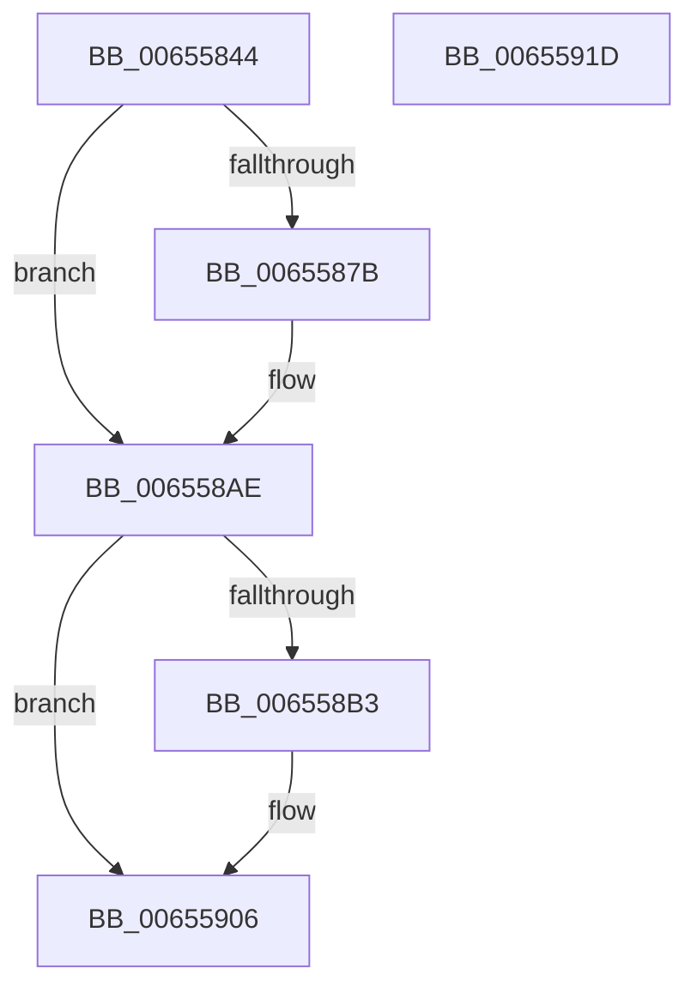

# ExInitializeProcessor

- RVA: `0x00655844`–`0x0065591E` (길이 `218` bytes)
- VA: `0x0000000140655844`
- 실행 섹션: `.text`
- PDB 이름 있음: `예`; PDB Function 태그: `아니요`
- unwind 정보 RVA: `0x00066400`
- 디코드: `50`개 명령, `218/218` bytes 표시
- 미해석 바이트: `0` (있으면 어셈블리에 `.byte`로 보존)

> 이 문서는 커널 이미지의 기계어와 PDB 기호를 분석해 생성했습니다. 4번과 5번은 함수 원형과 자료형을 바이너리 사용 방식에서 추정한 C 해석이며 원본 소스 복구 결과는 아닙니다.

## 1. Dependencies

- 직접 호출 지점: **3**; 고유 호출 대상: **3**
- 직접 호출자로 확인된 함수: **2**
- RIP 상대 이미지 참조: **4**

### Outgoing calls
- `0x0065586C` → [ExAllocatePool2](../../poolcode/B8/ExAllocatePool2_function_00B820F0.md) (function, `0x00B820F0`)
- `0x006558A2` → [ExInitializeSystemLookasideList](../../pagelk/B7/ExInitializeSystemLookasideList_function_00B7E57C.md) (function, `0x00B7E57C`)
- `0x006558EC` → [ExpNodeHotAddProcessor](ExpNodeHotAddProcessor_function_0065A664.md) (function, `0x0065A664`)

### Direct callers
- [KiStartDynamicProcessor](../../page/74/KiStartDynamicProcessor_function_007456C8.md) at `0x007458EA`
- [ExpInitSystemPhase1](../../init/C5/ExpInitSystemPhase1_function_00C51508.md) at `0x00C515B4`

### Static image references
- `0x0065587B` → RVA `0x00EFAC00` (`.data`; read)
- `0x006558BA` → RVA `0x00FCF6C0` (`CACHEALI`; read)
- `0x006558C1` → RVA `0x00FDAEC0` (`PAGEDATA`; read)
- `0x006558F4` → RVA `0x00EFA278` (`.data`; read)

## 2. Other-region calls and transfers

- 다른 실행 섹션으로 향하는 call: **2**
  - `0x0065586C` → [ExAllocatePool2](../../poolcode/B8/ExAllocatePool2_function_00B820F0.md) (`.text` → `POOLCODE`)
  - `0x006558A2` → [ExInitializeSystemLookasideList](../../pagelk/B7/ExInitializeSystemLookasideList_function_00B7E57C.md) (`.text` → `PAGELK`)
- 별도 외부 분기/꼬리 이동을 확인하지 못했습니다.

## 3. Assembly (complete function range)

```asm
00655844  48 89 5C 24 08                  mov qword ptr [rsp + 8], rbx
00655849  48 89 6C 24 10                  mov qword ptr [rsp + 0x10], rbp
0065584E  48 89 74 24 18                  mov qword ptr [rsp + 0x18], rsi
00655853  57                              push rdi
00655854  48 83 EC 30                     sub rsp, 0x30
00655858  40 8A EA                        mov bpl, dl
0065585B  48 8B F1                        mov rsi, rcx
0065585E  BA 80 00 00 00                  mov edx, 0x80
00655863  41 B8 45 78 49 43               mov r8d, 0x43497845
00655869  8D 4A C0                        lea ecx, [rdx - 0x40]
0065586C  E8 7F C8 52 00                  call 0x140b820f0
00655871  33 DB                           xor ebx, ebx
00655873  48 8B F8                        mov rdi, rax
00655876  48 85 C0                        test rax, rax
00655879  74 33                           je 0x1406558ae
0065587B  48 8D 05 7E 53 8A 00            lea rax, [rip + 0x8a537e]
00655882  BA 00 02 00 00                  mov edx, 0x200
00655887  48 89 44 24 28                  mov qword ptr [rsp + 0x28], rax
0065588C  41 B9 45 78 49 43               mov r9d, 0x43497845
00655892  41 B8 F0 04 00 00               mov r8d, 0x4f0
00655898  66 C7 44 24 20 20 00            mov word ptr [rsp + 0x20], 0x20
0065589F  48 8B CF                        mov rcx, rdi
006558A2  E8 D5 8C 52 00                  call 0x140b7e57c
006558A7  48 89 BE 80 08 00 00            mov qword ptr [rsi + 0x880], rdi
006558AE  40 84 ED                        test bpl, bpl
006558B1  74 53                           je 0x140655906
006558B3  48 8B 86 C0 00 00 00            mov rax, qword ptr [rsi + 0xc0]
006558BA  4C 8D 0D FF 9D 97 00            lea r9, [rip + 0x979dff]
006558C1  48 8D 0D F8 55 98 00            lea rcx, [rip + 0x9855f8]
006558C8  0F B7 90 8A 00 00 00            movzx edx, word ptr [rax + 0x8a]
006558CF  4D 8B 04 D1                     mov r8, qword ptr [r9 + rdx*8]
006558D3  41 0F B7 10                     movzx edx, word ptr [r8]
006558D7  48 69 C2 38 03 00 00            imul rax, rdx, 0x338
006558DE  48 03 C1                        add rax, rcx
006558E1  49 39 04 D1                     cmp qword ptr [r9 + rdx*8], rax
006558E5  49 0F 45 D8                     cmovne rbx, r8
006558E9  48 8B CB                        mov rcx, rbx
006558EC  E8 73 4D 00 00                  call 0x14065a664
006558F1  8B 4E 24                        mov ecx, dword ptr [rsi + 0x24]
006558F4  48 8B 05 7D 49 8A 00            mov rax, qword ptr [rip + 0x8a497d]
006558FB  48 8B 0C C8                     mov rcx, qword ptr [rax + rcx*8]
006558FF  48 89 8E B0 8B 00 00            mov qword ptr [rsi + 0x8bb0], rcx
00655906  48 8B 5C 24 40                  mov rbx, qword ptr [rsp + 0x40]
0065590B  33 C0                           xor eax, eax
0065590D  48 8B 6C 24 48                  mov rbp, qword ptr [rsp + 0x48]
00655912  48 8B 74 24 50                  mov rsi, qword ptr [rsp + 0x50]
00655917  48 83 C4 30                     add rsp, 0x30
0065591B  5F                              pop rdi
0065591C  C3                              ret
0065591D  CC                              int3
```

## 4. C-style interpretation (structured pseudocode)

```c
__int64 __fastcall ExInitializeProcessor(__int64 a1, unsigned __int8 a2)
{
    __int64 result;
    __int64 v_rbx;
    __int64 v_rsp;
    unsigned __int64 v_stack_m10;
    unsigned __int16 v_stack_m18;
    unsigned __int64 v_stack_p10;
    unsigned __int64 v_stack_p18;
    unsigned __int64 v_stack_p8;

    v_stack_p8 = v_rbx;
    v_stack_p10 = v_rbp;
    v_stack_p18 = v_rsi;
    v_rsp = (v_rsp) - (48);
    result = ExAllocatePool2(128 - 64, 128, (unsigned int)(0x43497845ULL), a4);
    v_rbx = 0;
    if (result != 0) {
        result = v_rip + 9065342;
        a2 = 512;
        v_stack_m10 = result;
        a4 = 0x43497845ULL;
        a3 = 0x4F0ULL;
        v_stack_m18 = 32;
        a1 = result;
        result = ExInitializeSystemLookasideList(a1, a2, a3, a4);
        *(unsigned __int64 *)(a1 + 2176) = result;
    }
    if (a2 != 0) {
        result = *(unsigned __int64 *)(a1 + 192);
        a4 = v_rip + 9936383;
        a1 = v_rip + 9983480;
        a2 = *(unsigned __int16 *)(result + 138);
        a3 = *(unsigned __int64 *)(a4 + a2 * 8);
        a2 = *(unsigned __int16 *)(a3);
        result = (result) * (a2);
        result = (result) + (a1);
        if ((*(unsigned __int64 *)(a4 + a2 * 8)) != result) { v_rbx = a3; }
        a1 = v_rbx;
        result = ExpNodeHotAddProcessor(a1, a2, a3, a4);
        a1 = *(unsigned int *)(a1 + 36);
        result = *(unsigned __int64 *)(v_rip + 9062781);
        a1 = *(unsigned __int64 *)(result + a1 * 8);
        *(unsigned __int64 *)(a1 + 35760) = a1;
    }
    result = 0;
    v_rsp = (v_rsp) + (48);
    return result;
}
```

## 5. (Beta) C Style

```c
int64_t ExInitializeProcessor(void *Processor, uint8_t Arg2)
{
    uint8_t *processor = (uint8_t *)Processor;

    int64_t result;
    int64_t local_rbx;
    int64_t local_rsp;
    uint64_t v_stack_m10;
    uint16_t v_stack_m18;
    uint64_t v_stack_p10;
    uint64_t v_stack_p18;
    uint64_t v_stack_p8;

    v_stack_p8 = local_rbx;
    v_stack_p10 = local_rbp;
    v_stack_p18 = local_rsi;
    local_rsp = (local_rsp) - (48);
    result = ExAllocatePool2(128 - 64, 128, (uint32_t)(0x43497845ULL), a4);
    local_rbx = 0;
    if (result != 0) {
        result = v_rip + 9065342;
        Arg2 = 512;
        v_stack_m10 = result;
        a4 = 0x43497845ULL;
        a3 = 0x4F0ULL;
        v_stack_m18 = 32;
        Processor = result;
        result = ExInitializeSystemLookasideList(Processor, Arg2, a3, a4);
        *(uint64_t *)(processor + 0x880) = result;
    }
    if (Arg2 != 0) {
        result = *(uint64_t *)(processor + 0xC0);
        a4 = v_rip + 9936383;
        Processor = v_rip + 9983480;
        Arg2 = *(uint16_t *)(result + 0x8A);
        a3 = *(uint64_t *)(a4 + Arg2 * 8);
        Arg2 = *(uint16_t *)(a3);
        result = (result) * (Arg2);
        result = (result) + (Processor);
        if ((*(uint64_t *)(a4 + Arg2 * 8)) != result) { local_rbx = a3; }
        Processor = local_rbx;
        result = ExpNodeHotAddProcessor(Processor, Arg2, a3, a4);
        Processor = *(uint32_t *)(processor + 0x24);
        result = *(uint64_t *)(v_rip + 0x8A497D);
        Processor = *(uint64_t *)(result + processor * 8);
        *(void **)(processor + 0x8BB0) = Processor;
    }
    result = 0;
    local_rsp = (local_rsp) + (48);
    return result;
}
```

### 관측된 메모리 오프셋

구조체 형식이 확인되지 않은 접근은 인자 기준의 오프셋으로만 기록했습니다.

| 기준 인자 | 오프셋 표현 | 폭 (bit) | 접근 |
|---|---:|---:|---|
| `Processor` | `+ 0x24` | `32` | `R` |
| `Processor` | `+ 0xC0` | `64` | `R` |
| `Processor` | `+ 0x880` | `64` | `W` |
| `Processor` | `+ 0x8BB0` | `64` | `W` |

## 6. Execution-region graph

[열기: 2D/3D 그래프와 함수 탐색 컨트롤 패널](../../../control-panel.html?section=text&rva=0x00655844&view=graph)

- 2D 그래프는 위에서 아래로 흐르고, 3D 그래프는 빈 공간을 드래그해 회전합니다. Shift+드래그는 이동, 휠은 확대·축소, 함수 노드 선택은 대상 보고서 이동입니다.

### Static fallback


