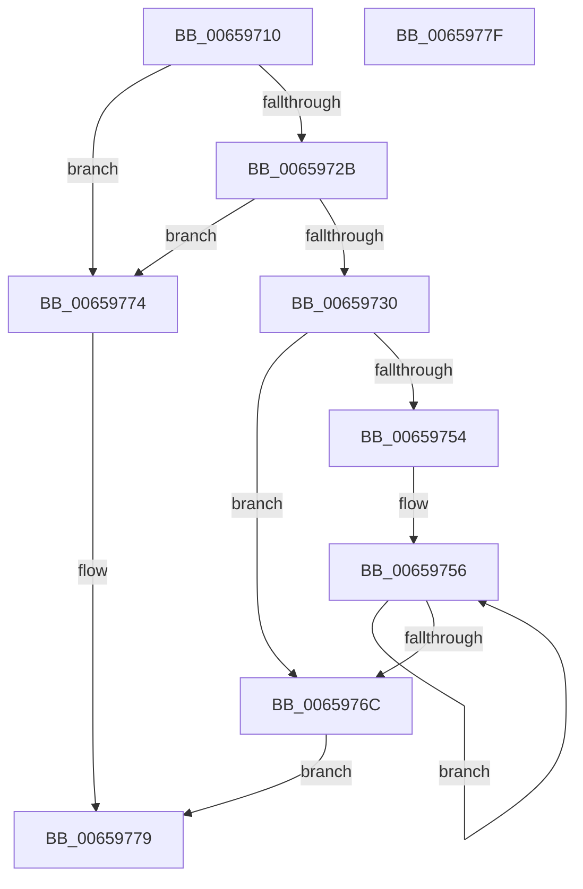

# ExInitializeZone

- RVA: `0x00659710`–`0x00659780` (길이 `112` bytes)
- VA: `0x0000000140659710`
- 실행 섹션: `.text`
- PDB 이름 있음: `예`; PDB Function 태그: `아니요`
- unwind 정보 RVA: `0x00071750`
- 디코드: `37`개 명령, `112/112` bytes 표시
- 미해석 바이트: `0` (있으면 어셈블리에 `.byte`로 보존)

> 이 문서는 커널 이미지의 기계어와 PDB 기호를 분석해 생성했습니다. 4번과 5번은 함수 원형과 자료형을 바이너리 사용 방식에서 추정한 C 해석이며 원본 소스 복구 결과는 아닙니다.

## 1. Dependencies

- 직접 호출 지점: **0**; 고유 호출 대상: **0**
- 직접 호출자로 확인된 함수: **0**
- RIP 상대 이미지 참조: **0**

### Outgoing calls
- 직접 디코드된 call 명령이 없습니다.

### Direct callers
- 이 함수 시작 RVA로 연결되는 직접 call은 확인되지 않았습니다. 간접 호출은 완전히 역산할 수 없습니다.

### Static image references
- 디코드된 RIP-relative 메모리 참조가 없습니다.

## 2. Other-region calls and transfers

- 다른 실행 섹션으로 향하는 call: **0**
- 별도 외부 분기/꼬리 이동을 확인하지 못했습니다.

## 3. Assembly (complete function range)

```asm
00659710  48 89 5C 24 08                  mov qword ptr [rsp + 8], rbx
00659715  F6 C2 07                        test dl, 7
00659718  4C 8B D9                        mov r11, rcx
0065971B  41 0F 94 C2                     sete r10b
0065971F  41 F6 C0 07                     test r8b, 7
00659723  0F 94 C0                        sete al
00659726  44 84 D0                        test al, r10b
00659729  74 49                           je 0x140659774
0065972B  41 3B D1                        cmp edx, r9d
0065972E  77 44                           ja 0x140659774
00659730  45 33 D2                        xor r10d, r10d
00659733  4C 89 41 08                     mov qword ptr [rcx + 8], r8
00659737  89 51 10                        mov dword ptr [rcx + 0x10], edx
0065973A  44 2B CA                        sub r9d, edx
0065973D  4D 89 10                        mov qword ptr [r8], r10
00659740  4D 89 50 08                     mov qword ptr [r8 + 8], r10
00659744  49 83 C0 10                     add r8, 0x10
00659748  4C 89 11                        mov qword ptr [rcx], r10
0065974B  41 8D 4A 10                     lea ecx, [r10 + 0x10]
0065974F  44 3B C9                        cmp r9d, ecx
00659752  72 18                           jb 0x14065976c
00659754  8B DA                           mov ebx, edx
00659756  4D 89 10                        mov qword ptr [r8], r10
00659759  49 8B C0                        mov rax, r8
0065975C  4D 89 03                        mov qword ptr [r11], r8
0065975F  03 CA                           add ecx, edx
00659761  4C 03 C3                        add r8, rbx
00659764  4C 8B D0                        mov r10, rax
00659767  41 3B C9                        cmp ecx, r9d
0065976A  76 EA                           jbe 0x140659756
0065976C  41 89 4B 14                     mov dword ptr [r11 + 0x14], ecx
00659770  33 C0                           xor eax, eax
00659772  EB 05                           jmp 0x140659779
00659774  B8 0D 00 00 C0                  mov eax, 0xc000000d
00659779  48 8B 5C 24 08                  mov rbx, qword ptr [rsp + 8]
0065977E  C3                              ret
0065977F  CC                              int3
```

## 4. C-style interpretation (structured pseudocode)

```c
__int64 __fastcall ExInitializeZone(__int64 a1, int a2, __int64 a3, int a4)
{
    __int64 result;
    __int64 v_r10;
    unsigned __int64 v_stack_p8;

    v_stack_p8 = v_rbx;
    v_r10 = ((((unsigned __int8)(a2)) & (7)) == 0) ? 1 : 0;
    result = ((((unsigned __int8)(a3)) & (7)) == 0) ? 1 : 0;
    if ((((unsigned __int8)(result)) & ((unsigned __int8)(v_r10))) == 0) goto loc_00659774;
    if (a2 > a4) goto loc_00659774;
    v_r10 = 0;
    *(unsigned __int64 *)(a1 + 8) = a3;
    *(unsigned int *)(a1 + 16) = a2;
    a4 = (unsigned int)((a4) - (a2));
    *(unsigned __int64 *)(a3) = 0;
    *(unsigned __int64 *)(a3 + 8) = 0;
    a3 = (a3) + (16);
    *(unsigned __int64 *)(a1) = 0;
    if (a4 < ((unsigned int)(v_r10 + 16))) goto loc_0065976C;
loc_00659756:
    *(unsigned __int64 *)(a3) = 0;
    *(unsigned __int64 *)(a1) = a3;
    a1 = (unsigned int)((v_r10 + 16) + (a2));
    a3 = (a3) + ((unsigned int)(a2));
    if (((unsigned int)(a1)) <= a4) goto loc_00659756;
loc_0065976C:
    *(unsigned int *)(a1 + 20) = (unsigned int)(a1);
    result = 0;
    goto loc_00659779;
loc_00659774:
loc_00659779:
    return (unsigned int)(0xC000000DULL);
}
```

## 5. (Beta) C Style

```c
int64_t ExInitializeZone(void *Zone, int32_t Arg2, int64_t Arg3, int32_t Arg4)
{
    uint8_t *zone = (uint8_t *)Zone;

    int64_t result;
    int64_t local_r10;
    uint64_t v_stack_p8;

    v_stack_p8 = local_rbx;
    local_r10 = ((((uint8_t)(Arg2)) & (7)) == 0) ? 1 : 0;
    result = ((((uint8_t)(Arg3)) & (7)) == 0) ? 1 : 0;
    if ((((uint8_t)(result)) & ((uint8_t)(local_r10))) == 0) goto loc_00659774;
    if (Arg2 > Arg4) goto loc_00659774;
    local_r10 = 0;
    *(uint64_t *)(zone + 0x8) = Arg3;
    *(uint32_t *)(zone + 0x10) = Arg2;
    Arg4 = (uint32_t)((Arg4) - (Arg2));
    *(uint64_t *)(Arg3) = 0;
    *(uint64_t *)(Arg3 + 0x8) = 0;
    Arg3 = (Arg3) + (16);
    *(uint64_t *)(zone) = 0;
    if (Arg4 < ((uint32_t)(local_r10 + 16))) goto loc_0065976C;
loc_00659756:
    *(uint64_t *)(Arg3) = 0;
    *(uint64_t *)(zone) = Arg3;
    Zone = (uint32_t)((local_r10 + 16) + (Arg2));
    Arg3 = (Arg3) + ((uint32_t)(Arg2));
    if (((uint32_t)(Zone)) <= Arg4) goto loc_00659756;
loc_0065976C:
    *(uint32_t *)(zone + 0x14) = (uint32_t)(Zone);
    result = 0;
    goto loc_00659779;
loc_00659774:
loc_00659779:
    return (uint32_t)(0xC000000DULL);
}
```

### 관측된 메모리 오프셋

구조체 형식이 확인되지 않은 접근은 인자 기준의 오프셋으로만 기록했습니다.

| 기준 인자 | 오프셋 표현 | 폭 (bit) | 접근 |
|---|---:|---:|---|
| `Zone` | `+ 0x0` | `64` | `W` |
| `Zone` | `+ 0x8` | `64` | `W` |
| `Zone` | `+ 0x10` | `32` | `W` |
| `Zone` | `+ 0x14` | `32` | `W` |

## 6. Execution-region graph

[열기: 2D/3D 그래프와 함수 탐색 컨트롤 패널](../../../control-panel.html?section=text&rva=0x00659710&view=graph)

- 2D 그래프는 위에서 아래로 흐르고, 3D 그래프는 빈 공간을 드래그해 회전합니다. Shift+드래그는 이동, 휠은 확대·축소, 함수 노드 선택은 대상 보고서 이동입니다.

### Static fallback


