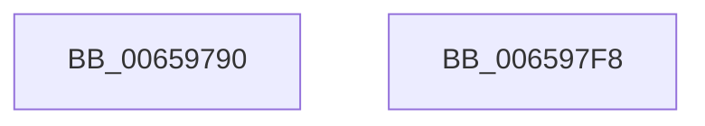

# ExInterlockedExtendZone

- RVA: `0x00659790`–`0x006597F9` (길이 `105` bytes)
- VA: `0x0000000140659790`
- 실행 섹션: `.text`
- PDB 이름 있음: `예`; PDB Function 태그: `아니요`
- unwind 정보 RVA: `0x0005E6B4`
- 디코드: `31`개 명령, `105/105` bytes 표시
- 미해석 바이트: `0` (있으면 어셈블리에 `.byte`로 보존)

> 이 문서는 커널 이미지의 기계어와 PDB 기호를 분석해 생성했습니다. 4번과 5번은 함수 원형과 자료형을 바이너리 사용 방식에서 추정한 C 해석이며 원본 소스 복구 결과는 아닙니다.

## 1. Dependencies

- 직접 호출 지점: **3**; 고유 호출 대상: **3**
- 직접 호출자로 확인된 함수: **0**
- RIP 상대 이미지 참조: **0**

### Outgoing calls
- `0x006597B8` → [KeAcquireSpinLockRaiseToDpc](../20/KeAcquireSpinLockRaiseToDpc_function_00208470.md) (function, `0x00208470`)
- `0x006597C9` → [ExExtendZone](ExExtendZone_function_006596A0.md) (function, `0x006596A0`)
- `0x006597D6` → [KeReleaseSpinLock](../39/KeReleaseSpinLock_function_00392BA0.md) (function, `0x00392BA0`)

### Direct callers
- 이 함수 시작 RVA로 연결되는 직접 call은 확인되지 않았습니다. 간접 호출은 완전히 역산할 수 없습니다.

### Static image references
- 디코드된 RIP-relative 메모리 참조가 없습니다.

## 2. Other-region calls and transfers

- 다른 실행 섹션으로 향하는 call: **0**
- 별도 외부 분기/꼬리 이동을 확인하지 못했습니다.

## 3. Assembly (complete function range)

```asm
00659790  48 8B C4                        mov rax, rsp
00659793  48 89 58 08                     mov qword ptr [rax + 8], rbx
00659797  48 89 68 10                     mov qword ptr [rax + 0x10], rbp
0065979B  48 89 70 18                     mov qword ptr [rax + 0x18], rsi
0065979F  48 89 78 20                     mov qword ptr [rax + 0x20], rdi
006597A3  41 56                           push r14
006597A5  48 83 EC 20                     sub rsp, 0x20
006597A9  48 8B E9                        mov rbp, rcx
006597AC  4D 8B F1                        mov r14, r9
006597AF  49 8B C9                        mov rcx, r9
006597B2  41 8B D8                        mov ebx, r8d
006597B5  48 8B F2                        mov rsi, rdx
006597B8  E8 B3 EC BA FF                  call 0x140208470
006597BD  44 8B C3                        mov r8d, ebx
006597C0  48 8B D6                        mov rdx, rsi
006597C3  48 8B CD                        mov rcx, rbp
006597C6  40 8A F8                        mov dil, al
006597C9  E8 D2 FE FF FF                  call 0x1406596a0
006597CE  40 8A D7                        mov dl, dil
006597D1  49 8B CE                        mov rcx, r14
006597D4  8B D8                           mov ebx, eax
006597D6  E8 C5 93 D3 FF                  call 0x140392ba0
006597DB  48 8B 6C 24 38                  mov rbp, qword ptr [rsp + 0x38]
006597E0  8B C3                           mov eax, ebx
006597E2  48 8B 5C 24 30                  mov rbx, qword ptr [rsp + 0x30]
006597E7  48 8B 74 24 40                  mov rsi, qword ptr [rsp + 0x40]
006597EC  48 8B 7C 24 48                  mov rdi, qword ptr [rsp + 0x48]
006597F1  48 83 C4 20                     add rsp, 0x20
006597F5  41 5E                           pop r14
006597F7  C3                              ret
006597F8  CC                              int3
```

## 4. C-style interpretation (structured pseudocode)

```c
__int64 __fastcall ExInterlockedExtendZone(__int64 a1, __int64 a2, int a3, __int64 a4)
{
    __int64 result;
    __int64 v_rsp;
    unsigned __int64 v_stack_p10;
    unsigned __int64 v_stack_p18;
    unsigned __int64 v_stack_p20;
    unsigned __int64 v_stack_p8;

    *(unsigned __int64 *)(v_rsp + 8) = v_rbx;
    *(unsigned __int64 *)(v_rsp + 16) = v_rbp;
    *(unsigned __int64 *)(v_rsp + 24) = v_rsi;
    *(unsigned __int64 *)(v_rsp + 32) = v_rdi;
    v_rsp = (v_rsp) - (32);
    result = KeAcquireSpinLockRaiseToDpc(a4, a2, a3, a4);
    result = ExExtendZone(a1, a2, (unsigned int)((unsigned int)((unsigned int)(a3))), a4);
    result = KeReleaseSpinLock(a4, (unsigned __int8)((unsigned __int8)(result)), (unsigned int)((unsigned int)((unsigned int)(a3))), a4);
    v_rsp = (v_rsp) + (32);
    return (unsigned int)((unsigned int)((unsigned int)((unsigned int)(result))));
}
```

## 5. (Beta) C Style

```c
int64_t ExInterlockedExtendZone(int64_t Arg1, int64_t Arg2, int32_t Arg3, int64_t Arg4)
{
    int64_t result;
    int64_t local_rsp;
    uint64_t v_stack_p10;
    uint64_t v_stack_p18;
    uint64_t v_stack_p20;
    uint64_t v_stack_p8;

    *(uint64_t *)(local_rsp + 0x8) = local_rbx;
    *(uint64_t *)(local_rsp + 0x10) = local_rbp;
    *(uint64_t *)(local_rsp + 0x18) = local_rsi;
    *(uint64_t *)(local_rsp + 0x20) = local_rdi;
    local_rsp = (local_rsp) - (32);
    result = KeAcquireSpinLockRaiseToDpc(Arg4, Arg2, Arg3, Arg4);
    result = ExExtendZone(Arg1, Arg2, (uint32_t)((uint32_t)((uint32_t)(Arg3))), Arg4);
    result = KeReleaseSpinLock(Arg4, (uint8_t)((uint8_t)(result)), (uint32_t)((uint32_t)((uint32_t)(Arg3))), Arg4);
    local_rsp = (local_rsp) + (32);
    return (uint32_t)((uint32_t)((uint32_t)((uint32_t)(result))));
}
```

## 6. Execution-region graph

[열기: 2D/3D 그래프와 함수 탐색 컨트롤 패널](../../../control-panel.html?section=text&rva=0x00659790&view=graph)

- 2D 그래프는 위에서 아래로 흐르고, 3D 그래프는 빈 공간을 드래그해 회전합니다. Shift+드래그는 이동, 휠은 확대·축소, 함수 노드 선택은 대상 보고서 이동입니다.

### Static fallback


