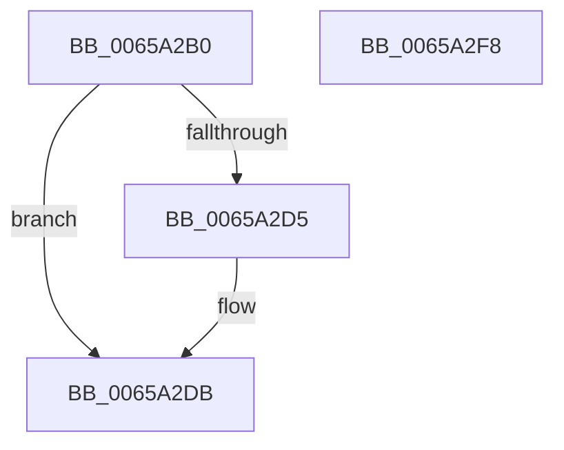

# ExInterlockedPopEntryList

- RVA: `0x0065A2B0`–`0x0065A2F9` (길이 `73` bytes)
- VA: `0x000000014065A2B0`
- 실행 섹션: `.text`
- PDB 이름 있음: `예`; PDB Function 태그: `아니요`
- unwind 정보 RVA: `0x00060BC4`
- 디코드: `23`개 명령, `73/73` bytes 표시
- 미해석 바이트: `0` (있으면 어셈블리에 `.byte`로 보존)

> 이 문서는 커널 이미지의 기계어와 PDB 기호를 분석해 생성했습니다. 4번과 5번은 함수 원형과 자료형을 바이너리 사용 방식에서 추정한 C 해석이며 원본 소스 복구 결과는 아닙니다.

## 1. Dependencies

- 직접 호출 지점: **2**; 고유 호출 대상: **2**
- 직접 호출자로 확인된 함수: **0**
- RIP 상대 이미지 참조: **0**

### Outgoing calls
- `0x0065A2C8` → [ExpAcquireSpinLockDisabled](../38/ExpAcquireSpinLockDisabled_function_00386858.md) (function, `0x00386858`)
- `0x0065A2E0` → [ExpReleaseSpinLockDisabled](../38/ExpReleaseSpinLockDisabled_function_003869E4.md) (function, `0x003869E4`)

### Direct callers
- 이 함수 시작 RVA로 연결되는 직접 call은 확인되지 않았습니다. 간접 호출은 완전히 역산할 수 없습니다.

### Static image references
- 디코드된 RIP-relative 메모리 참조가 없습니다.

## 2. Other-region calls and transfers

- 다른 실행 섹션으로 향하는 call: **0**
- 별도 외부 분기/꼬리 이동을 확인하지 못했습니다.

## 3. Assembly (complete function range)

```asm
0065A2B0  48 89 5C 24 08                  mov qword ptr [rsp + 8], rbx
0065A2B5  48 89 74 24 10                  mov qword ptr [rsp + 0x10], rsi
0065A2BA  57                              push rdi
0065A2BB  48 83 EC 20                     sub rsp, 0x20
0065A2BF  48 8B F9                        mov rdi, rcx
0065A2C2  48 8B F2                        mov rsi, rdx
0065A2C5  48 8B CA                        mov rcx, rdx
0065A2C8  E8 8B C5 D2 FF                  call 0x140386858
0065A2CD  48 8B 1F                        mov rbx, qword ptr [rdi]
0065A2D0  48 85 DB                        test rbx, rbx
0065A2D3  74 06                           je 0x14065a2db
0065A2D5  4C 8B 03                        mov r8, qword ptr [rbx]
0065A2D8  4C 89 07                        mov qword ptr [rdi], r8
0065A2DB  8A D0                           mov dl, al
0065A2DD  48 8B CE                        mov rcx, rsi
0065A2E0  E8 FF C6 D2 FF                  call 0x1403869e4
0065A2E5  48 8B 74 24 38                  mov rsi, qword ptr [rsp + 0x38]
0065A2EA  48 8B C3                        mov rax, rbx
0065A2ED  48 8B 5C 24 30                  mov rbx, qword ptr [rsp + 0x30]
0065A2F2  48 83 C4 20                     add rsp, 0x20
0065A2F6  5F                              pop rdi
0065A2F7  C3                              ret
0065A2F8  CC                              int3
```

## 4. C-style interpretation (structured pseudocode)

```c
__int64 __fastcall ExInterlockedPopEntryList(__int64 a1, __int64 a2)
{
    __int64 result;
    __int64 v_rsp;
    unsigned __int64 v_stack_p10;
    unsigned __int64 v_stack_p8;

    v_stack_p8 = v_rbx;
    v_stack_p10 = v_rsi;
    v_rsp = (v_rsp) - (32);
    result = ExpAcquireSpinLockDisabled(a2, a2, a3, a4);
    if (*(unsigned __int64 *)(a1) != 0) {
        a3 = *(unsigned __int64 *)(*(unsigned __int64 *)(a1));
        *(unsigned __int64 *)(a1) = a3;
    }
    result = ExpReleaseSpinLockDisabled(a2, (unsigned __int8)(result), a3, a4);
    v_rsp = (v_rsp) + (32);
    return *(unsigned __int64 *)(a1);
}
```

## 5. (Beta) C Style

```c
int64_t ExInterlockedPopEntryList(void *Arg1, int64_t Arg2)
{
    uint8_t *arg1 = (uint8_t *)Arg1;

    int64_t result;
    int64_t local_rsp;
    uint64_t v_stack_p10;
    uint64_t v_stack_p8;

    v_stack_p8 = local_rbx;
    v_stack_p10 = local_rsi;
    local_rsp = (local_rsp) - (32);
    result = ExpAcquireSpinLockDisabled(Arg2, Arg2, a3, a4);
    if (*(uint64_t *)(arg1) != 0) {
        a3 = *(uint64_t *)(*(uint64_t *)(arg1));
        *(uint64_t *)(arg1) = a3;
    }
    result = ExpReleaseSpinLockDisabled(Arg2, (uint8_t)(result), a3, a4);
    local_rsp = (local_rsp) + (32);
    return *(uint64_t *)(arg1);
}
```

### 관측된 메모리 오프셋

구조체 형식이 확인되지 않은 접근은 인자 기준의 오프셋으로만 기록했습니다.

| 기준 인자 | 오프셋 표현 | 폭 (bit) | 접근 |
|---|---:|---:|---|
| `Arg1` | `+ 0x0` | `64` | `R` |
| `Arg1` | `+ 0x0` | `64` | `W` |

## 6. Execution-region graph

[열기: 2D/3D 그래프와 함수 탐색 컨트롤 패널](../../../control-panel.html?section=text&rva=0x0065A2B0&view=graph)

- 2D 그래프는 위에서 아래로 흐르고, 3D 그래프는 빈 공간을 드래그해 회전합니다. Shift+드래그는 이동, 휠은 확대·축소, 함수 노드 선택은 대상 보고서 이동입니다.

### Static fallback


