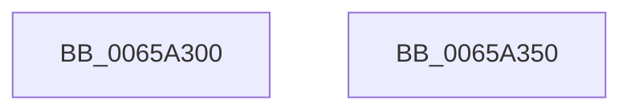

# ExInterlockedPushEntryList

- RVA: `0x0065A300`–`0x0065A351` (길이 `81` bytes)
- VA: `0x000000014065A300`
- 실행 섹션: `.text`
- PDB 이름 있음: `예`; PDB Function 태그: `아니요`
- unwind 정보 RVA: `0x0005C954`
- 디코드: `24`개 명령, `81/81` bytes 표시
- 미해석 바이트: `0` (있으면 어셈블리에 `.byte`로 보존)

> 이 문서는 커널 이미지의 기계어와 PDB 기호를 분석해 생성했습니다. 4번과 5번은 함수 원형과 자료형을 바이너리 사용 방식에서 추정한 C 해석이며 원본 소스 복구 결과는 아닙니다.

## 1. Dependencies

- 직접 호출 지점: **2**; 고유 호출 대상: **2**
- 직접 호출자로 확인된 함수: **1**
- RIP 상대 이미지 참조: **0**

### Outgoing calls
- `0x0065A320` → [ExpAcquireSpinLockDisabled](../38/ExpAcquireSpinLockDisabled_function_00386858.md) (function, `0x00386858`)
- `0x0065A333` → [ExpReleaseSpinLockDisabled](../38/ExpReleaseSpinLockDisabled_function_003869E4.md) (function, `0x003869E4`)

### Direct callers
- [WheapPushPendingOfflineWrapper](../../page/7D/WheapPushPendingOfflineWrapper_function_007D95F4.md) at `0x007D9609`

### Static image references
- 디코드된 RIP-relative 메모리 참조가 없습니다.

## 2. Other-region calls and transfers

- 다른 실행 섹션으로 향하는 call: **0**
- 별도 외부 분기/꼬리 이동을 확인하지 못했습니다.

## 3. Assembly (complete function range)

```asm
0065A300  48 89 5C 24 08                  mov qword ptr [rsp + 8], rbx
0065A305  48 89 6C 24 10                  mov qword ptr [rsp + 0x10], rbp
0065A30A  48 89 74 24 18                  mov qword ptr [rsp + 0x18], rsi
0065A30F  57                              push rdi
0065A310  48 83 EC 20                     sub rsp, 0x20
0065A314  48 8B F9                        mov rdi, rcx
0065A317  49 8B E8                        mov rbp, r8
0065A31A  49 8B C8                        mov rcx, r8
0065A31D  48 8B F2                        mov rsi, rdx
0065A320  E8 33 C5 D2 FF                  call 0x140386858
0065A325  48 8B 1F                        mov rbx, qword ptr [rdi]
0065A328  8A D0                           mov dl, al
0065A32A  48 89 1E                        mov qword ptr [rsi], rbx
0065A32D  48 8B CD                        mov rcx, rbp
0065A330  48 89 37                        mov qword ptr [rdi], rsi
0065A333  E8 AC C6 D2 FF                  call 0x1403869e4
0065A338  48 8B 6C 24 38                  mov rbp, qword ptr [rsp + 0x38]
0065A33D  48 8B C3                        mov rax, rbx
0065A340  48 8B 5C 24 30                  mov rbx, qword ptr [rsp + 0x30]
0065A345  48 8B 74 24 40                  mov rsi, qword ptr [rsp + 0x40]
0065A34A  48 83 C4 20                     add rsp, 0x20
0065A34E  5F                              pop rdi
0065A34F  C3                              ret
0065A350  CC                              int3
```

## 4. C-style interpretation (structured pseudocode)

```c
__int64 __fastcall ExInterlockedPushEntryList(__int64 a1, __int64 a2, __int64 a3)
{
    __int64 result;
    __int64 v_rsp;
    unsigned __int64 v_stack_p10;
    unsigned __int64 v_stack_p18;
    unsigned __int64 v_stack_p8;

    v_stack_p8 = v_rbx;
    v_stack_p10 = v_rbp;
    v_stack_p18 = v_rsi;
    v_rsp = (v_rsp) - (32);
    result = ExpAcquireSpinLockDisabled(a3, a2, a3, a4);
    *(unsigned __int64 *)(a2) = *(unsigned __int64 *)(a1);
    *(unsigned __int64 *)(a1) = a2;
    result = ExpReleaseSpinLockDisabled(a3, (unsigned __int8)(result), a3, a4);
    v_rsp = (v_rsp) + (32);
    return *(unsigned __int64 *)(a1);
}
```

## 5. (Beta) C Style

```c
int64_t ExInterlockedPushEntryList(void *Arg1, void *Arg2, int64_t Arg3)
{
    uint8_t *arg1 = (uint8_t *)Arg1;
    uint8_t *arg2 = (uint8_t *)Arg2;

    int64_t result;
    int64_t local_rsp;
    uint64_t v_stack_p10;
    uint64_t v_stack_p18;
    uint64_t v_stack_p8;

    v_stack_p8 = local_rbx;
    v_stack_p10 = local_rbp;
    v_stack_p18 = local_rsi;
    local_rsp = (local_rsp) - (32);
    result = ExpAcquireSpinLockDisabled(Arg3, Arg2, Arg3, a4);
    *(uint64_t *)(arg2) = *(uint64_t *)(arg1);
    *(void **)(arg1) = Arg2;
    result = ExpReleaseSpinLockDisabled(Arg3, (uint8_t)(result), Arg3, a4);
    local_rsp = (local_rsp) + (32);
    return *(uint64_t *)(arg1);
}
```

### 관측된 메모리 오프셋

구조체 형식이 확인되지 않은 접근은 인자 기준의 오프셋으로만 기록했습니다.

| 기준 인자 | 오프셋 표현 | 폭 (bit) | 접근 |
|---|---:|---:|---|
| `Arg1` | `+ 0x0` | `64` | `R` |
| `Arg1` | `+ 0x0` | `64` | `W` |
| `Arg2` | `+ 0x0` | `64` | `W` |

## 6. Execution-region graph

[열기: 2D/3D 그래프와 함수 탐색 컨트롤 패널](../../../control-panel.html?section=text&rva=0x0065A300&view=graph)

- 2D 그래프는 위에서 아래로 흐르고, 3D 그래프는 빈 공간을 드래그해 회전합니다. Shift+드래그는 이동, 휠은 확대·축소, 함수 노드 선택은 대상 보고서 이동입니다.

### Static fallback


