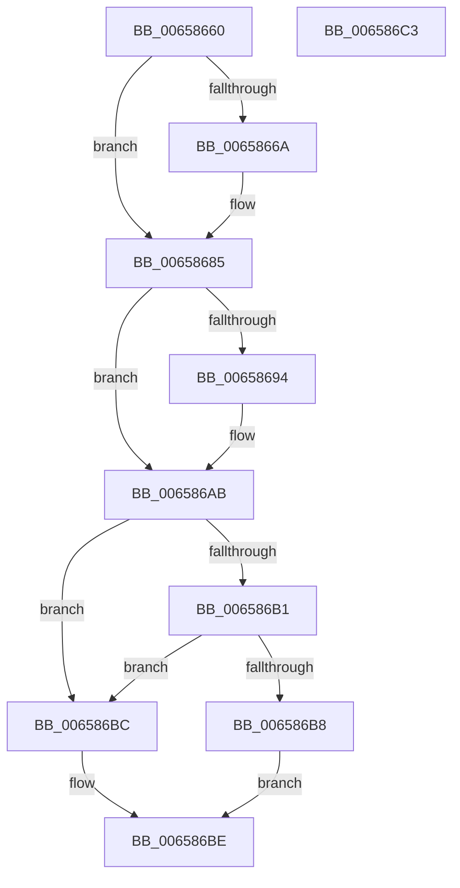

# ExIsFastResourceContended

- RVA: `0x00658660`–`0x006586C4` (길이 `100` bytes)
- VA: `0x0000000140658660`
- 실행 섹션: `.text`
- PDB 이름 있음: `예`; PDB Function 태그: `아니요`
- unwind 정보 RVA: `0x0005D2F4`
- 디코드: `30`개 명령, `100/100` bytes 표시
- 미해석 바이트: `0` (있으면 어셈블리에 `.byte`로 보존)

> 이 문서는 커널 이미지의 기계어와 PDB 기호를 분석해 생성했습니다. 4번과 5번은 함수 원형과 자료형을 바이너리 사용 방식에서 추정한 C 해석이며 원본 소스 복구 결과는 아닙니다.

## 1. Dependencies

- 직접 호출 지점: **2**; 고유 호출 대상: **1**
- 직접 호출자로 확인된 함수: **1**
- RIP 상대 이미지 참조: **0**

### Outgoing calls
- `0x0065867F` → [KeBugCheckEx](../4F/KeBugCheckEx_function_004FD660.md) (function, `0x004FD660`)
- `0x006586A5` → [KeBugCheckEx](../4F/KeBugCheckEx_function_004FD660.md) (function, `0x004FD660`)

### Direct callers
- [DifExIsFastResourceContendedWrapper](../62/DifExIsFastResourceContendedWrapper_function_00621230.md) at `0x006212FD`

### Static image references
- 디코드된 RIP-relative 메모리 참조가 없습니다.

## 2. Other-region calls and transfers

- 다른 실행 섹션으로 향하는 call: **0**
- 별도 외부 분기/꼬리 이동을 확인하지 못했습니다.

## 3. Assembly (complete function range)

```asm
00658660  48 83 EC 38                     sub rsp, 0x38
00658664  F6 41 1A 01                     test byte ptr [rcx + 0x1a], 1
00658668  75 1B                           jne 0x140658685
0065866A  48 83 64 24 20 00               and qword ptr [rsp + 0x20], 0
00658670  45 33 C9                        xor r9d, r9d
00658673  4C 8B C1                        mov r8, rcx
00658676  B9 C6 01 00 00                  mov ecx, 0x1c6
0065867B  41 8D 51 03                     lea edx, [r9 + 3]
0065867F  E8 DC 4F EA FF                  call 0x1404fd660
00658684  CC                              int3
00658685  44 0F 20 C0                     mov rax, cr8
00658689  41 B9 02 00 00 00               mov r9d, 2
0065868F  41 3A C1                        cmp al, r9b
00658692  76 17                           jbe 0x1406586ab
00658694  48 83 64 24 20 00               and qword ptr [rsp + 0x20], 0
0065869A  33 D2                           xor edx, edx
0065869C  44 0F B6 C0                     movzx r8d, al
006586A0  B9 C6 01 00 00                  mov ecx, 0x1c6
006586A5  E8 B6 4F EA FF                  call 0x1404fd660
006586AA  CC                              int3
006586AB  83 79 38 00                     cmp dword ptr [rcx + 0x38], 0
006586AF  75 0B                           jne 0x1406586bc
006586B1  48 83 79 10 00                  cmp qword ptr [rcx + 0x10], 0
006586B6  75 04                           jne 0x1406586bc
006586B8  32 C0                           xor al, al
006586BA  EB 02                           jmp 0x1406586be
006586BC  B0 01                           mov al, 1
006586BE  48 83 C4 38                     add rsp, 0x38
006586C2  C3                              ret
006586C3  CC                              int3
```

## 4. C-style interpretation (structured pseudocode)

```c
__int64 __fastcall ExIsFastResourceContended(__int64 a1, __int64 a2, __int64 a3, int a4)
{
    __int64 result;
    __int64 v_rsp;
    unsigned __int64 v_stack_m18;

    v_rsp = (v_rsp) - (56);
    if (((*(unsigned __int8 *)(a1 + 26)) & (1)) == 0) {
        a4 = 0;
        a3 = a1;
        a1 = 454;
        a2 = a4 + 3;
        result = KeBugCheckEx(a1, a2, a3, a4);
    }
    result = v_cr8;
    if (((unsigned __int8)(v_cr8)) >= = 2) {
        a2 = 0;
        a3 = (unsigned __int8)(v_cr8);
        a1 = 454;
        result = KeBugCheckEx(a1, a2, a3, 2);
    }
    if ((*(unsigned int *)(a1 + 56)) != 0) goto loc_006586BC;
    if ((*(unsigned __int64 *)(a1 + 16)) != 0) goto loc_006586BC;
    result = 0;
    goto loc_006586BE;
loc_006586BC:
loc_006586BE:
    v_rsp = (v_rsp) + (56);
    return 1;
}
```

## 5. (Beta) C Style

```c
int64_t ExIsFastResourceContended(void *Arg1, int64_t Arg2, int64_t Arg3, int32_t Arg4)
{
    uint8_t *arg1 = (uint8_t *)Arg1;

    int64_t result;
    int64_t local_rsp;
    uint64_t v_stack_m18;

    local_rsp = (local_rsp) - (56);
    if (((*(uint8_t *)(arg1 + 0x1A)) & (1)) == 0) {
        Arg4 = 0;
        Arg3 = Arg1;
        Arg1 = 454;
        Arg2 = Arg4 + 3;
        result = KeBugCheckEx(Arg1, Arg2, Arg3, Arg4);
    }
    result = v_cr8;
    if (((uint8_t)(v_cr8)) >= = 2) {
        Arg2 = 0;
        Arg3 = (uint8_t)(v_cr8);
        Arg1 = 454;
        result = KeBugCheckEx(Arg1, Arg2, Arg3, 2);
    }
    if ((*(uint32_t *)(arg1 + 0x38)) != 0) goto loc_006586BC;
    if ((*(uint64_t *)(arg1 + 0x10)) != 0) goto loc_006586BC;
    result = 0;
    goto loc_006586BE;
loc_006586BC:
loc_006586BE:
    local_rsp = (local_rsp) + (56);
    return 1;
}
```

### 관측된 메모리 오프셋

구조체 형식이 확인되지 않은 접근은 인자 기준의 오프셋으로만 기록했습니다.

| 기준 인자 | 오프셋 표현 | 폭 (bit) | 접근 |
|---|---:|---:|---|
| `Arg1` | `+ 0x1A` | `8` | `R` |

## 6. Execution-region graph

[열기: 2D/3D 그래프와 함수 탐색 컨트롤 패널](../../../control-panel.html?section=text&rva=0x00658660&view=graph)

- 2D 그래프는 위에서 아래로 흐르고, 3D 그래프는 빈 공간을 드래그해 회전합니다. Shift+드래그는 이동, 휠은 확대·축소, 함수 노드 선택은 대상 보고서 이동입니다.

### Static fallback


