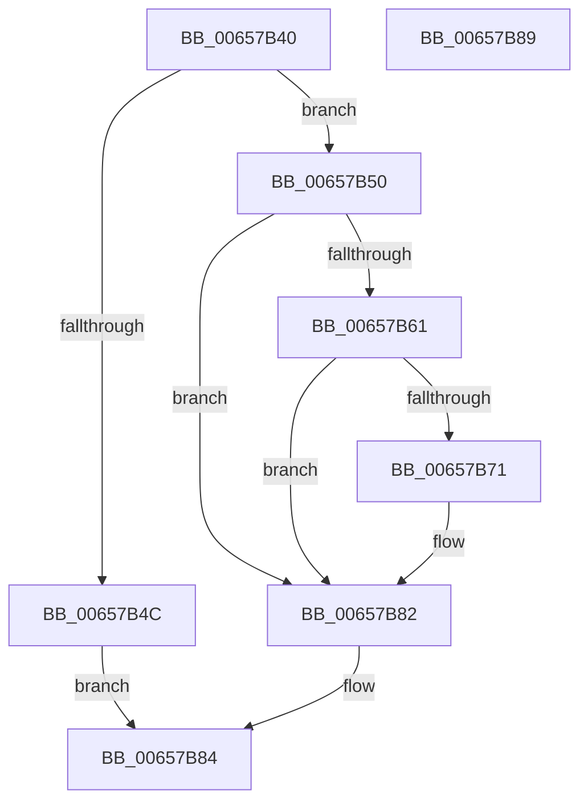

# ExNotifyBootDeviceRemoval

- RVA: `0x00657B40`–`0x00657B8A` (길이 `74` bytes)
- VA: `0x0000000140657B40`
- 실행 섹션: `.text`
- PDB 이름 있음: `예`; PDB Function 태그: `아니요`
- unwind 정보 RVA: `0x0005C788`
- 디코드: `23`개 명령, `74/74` bytes 표시
- 미해석 바이트: `0` (있으면 어셈블리에 `.byte`로 보존)

> 이 문서는 커널 이미지의 기계어와 PDB 기호를 분석해 생성했습니다. 4번과 5번은 함수 원형과 자료형을 바이너리 사용 방식에서 추정한 C 해석이며 원본 소스 복구 결과는 아닙니다.

## 1. Dependencies

- 직접 호출 지점: **1**; 고유 호출 대상: **1**
- 직접 호출자로 확인된 함수: **0**
- RIP 상대 이미지 참조: **2**

### Outgoing calls
- `0x00657B7D` → [KeSetEvent](../33/KeSetEvent_function_0033F310.md) (function, `0x0033F310`)

### Direct callers
- 이 함수 시작 RVA로 연결되는 직접 call은 확인되지 않았습니다. 간접 호출은 완전히 역산할 수 없습니다.

### Static image references
- `0x00657B63` → RVA `0x00EFAC98` (`.data`; read/write)
- `0x00657B74` → RVA `0x00EFAC40` (`.data`; read)

## 2. Other-region calls and transfers

- 다른 실행 섹션으로 향하는 call: **0**
- 별도 외부 분기/꼬리 이동을 확인하지 못했습니다.

## 3. Assembly (complete function range)

```asm
00657B40  48 83 EC 28                     sub rsp, 0x28
00657B44  81 39 42 44 4E 50               cmp dword ptr [rcx], 0x504e4442
00657B4A  74 04                           je 0x140657b50
00657B4C  32 C0                           xor al, al
00657B4E  EB 34                           jmp 0x140657b84
00657B50  B8 01 00 00 00                  mov eax, 1
00657B55  F0 0F C1 41 04                  lock xadd dword ptr [rcx + 4], eax
00657B5A  FF C0                           inc eax
00657B5C  83 F8 01                        cmp eax, 1
00657B5F  75 21                           jne 0x140657b82
00657B61  8B C8                           mov ecx, eax
00657B63  F0 0F C1 0D 2D 31 8A 00         lock xadd dword ptr [rip + 0x8a312d], ecx
00657B6B  FF C1                           inc ecx
00657B6D  3B C8                           cmp ecx, eax
00657B6F  75 11                           jne 0x140657b82
00657B71  45 33 C0                        xor r8d, r8d
00657B74  48 8D 0D C5 30 8A 00            lea rcx, [rip + 0x8a30c5]
00657B7B  33 D2                           xor edx, edx
00657B7D  E8 8E 77 CE FF                  call 0x14033f310
00657B82  B0 01                           mov al, 1
00657B84  48 83 C4 28                     add rsp, 0x28
00657B88  C3                              ret
00657B89  CC                              int3
```

## 4. C-style interpretation (structured pseudocode)

```c
__int64 __fastcall ExNotifyBootDeviceRemoval(__int64 a1, int a2, int a3)
{
    __int64 result;
    __int64 v_rsp;

    v_rsp = (v_rsp) - (40);
    if ((*(unsigned int *)(a1)) == 0x504E4442ULL) goto loc_00657B50;
    result = 0;
    goto loc_00657B84;
loc_00657B50:
    result = (unsigned int)((1) + 1);
    if (((unsigned int)(result)) != 1) goto loc_00657B82;
    a1 = (unsigned int)(((unsigned int)((unsigned int)(result))) + 1);
    if (((unsigned int)(a1)) == ((unsigned int)(result))) {
        a3 = 0;
        a1 = v_rip + 9056453;
        a2 = 0;
        result = KeSetEvent(a1, a2, a3, a4);
    }
loc_00657B84:
    v_rsp = (v_rsp) + (40);
    return 1;
}
```

## 5. (Beta) C Style

```c
int64_t ExNotifyBootDeviceRemoval(void *Arg1, int32_t Arg2, int32_t Arg3)
{
    uint8_t *arg1 = (uint8_t *)Arg1;

    int64_t result;
    int64_t local_rsp;

    local_rsp = (local_rsp) - (40);
    if ((*(uint32_t *)(arg1)) == 0x504E4442ULL) goto loc_00657B50;
    result = 0;
    goto loc_00657B84;
loc_00657B50:
    result = (uint32_t)((1) + 1);
    if (((uint32_t)(result)) != 1) goto loc_00657B82;
    Arg1 = (uint32_t)(((uint32_t)((uint32_t)(result))) + 1);
    if (((uint32_t)(Arg1)) == ((uint32_t)(result))) {
        Arg3 = 0;
        Arg1 = v_rip + 9056453;
        Arg2 = 0;
        result = KeSetEvent(Arg1, Arg2, Arg3, a4);
    }
loc_00657B84:
    local_rsp = (local_rsp) + (40);
    return 1;
}
```

### 관측된 메모리 오프셋

구조체 형식이 확인되지 않은 접근은 인자 기준의 오프셋으로만 기록했습니다.

| 기준 인자 | 오프셋 표현 | 폭 (bit) | 접근 |
|---|---:|---:|---|
| `Arg1` | `+ 0x0` | `32` | `R` |
| `Arg1` | `+ 0x4` | `32` | `R/W` |

## 6. Execution-region graph

[열기: 2D/3D 그래프와 함수 탐색 컨트롤 패널](../../../control-panel.html?section=text&rva=0x00657B40&view=graph)

- 2D 그래프는 위에서 아래로 흐르고, 3D 그래프는 빈 공간을 드래그해 회전합니다. Shift+드래그는 이동, 휠은 확대·축소, 함수 노드 선택은 대상 보고서 이동입니다.

### Static fallback


