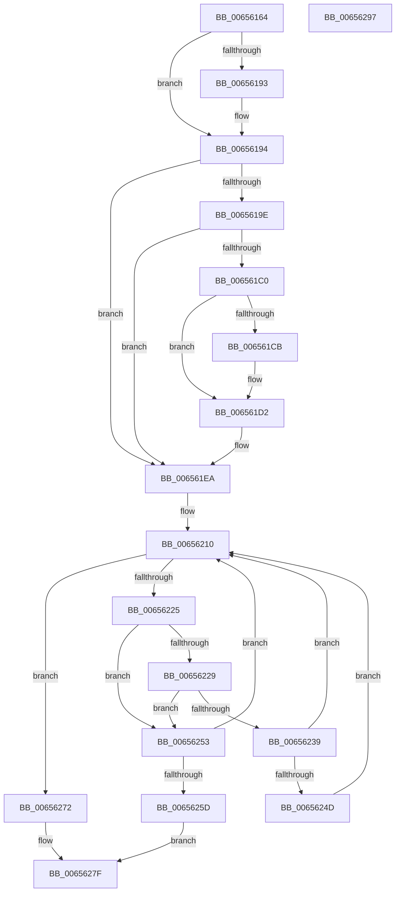

# ExPoolCleanupExpansionTable

- RVA: `0x00656164`–`0x00656298` (길이 `308` bytes)
- VA: `0x0000000140656164`
- 실행 섹션: `.text`
- PDB 이름 있음: `예`; PDB Function 태그: `아니요`
- unwind 정보 RVA: `0x000718AC`
- 디코드: `82`개 명령, `308/308` bytes 표시
- 미해석 바이트: `0` (있으면 어셈블리에 `.byte`로 보존)

> 이 문서는 커널 이미지의 기계어와 PDB 기호를 분석해 생성했습니다. 4번과 5번은 함수 원형과 자료형을 바이너리 사용 방식에서 추정한 C 해석이며 원본 소스 복구 결과는 아닙니다.

## 1. Dependencies

- 직접 호출 지점: **5**; 고유 호출 대상: **5**
- 직접 호출자로 확인된 함수: **1**
- RIP 상대 이미지 참조: **5**

### Outgoing calls
- `0x006561B7` → [ExpPoolFlagsToPoolType](../../poolcode/B8/ExpPoolFlagsToPoolType_function_00B84080.md) (function, `0x00B84080`)
- `0x006561E5` → [EtwTracePool](../2E/EtwTracePool_function_002ECEEC.md) (function, `0x002ECEEC`)
- `0x0065626B` → [ExpRemovePoolTrackerExpansion](../36/ExpRemovePoolTrackerExpansion_function_00361300.md) (function, `0x00361300`)
- `0x0065627A` → [ExpPoolTrackerReturnLimit](../36/ExpPoolTrackerReturnLimit_function_00361570.md) (function, `0x00361570`)
- `0x00656282` → [ExFreeHeapPages](../44/ExFreeHeapPages_function_00446B8C.md) (function, `0x00446B8C`)

### Direct callers
- [sub_006DEB9E](../6D/Unknown_function_006DEB9E.md) at `0x006DECA1`

### Static image references
- `0x00656186` → RVA `0x00FC514C` (`ALMOSTRO`; read)
- `0x00656194` → RVA `0x00FC6B04` (`ALMOSTRO`; read)
- `0x006561F2` → RVA `0x00EFAD20` (`.data`; read)
- `0x006561F9` → RVA `0x00EFED58` (`.data`; read)
- `0x00656229` → RVA `0x00EFED60` (`.data`; read)

## 2. Other-region calls and transfers

- 다른 실행 섹션으로 향하는 call: **1**
  - `0x006561B7` → [ExpPoolFlagsToPoolType](../../poolcode/B8/ExpPoolFlagsToPoolType_function_00B84080.md) (`.text` → `POOLCODE`)
- 별도 외부 분기/꼬리 이동을 확인하지 못했습니다.

## 3. Assembly (complete function range)

```asm
00656164  48 8B C4                        mov rax, rsp
00656167  48 89 58 08                     mov qword ptr [rax + 8], rbx
0065616B  48 89 70 10                     mov qword ptr [rax + 0x10], rsi
0065616F  57                              push rdi
00656170  48 83 EC 40                     sub rsp, 0x40
00656174  83 60 E8 00                     and dword ptr [rax - 0x18], 0
00656178  48 8B DA                        mov rbx, rdx
0065617B  C6 40 18 00                     mov byte ptr [rax + 0x18], 0
0065617F  48 8B F9                        mov rdi, rcx
00656182  C6 40 20 00                     mov byte ptr [rax + 0x20], 0
00656186  8B 05 C0 EF 96 00               mov eax, dword ptr [rip + 0x96efc0]
0065618C  3D 50 6F 6F 6C                  cmp eax, 0x6c6f6f50
00656191  75 01                           jne 0x140656194
00656193  CC                              int3
00656194  8B 05 6A 09 97 00               mov eax, dword ptr [rip + 0x97096a]
0065619A  A8 41                           test al, 0x41
0065619C  74 4C                           je 0x1406561ea
0065619E  33 D2                           xor edx, edx
006561A0  48 8D 44 24 68                  lea rax, [rsp + 0x68]
006561A5  4C 8D 4C 24 60                  lea r9, [rsp + 0x60]
006561AA  48 89 44 24 20                  mov qword ptr [rsp + 0x20], rax
006561AF  4C 8D 44 24 30                  lea r8, [rsp + 0x30]
006561B4  8D 4A 40                        lea ecx, [rdx + 0x40]
006561B7  E8 C4 DE 52 00                  call 0x140b84080
006561BC  85 C0                           test eax, eax
006561BE  78 2A                           js 0x1406561ea
006561C0  80 7C 24 60 00                  cmp byte ptr [rsp + 0x60], 0
006561C5  8B 54 24 30                     mov edx, dword ptr [rsp + 0x30]
006561C9  74 07                           je 0x1406561d2
006561CB  83 CA 08                        or edx, 8
006561CE  89 54 24 30                     mov dword ptr [rsp + 0x30], edx
006561D2  B9 22 0E 00 00                  mov ecx, 0xe22
006561D7  48 89 5C 24 20                  mov qword ptr [rsp + 0x20], rbx
006561DC  4C 8B CF                        mov r9, rdi
006561DF  41 B8 50 6F 6F 6C               mov r8d, 0x6c6f6f50
006561E5  E8 02 6D C9 FF                  call 0x1402eceec
006561EA  65 8B 04 25 A4 01 00 00         mov eax, dword ptr gs:[0x1a4]
006561F2  48 8D 35 27 4B 8A 00            lea rsi, [rip + 0x8a4b27]
006561F9  44 8B 15 58 8B 8A 00            mov r10d, dword ptr [rip + 0x8a8b58]
00656200  41 8B CA                        mov ecx, r10d
00656203  81 E1 A5 ED 0D 04               and ecx, 0x40deda5
00656209  44 8B D9                        mov r11d, ecx
0065620C  48 8B 34 C6                     mov rsi, qword ptr [rsi + rax*8]
00656210  48 8D 14 89                     lea rdx, [rcx + rcx*4]
00656214  48 03 D2                        add rdx, rdx
00656217  4C 8D 04 D6                     lea r8, [rsi + rdx*8]
0065621B  41 8B 00                        mov eax, dword ptr [r8]
0065621E  3D 50 6F 6F 6C                  cmp eax, 0x6c6f6f50
00656223  74 4D                           je 0x140656272
00656225  85 C0                           test eax, eax
00656227  75 2A                           jne 0x140656253
00656229  48 8B 05 30 8B 8A 00            mov rax, qword ptr [rip + 0x8a8b30]
00656230  44 8B 0C D0                     mov r9d, dword ptr [rax + rdx*8]
00656234  45 85 C9                        test r9d, r9d
00656237  74 1A                           je 0x140656253
00656239  45 89 08                        mov dword ptr [r8], r9d
0065623C  48 8B 05 1D 8B 8A 00            mov rax, qword ptr [rip + 0x8a8b1d]
00656243  4C 8B 4C D0 48                  mov r9, qword ptr [rax + rdx*8 + 0x48]
00656248  4D 85 C9                        test r9, r9
0065624B  74 C3                           je 0x140656210
0065624D  4D 89 48 48                     mov qword ptr [r8 + 0x48], r9
00656251  EB BD                           jmp 0x140656210
00656253  FF C1                           inc ecx
00656255  41 23 CA                        and ecx, r10d
00656258  41 3B CB                        cmp ecx, r11d
0065625B  75 B3                           jne 0x140656210
0065625D  41 B8 40 00 00 00               mov r8d, 0x40
00656263  48 8B D3                        mov rdx, rbx
00656266  B9 50 6F 6F 6C                  mov ecx, 0x6c6f6f50
0065626B  E8 90 B0 D0 FF                  call 0x140361300
00656270  EB 0D                           jmp 0x14065627f
00656272  48 8B D3                        mov rdx, rbx
00656275  B9 01 00 00 00                  mov ecx, 1
0065627A  E8 F1 B2 D0 FF                  call 0x140361570
0065627F  48 8B CF                        mov rcx, rdi
00656282  E8 05 09 DF FF                  call 0x140446b8c
00656287  48 8B 5C 24 50                  mov rbx, qword ptr [rsp + 0x50]
0065628C  48 8B 74 24 58                  mov rsi, qword ptr [rsp + 0x58]
00656291  48 83 C4 40                     add rsp, 0x40
00656295  5F                              pop rdi
00656296  C3                              ret
00656297  CC                              int3
```

## 4. C-style interpretation (structured pseudocode)

```c
__int64 __fastcall ExPoolCleanupExpansionTable(__int64 a1, __int64 a2)
{
    __int64 result;
    __int64 v_rsp;
    unsigned __int64 v_stack_m18;
    unsigned __int64 v_stack_m28;
    unsigned __int64 v_stack_p10;
    unsigned __int64 v_stack_p18;
    unsigned __int64 v_stack_p20;
    unsigned __int64 v_stack_p8;

    *(unsigned __int64 *)(v_rsp + 8) = v_rbx;
    *(unsigned __int64 *)(v_rsp + 16) = v_rsi;
    v_rsp = (v_rsp) - (64);
    *(unsigned __int8 *)(v_rsp + 24) = 0;
    *(unsigned __int8 *)(v_rsp + 32) = 0;
    if (((unsigned int)((unsigned int)(*(unsigned int *)(v_rip + 9891776)))) == 0x6C6F6F50ULL) {
    }
    if ((((unsigned __int8)((unsigned int)(*(unsigned int *)(v_rip + 9898346)))) & (65)) == 0) goto loc_006561EA;
    a2 = 0;
    v_stack_m28 = v_stack_p20;
    result = ExpPoolFlagsToPoolType(a2 + 64, a2, v_stack_m18, v_stack_p18);
    if (sign_flag) goto loc_006561EA;
    if (v_stack_p18 != 0) {
        a2 = (unsigned int)(((unsigned int)(v_stack_m18)) | (8));
        v_stack_m18 = (unsigned int)(a2);
    }
    v_stack_m28 = a2;
    result = EtwTracePool((unsigned int)(0xE22ULL), a2, (unsigned int)(0x6C6F6F50ULL), a1);
loc_006561EA:
    a1 = (unsigned int)(((unsigned int)((unsigned int)((unsigned int)(*(unsigned int *)(v_rip + 9079640))))) & (0x40DEDA5ULL));
loc_00656210:
    a2 = (a1 + a1 * 4) + (a1 + a1 * 4);
    if (((unsigned int)((unsigned int)(*(unsigned int *)(*(unsigned __int64 *)(v_rip + 9063207 + (unsigned int)(*(unsigned int *)(gs_base + (0 + 420))) * 8) + a2 * 8)))) == 0x6C6F6F50ULL) goto loc_00656272;
    if ((unsigned int)((unsigned int)(*(unsigned int *)(*(unsigned __int64 *)(v_rip + 9063207 + (unsigned int)(*(unsigned int *)(gs_base + (0 + 420))) * 8) + a2 * 8))) != 0) goto loc_00656253;
    if ((unsigned int)((unsigned int)(*(unsigned int *)(*(unsigned __int64 *)(v_rip + 9079600) + a2 * 8))) == 0) goto loc_00656253;
    *(unsigned int *)(*(unsigned __int64 *)(v_rip + 9063207 + (unsigned int)(*(unsigned int *)(gs_base + (0 + 420))) * 8) + a2 * 8) = (unsigned int)((unsigned int)(*(unsigned int *)(*(unsigned __int64 *)(v_rip + 9079600) + a2 * 8)));
    if (*(unsigned __int64 *)(*(unsigned __int64 *)(v_rip + 9079581) + a2 * 8 + 72) == 0) goto loc_00656210;
    *(unsigned __int64 *)(*(unsigned __int64 *)(v_rip + 9063207 + (unsigned int)(*(unsigned int *)(gs_base + (0 + 420))) * 8) + a2 * 8 + 72) = *(unsigned __int64 *)(*(unsigned __int64 *)(v_rip + 9079581) + a2 * 8 + 72);
    goto loc_00656210;
loc_00656253:
    a1 = (unsigned int)((a1) + 1);
    a1 = (unsigned int)((a1) & ((unsigned int)((unsigned int)(*(unsigned int *)(v_rip + 9079640)))));
    if (((unsigned int)(a1)) != ((unsigned int)((unsigned int)((unsigned int)(a1))))) goto loc_00656210;
    result = ExpRemovePoolTrackerExpansion((unsigned int)(0x6C6F6F50ULL), a2, 64, *(unsigned __int64 *)(*(unsigned __int64 *)(v_rip + 9079581) + a2 * 8 + 72));
    goto loc_0065627F;
loc_00656272:
    result = ExpPoolTrackerReturnLimit(1, a2, 64, *(unsigned __int64 *)(*(unsigned __int64 *)(v_rip + 9079581) + a2 * 8 + 72));
loc_0065627F:
    result = ExFreeHeapPages(a1, a2, 64, *(unsigned __int64 *)(*(unsigned __int64 *)(v_rip + 9079581) + a2 * 8 + 72));
    v_rsp = (v_rsp) + (64);
    return result;
}
```

## 5. (Beta) C Style

```c
int64_t ExPoolCleanupExpansionTable(int64_t Arg1, int64_t Arg2)
{
    int64_t result;
    int64_t local_rsp;
    uint64_t v_stack_m18;
    uint64_t v_stack_m28;
    uint64_t v_stack_p10;
    uint64_t v_stack_p18;
    uint64_t v_stack_p20;
    uint64_t v_stack_p8;

    *(uint64_t *)(local_rsp + 0x8) = local_rbx;
    *(uint64_t *)(local_rsp + 0x10) = local_rsi;
    local_rsp = (local_rsp) - (64);
    *(uint8_t *)(local_rsp + 0x18) = 0;
    *(uint8_t *)(local_rsp + 0x20) = 0;
    if (((uint32_t)((uint32_t)(*(uint32_t *)(v_rip + 0x96EFC0)))) == 0x6C6F6F50ULL) {
    }
    if ((((uint8_t)((uint32_t)(*(uint32_t *)(v_rip + 0x97096A)))) & (65)) == 0) goto loc_006561EA;
    Arg2 = 0;
    v_stack_m28 = v_stack_p20;
    result = ExpPoolFlagsToPoolType(Arg2 + 64, Arg2, v_stack_m18, v_stack_p18);
    if (sign_flag) goto loc_006561EA;
    if (v_stack_p18 != 0) {
        Arg2 = (uint32_t)(((uint32_t)(v_stack_m18)) | (8));
        v_stack_m18 = (uint32_t)(Arg2);
    }
    v_stack_m28 = Arg2;
    result = EtwTracePool((uint32_t)(0xE22ULL), Arg2, (uint32_t)(0x6C6F6F50ULL), Arg1);
loc_006561EA:
    Arg1 = (uint32_t)(((uint32_t)((uint32_t)((uint32_t)(*(uint32_t *)(v_rip + 0x8A8B58))))) & (0x40DEDA5ULL));
loc_00656210:
    Arg2 = (Arg1 + Arg1 * 4) + (Arg1 + Arg1 * 4);
    if (((uint32_t)((uint32_t)(*(uint32_t *)(*(uint64_t *)(v_rip + 0x8A4B27 + (uint32_t)(*(uint32_t *)(gs_base + (0 + 0x1A4))) * 8) + Arg2 * 8)))) == 0x6C6F6F50ULL) goto loc_00656272;
    if ((uint32_t)((uint32_t)(*(uint32_t *)(*(uint64_t *)(v_rip + 0x8A4B27 + (uint32_t)(*(uint32_t *)(gs_base + (0 + 0x1A4))) * 8) + Arg2 * 8))) != 0) goto loc_00656253;
    if ((uint32_t)((uint32_t)(*(uint32_t *)(*(uint64_t *)(v_rip + 0x8A8B30) + Arg2 * 8))) == 0) goto loc_00656253;
    *(uint32_t *)(*(uint64_t *)(v_rip + 0x8A4B27 + (uint32_t)(*(uint32_t *)(gs_base + (0 + 0x1A4))) * 8) + Arg2 * 8) = (uint32_t)((uint32_t)(*(uint32_t *)(*(uint64_t *)(v_rip + 0x8A8B30) + Arg2 * 8)));
    if (*(uint64_t *)(*(uint64_t *)(v_rip + 0x8A8B1D) + Arg2 * 8 + 0x48) == 0) goto loc_00656210;
    *(uint64_t *)(*(uint64_t *)(v_rip + 0x8A4B27 + (uint32_t)(*(uint32_t *)(gs_base + (0 + 0x1A4))) * 8) + Arg2 * 8 + 0x48) = *(uint64_t *)(*(uint64_t *)(v_rip + 0x8A8B1D) + Arg2 * 8 + 0x48);
    goto loc_00656210;
loc_00656253:
    Arg1 = (uint32_t)((Arg1) + 1);
    Arg1 = (uint32_t)((Arg1) & ((uint32_t)((uint32_t)(*(uint32_t *)(v_rip + 0x8A8B58)))));
    if (((uint32_t)(Arg1)) != ((uint32_t)((uint32_t)((uint32_t)(Arg1))))) goto loc_00656210;
    result = ExpRemovePoolTrackerExpansion((uint32_t)(0x6C6F6F50ULL), Arg2, 64, *(uint64_t *)(*(uint64_t *)(v_rip + 0x8A8B1D) + Arg2 * 8 + 0x48));
    goto loc_0065627F;
loc_00656272:
    result = ExpPoolTrackerReturnLimit(1, Arg2, 64, *(uint64_t *)(*(uint64_t *)(v_rip + 0x8A8B1D) + Arg2 * 8 + 0x48));
loc_0065627F:
    result = ExFreeHeapPages(Arg1, Arg2, 64, *(uint64_t *)(*(uint64_t *)(v_rip + 0x8A8B1D) + Arg2 * 8 + 0x48));
    local_rsp = (local_rsp) + (64);
    return result;
}
```

## 6. Execution-region graph

[열기: 2D/3D 그래프와 함수 탐색 컨트롤 패널](../../../control-panel.html?section=text&rva=0x00656164&view=graph)

- 2D 그래프는 위에서 아래로 흐르고, 3D 그래프는 빈 공간을 드래그해 회전합니다. Shift+드래그는 이동, 휠은 확대·축소, 함수 노드 선택은 대상 보고서 이동입니다.

### Static fallback


