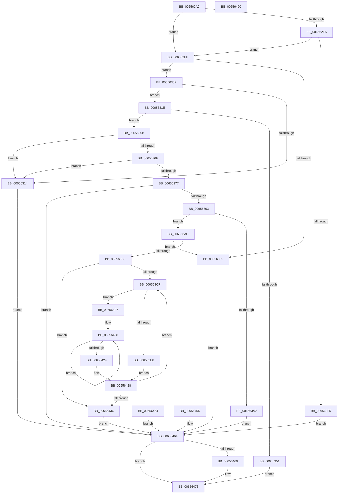

# ExPoolQueryLimits

- RVA: `0x006562A0`–`0x00656491` (길이 `497` bytes)
- VA: `0x00000001406562A0`
- 실행 섹션: `.text`
- PDB 이름 있음: `예`; PDB Function 태그: `아니요`
- unwind 정보 RVA: `0x000D4D20`
- 디코드: `136`개 명령, `497/497` bytes 표시
- 미해석 바이트: `0` (있으면 어셈블리에 `.byte`로 보존)

> 이 문서는 커널 이미지의 기계어와 PDB 기호를 분석해 생성했습니다. 4번과 5번은 함수 원형과 자료형을 바이너리 사용 방식에서 추정한 C 해석이며 원본 소스 복구 결과는 아닙니다.

## 1. Dependencies

- 직접 호출 지점: **10**; 고유 호출 대상: **9**
- 직접 호출자로 확인된 함수: **1**
- RIP 상대 이미지 참조: **2**

### Outgoing calls
- `0x006562EC` → [SeSinglePrivilegeCheck](../../page/87/SeSinglePrivilegeCheck_function_00871E20.md) (function, `0x00871E20`)
- `0x0065631E` → [Feature_Servicing_PoolQueryLimitFix__private_IsEnabledDeviceUsageNoInline](Feature_Servicing_PoolQueryLimitFix__private_IsEnabledDeviceUsageNoInline_function_006575A8.md) (function, `0x006575A8`)
- `0x0065633F` → [ExAllocatePool2](../../poolcode/B8/ExAllocatePool2_function_00B820F0.md) (function, `0x00B820F0`)
- `0x00656364` → [memcpy](../6C/memcpy_function_006C6840.md) (function, `0x006C6840`)
- `0x00656384` → [RtlULongLongMult](../43/RtlULongLongMult_function_0043E530.md) (function, `0x0043E530`)
- `0x006563C1` → [KeAcquireInStackQueuedSpinLock](../27/KeAcquireInStackQueuedSpinLock_function_002757A0.md) (function, `0x002757A0`)
- `0x006563DB` → [ExpPlFindLimitEntry](../2E/ExpPlFindLimitEntry_function_002ECBF0.md) (function, `0x002ECBF0`)
- `0x0065643B` → [KeReleaseInStackQueuedSpinLock](../34/KeReleaseInStackQueuedSpinLock_function_00342CE0.md) (function, `0x00342CE0`)
- `0x0065644A` → [memcpy](../6C/memcpy_function_006C6840.md) (function, `0x006C6840`)
- `0x0065646E` → [ExFreePoolWithTag](../../poolcode/B8/ExFreePoolWithTag_function_00B82870.md) (function, `0x00B82870`)

### Direct callers
- [ExpQuerySystemInformation](../../page/A5/ExpQuerySystemInformation_function_00A57858.md) at `0x00A5B38E`

### Static image references
- `0x006562E5` → RVA `0x00FD9B70` (`PAGEDATA`; read)
- `0x006563BA` → RVA `0x00EFAD00` (`.data`; read)

## 2. Other-region calls and transfers

- 다른 실행 섹션으로 향하는 call: **3**
  - `0x006562EC` → [SeSinglePrivilegeCheck](../../page/87/SeSinglePrivilegeCheck_function_00871E20.md) (`.text` → `PAGE`)
  - `0x0065633F` → [ExAllocatePool2](../../poolcode/B8/ExAllocatePool2_function_00B820F0.md) (`.text` → `POOLCODE`)
  - `0x0065646E` → [ExFreePoolWithTag](../../poolcode/B8/ExFreePoolWithTag_function_00B82870.md) (`.text` → `POOLCODE`)
- 별도 외부 분기/꼬리 이동을 확인하지 못했습니다.

## 3. Assembly (complete function range)

```asm
006562A0  4C 8B DC                        mov r11, rsp
006562A3  49 89 5B 08                     mov qword ptr [r11 + 8], rbx
006562A7  49 89 73 10                     mov qword ptr [r11 + 0x10], rsi
006562AB  49 89 7B 18                     mov qword ptr [r11 + 0x18], rdi
006562AF  4D 89 73 20                     mov qword ptr [r11 + 0x20], r14
006562B3  41 57                           push r15
006562B5  48 83 EC 50                     sub rsp, 0x50
006562B9  49 8B F9                        mov rdi, r9
006562BC  4D 8B F8                        mov r15, r8
006562BF  48 8B F2                        mov rsi, rdx
006562C2  4C 8B F1                        mov r14, rcx
006562C5  49 83 63 C8 00                  and qword ptr [r11 - 0x38], 0
006562CA  0F 57 C0                        xorps xmm0, xmm0
006562CD  33 C0                           xor eax, eax
006562CF  0F 11 44 24 30                  movups xmmword ptr [rsp + 0x30], xmm0
006562D4  49 89 43 E8                     mov qword ptr [r11 - 0x18], rax
006562D8  33 DB                           xor ebx, ebx
006562DA  8A 94 24 80 00 00 00            mov dl, byte ptr [rsp + 0x80]
006562E1  84 D2                           test dl, dl
006562E3  74 1A                           je 0x1406562ff
006562E5  48 8B 0D 84 38 98 00            mov rcx, qword ptr [rip + 0x983884]
006562EC  E8 2F BB 21 00                  call 0x140871e20
006562F1  84 C0                           test al, al
006562F3  75 0A                           jne 0x1406562ff
006562F5  BF 61 00 00 C0                  mov edi, 0xc0000061
006562FA  E9 65 01 00 00                  jmp 0x140656464
006562FF  48 83 FE 38                     cmp rsi, 0x38
00656303  73 0A                           jae 0x14065630f
00656305  BF 04 00 00 C0                  mov edi, 0xc0000004
0065630A  E9 55 01 00 00                  jmp 0x140656464
0065630F  48 3B F7                        cmp rsi, rdi
00656312  76 0A                           jbe 0x14065631e
00656314  BF 0D 00 00 C0                  mov edi, 0xc000000d
00656319  E9 46 01 00 00                  jmp 0x140656464
0065631E  E8 85 12 00 00                  call 0x1406575a8
00656323  F7 D8                           neg eax
00656325  48 1B C9                        sbb rcx, rcx
00656328  48 81 E1 40 FF FF FF            and rcx, 0xffffffffffffff40
0065632F  48 81 C1 00 01 00 00            add rcx, 0x100
00656336  41 B8 50 6F 6F 6C               mov r8d, 0x6c6f6f50
0065633C  48 8B D6                        mov rdx, rsi
0065633F  E8 AC BD 52 00                  call 0x140b820f0
00656344  48 8B D8                        mov rbx, rax
00656347  48 89 44 24 28                  mov qword ptr [rsp + 0x28], rax
0065634C  48 85 C0                        test rax, rax
0065634F  75 0A                           jne 0x14065635b
00656351  BF 9A 00 00 C0                  mov edi, 0xc000009a
00656356  E9 18 01 00 00                  jmp 0x140656473
0065635B  4C 8B C6                        mov r8, rsi
0065635E  49 8B D6                        mov rdx, r14
00656361  48 8B CB                        mov rcx, rbx
00656364  E8 D7 04 07 00                  call 0x1406c6840
00656369  90                              nop
0065636A  83 3B 01                        cmp dword ptr [rbx], 1
0065636D  75 A5                           jne 0x140656314
0065636F  8B 43 04                        mov eax, dword ptr [rbx + 4]
00656372  83 F8 01                        cmp eax, 1
00656375  72 9D                           jb 0x140656314
00656377  8D 48 FF                        lea ecx, [rax - 1]
0065637A  4C 8D 44 24 20                  lea r8, [rsp + 0x20]
0065637F  BA 30 00 00 00                  mov edx, 0x30
00656384  E8 A7 81 DE FF                  call 0x14043e530
00656389  8B F8                           mov edi, eax
0065638B  85 C0                           test eax, eax
0065638D  0F 88 D1 00 00 00               js 0x140656464
00656393  48 8B 44 24 20                  mov rax, qword ptr [rsp + 0x20]
00656398  48 83 C0 38                     add rax, 0x38
0065639C  48 83 F8 38                     cmp rax, 0x38
006563A0  73 0A                           jae 0x1406563ac
006563A2  BF 95 00 00 C0                  mov edi, 0xc0000095
006563A7  E9 B8 00 00 00                  jmp 0x140656464
006563AC  48 3B C6                        cmp rax, rsi
006563AF  0F 87 50 FF FF FF               ja 0x140656305
006563B5  48 8D 54 24 30                  lea rdx, [rsp + 0x30]
006563BA  48 8D 0D 3F 49 8A 00            lea rcx, [rip + 0x8a493f]
006563C1  E8 DA F3 C1 FF                  call 0x1402757a0
006563C6  45 33 F6                        xor r14d, r14d
006563C9  44 39 73 04                     cmp dword ptr [rbx + 4], r14d
006563CD  76 67                           jbe 0x140656436
006563CF  4B 8D 3C 76                     lea rdi, [r14 + r14*2]
006563D3  48 C1 E7 04                     shl rdi, 4
006563D7  8B 4C 1F 08                     mov ecx, dword ptr [rdi + rbx + 8]
006563DB  E8 10 68 C9 FF                  call 0x1402ecbf0
006563E0  4C 8B C0                        mov r8, rax
006563E3  48 85 C0                        test rax, rax
006563E6  75 0F                           jne 0x1406563f7
006563E8  0F 57 C0                        xorps xmm0, xmm0
006563EB  0F 11 44 1F 10                  movups xmmword ptr [rdi + rbx + 0x10], xmm0
006563F0  0F 11 44 1F 20                  movups xmmword ptr [rdi + rbx + 0x20], xmm0
006563F5  EB 31                           jmp 0x140656428
006563F7  48 8D 4B 18                     lea rcx, [rbx + 0x18]
006563FB  48 03 CF                        add rcx, rdi
006563FE  48 8D 50 18                     lea rdx, [rax + 0x18]
00656402  41 B9 02 00 00 00               mov r9d, 2
00656408  48 8B 42 F8                     mov rax, qword ptr [rdx - 8]
0065640C  48 89 41 F8                     mov qword ptr [rcx - 8], rax
00656410  48 8B 02                        mov rax, qword ptr [rdx]
00656413  48 89 01                        mov qword ptr [rcx], rax
00656416  48 8D 52 18                     lea rdx, [rdx + 0x18]
0065641A  48 8D 49 10                     lea rcx, [rcx + 0x10]
0065641E  49 83 E9 01                     sub r9, 1
00656422  75 E4                           jne 0x140656408
00656424  49 8B 40 40                     mov rax, qword ptr [r8 + 0x40]
00656428  48 89 44 1F 30                  mov qword ptr [rdi + rbx + 0x30], rax
0065642D  41 FF C6                        inc r14d
00656430  44 3B 73 04                     cmp r14d, dword ptr [rbx + 4]
00656434  72 99                           jb 0x1406563cf
00656436  48 8D 4C 24 30                  lea rcx, [rsp + 0x30]
0065643B  E8 A0 C8 CE FF                  call 0x140342ce0
00656440  90                              nop
00656441  4C 8B C6                        mov r8, rsi
00656444  48 8B D3                        mov rdx, rbx
00656447  49 8B CF                        mov rcx, r15
0065644A  E8 F1 03 07 00                  call 0x1406c6840
0065644F  90                              nop
00656450  33 FF                           xor edi, edi
00656452  EB 10                           jmp 0x140656464
00656454  8B F8                           mov edi, eax
00656456  48 8B 5C 24 28                  mov rbx, qword ptr [rsp + 0x28]
0065645B  EB 07                           jmp 0x140656464
0065645D  8B F8                           mov edi, eax
0065645F  48 8B 5C 24 28                  mov rbx, qword ptr [rsp + 0x28]
00656464  48 85 DB                        test rbx, rbx
00656467  74 0A                           je 0x140656473
00656469  33 D2                           xor edx, edx
0065646B  48 8B CB                        mov rcx, rbx
0065646E  E8 FD C3 52 00                  call 0x140b82870
00656473  8B C7                           mov eax, edi
00656475  48 8B 5C 24 60                  mov rbx, qword ptr [rsp + 0x60]
0065647A  48 8B 74 24 68                  mov rsi, qword ptr [rsp + 0x68]
0065647F  48 8B 7C 24 70                  mov rdi, qword ptr [rsp + 0x70]
00656484  4C 8B 74 24 78                  mov r14, qword ptr [rsp + 0x78]
00656489  48 83 C4 50                     add rsp, 0x50
0065648D  41 5F                           pop r15
0065648F  C3                              ret
00656490  CC                              int3
```

## 4. C-style interpretation (structured pseudocode)

```c
__int64 __fastcall ExPoolQueryLimits(__int64 a1, __int64 a2, __int64 a3, __int64 a4, unsigned __int8 a5)
{
    __int64 result;
    __int64 v_r14;
    __int64 v_rbx;
    __int64 v_rdi;
    __int64 v_rsp;
    unsigned __int64 v_stack_m28;
    unsigned __int64 v_stack_m30;
    unsigned __int64 v_stack_m38;
    unsigned __int64 v_stack_p10;
    unsigned __int64 v_stack_p18;
    unsigned __int64 v_stack_p20;
    unsigned __int64 v_stack_p8;

    *(unsigned __int64 *)(v_rsp + 8) = v_rbx;
    *(unsigned __int64 *)(v_rsp + 16) = v_rsi;
    *(unsigned __int64 *)(v_rsp + 24) = v_rdi;
    *(unsigned __int64 *)(v_rsp + 32) = v_r14;
    v_rsp = (v_rsp) - (80);
    result = 0;
    v_stack_m28 = v_xmm0;
    *(unsigned __int64 *)(v_rsp - 24) = 0;
    v_rbx = 0;
    if (a5 == 0) goto loc_006562FF;
    result = SeSinglePrivilegeCheck(*(unsigned __int64 *)(v_rip + 9975940), a5, a3, a4);
    if ((unsigned __int8)(result) != 0) goto loc_006562FF;
    goto loc_00656464;
loc_006562FF:
    if (a2 >= 56) goto loc_0065630F;
loc_00656305:
    goto loc_00656464;
loc_0065630F:
    if (a2 <= ((unsigned int)(0xC0000004ULL))) goto loc_0065631E;
loc_00656314:
    goto loc_00656464;
loc_0065631E:
    result = Feature_Servicing_PoolQueryLimitFix__private_IsEnabledDeviceUsageNoInline(*(unsigned __int64 *)(v_rip + 9975940), a5, a3, a4);
    result = (unsigned int)(-(result));
    a1 = (*(unsigned __int64 *)(v_rip + 9975940)) & (-192);
    a1 = (a1) + (256);
    result = ExAllocatePool2(a1, a2, (unsigned int)(0x6C6F6F50ULL), a4);
    v_stack_m30 = result;
    if (result != 0) goto loc_0065635B;
    goto loc_00656473;
loc_0065635B:
    result = memcpy(result, a1, a2, a4);
    if ((*(unsigned int *)(result)) != 1) goto loc_00656314;
    if (((unsigned int)((unsigned int)(*(unsigned int *)(result + 4)))) < 1) goto loc_00656314;
    result = RtlULongLongMult((unsigned int)(*(unsigned int *)(result + 4)) - 1, 48, v_stack_m38, a4);
    if (sign_flag) goto loc_00656464;
    result = (v_stack_m38) + (56);
    if (result >= 56) goto loc_006563AC;
    goto loc_00656464;
loc_006563AC:
    if (result > a2) goto loc_00656305;
    result = KeAcquireInStackQueuedSpinLock(v_rip + 9062719, v_stack_m28, v_stack_m38, a4);
    v_r14 = 0;
    if ((*(unsigned int *)(result + 4)) <= 0) goto loc_00656436;
loc_006563CF:
    v_rdi = (v_r14 + v_r14 * 2) << (4);
    result = ExpPlFindLimitEntry((unsigned int)(*(unsigned int *)(v_rdi + result * 1 + 8)), v_stack_m28, v_stack_m38, a4);
    if (result != 0) goto loc_006563F7;
    *(unsigned __int64 *)(v_rdi + result * 1 + 16) = v_xmm0;
    *(unsigned __int64 *)(v_rdi + result * 1 + 32) = v_xmm0;
    goto loc_00656428;
loc_006563F7:
    a1 = (result + 24) + (v_rdi);
loc_00656408:
    *(unsigned __int64 *)(a1 - 8) = *(unsigned __int64 *)(result + 24 - 8);
    *(unsigned __int64 *)(a1) = *(unsigned __int64 *)(result + 24);
    a4 = (2) - (1);
    if (condition_is_not_equal) goto loc_00656408;
loc_00656428:
    *(unsigned __int64 *)(v_rdi + result * 1 + 48) = *(unsigned __int64 *)(result + 64);
    v_r14 = (unsigned int)((v_r14) + 1);
    if (((unsigned int)(v_r14)) < (*(unsigned int *)(result + 4))) goto loc_006563CF;
loc_00656436:
    result = KeReleaseInStackQueuedSpinLock(v_stack_m28, result + 24 + 24, result, a4);
    result = memcpy(a3, result, a2, a4);
    v_rdi = 0;
    goto loc_00656464;
loc_00656464:
    if (result != 0) {
        a2 = 0;
        a1 = result;
        result = ExFreePoolWithTag(a1, a2, a2, a4);
    }
    v_rsp = (v_rsp) + (80);
    return 0;
}
```

## 5. (Beta) C Style

```c
int64_t ExPoolQueryLimits(int64_t Arg1, int64_t Arg2, int64_t Arg3, int64_t Arg4, uint8_t Arg5)
{
    int64_t result;
    int64_t local_r14;
    int64_t local_rbx;
    int64_t local_rdi;
    int64_t local_rsp;
    uint64_t v_stack_m28;
    uint64_t v_stack_m30;
    uint64_t v_stack_m38;
    uint64_t v_stack_p10;
    uint64_t v_stack_p18;
    uint64_t v_stack_p20;
    uint64_t v_stack_p8;

    *(uint64_t *)(local_rsp + 0x8) = local_rbx;
    *(uint64_t *)(local_rsp + 0x10) = local_rsi;
    *(uint64_t *)(local_rsp + 0x18) = local_rdi;
    *(uint64_t *)(local_rsp + 0x20) = local_r14;
    local_rsp = (local_rsp) - (80);
    result = 0;
    v_stack_m28 = v_xmm0;
    *(uint64_t *)(local_rsp - 0x18) = 0;
    local_rbx = 0;
    if (Arg5 == 0) goto loc_006562FF;
    result = SeSinglePrivilegeCheck(*(uint64_t *)(v_rip + 0x983884), Arg5, Arg3, Arg4);
    if ((uint8_t)(result) != 0) goto loc_006562FF;
    goto loc_00656464;
loc_006562FF:
    if (Arg2 >= 56) goto loc_0065630F;
loc_00656305:
    goto loc_00656464;
loc_0065630F:
    if (Arg2 <= ((uint32_t)(0xC0000004ULL))) goto loc_0065631E;
loc_00656314:
    goto loc_00656464;
loc_0065631E:
    result = Feature_Servicing_PoolQueryLimitFix__private_IsEnabledDeviceUsageNoInline(*(uint64_t *)(v_rip + 0x983884), Arg5, Arg3, Arg4);
    result = (uint32_t)(-(result));
    Arg1 = (*(uint64_t *)(v_rip + 0x983884)) & (-192);
    Arg1 = (Arg1) + (256);
    result = ExAllocatePool2(Arg1, Arg2, (uint32_t)(0x6C6F6F50ULL), Arg4);
    v_stack_m30 = result;
    if (result != 0) goto loc_0065635B;
    goto loc_00656473;
loc_0065635B:
    result = memcpy(result, Arg1, Arg2, Arg4);
    if ((*(uint32_t *)(result)) != 1) goto loc_00656314;
    if (((uint32_t)((uint32_t)(*(uint32_t *)(result + 0x4)))) < 1) goto loc_00656314;
    result = RtlULongLongMult((uint32_t)(*(uint32_t *)(result + 0x4)) - 1, 48, v_stack_m38, Arg4);
    if (sign_flag) goto loc_00656464;
    result = (v_stack_m38) + (56);
    if (result >= 56) goto loc_006563AC;
    goto loc_00656464;
loc_006563AC:
    if (result > Arg2) goto loc_00656305;
    result = KeAcquireInStackQueuedSpinLock(v_rip + 9062719, v_stack_m28, v_stack_m38, Arg4);
    local_r14 = 0;
    if ((*(uint32_t *)(result + 0x4)) <= 0) goto loc_00656436;
loc_006563CF:
    local_rdi = (local_r14 + local_r14 * 2) << (4);
    result = ExpPlFindLimitEntry((uint32_t)(*(uint32_t *)(local_rdi + result * 1 + 0x8)), v_stack_m28, v_stack_m38, Arg4);
    if (result != 0) goto loc_006563F7;
    *(uint64_t *)(local_rdi + result * 1 + 0x10) = v_xmm0;
    *(uint64_t *)(local_rdi + result * 1 + 0x20) = v_xmm0;
    goto loc_00656428;
loc_006563F7:
    Arg1 = (result + 24) + (local_rdi);
loc_00656408:
    *(uint64_t *)(Arg1 - 0x8) = *(uint64_t *)(result + 0x18 - 0x8);
    *(uint64_t *)(Arg1) = *(uint64_t *)(result + 0x18);
    Arg4 = (2) - (1);
    if (condition_is_not_equal) goto loc_00656408;
loc_00656428:
    *(uint64_t *)(local_rdi + result * 1 + 0x30) = *(uint64_t *)(result + 0x40);
    local_r14 = (uint32_t)((local_r14) + 1);
    if (((uint32_t)(local_r14)) < (*(uint32_t *)(result + 0x4))) goto loc_006563CF;
loc_00656436:
    result = KeReleaseInStackQueuedSpinLock(v_stack_m28, result + 24 + 24, result, Arg4);
    result = memcpy(Arg3, result, Arg2, Arg4);
    local_rdi = 0;
    goto loc_00656464;
loc_00656464:
    if (result != 0) {
        Arg2 = 0;
        Arg1 = result;
        result = ExFreePoolWithTag(Arg1, Arg2, Arg2, Arg4);
    }
    local_rsp = (local_rsp) + (80);
    return 0;
}
```

## 6. Execution-region graph

[열기: 2D/3D 그래프와 함수 탐색 컨트롤 패널](../../../control-panel.html?section=text&rva=0x006562A0&view=graph)

- 2D 그래프는 위에서 아래로 흐르고, 3D 그래프는 빈 공간을 드래그해 회전합니다. Shift+드래그는 이동, 휠은 확대·축소, 함수 노드 선택은 대상 보고서 이동입니다.

### Static fallback


