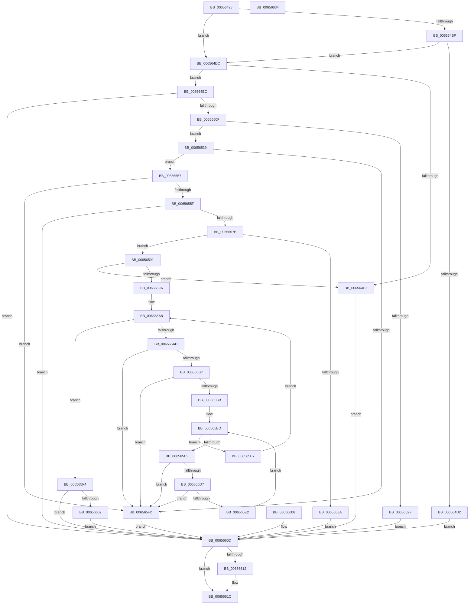

# ExPoolSetLimit

- RVA: `0x00656498`–`0x00656635` (길이 `413` bytes)
- VA: `0x0000000140656498`
- 실행 섹션: `.text`
- PDB 이름 있음: `예`; PDB Function 태그: `아니요`
- unwind 정보 RVA: `0x000D4D64`
- 디코드: `117`개 명령, `413/413` bytes 표시
- 미해석 바이트: `0` (있으면 어셈블리에 `.byte`로 보존)

> 이 문서는 커널 이미지의 기계어와 PDB 기호를 분석해 생성했습니다. 4번과 5번은 함수 원형과 자료형을 바이너리 사용 방식에서 추정한 C 해석이며 원본 소스 복구 결과는 아닙니다.

## 1. Dependencies

- 직접 호출 지점: **7**; 고유 호출 대상: **7**
- 직접 호출자로 확인된 함수: **1**
- RIP 상대 이미지 참조: **3**

### Outgoing calls
- `0x006564C9` → [SeSinglePrivilegeCheck](../../page/87/SeSinglePrivilegeCheck_function_00871E20.md) (function, `0x00871E20`)
- `0x00656500` → [RtlRunOnceExecuteOnce](../../page/95/RtlRunOnceExecuteOnce_function_0095DC00.md) (function, `0x0095DC00`)
- `0x0065651D` → [ExAllocatePool2](../../poolcode/B8/ExAllocatePool2_function_00B820F0.md) (function, `0x00B820F0`)
- `0x00656542` → [memcpy](../6C/memcpy_function_006C6840.md) (function, `0x006C6840`)
- `0x0065656C` → [RtlULongLongMult](../43/RtlULongLongMult_function_0043E530.md) (function, `0x0043E530`)
- `0x006565F7` → [ExpTrackTableInsertLimit](ExpTrackTableInsertLimit_function_006572D0.md) (function, `0x006572D0`)
- `0x00656617` → [ExFreePoolWithTag](../../poolcode/B8/ExFreePoolWithTag_function_00B82870.md) (function, `0x00B82870`)

### Direct callers
- [NtSetSystemInformation](../../page/AF/NtSetSystemInformation_function_00AF4A60.md) at `0x00AF66B8`

### Static image references
- `0x006564C2` → RVA `0x00FD9B70` (`PAGEDATA`; read)
- `0x006564F2` → RVA `0x006571E0` (`ExpPlRunOnceInit`; read)
- `0x006564F9` → RVA `0x00E68598` (`.data`; read)

## 2. Other-region calls and transfers

- 다른 실행 섹션으로 향하는 call: **4**
  - `0x006564C9` → [SeSinglePrivilegeCheck](../../page/87/SeSinglePrivilegeCheck_function_00871E20.md) (`.text` → `PAGE`)
  - `0x00656500` → [RtlRunOnceExecuteOnce](../../page/95/RtlRunOnceExecuteOnce_function_0095DC00.md) (`.text` → `PAGE`)
  - `0x0065651D` → [ExAllocatePool2](../../poolcode/B8/ExAllocatePool2_function_00B820F0.md) (`.text` → `POOLCODE`)
  - `0x00656617` → [ExFreePoolWithTag](../../poolcode/B8/ExFreePoolWithTag_function_00B82870.md) (`.text` → `POOLCODE`)
- 별도 외부 분기/꼬리 이동을 확인하지 못했습니다.

## 3. Assembly (complete function range)

```asm
00656498  48 8B C4                        mov rax, rsp
0065649B  48 89 58 08                     mov qword ptr [rax + 8], rbx
0065649F  48 89 70 10                     mov qword ptr [rax + 0x10], rsi
006564A3  48 89 78 18                     mov qword ptr [rax + 0x18], rdi
006564A7  41 56                           push r14
006564A9  48 83 EC 30                     sub rsp, 0x30
006564AD  48 8B F2                        mov rsi, rdx
006564B0  4C 8B F1                        mov r14, rcx
006564B3  48 83 60 20 00                  and qword ptr [rax + 0x20], 0
006564B8  33 FF                           xor edi, edi
006564BA  45 84 C0                        test r8b, r8b
006564BD  74 1D                           je 0x1406564dc
006564BF  41 8A D0                        mov dl, r8b
006564C2  48 8B 0D A7 36 98 00            mov rcx, qword ptr [rip + 0x9836a7]
006564C9  E8 52 B9 21 00                  call 0x140871e20
006564CE  84 C0                           test al, al
006564D0  75 0A                           jne 0x1406564dc
006564D2  BB 61 00 00 C0                  mov ebx, 0xc0000061
006564D7  E9 31 01 00 00                  jmp 0x14065660d
006564DC  48 83 FE 38                     cmp rsi, 0x38
006564E0  73 0A                           jae 0x1406564ec
006564E2  BB 04 00 00 C0                  mov ebx, 0xc0000004
006564E7  E9 21 01 00 00                  jmp 0x14065660d
006564EC  45 33 C9                        xor r9d, r9d
006564EF  45 33 C0                        xor r8d, r8d
006564F2  48 8D 15 E7 0C 00 00            lea rdx, [rip + 0xce7]
006564F9  48 8D 0D 98 20 81 00            lea rcx, [rip + 0x812098]
00656500  E8 FB 76 30 00                  call 0x14095dc00
00656505  8B D8                           mov ebx, eax
00656507  85 C0                           test eax, eax
00656509  0F 88 FE 00 00 00               js 0x14065660d
0065650F  41 B8 50 6F 6F 6C               mov r8d, 0x6c6f6f50
00656515  48 8B D6                        mov rdx, rsi
00656518  B9 00 01 00 00                  mov ecx, 0x100
0065651D  E8 CE BB 52 00                  call 0x140b820f0
00656522  48 8B F8                        mov rdi, rax
00656525  48 89 44 24 20                  mov qword ptr [rsp + 0x20], rax
0065652A  48 85 C0                        test rax, rax
0065652D  75 0A                           jne 0x140656539
0065652F  BB 9A 00 00 C0                  mov ebx, 0xc000009a
00656534  E9 D4 00 00 00                  jmp 0x14065660d
00656539  4C 8B C6                        mov r8, rsi
0065653C  49 8B D6                        mov rdx, r14
0065653F  48 8B CF                        mov rcx, rdi
00656542  E8 F9 02 07 00                  call 0x1406c6840
00656547  90                              nop
00656548  83 3F 01                        cmp dword ptr [rdi], 1
0065654B  74 0A                           je 0x140656557
0065654D  BB 0D 00 00 C0                  mov ebx, 0xc000000d
00656552  E9 B6 00 00 00                  jmp 0x14065660d
00656557  8B 47 04                        mov eax, dword ptr [rdi + 4]
0065655A  83 F8 01                        cmp eax, 1
0065655D  72 EE                           jb 0x14065654d
0065655F  8D 48 FF                        lea ecx, [rax - 1]
00656562  4C 8D 44 24 58                  lea r8, [rsp + 0x58]
00656567  BA 30 00 00 00                  mov edx, 0x30
0065656C  E8 BF 7F DE FF                  call 0x14043e530
00656571  8B D8                           mov ebx, eax
00656573  85 C0                           test eax, eax
00656575  0F 88 92 00 00 00               js 0x14065660d
0065657B  48 8B 44 24 58                  mov rax, qword ptr [rsp + 0x58]
00656580  48 83 C0 38                     add rax, 0x38
00656584  48 83 F8 38                     cmp rax, 0x38
00656588  73 07                           jae 0x140656591
0065658A  BB 95 00 00 C0                  mov ebx, 0xc0000095
0065658F  EB 7C                           jmp 0x14065660d
00656591  48 3B C6                        cmp rax, rsi
00656594  0F 87 48 FF FF FF               ja 0x1406564e2
0065659A  45 33 C0                        xor r8d, r8d
0065659D  44 8B 5F 04                     mov r11d, dword ptr [rdi + 4]
006565A1  45 33 D2                        xor r10d, r10d
006565A4  4C 8D 4F 08                     lea r9, [rdi + 8]
006565A8  4D 3B C3                        cmp r8, r11
006565AB  73 47                           jae 0x1406565f4
006565AD  41 8B 01                        mov eax, dword ptr [r9]
006565B0  3D 50 6F 6F 6C                  cmp eax, 0x6c6f6f50
006565B5  74 96                           je 0x14065654d
006565B7  85 C0                           test eax, eax
006565B9  74 92                           je 0x14065654d
006565BB  33 C9                           xor ecx, ecx
006565BD  48 83 F9 02                     cmp rcx, 2
006565C1  7D 24                           jge 0x1406565e7
006565C3  48 8D 51 01                     lea rdx, [rcx + 1]
006565C7  49 03 D2                        add rdx, r10
006565CA  48 03 D2                        add rdx, rdx
006565CD  F6 04 D7 0F                     test byte ptr [rdi + rdx*8], 0xf
006565D1  0F 85 76 FF FF FF               jne 0x14065654d
006565D7  F6 44 D7 08 0F                  test byte ptr [rdi + rdx*8 + 8], 0xf
006565DC  0F 85 6B FF FF FF               jne 0x14065654d
006565E2  48 FF C1                        inc rcx
006565E5  EB D6                           jmp 0x1406565bd
006565E7  49 FF C0                        inc r8
006565EA  49 83 C1 30                     add r9, 0x30
006565EE  49 83 C2 03                     add r10, 3
006565F2  EB B4                           jmp 0x1406565a8
006565F4  48 8B CF                        mov rcx, rdi
006565F7  E8 D4 0C 00 00                  call 0x1406572d0
006565FC  8B D8                           mov ebx, eax
006565FE  85 C0                           test eax, eax
00656600  78 0B                           js 0x14065660d
00656602  33 DB                           xor ebx, ebx
00656604  EB 07                           jmp 0x14065660d
00656606  8B D8                           mov ebx, eax
00656608  48 8B 7C 24 20                  mov rdi, qword ptr [rsp + 0x20]
0065660D  48 85 FF                        test rdi, rdi
00656610  74 0A                           je 0x14065661c
00656612  33 D2                           xor edx, edx
00656614  48 8B CF                        mov rcx, rdi
00656617  E8 54 C2 52 00                  call 0x140b82870
0065661C  8B C3                           mov eax, ebx
0065661E  48 8B 5C 24 40                  mov rbx, qword ptr [rsp + 0x40]
00656623  48 8B 74 24 48                  mov rsi, qword ptr [rsp + 0x48]
00656628  48 8B 7C 24 50                  mov rdi, qword ptr [rsp + 0x50]
0065662D  48 83 C4 30                     add rsp, 0x30
00656631  41 5E                           pop r14
00656633  C3                              ret
00656634  CC                              int3
```

## 4. C-style interpretation (structured pseudocode)

```c
__int64 __fastcall ExPoolSetLimit(__int64 a1, __int64 a2, int a3, int a4)
{
    __int64 result;
    __int64 v_r10;
    __int64 v_rbx;
    __int64 v_rdi;
    __int64 v_rsp;
    unsigned __int64 v_stack_m18;
    unsigned __int64 v_stack_p10;
    unsigned __int64 v_stack_p18;
    unsigned __int64 v_stack_p20;
    unsigned __int64 v_stack_p8;

    *(unsigned __int64 *)(v_rsp + 8) = v_rbx;
    *(unsigned __int64 *)(v_rsp + 16) = v_rsi;
    *(unsigned __int64 *)(v_rsp + 24) = v_rdi;
    v_rsp = (v_rsp) - (48);
    v_rdi = 0;
    if ((unsigned __int8)(a3) == 0) goto loc_006564DC;
    result = SeSinglePrivilegeCheck(*(unsigned __int64 *)(v_rip + 9975463), (unsigned __int8)(a3), a3, a4);
    if ((unsigned __int8)(result) != 0) goto loc_006564DC;
    goto loc_0065660D;
loc_006564DC:
    if (a2 >= 56) goto loc_006564EC;
loc_006564E2:
    goto loc_0065660D;
loc_006564EC:
    a4 = 0;
    a3 = 0;
    result = RtlRunOnceExecuteOnce(v_rip + 8462488, v_rip + 3303, a3, a4);
    if (sign_flag) goto loc_0065660D;
    result = ExAllocatePool2(256, a2, (unsigned int)(0x6C6F6F50ULL), a4);
    v_stack_m18 = result;
    if (result != 0) goto loc_00656539;
    goto loc_0065660D;
loc_00656539:
    result = memcpy(result, a1, a2, a4);
    if ((*(unsigned int *)(result)) == 1) goto loc_00656557;
loc_0065654D:
    goto loc_0065660D;
loc_00656557:
    if (((unsigned int)((unsigned int)(*(unsigned int *)(result + 4)))) < 1) goto loc_0065654D;
    result = RtlULongLongMult((unsigned int)(*(unsigned int *)(result + 4)) - 1, 48, v_stack_p20, a4);
    if (sign_flag) goto loc_0065660D;
    result = (v_stack_p20) + (56);
    if (result >= 56) goto loc_00656591;
    goto loc_0065660D;
loc_00656591:
    if (result > a2) goto loc_006564E2;
    a3 = 0;
    v_r10 = 0;
loc_006565A8:
    if (0 >= ((unsigned int)(*(unsigned int *)(result + 4)))) goto loc_006565F4;
    if (((unsigned int)((unsigned int)(*(unsigned int *)(result + 8)))) == 0x6C6F6F50ULL) goto loc_0065654D;
    if ((unsigned int)((unsigned int)(*(unsigned int *)(result + 8))) == 0) goto loc_0065654D;
    a1 = 0;
loc_006565BD:
    if (0 >= 2) goto loc_006565E7;
    a2 = (a1 + 1) + (0);
    a2 = (a2) + (a2);
    if (((*(unsigned __int8 *)(result + a2 * 8)) & (15)) != 0) goto loc_0065654D;
    if (((*(unsigned __int8 *)(result + a2 * 8 + 8)) & (15)) != 0) goto loc_0065654D;
    a1 = (a1) + 1;
    goto loc_006565BD;
loc_006565E7:
    a3 = (a3) + 1;
    a4 = (result + 8) + (48);
    v_r10 = (v_r10) + (3);
    goto loc_006565A8;
loc_006565F4:
    result = ExpTrackTableInsertLimit(result, a2, a3, a4);
    if (sign_flag) goto loc_0065660D;
    v_rbx = 0;
    goto loc_0065660D;
loc_0065660D:
    if (result != 0) {
        a2 = 0;
        a1 = result;
        result = ExFreePoolWithTag(a1, a2, a3, a4);
    }
    v_rsp = (v_rsp) + (48);
    return 0;
}
```

## 5. (Beta) C Style

```c
int64_t ExPoolSetLimit(int64_t Arg1, int64_t Arg2, int32_t Arg3, int32_t Arg4)
{
    int64_t result;
    int64_t local_r10;
    int64_t local_rbx;
    int64_t local_rdi;
    int64_t local_rsp;
    uint64_t v_stack_m18;
    uint64_t v_stack_p10;
    uint64_t v_stack_p18;
    uint64_t v_stack_p20;
    uint64_t v_stack_p8;

    *(uint64_t *)(local_rsp + 0x8) = local_rbx;
    *(uint64_t *)(local_rsp + 0x10) = local_rsi;
    *(uint64_t *)(local_rsp + 0x18) = local_rdi;
    local_rsp = (local_rsp) - (48);
    local_rdi = 0;
    if ((uint8_t)(Arg3) == 0) goto loc_006564DC;
    result = SeSinglePrivilegeCheck(*(uint64_t *)(v_rip + 0x9836A7), (uint8_t)(Arg3), Arg3, Arg4);
    if ((uint8_t)(result) != 0) goto loc_006564DC;
    goto loc_0065660D;
loc_006564DC:
    if (Arg2 >= 56) goto loc_006564EC;
loc_006564E2:
    goto loc_0065660D;
loc_006564EC:
    Arg4 = 0;
    Arg3 = 0;
    result = RtlRunOnceExecuteOnce(v_rip + 8462488, v_rip + 3303, Arg3, Arg4);
    if (sign_flag) goto loc_0065660D;
    result = ExAllocatePool2(256, Arg2, (uint32_t)(0x6C6F6F50ULL), Arg4);
    v_stack_m18 = result;
    if (result != 0) goto loc_00656539;
    goto loc_0065660D;
loc_00656539:
    result = memcpy(result, Arg1, Arg2, Arg4);
    if ((*(uint32_t *)(result)) == 1) goto loc_00656557;
loc_0065654D:
    goto loc_0065660D;
loc_00656557:
    if (((uint32_t)((uint32_t)(*(uint32_t *)(result + 0x4)))) < 1) goto loc_0065654D;
    result = RtlULongLongMult((uint32_t)(*(uint32_t *)(result + 0x4)) - 1, 48, v_stack_p20, Arg4);
    if (sign_flag) goto loc_0065660D;
    result = (v_stack_p20) + (56);
    if (result >= 56) goto loc_00656591;
    goto loc_0065660D;
loc_00656591:
    if (result > Arg2) goto loc_006564E2;
    Arg3 = 0;
    local_r10 = 0;
loc_006565A8:
    if (0 >= ((uint32_t)(*(uint32_t *)(result + 0x4)))) goto loc_006565F4;
    if (((uint32_t)((uint32_t)(*(uint32_t *)(result + 0x8)))) == 0x6C6F6F50ULL) goto loc_0065654D;
    if ((uint32_t)((uint32_t)(*(uint32_t *)(result + 0x8))) == 0) goto loc_0065654D;
    Arg1 = 0;
loc_006565BD:
    if (0 >= 2) goto loc_006565E7;
    Arg2 = (Arg1 + 1) + (0);
    Arg2 = (Arg2) + (Arg2);
    if (((*(uint8_t *)(result + Arg2 * 8)) & (15)) != 0) goto loc_0065654D;
    if (((*(uint8_t *)(result + Arg2 * 8 + 0x8)) & (15)) != 0) goto loc_0065654D;
    Arg1 = (Arg1) + 1;
    goto loc_006565BD;
loc_006565E7:
    Arg3 = (Arg3) + 1;
    Arg4 = (result + 8) + (48);
    local_r10 = (local_r10) + (3);
    goto loc_006565A8;
loc_006565F4:
    result = ExpTrackTableInsertLimit(result, Arg2, Arg3, Arg4);
    if (sign_flag) goto loc_0065660D;
    local_rbx = 0;
    goto loc_0065660D;
loc_0065660D:
    if (result != 0) {
        Arg2 = 0;
        Arg1 = result;
        result = ExFreePoolWithTag(Arg1, Arg2, Arg3, Arg4);
    }
    local_rsp = (local_rsp) + (48);
    return 0;
}
```

## 6. Execution-region graph

[열기: 2D/3D 그래프와 함수 탐색 컨트롤 패널](../../../control-panel.html?section=text&rva=0x00656498&view=graph)

- 2D 그래프는 위에서 아래로 흐르고, 3D 그래프는 빈 공간을 드래그해 회전합니다. Shift+드래그는 이동, 휠은 확대·축소, 함수 노드 선택은 대상 보고서 이동입니다.

### Static fallback


