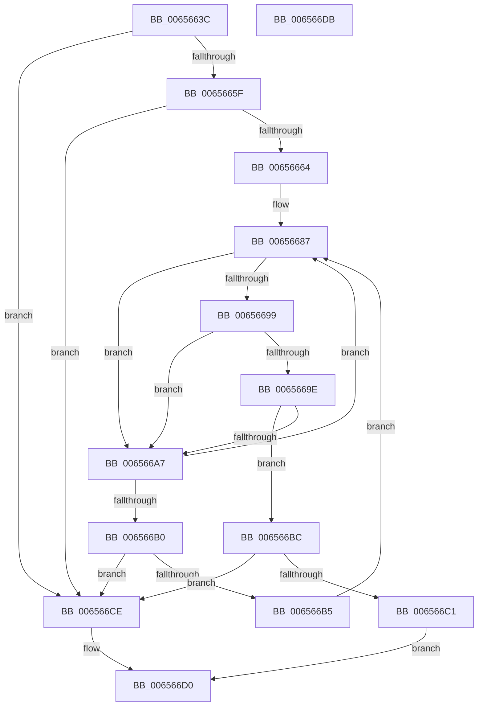

# ExQueryBigPoolTag

- RVA: `0x0065663C`–`0x006566DC` (길이 `160` bytes)
- VA: `0x000000014065663C`
- 실행 섹션: `.text`
- PDB 이름 있음: `예`; PDB Function 태그: `아니요`
- unwind 정보 RVA: `0x000950EC`
- 디코드: `50`개 명령, `160/160` bytes 표시
- 미해석 바이트: `0` (있으면 어셈블리에 `.byte`로 보존)

> 이 문서는 커널 이미지의 기계어와 PDB 기호를 분석해 생성했습니다. 4번과 5번은 함수 원형과 자료형을 바이너리 사용 방식에서 추정한 C 해석이며 원본 소스 복구 결과는 아닙니다.

## 1. Dependencies

- 직접 호출 지점: **0**; 고유 호출 대상: **0**
- 직접 호출자로 확인된 함수: **1**
- RIP 상대 이미지 참조: **2**

### Outgoing calls
- 직접 디코드된 call 명령이 없습니다.

### Direct callers
- [sub_0051C6D8](../51/Unknown_function_0051C6D8.md) at `0x0051C7EF`

### Static image references
- `0x00656646` → RVA `0x00EFED30` (`.data`; read)
- `0x00656650` → RVA `0x00EFED38` (`.data`; read)

## 2. Other-region calls and transfers

- 다른 실행 섹션으로 향하는 call: **0**
- 별도 외부 분기/꼬리 이동을 확인하지 못했습니다.

## 3. Assembly (complete function range)

```asm
0065663C  48 89 5C 24 08                  mov qword ptr [rsp + 8], rbx
00656641  48 89 7C 24 10                  mov qword ptr [rsp + 0x10], rdi
00656646  48 8B 1D E3 86 8A 00            mov rbx, qword ptr [rip + 0x8a86e3]
0065664D  48 8B FA                        mov rdi, rdx
00656650  4C 8B 0D E1 86 8A 00            mov r9, qword ptr [rip + 0x8a86e1]
00656657  4C 8B D1                        mov r10, rcx
0065665A  48 85 DB                        test rbx, rbx
0065665D  74 6F                           je 0x1406566ce
0065665F  4D 85 C9                        test r9, r9
00656662  74 6A                           je 0x1406566ce
00656664  48 8B C1                        mov rax, rcx
00656667  41 BB 01 00 00 00               mov r11d, 1
0065666D  48 C1 E8 0C                     shr rax, 0xc
00656671  48 69 C8 5F 9E 00 00            imul rcx, rax, 0x9e5f
00656678  41 8D 41 FF                     lea eax, [r9 - 1]
0065667C  48 8B D1                        mov rdx, rcx
0065667F  48 C1 EA 20                     shr rdx, 0x20
00656683  33 D1                           xor edx, ecx
00656685  23 D0                           and edx, eax
00656687  44 8B C2                        mov r8d, edx
0065668A  49 C1 E0 05                     shl r8, 5
0065668E  4C 03 C3                        add r8, rbx
00656691  49 8B 08                        mov rcx, qword ptr [r8]
00656694  F6 C1 01                        test cl, 1
00656697  75 0E                           jne 0x1406566a7
00656699  4C 3B D1                        cmp r10, rcx
0065669C  72 09                           jb 0x1406566a7
0065669E  49 03 48 10                     add rcx, qword ptr [r8 + 0x10]
006566A2  4C 3B D1                        cmp r10, rcx
006566A5  72 15                           jb 0x1406566bc
006566A7  FF C2                           inc edx
006566A9  8B C2                           mov eax, edx
006566AB  49 3B C1                        cmp rax, r9
006566AE  72 D7                           jb 0x140656687
006566B0  45 85 DB                        test r11d, r11d
006566B3  74 19                           je 0x1406566ce
006566B5  33 D2                           xor edx, edx
006566B7  45 33 DB                        xor r11d, r11d
006566BA  EB CB                           jmp 0x140656687
006566BC  4D 85 C0                        test r8, r8
006566BF  74 0D                           je 0x1406566ce
006566C1  41 8B 48 08                     mov ecx, dword ptr [r8 + 8]
006566C5  B8 01 00 00 00                  mov eax, 1
006566CA  89 0F                           mov dword ptr [rdi], ecx
006566CC  EB 02                           jmp 0x1406566d0
006566CE  33 C0                           xor eax, eax
006566D0  48 8B 5C 24 08                  mov rbx, qword ptr [rsp + 8]
006566D5  48 8B 7C 24 10                  mov rdi, qword ptr [rsp + 0x10]
006566DA  C3                              ret
006566DB  CC                              int3
```

## 4. C-style interpretation (structured pseudocode)

```c
__int64 __fastcall ExQueryBigPoolTag(__int64 a1, __int64 a2)
{
    __int64 result;
    __int64 v_r11;
    unsigned __int64 v_stack_p10;
    unsigned __int64 v_stack_p8;

    v_stack_p8 = v_rbx;
    v_stack_p10 = v_rdi;
    if (*(unsigned __int64 *)(v_rip + 9078499) == 0) goto loc_006566CE;
    if (*(unsigned __int64 *)(v_rip + 9078497) == 0) goto loc_006566CE;
    result = (a1) >> (12);
    a1 = (a1) * (result);
    a2 = (a1) >> (32);
    a2 = (unsigned int)((a2) ^ ((unsigned int)(a1)));
    a2 = (unsigned int)((a2) & ((unsigned int)(*(unsigned __int64 *)(v_rip + 9078497) - 1)));
loc_00656687:
    a3 = ((unsigned int)((unsigned int)(a2))) << (5);
    a3 = (a3) + (*(unsigned __int64 *)(v_rip + 9078499));
    if ((((unsigned __int8)(*(unsigned __int64 *)(a3))) & (1)) != 0) goto loc_006566A7;
    if (a1 < (*(unsigned __int64 *)(a3))) goto loc_006566A7;
    a1 = (*(unsigned __int64 *)(a3)) + (*(unsigned __int64 *)(a3 + 16));
    if (a1 < a1) goto loc_006566BC;
loc_006566A7:
    a2 = (unsigned int)((a2) + 1);
    if (((unsigned int)((unsigned int)(a2))) < (*(unsigned __int64 *)(v_rip + 9078497))) goto loc_00656687;
    if (1 == 0) goto loc_006566CE;
    a2 = 0;
    v_r11 = 0;
    goto loc_00656687;
loc_006566BC:
    if (a3 == 0) goto loc_006566CE;
    *(unsigned int *)(a2) = (unsigned int)((unsigned int)(*(unsigned int *)(a3 + 8)));
    goto loc_006566D0;
loc_006566CE:
    result = 0;
loc_006566D0:
    return result;
}
```

## 5. (Beta) C Style

```c
int64_t ExQueryBigPoolTag(int64_t Arg1, void *Arg2)
{
    uint8_t *arg2 = (uint8_t *)Arg2;

    int64_t result;
    int64_t local_r11;
    uint64_t v_stack_p10;
    uint64_t v_stack_p8;

    v_stack_p8 = local_rbx;
    v_stack_p10 = local_rdi;
    if (*(uint64_t *)(v_rip + 0x8A86E3) == 0) goto loc_006566CE;
    if (*(uint64_t *)(v_rip + 0x8A86E1) == 0) goto loc_006566CE;
    result = (Arg1) >> (12);
    Arg1 = (Arg1) * (result);
    Arg2 = (Arg1) >> (32);
    Arg2 = (uint32_t)((Arg2) ^ ((uint32_t)(Arg1)));
    Arg2 = (uint32_t)((Arg2) & ((uint32_t)(*(uint64_t *)(v_rip + 0x8A86E1) - 1)));
loc_00656687:
    a3 = ((uint32_t)((uint32_t)(Arg2))) << (5);
    a3 = (a3) + (*(uint64_t *)(v_rip + 0x8A86E3));
    if ((((uint8_t)(*(uint64_t *)(a3))) & (1)) != 0) goto loc_006566A7;
    if (Arg1 < (*(uint64_t *)(a3))) goto loc_006566A7;
    Arg1 = (*(uint64_t *)(a3)) + (*(uint64_t *)(a3 + 0x10));
    if (Arg1 < Arg1) goto loc_006566BC;
loc_006566A7:
    Arg2 = (uint32_t)((Arg2) + 1);
    if (((uint32_t)((uint32_t)(Arg2))) < (*(uint64_t *)(v_rip + 0x8A86E1))) goto loc_00656687;
    if (1 == 0) goto loc_006566CE;
    Arg2 = 0;
    local_r11 = 0;
    goto loc_00656687;
loc_006566BC:
    if (a3 == 0) goto loc_006566CE;
    *(uint32_t *)(arg2) = (uint32_t)((uint32_t)(*(uint32_t *)(a3 + 0x8)));
    goto loc_006566D0;
loc_006566CE:
    result = 0;
loc_006566D0:
    return result;
}
```

### 관측된 메모리 오프셋

구조체 형식이 확인되지 않은 접근은 인자 기준의 오프셋으로만 기록했습니다.

| 기준 인자 | 오프셋 표현 | 폭 (bit) | 접근 |
|---|---:|---:|---|
| `Arg2` | `+ 0x0` | `32` | `W` |

## 6. Execution-region graph

[열기: 2D/3D 그래프와 함수 탐색 컨트롤 패널](../../../control-panel.html?section=text&rva=0x0065663C&view=graph)

- 2D 그래프는 위에서 아래로 흐르고, 3D 그래프는 빈 공간을 드래그해 회전합니다. Shift+드래그는 이동, 휠은 확대·축소, 함수 노드 선택은 대상 보고서 이동입니다.

### Static fallback


