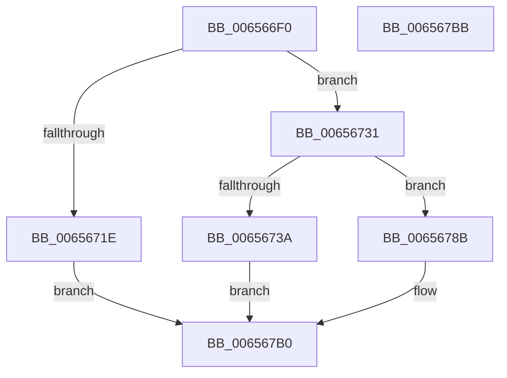

# ExQueryPoolBlockSize

- RVA: `0x006566F0`–`0x006567BC` (길이 `204` bytes)
- VA: `0x00000001406566F0`
- 실행 섹션: `.text`
- PDB 이름 있음: `예`; PDB Function 태그: `아니요`
- unwind 정보 RVA: `0x00089EA4`
- 디코드: `55`개 명령, `204/204` bytes 표시
- 미해석 바이트: `0` (있으면 어셈블리에 `.byte`로 보존)

> 이 문서는 커널 이미지의 기계어와 PDB 기호를 분석해 생성했습니다. 4번과 5번은 함수 원형과 자료형을 바이너리 사용 방식에서 추정한 C 해석이며 원본 소스 복구 결과는 아닙니다.

## 1. Dependencies

- 직접 호출 지점: **4**; 고유 호출 대상: **4**
- 직접 호출자로 확인된 함수: **1**
- RIP 상대 이미지 참조: **0**

### Outgoing calls
- `0x00656715` → [ExIsSpecialPoolAddress](../49/ExIsSpecialPoolAddress_function_0049C410.md) (function, `0x0049C410`)
- `0x0065673D` → [MmDeterminePoolType](../35/MmDeterminePoolType_function_0035F5B0.md) (function, `0x0035F5B0`)
- `0x0065676E` → [ExpRemoveTagForBigPages](../41/ExpRemoveTagForBigPages_function_00411980.md) (function, `0x00411980`)
- `0x0065679B` → [ExpGetEntryBilledProcess](../40/ExpGetEntryBilledProcess_function_0040ED00.md) (function, `0x0040ED00`)

### Direct callers
- [sub_00BF16D0](../../init/BF/Unknown_function_00BF16D0.md) at `0x00C15B8F`

### Static image references
- 디코드된 RIP-relative 메모리 참조가 없습니다.

## 2. Other-region calls and transfers

- 다른 실행 섹션으로 향하는 call: **0**
- 별도 외부 분기/꼬리 이동을 확인하지 못했습니다.

## 3. Assembly (complete function range)

```asm
006566F0  48 8B C4                        mov rax, rsp
006566F3  48 89 58 08                     mov qword ptr [rax + 8], rbx
006566F7  57                              push rdi
006566F8  48 83 EC 50                     sub rsp, 0x50
006566FC  48 83 60 E8 00                  and qword ptr [rax - 0x18], 0
00656701  48 8B FA                        mov rdi, rdx
00656704  48 83 60 20 00                  and qword ptr [rax + 0x20], 0
00656709  48 8B D9                        mov rbx, rcx
0065670C  48 83 60 F0 00                  and qword ptr [rax - 0x10], 0
00656711  83 60 18 00                     and dword ptr [rax + 0x18], 0
00656715  E8 F6 5C E4 FF                  call 0x14049c410
0065671A  85 C0                           test eax, eax
0065671C  74 13                           je 0x140656731
0065671E  48 81 E3 00 F0 FF FF            and rbx, 0xfffffffffffff000
00656725  C6 07 00                        mov byte ptr [rdi], 0
00656728  8B 03                           mov eax, dword ptr [rbx]
0065672A  25 FF 0F 00 00                  and eax, 0xfff
0065672F  EB 7F                           jmp 0x1406567b0
00656731  48 F7 C3 FF 0F 00 00            test rbx, 0xfff
00656738  75 51                           jne 0x14065678b
0065673A  48 8B CB                        mov rcx, rbx
0065673D  E8 6E 8E D0 FF                  call 0x14035f5b0
00656742  48 8B D0                        mov rdx, rax
00656745  4C 8D 4C 24 70                  lea r9, [rsp + 0x70]
0065674A  48 8D 44 24 78                  lea rax, [rsp + 0x78]
0065674F  45 33 C0                        xor r8d, r8d
00656752  48 89 44 24 30                  mov qword ptr [rsp + 0x30], rax
00656757  48 8B CB                        mov rcx, rbx
0065675A  48 8D 44 24 40                  lea rax, [rsp + 0x40]
0065675F  48 89 44 24 28                  mov qword ptr [rsp + 0x28], rax
00656764  48 8D 44 24 48                  lea rax, [rsp + 0x48]
00656769  48 89 44 24 20                  mov qword ptr [rsp + 0x20], rax
0065676E  E8 0D B2 DB FF                  call 0x140411980
00656773  48 8B 44 24 78                  mov rax, qword ptr [rsp + 0x78]
00656778  48 FF C8                        dec rax
0065677B  48 83 F8 FD                     cmp rax, -3
0065677F  0F 96 C0                        setbe al
00656782  88 07                           mov byte ptr [rdi], al
00656784  B8 00 10 00 00                  mov eax, 0x1000
00656789  EB 25                           jmp 0x1406567b0
0065678B  48 8D 4B F0                     lea rcx, [rbx - 0x10]
0065678F  0F B7 41 02                     movzx eax, word ptr [rcx + 2]
00656793  44 0F B6 C0                     movzx r8d, al
00656797  49 C1 E0 04                     shl r8, 4
0065679B  E8 60 85 DB FF                  call 0x14040ed00
006567A0  48 FF C8                        dec rax
006567A3  48 83 F8 FD                     cmp rax, -3
006567A7  49 8D 40 F0                     lea rax, [r8 - 0x10]
006567AB  0F 96 C1                        setbe cl
006567AE  88 0F                           mov byte ptr [rdi], cl
006567B0  48 8B 5C 24 60                  mov rbx, qword ptr [rsp + 0x60]
006567B5  48 83 C4 50                     add rsp, 0x50
006567B9  5F                              pop rdi
006567BA  C3                              ret
006567BB  CC                              int3
```

## 4. C-style interpretation (structured pseudocode)

```c
__int64 __fastcall ExQueryPoolBlockSize(__int64 a1, __int64 a2, int a3)
{
    __int64 result;
    __int64 v_rbx;
    __int64 v_rsp;
    unsigned __int64 v_stack_m10;
    unsigned __int64 v_stack_m18;
    unsigned __int64 v_stack_m28;
    unsigned __int64 v_stack_m30;
    unsigned __int64 v_stack_m38;
    unsigned __int64 v_stack_p18;
    unsigned __int64 v_stack_p20;
    unsigned __int64 v_stack_p8;

    *(unsigned __int64 *)(v_rsp + 8) = v_rbx;
    v_rsp = (v_rsp) - (80);
    result = ExIsSpecialPoolAddress(a1, a2, a3, a4);
    if ((unsigned int)(result) == 0) goto loc_00656731;
    v_rbx = (a1) & (0xFFFFFFFFFFFFF000ULL);
    *(unsigned __int8 *)(a2) = 0;
    result = (unsigned int)(((unsigned int)(*(unsigned int *)(v_rbx))) & (0xFFFULL));
    goto loc_006567B0;
loc_00656731:
    if (((v_rbx) & (0xFFFULL)) != 0) goto loc_0065678B;
    result = MmDeterminePoolType(v_rbx, a2, a3, a4);
    a3 = 0;
    v_stack_m28 = v_stack_p20;
    v_stack_m30 = v_stack_m18;
    v_stack_m38 = v_stack_m10;
    result = ExpRemoveTagForBigPages(v_rbx, result, a3, v_stack_p18);
    result = (v_stack_p20) - 1;
    result = (result <= -3) ? 1 : 0;
    *(unsigned __int8 *)(a2) = (unsigned __int8)(result);
    goto loc_006567B0;
loc_0065678B:
    a3 = ((unsigned __int8)(*(unsigned __int16 *)(v_rbx - 16 + 2))) << (4);
    result = ExpGetEntryBilledProcess(v_rbx - 16, result, a3, v_stack_p18);
    result = (result) - 1;
    a1 = (result <= -3) ? 1 : 0;
    *(unsigned __int8 *)(a2) = (unsigned __int8)(a1);
loc_006567B0:
    v_rsp = (v_rsp) + (80);
    return a3 - 16;
}
```

## 5. (Beta) C Style

```c
int64_t ExQueryPoolBlockSize(void *Arg1, void *Arg2, int32_t Arg3)
{
    uint8_t *arg1 = (uint8_t *)Arg1;
    uint8_t *arg2 = (uint8_t *)Arg2;

    int64_t result;
    int64_t local_rbx;
    int64_t local_rsp;
    uint64_t v_stack_m10;
    uint64_t v_stack_m18;
    uint64_t v_stack_m28;
    uint64_t v_stack_m30;
    uint64_t v_stack_m38;
    uint64_t v_stack_p18;
    uint64_t v_stack_p20;
    uint64_t v_stack_p8;

    *(uint64_t *)(local_rsp + 0x8) = local_rbx;
    local_rsp = (local_rsp) - (80);
    result = ExIsSpecialPoolAddress(Arg1, Arg2, Arg3, a4);
    if ((uint32_t)(result) == 0) goto loc_00656731;
    local_rbx = (Arg1) & (0xFFFFFFFFFFFFF000ULL);
    *(uint8_t *)(arg2) = 0;
    result = (uint32_t)(((uint32_t)(*(uint32_t *)(local_rbx))) & (0xFFFULL));
    goto loc_006567B0;
loc_00656731:
    if (((local_rbx) & (0xFFFULL)) != 0) goto loc_0065678B;
    result = MmDeterminePoolType(local_rbx, Arg2, Arg3, a4);
    Arg3 = 0;
    v_stack_m28 = v_stack_p20;
    v_stack_m30 = v_stack_m18;
    v_stack_m38 = v_stack_m10;
    result = ExpRemoveTagForBigPages(local_rbx, result, Arg3, v_stack_p18);
    result = (v_stack_p20) - 1;
    result = (result <= -3) ? 1 : 0;
    *(uint8_t *)(arg2) = (uint8_t)(result);
    goto loc_006567B0;
loc_0065678B:
    Arg3 = ((uint8_t)(*(uint16_t *)(local_rbx - 0x10 + 0x2))) << (4);
    result = ExpGetEntryBilledProcess(local_rbx - 16, result, Arg3, v_stack_p18);
    result = (result) - 1;
    Arg1 = (result <= -3) ? 1 : 0;
    *(uint8_t *)(arg2) = (uint8_t)(Arg1);
loc_006567B0:
    local_rsp = (local_rsp) + (80);
    return Arg3 - 16;
}
```

### 관측된 메모리 오프셋

구조체 형식이 확인되지 않은 접근은 인자 기준의 오프셋으로만 기록했습니다.

| 기준 인자 | 오프셋 표현 | 폭 (bit) | 접근 |
|---|---:|---:|---|
| `Arg1` | `+ 0x0` | `32` | `R` |
| `Arg2` | `+ 0x0` | `8` | `W` |

## 6. Execution-region graph

[열기: 2D/3D 그래프와 함수 탐색 컨트롤 패널](../../../control-panel.html?section=text&rva=0x006566F0&view=graph)

- 2D 그래프는 위에서 아래로 흐르고, 3D 그래프는 빈 공간을 드래그해 회전합니다. Shift+드래그는 이동, 휠은 확대·축소, 함수 노드 선택은 대상 보고서 이동입니다.

### Static fallback


