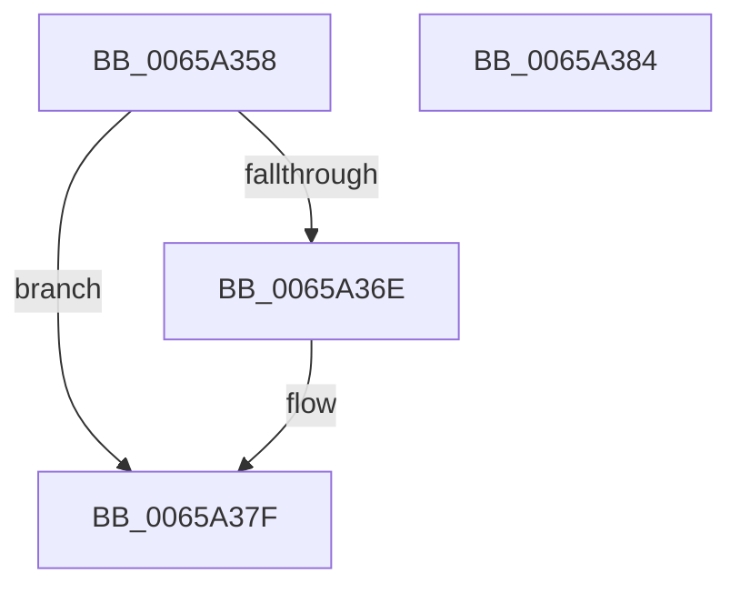

# ExQueueDebuggerWorker

- RVA: `0x0065A358`–`0x0065A385` (길이 `45` bytes)
- VA: `0x000000014065A358`
- 실행 섹션: `.text`
- PDB 이름 있음: `예`; PDB Function 태그: `아니요`
- unwind 정보 RVA: `0x0005C788`
- 디코드: `12`개 명령, `45/45` bytes 표시
- 미해석 바이트: `0` (있으면 어셈블리에 `.byte`로 보존)

> 이 문서는 커널 이미지의 기계어와 PDB 기호를 분석해 생성했습니다. 4번과 5번은 함수 원형과 자료형을 바이너리 사용 방식에서 추정한 C 해석이며 원본 소스 복구 결과는 아닙니다.

## 1. Dependencies

- 직접 호출 지점: **1**; 고유 호출 대상: **1**
- 직접 호출자로 확인된 함수: **2**
- RIP 상대 이미지 참조: **2**

### Outgoing calls
- `0x0065A37A` → [KeInsertQueueDpc](../20/KeInsertQueueDpc_function_00207C50.md) (function, `0x00207C50`)

### Direct callers
- [KdExitDebugger](../../pagekd/B8/KdExitDebugger_function_00B85008.md) at `0x00B8513C`
- [ExpWorkerInitialization](../../init/C5/ExpWorkerInitialization_function_00C539A4.md) at `0x00C53D92`

### Static image references
- `0x0065A364` → RVA `0x00E0EBC8` (`.data`; read)
- `0x0065A371` → RVA `0x00EFAA20` (`.data`; read)

## 2. Other-region calls and transfers

- 다른 실행 섹션으로 향하는 call: **0**
- 별도 외부 분기/꼬리 이동을 확인하지 못했습니다.

## 3. Assembly (complete function range)

```asm
0065A358  48 83 EC 28                     sub rsp, 0x28
0065A35C  B9 02 00 00 00                  mov ecx, 2
0065A361  8D 41 FF                        lea eax, [rcx - 1]
0065A364  F0 0F B1 0D 5C 48 7B 00         lock cmpxchg dword ptr [rip + 0x7b485c], ecx
0065A36C  75 11                           jne 0x14065a37f
0065A36E  45 33 C0                        xor r8d, r8d
0065A371  48 8D 0D A8 06 8A 00            lea rcx, [rip + 0x8a06a8]
0065A378  33 D2                           xor edx, edx
0065A37A  E8 D1 D8 BA FF                  call 0x140207c50
0065A37F  48 83 C4 28                     add rsp, 0x28
0065A383  C3                              ret
0065A384  CC                              int3
```

## 4. C-style interpretation (structured pseudocode)

```c
__int64 __fastcall ExQueueDebuggerWorker(__int64 a1, int a2, int a3)
{
    __int64 result;
    __int64 v_rsp;

    v_rsp = (v_rsp) - (40);
    result = 2 - 1;
    if (!(condition_is_not_equal)) {
        a3 = 0;
        a1 = v_rip + 9045672;
        a2 = 0;
        result = KeInsertQueueDpc(a1, a2, a3, a4);
    }
    v_rsp = (v_rsp) + (40);
    return result;
}
```

## 5. (Beta) C Style

```c
int64_t ExQueueDebuggerWorker(int64_t Arg1, int32_t Arg2, int32_t Arg3)
{
    int64_t result;
    int64_t local_rsp;

    local_rsp = (local_rsp) - (40);
    result = 2 - 1;
    if (!(condition_is_not_equal)) {
        Arg3 = 0;
        Arg1 = v_rip + 9045672;
        Arg2 = 0;
        result = KeInsertQueueDpc(Arg1, Arg2, Arg3, a4);
    }
    local_rsp = (local_rsp) + (40);
    return result;
}
```

## 6. Execution-region graph

[열기: 2D/3D 그래프와 함수 탐색 컨트롤 패널](../../../control-panel.html?section=text&rva=0x0065A358&view=graph)

- 2D 그래프는 위에서 아래로 흐르고, 3D 그래프는 빈 공간을 드래그해 회전합니다. Shift+드래그는 이동, 휠은 확대·축소, 함수 노드 선택은 대상 보고서 이동입니다.

### Static fallback


