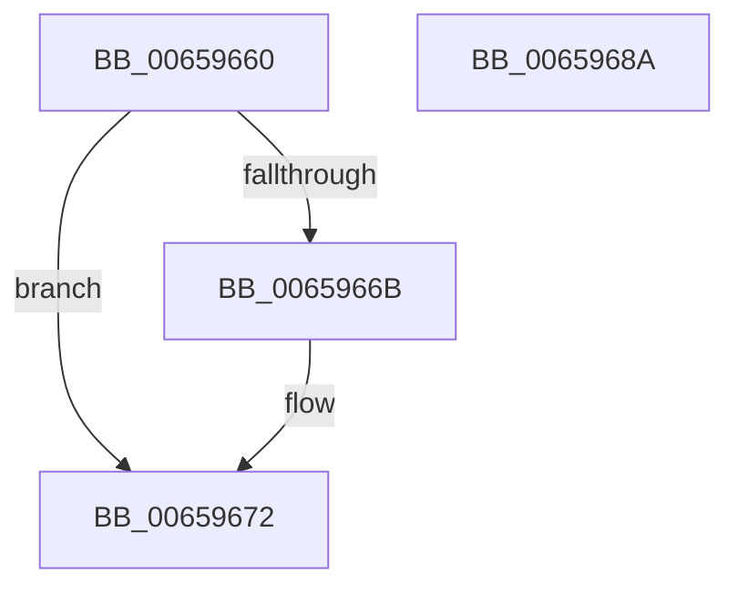

# ExQueueDpcEventWait

- RVA: `0x00659660`–`0x0065968B` (길이 `43` bytes)
- VA: `0x0000000140659660`
- 실행 섹션: `.text`
- PDB 이름 있음: `예`; PDB Function 태그: `아니요`
- unwind 정보 RVA: `0x0005C788`
- 디코드: `14`개 명령, `43/43` bytes 표시
- 미해석 바이트: `0` (있으면 어셈블리에 `.byte`로 보존)

> 이 문서는 커널 이미지의 기계어와 PDB 기호를 분석해 생성했습니다. 4번과 5번은 함수 원형과 자료형을 바이너리 사용 방식에서 추정한 C 해석이며 원본 소스 복구 결과는 아닙니다.

## 1. Dependencies

- 직접 호출 지점: **1**; 고유 호출 대상: **1**
- 직접 호출자로 확인된 함수: **0**
- RIP 상대 이미지 참조: **0**

### Outgoing calls
- `0x00659680` → [KeRegisterObjectDpc](../5B/KeRegisterObjectDpc_function_005B2544.md) (function, `0x005B2544`)

### Direct callers
- 이 함수 시작 RVA로 연결되는 직접 call은 확인되지 않았습니다. 간접 호출은 완전히 역산할 수 없습니다.

### Static image references
- 디코드된 RIP-relative 메모리 참조가 없습니다.

## 2. Other-region calls and transfers

- 다른 실행 섹션으로 향하는 call: **0**
- 별도 외부 분기/꼬리 이동을 확인하지 못했습니다.

## 3. Assembly (complete function range)

```asm
00659660  48 83 EC 28                     sub rsp, 0x28
00659664  8A 41 11                        mov al, byte ptr [rcx + 0x11]
00659667  3C 05                           cmp al, 5
00659669  74 07                           je 0x140659672
0065966B  B9 05 00 00 00                  mov ecx, 5
00659670  CD 29                           int 0x29
00659672  44 8A CA                        mov r9b, dl
00659675  4C 8B C1                        mov r8, rcx
00659678  48 8B 51 30                     mov rdx, qword ptr [rcx + 0x30]
0065967C  48 8B 49 38                     mov rcx, qword ptr [rcx + 0x38]
00659680  E8 BF 8E F5 FF                  call 0x1405b2544
00659685  48 83 C4 28                     add rsp, 0x28
00659689  C3                              ret
0065968A  CC                              int3
```

## 4. C-style interpretation (structured pseudocode)

```c
__int64 __fastcall ExQueueDpcEventWait(__int64 a1, unsigned __int8 a2)
{
    __int64 result;
    __int64 v_rsp;

    v_rsp = (v_rsp) - (40);
    if (((unsigned __int8)(*(unsigned __int8 *)(a1 + 17))) != 5) {
        a1 = 5;
    }
    result = KeRegisterObjectDpc(*(unsigned __int64 *)(a1 + 56), *(unsigned __int64 *)(a1 + 48), a1, a2);
    v_rsp = (v_rsp) + (40);
    return result;
}
```

## 5. (Beta) C Style

```c
int64_t ExQueueDpcEventWait(void *Arg1, uint8_t Arg2)
{
    uint8_t *arg1 = (uint8_t *)Arg1;

    int64_t result;
    int64_t local_rsp;

    local_rsp = (local_rsp) - (40);
    if (((uint8_t)(*(uint8_t *)(arg1 + 0x11))) != 5) {
        Arg1 = 5;
    }
    result = KeRegisterObjectDpc(*(uint64_t *)(arg1 + 0x38), *(uint64_t *)(arg1 + 0x30), Arg1, Arg2);
    local_rsp = (local_rsp) + (40);
    return result;
}
```

### 관측된 메모리 오프셋

구조체 형식이 확인되지 않은 접근은 인자 기준의 오프셋으로만 기록했습니다.

| 기준 인자 | 오프셋 표현 | 폭 (bit) | 접근 |
|---|---:|---:|---|
| `Arg1` | `+ 0x11` | `8` | `R` |

## 6. Execution-region graph

[열기: 2D/3D 그래프와 함수 탐색 컨트롤 패널](../../../control-panel.html?section=text&rva=0x00659660&view=graph)

- 2D 그래프는 위에서 아래로 흐르고, 3D 그래프는 빈 공간을 드래그해 회전합니다. Shift+드래그는 이동, 휠은 확대·축소, 함수 노드 선택은 대상 보고서 이동입니다.

### Static fallback


