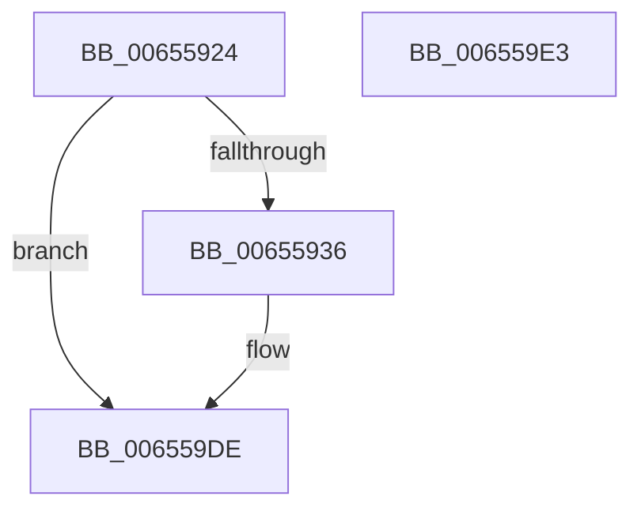

# ExRebootSystemForRecovery

- RVA: `0x00655924`–`0x006559E4` (길이 `192` bytes)
- VA: `0x0000000140655924`
- 실행 섹션: `.text`
- PDB 이름 있음: `예`; PDB Function 태그: `아니요`
- unwind 정보 RVA: `0x0005C788`
- 디코드: `44`개 명령, `192/192` bytes 표시
- 미해석 바이트: `0` (있으면 어셈블리에 `.byte`로 보존)

> 이 문서는 커널 이미지의 기계어와 PDB 기호를 분석해 생성했습니다. 4번과 5번은 함수 원형과 자료형을 바이너리 사용 방식에서 추정한 C 해석이며 원본 소스 복구 결과는 아닙니다.

## 1. Dependencies

- 직접 호출 지점: **12**; 고유 호출 대상: **7**
- 직접 호출자로 확인된 함수: **2**
- RIP 상대 이미지 참조: **2**

### Outgoing calls
- `0x00655938` → [CmShutdownSystem](../../page/7E/CmShutdownSystem_function_007E5174.md) (function, `0x007E5174`)
- `0x00655942` → [CmShutdownSystem](../../page/7E/CmShutdownSystem_function_007E5174.md) (function, `0x007E5174`)
- `0x00655958` → [ExNotifyWithProcessing](../45/ExNotifyWithProcessing_function_004523F4.md) (function, `0x004523F4`)
- `0x0065596E` → [ExNotifyWithProcessing](../45/ExNotifyWithProcessing_function_004523F4.md) (function, `0x004523F4`)
- `0x00655984` → [ExNotifyWithProcessing](../45/ExNotifyWithProcessing_function_004523F4.md) (function, `0x004523F4`)
- `0x0065599A` → [ExNotifyWithProcessing](../45/ExNotifyWithProcessing_function_004523F4.md) (function, `0x004523F4`)
- `0x006559B0` → [ExNotifyWithProcessing](../45/ExNotifyWithProcessing_function_004523F4.md) (function, `0x004523F4`)
- `0x006559B5` → [MiDeleteAllHardwareEnclaves](../../pagelk/B7/MiDeleteAllHardwareEnclaves_function_00B74CAC.md) (function, `0x00B74CAC`)
- `0x006559BC` → [VslNotifyShutdown](../58/VslNotifyShutdown_function_0058EBC8.md) (function, `0x0058EBC8`)
- `0x006559C1` → [KiBugcheckUnloadDebugSymbols](../5B/KiBugcheckUnloadDebugSymbols_function_005B41B4.md) (function, `0x005B41B4`)
- `0x006559CF` → [KiSendThawExecution](../4E/KiSendThawExecution_function_004E2800.md) (function, `0x004E2800`)
- `0x006559D9` → [HalReturnToFirmware](../54/HalReturnToFirmware_function_00546550.md) (function, `0x00546550`)

### Direct callers
- [KiDeferredBugcheckRecoveryWorker](../5C/KiDeferredBugcheckRecoveryWorker_function_005C75A0.md) at `0x005C76FA`
- [NtShutdownSystem](NtShutdownSystem_function_00655B70.md) at `0x00655BBD`

### Static image references
- `0x00655928` → RVA `0x00F8A888` (`.data`; read)
- `0x006559C8` → RVA `0x00E66890` (`.data`; write)

## 2. Other-region calls and transfers

- 다른 실행 섹션으로 향하는 call: **3**
  - `0x00655938` → [CmShutdownSystem](../../page/7E/CmShutdownSystem_function_007E5174.md) (`.text` → `PAGE`)
  - `0x00655942` → [CmShutdownSystem](../../page/7E/CmShutdownSystem_function_007E5174.md) (`.text` → `PAGE`)
  - `0x006559B5` → [MiDeleteAllHardwareEnclaves](../../pagelk/B7/MiDeleteAllHardwareEnclaves_function_00B74CAC.md) (`.text` → `PAGELK`)
- 별도 외부 분기/꼬리 이동을 확인하지 못했습니다.

## 3. Assembly (complete function range)

```asm
00655924  48 83 EC 28                     sub rsp, 0x28
00655928  48 83 3D 58 4F 93 00 00         cmp qword ptr [rip + 0x934f58], 0
00655930  0F 84 A8 00 00 00               je 0x1406559de
00655936  33 C9                           xor ecx, ecx
00655938  E8 37 F8 18 00                  call 0x1407e5174
0065593D  B9 01 00 00 00                  mov ecx, 1
00655942  E8 2D F8 18 00                  call 0x1407e5174
00655947  48 8B 0D 3A 4F 93 00            mov rcx, qword ptr [rip + 0x934f3a]
0065594E  45 33 C9                        xor r9d, r9d
00655951  45 33 C0                        xor r8d, r8d
00655954  41 8D 51 0A                     lea edx, [r9 + 0xa]
00655958  E8 97 CA DF FF                  call 0x1404523f4
0065595D  48 8B 0D 24 4F 93 00            mov rcx, qword ptr [rip + 0x934f24]
00655964  45 33 C9                        xor r9d, r9d
00655967  45 33 C0                        xor r8d, r8d
0065596A  41 8D 51 0F                     lea edx, [r9 + 0xf]
0065596E  E8 81 CA DF FF                  call 0x1404523f4
00655973  48 8B 0D 0E 4F 93 00            mov rcx, qword ptr [rip + 0x934f0e]
0065597A  45 33 C9                        xor r9d, r9d
0065597D  45 33 C0                        xor r8d, r8d
00655980  41 8D 51 14                     lea edx, [r9 + 0x14]
00655984  E8 6B CA DF FF                  call 0x1404523f4
00655989  48 8B 0D F8 4E 93 00            mov rcx, qword ptr [rip + 0x934ef8]
00655990  45 33 C9                        xor r9d, r9d
00655993  45 33 C0                        xor r8d, r8d
00655996  41 8D 51 16                     lea edx, [r9 + 0x16]
0065599A  E8 55 CA DF FF                  call 0x1404523f4
0065599F  48 8B 0D E2 4E 93 00            mov rcx, qword ptr [rip + 0x934ee2]
006559A6  45 33 C9                        xor r9d, r9d
006559A9  45 33 C0                        xor r8d, r8d
006559AC  41 8D 51 19                     lea edx, [r9 + 0x19]
006559B0  E8 3F CA DF FF                  call 0x1404523f4
006559B5  E8 F2 F2 51 00                  call 0x140b74cac
006559BA  33 C9                           xor ecx, ecx
006559BC  E8 07 92 F3 FF                  call 0x14058ebc8
006559C1  E8 EE E7 F5 FF                  call 0x1405b41b4
006559C6  33 C9                           xor ecx, ecx
006559C8  C6 05 C1 0E 81 00 01            mov byte ptr [rip + 0x810ec1], 1
006559CF  E8 2C CE E8 FF                  call 0x1404e2800
006559D4  B9 03 00 00 00                  mov ecx, 3
006559D9  E8 72 0B EF FF                  call 0x140546550
006559DE  48 83 C4 28                     add rsp, 0x28
006559E2  C3                              ret
006559E3  CC                              int3
```

## 4. C-style interpretation (structured pseudocode)

```c
__int64 __fastcall ExRebootSystemForRecovery(int a1, __int64 a2, int a3, int a4)
{
    __int64 result;
    __int64 v_rsp;

    v_rsp = (v_rsp) - (40);
    if ((*(unsigned __int64 *)(v_rip + 9654104)) != 0) {
        a1 = 0;
        result = CmShutdownSystem(a1, a2, a3, a4);
        a1 = 1;
        result = CmShutdownSystem(a1, a2, a3, a4);
        a1 = *(unsigned __int64 *)(v_rip + 9654074);
        a4 = 0;
        a3 = 0;
        a2 = a4 + 10;
        result = ExNotifyWithProcessing(a1, a2, a3, a4);
        a1 = *(unsigned __int64 *)(v_rip + 9654052);
        a4 = 0;
        a3 = 0;
        a2 = a4 + 15;
        result = ExNotifyWithProcessing(a1, a2, a3, a4);
        a1 = *(unsigned __int64 *)(v_rip + 9654030);
        a4 = 0;
        a3 = 0;
        a2 = a4 + 20;
        result = ExNotifyWithProcessing(a1, a2, a3, a4);
        a1 = *(unsigned __int64 *)(v_rip + 9654008);
        a4 = 0;
        a3 = 0;
        a2 = a4 + 22;
        result = ExNotifyWithProcessing(a1, a2, a3, a4);
        a1 = *(unsigned __int64 *)(v_rip + 9653986);
        a4 = 0;
        a3 = 0;
        a2 = a4 + 25;
        result = ExNotifyWithProcessing(a1, a2, a3, a4);
        result = MiDeleteAllHardwareEnclaves(a1, a2, a3, a4);
        a1 = 0;
        result = VslNotifyShutdown(a1, a2, a3, a4);
        result = KiBugcheckUnloadDebugSymbols(a1, a2, a3, a4);
        a1 = 0;
        *(unsigned __int8 *)(v_rip + 8457921) = 1;
        result = KiSendThawExecution(a1, a2, a3, a4);
        a1 = 3;
        result = HalReturnToFirmware(a1, a2, a3, a4);
    }
    v_rsp = (v_rsp) + (40);
    return result;
}
```

## 5. (Beta) C Style

```c
int64_t ExRebootSystemForRecovery(int32_t Arg1, int64_t Arg2, int32_t Arg3, int32_t Arg4)
{
    int64_t result;
    int64_t local_rsp;

    local_rsp = (local_rsp) - (40);
    if ((*(uint64_t *)(v_rip + 0x934F58)) != 0) {
        Arg1 = 0;
        result = CmShutdownSystem(Arg1, Arg2, Arg3, Arg4);
        Arg1 = 1;
        result = CmShutdownSystem(Arg1, Arg2, Arg3, Arg4);
        Arg1 = *(uint64_t *)(v_rip + 0x934F3A);
        Arg4 = 0;
        Arg3 = 0;
        Arg2 = Arg4 + 10;
        result = ExNotifyWithProcessing(Arg1, Arg2, Arg3, Arg4);
        Arg1 = *(uint64_t *)(v_rip + 0x934F24);
        Arg4 = 0;
        Arg3 = 0;
        Arg2 = Arg4 + 15;
        result = ExNotifyWithProcessing(Arg1, Arg2, Arg3, Arg4);
        Arg1 = *(uint64_t *)(v_rip + 0x934F0E);
        Arg4 = 0;
        Arg3 = 0;
        Arg2 = Arg4 + 20;
        result = ExNotifyWithProcessing(Arg1, Arg2, Arg3, Arg4);
        Arg1 = *(uint64_t *)(v_rip + 0x934EF8);
        Arg4 = 0;
        Arg3 = 0;
        Arg2 = Arg4 + 22;
        result = ExNotifyWithProcessing(Arg1, Arg2, Arg3, Arg4);
        Arg1 = *(uint64_t *)(v_rip + 0x934EE2);
        Arg4 = 0;
        Arg3 = 0;
        Arg2 = Arg4 + 25;
        result = ExNotifyWithProcessing(Arg1, Arg2, Arg3, Arg4);
        result = MiDeleteAllHardwareEnclaves(Arg1, Arg2, Arg3, Arg4);
        Arg1 = 0;
        result = VslNotifyShutdown(Arg1, Arg2, Arg3, Arg4);
        result = KiBugcheckUnloadDebugSymbols(Arg1, Arg2, Arg3, Arg4);
        Arg1 = 0;
        *(uint8_t *)(v_rip + 0x810EC1) = 1;
        result = KiSendThawExecution(Arg1, Arg2, Arg3, Arg4);
        Arg1 = 3;
        result = HalReturnToFirmware(Arg1, Arg2, Arg3, Arg4);
    }
    local_rsp = (local_rsp) + (40);
    return result;
}
```

## 6. Execution-region graph

[열기: 2D/3D 그래프와 함수 탐색 컨트롤 패널](../../../control-panel.html?section=text&rva=0x00655924&view=graph)

- 2D 그래프는 위에서 아래로 흐르고, 3D 그래프는 빈 공간을 드래그해 회전합니다. Shift+드래그는 이동, 휠은 확대·축소, 함수 노드 선택은 대상 보고서 이동입니다.

### Static fallback


