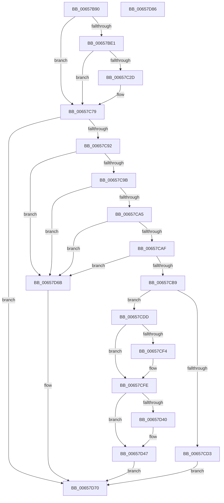

# ExRegisterBootDevice

- RVA: `0x00657B90`–`0x00657D87` (길이 `503` bytes)
- VA: `0x0000000140657B90`
- 실행 섹션: `.text`
- PDB 이름 있음: `예`; PDB Function 태그: `아니요`
- unwind 정보 RVA: `0x000CB780`
- 디코드: `125`개 명령, `503/503` bytes 표시
- 미해석 바이트: `0` (있으면 어셈블리에 `.byte`로 보존)

> 이 문서는 커널 이미지의 기계어와 PDB 기호를 분석해 생성했습니다. 4번과 5번은 함수 원형과 자료형을 바이너리 사용 방식에서 추정한 C 해석이며 원본 소스 복구 결과는 아닙니다.

## 1. Dependencies

- 직접 호출 지점: **11**; 고유 호출 대상: **10**
- 직접 호출자로 확인된 함수: **0**
- RIP 상대 이미지 참조: **8**

### Outgoing calls
- `0x00657BCF` → [KeWaitForSingleObject](../20/KeWaitForSingleObject_function_0020E6B0.md) (function, `0x0020E6B0`)
- `0x00657C22` → [PsCreateSystemThread](../../page/9E/PsCreateSystemThread_function_009ED0D0.md) (function, `0x009ED0D0`)
- `0x00657C4E` → [ObReferenceObjectByHandle](../../page/86/ObReferenceObjectByHandle_function_00868DB0.md) (function, `0x00868DB0`)
- `0x00657C64` → [ZwClose](../6A/ZwClose_function_006AD2B0.md) (function, `0x006AD2B0`)
- `0x00657C74` → [KeSetPriorityThread](../2C/KeSetPriorityThread_function_002C76E0.md) (function, `0x002C76E0`)
- `0x00657C85` → [KeSetEvent](../33/KeSetEvent_function_0033F310.md) (function, `0x0033F310`)
- `0x00657CC6` → [ExAllocatePool2](../../poolcode/B8/ExAllocatePool2_function_00B820F0.md) (function, `0x00B820F0`)
- `0x00657CE6` → [ObfReferenceObjectWithTag](../21/ObfReferenceObjectWithTag_function_00210710.md) (function, `0x00210710`)
- `0x00657CF9` → [ObfReferenceObjectWithTag](../21/ObfReferenceObjectWithTag_function_00210710.md) (function, `0x00210710`)
- `0x00657D24` → [KeAcquireSpinLockRaiseToDpc](../20/KeAcquireSpinLockRaiseToDpc_function_00208470.md) (function, `0x00208470`)
- `0x00657D61` → [KeReleaseSpinLock](../39/KeReleaseSpinLock_function_00392BA0.md) (function, `0x00392BA0`)

### Direct callers
- 이 함수 시작 RVA로 연결되는 직접 call은 확인되지 않았습니다. 간접 호출은 완전히 역산할 수 없습니다.

### Static image references
- `0x00657BB6` → RVA `0x00EFAC60` (`.data`; read)
- `0x00657BD4` → RVA `0x00EFACA0` (`.data`; read)
- `0x00657BE1` → RVA `0x00657D90` (`ExpWaitForBootDevices`; read)
- `0x00657C5D` → RVA `0x00EFACA0` (`.data`; write)
- `0x00657D04` → RVA `0x00EFAC90` (`.data`; read)
- `0x00657D29` → RVA `0x00EFAC88` (`.data`; read)
- `0x00657D30` → RVA `0x00EFAC80` (`.data`; read)
- `0x00657D53` → RVA `0x00EFAC88` (`.data`; write)

## 2. Other-region calls and transfers

- 다른 실행 섹션으로 향하는 call: **3**
  - `0x00657C22` → [PsCreateSystemThread](../../page/9E/PsCreateSystemThread_function_009ED0D0.md) (`.text` → `PAGE`)
  - `0x00657C4E` → [ObReferenceObjectByHandle](../../page/86/ObReferenceObjectByHandle_function_00868DB0.md) (`.text` → `PAGE`)
  - `0x00657CC6` → [ExAllocatePool2](../../poolcode/B8/ExAllocatePool2_function_00B820F0.md) (`.text` → `POOLCODE`)
- 별도 외부 분기/꼬리 이동을 확인하지 못했습니다.

## 3. Assembly (complete function range)

```asm
00657B90  48 89 5C 24 08                  mov qword ptr [rsp + 8], rbx
00657B95  55                              push rbp
00657B96  56                              push rsi
00657B97  57                              push rdi
00657B98  41 56                           push r14
00657B9A  41 57                           push r15
00657B9C  48 8B EC                        mov rbp, rsp
00657B9F  48 83 EC 70                     sub rsp, 0x70
00657BA3  45 33 FF                        xor r15d, r15d
00657BA6  4C 8B F2                        mov r14, rdx
00657BA9  48 8B F9                        mov rdi, rcx
00657BAC  4C 89 7D 40                     mov qword ptr [rbp + 0x40], r15
00657BB0  33 D2                           xor edx, edx
00657BB2  44 89 7D D4                     mov dword ptr [rbp - 0x2c], r15d
00657BB6  48 8D 0D A3 30 8A 00            lea rcx, [rip + 0x8a30a3]
00657BBD  44 89 7D EC                     mov dword ptr [rbp - 0x14], r15d
00657BC1  45 33 C9                        xor r9d, r9d
00657BC4  4C 89 7C 24 20                  mov qword ptr [rsp + 0x20], r15
00657BC9  45 33 C0                        xor r8d, r8d
00657BCC  41 8B DF                        mov ebx, r15d
00657BCF  E8 DC 6A BB FF                  call 0x14020e6b0
00657BD4  4C 39 3D C5 30 8A 00            cmp qword ptr [rip + 0x8a30c5], r15
00657BDB  0F 85 98 00 00 00               jne 0x140657c79
00657BE1  48 8D 05 A8 01 00 00            lea rax, [rip + 0x1a8]
00657BE8  4C 89 7C 24 30                  mov qword ptr [rsp + 0x30], r15
00657BED  0F 57 C0                        xorps xmm0, xmm0
00657BF0  48 89 44 24 28                  mov qword ptr [rsp + 0x28], rax
00657BF5  45 33 C9                        xor r9d, r9d
00657BF8  4C 89 7C 24 20                  mov qword ptr [rsp + 0x20], r15
00657BFD  4C 8D 45 D0                     lea r8, [rbp - 0x30]
00657C01  C7 45 D0 30 00 00 00            mov dword ptr [rbp - 0x30], 0x30
00657C08  33 D2                           xor edx, edx
00657C0A  4C 89 7D D8                     mov qword ptr [rbp - 0x28], r15
00657C0E  48 8D 4D 40                     lea rcx, [rbp + 0x40]
00657C12  C7 45 E8 00 02 00 00            mov dword ptr [rbp - 0x18], 0x200
00657C19  4C 89 7D E0                     mov qword ptr [rbp - 0x20], r15
00657C1D  F3 0F 7F 45 F0                  movdqu xmmword ptr [rbp - 0x10], xmm0
00657C22  E8 A9 54 39 00                  call 0x1409ed0d0
00657C27  8B D8                           mov ebx, eax
00657C29  85 C0                           test eax, eax
00657C2B  78 4C                           js 0x140657c79
00657C2D  48 8B 4D 40                     mov rcx, qword ptr [rbp + 0x40]
00657C31  48 8D 45 48                     lea rax, [rbp + 0x48]
00657C35  4C 89 7C 24 28                  mov qword ptr [rsp + 0x28], r15
00657C3A  45 33 C9                        xor r9d, r9d
00657C3D  45 33 C0                        xor r8d, r8d
00657C40  48 89 44 24 20                  mov qword ptr [rsp + 0x20], rax
00657C45  BA FF FF 1F 00                  mov edx, 0x1fffff
00657C4A  4C 89 7D 48                     mov qword ptr [rbp + 0x48], r15
00657C4E  E8 5D 11 21 00                  call 0x140868db0
00657C53  48 8B 4D 40                     mov rcx, qword ptr [rbp + 0x40]
00657C57  8B D8                           mov ebx, eax
00657C59  48 8B 45 48                     mov rax, qword ptr [rbp + 0x48]
00657C5D  48 89 05 3C 30 8A 00            mov qword ptr [rip + 0x8a303c], rax
00657C64  E8 47 56 05 00                  call 0x1406ad2b0
00657C69  48 8B 0D 30 30 8A 00            mov rcx, qword ptr [rip + 0x8a3030]
00657C70  41 8D 57 1F                     lea edx, [r15 + 0x1f]
00657C74  E8 67 FA C6 FF                  call 0x1402c76e0
00657C79  45 33 C0                        xor r8d, r8d
00657C7C  48 8D 0D DD 2F 8A 00            lea rcx, [rip + 0x8a2fdd]
00657C83  33 D2                           xor edx, edx
00657C85  E8 86 76 CE FF                  call 0x14033f310
00657C8A  85 DB                           test ebx, ebx
00657C8C  0F 88 DE 00 00 00               js 0x140657d70
00657C92  83 3F 01                        cmp dword ptr [rdi], 1
00657C95  0F 85 D0 00 00 00               jne 0x140657d6b
00657C9B  4C 39 7F 08                     cmp qword ptr [rdi + 8], r15
00657C9F  0F 84 C6 00 00 00               je 0x140657d6b
00657CA5  44 39 7F 04                     cmp dword ptr [rdi + 4], r15d
00657CA9  0F 85 BC 00 00 00               jne 0x140657d6b
00657CAF  4C 39 7F 18                     cmp qword ptr [rdi + 0x18], r15
00657CB3  0F 84 B2 00 00 00               je 0x140657d6b
00657CB9  B9 40 00 00 00                  mov ecx, 0x40
00657CBE  41 B8 42 44 4E 50               mov r8d, 0x504e4442
00657CC4  8B D1                           mov edx, ecx
00657CC6  E8 25 A4 52 00                  call 0x140b820f0
00657CCB  48 8B F0                        mov rsi, rax
00657CCE  48 85 C0                        test rax, rax
00657CD1  75 0A                           jne 0x140657cdd
00657CD3  BB 9A 00 00 C0                  mov ebx, 0xc000009a
00657CD8  E9 93 00 00 00                  jmp 0x140657d70
00657CDD  48 8B 4F 08                     mov rcx, qword ptr [rdi + 8]
00657CE1  BA 44 66 6C 74                  mov edx, 0x746c6644
00657CE6  E8 25 8A BB FF                  call 0x140210710
00657CEB  48 8B 4F 10                     mov rcx, qword ptr [rdi + 0x10]
00657CEF  48 85 C9                        test rcx, rcx
00657CF2  74 0A                           je 0x140657cfe
00657CF4  BA 44 66 6C 74                  mov edx, 0x746c6644
00657CF9  E8 12 8A BB FF                  call 0x140210710
00657CFE  C7 06 42 44 4E 50               mov dword ptr [rsi], 0x504e4442
00657D04  48 8D 0D 85 2F 8A 00            lea rcx, [rip + 0x8a2f85]
00657D0B  0F 10 07                        movups xmm0, xmmword ptr [rdi]
00657D0E  0F 11 46 18                     movups xmmword ptr [rsi + 0x18], xmm0
00657D12  0F 10 4F 10                     movups xmm1, xmmword ptr [rdi + 0x10]
00657D16  0F 11 4E 28                     movups xmmword ptr [rsi + 0x28], xmm1
00657D1A  F2 0F 10 47 20                  movsd xmm0, qword ptr [rdi + 0x20]
00657D1F  F2 0F 11 46 38                  movsd qword ptr [rsi + 0x38], xmm0
00657D24  E8 47 07 BB FF                  call 0x140208470
00657D29  48 8B 15 58 2F 8A 00            mov rdx, qword ptr [rip + 0x8a2f58]
00657D30  4C 8D 05 49 2F 8A 00            lea r8, [rip + 0x8a2f49]
00657D37  48 8D 4E 08                     lea rcx, [rsi + 8]
00657D3B  4C 39 02                        cmp qword ptr [rdx], r8
00657D3E  74 07                           je 0x140657d47
00657D40  B9 03 00 00 00                  mov ecx, 3
00657D45  CD 29                           int 0x29
00657D47  48 89 51 08                     mov qword ptr [rcx + 8], rdx
00657D4B  4C 89 01                        mov qword ptr [rcx], r8
00657D4E  48 89 0A                        mov qword ptr [rdx], rcx
00657D51  8A D0                           mov dl, al
00657D53  48 89 0D 2E 2F 8A 00            mov qword ptr [rip + 0x8a2f2e], rcx
00657D5A  48 8D 0D 2F 2F 8A 00            lea rcx, [rip + 0x8a2f2f]
00657D61  E8 3A AE D3 FF                  call 0x140392ba0
00657D66  49 89 36                        mov qword ptr [r14], rsi
00657D69  EB 05                           jmp 0x140657d70
00657D6B  BB 0D 00 00 C0                  mov ebx, 0xc000000d
00657D70  8B C3                           mov eax, ebx
00657D72  48 8B 9C 24 A0 00 00 00         mov rbx, qword ptr [rsp + 0xa0]
00657D7A  48 83 C4 70                     add rsp, 0x70
00657D7E  41 5F                           pop r15
00657D80  41 5E                           pop r14
00657D82  5F                              pop rdi
00657D83  5E                              pop rsi
00657D84  5D                              pop rbp
00657D85  C3                              ret
00657D86  CC                              int3
```

## 4. C-style interpretation (structured pseudocode)

```c
__int64 __fastcall ExRegisterBootDevice(__int64 a1, __int64 a2, int a3, int a4)
{
    __int64 result;
    __int64 v_r15;
    __int64 v_rbx;
    __int64 v_rsp;
    unsigned __int64 v_stack_m38;
    unsigned int v_stack_m3C;
    unsigned int v_stack_m40;
    unsigned __int64 v_stack_m48;
    unsigned __int64 v_stack_m50;
    unsigned int v_stack_m54;
    unsigned __int64 v_stack_m58;
    unsigned __int64 v_stack_m68;
    unsigned __int64 v_stack_m70;
    unsigned __int64 v_stack_m78;
    unsigned __int64 v_stack_p18;
    unsigned __int64 v_stack_p20;
    unsigned __int64 v_stack_p8;

    v_stack_p8 = v_rbx;
    v_rsp = (v_rsp) - (112);
    v_r15 = 0;
    v_stack_p18 = 0;
    a2 = 0;
    v_stack_m54 = 0;
    v_stack_m3C = 0;
    a4 = 0;
    v_stack_m78 = 0;
    a3 = 0;
    result = KeWaitForSingleObject(v_rip + 9056419, a2, a3, a4);
    if ((*(unsigned __int64 *)(v_rip + 9056453)) != 0) goto loc_00657C79;
    v_stack_m68 = 0;
    v_stack_m70 = v_rip + 424;
    a4 = 0;
    v_stack_m78 = 0;
    v_stack_m58 = 48;
    a2 = 0;
    v_stack_m50 = 0;
    v_stack_m40 = 512;
    v_stack_m48 = 0;
    v_stack_m38 = v_xmm0;
    result = PsCreateSystemThread(v_stack_p18, a2, v_stack_m58, a4);
    v_rbx = (unsigned int)((unsigned int)(result));
    if (!(sign_flag)) {
        a1 = v_stack_p18;
        result = v_stack_p20;
        v_stack_m70 = 0;
        a4 = 0;
        a3 = 0;
        v_stack_m78 = result;
        a2 = 0x1FFFFFULL;
        v_stack_p20 = 0;
        result = ObReferenceObjectByHandle(a1, a2, a3, a4);
        a1 = v_stack_p18;
        v_rbx = (unsigned int)(result);
        result = v_stack_p20;
        *(unsigned __int64 *)(v_rip + 9056316) = result;
        result = ZwClose(a1, a2, a3, a4);
        a1 = *(unsigned __int64 *)(v_rip + 9056304);
        a2 = v_r15 + 31;
        result = KeSetPriorityThread(a1, a2, a3, a4);
    }
    a3 = 0;
    a2 = 0;
    result = KeSetEvent(v_rip + 9056221, a2, a3, a4);
    if (sign_flag) goto loc_00657D70;
    if ((*(unsigned int *)(a1)) != 1) goto loc_00657D6B;
    if ((*(unsigned __int64 *)(a1 + 8)) == 0) goto loc_00657D6B;
    if ((*(unsigned int *)(a1 + 4)) != 0) goto loc_00657D6B;
    if ((*(unsigned __int64 *)(a1 + 24)) == 0) goto loc_00657D6B;
    result = ExAllocatePool2(64, 64, (unsigned int)(0x504E4442ULL), a4);
    if (result != 0) goto loc_00657CDD;
    goto loc_00657D70;
loc_00657CDD:
    result = ObfReferenceObjectWithTag(*(unsigned __int64 *)(a1 + 8), (unsigned int)(0x746C6644ULL), (unsigned int)(0x504E4442ULL), a4);
    if (*(unsigned __int64 *)(a1 + 16) != 0) {
        a2 = 0x746C6644ULL;
        result = ObfReferenceObjectWithTag(*(unsigned __int64 *)(a1 + 16), a2, (unsigned int)(0x504E4442ULL), a4);
    }
    *(unsigned int *)(result) = 0x504E4442ULL;
    *(unsigned __int64 *)(result + 24) = v_xmm0;
    *(unsigned __int64 *)(result + 40) = v_xmm1;
    *(unsigned __int64 *)(result + 56) = v_xmm0;
    result = KeAcquireSpinLockRaiseToDpc(v_rip + 9056133, a2, (unsigned int)(0x504E4442ULL), a4);
    if ((*(unsigned __int64 *)(*(unsigned __int64 *)(v_rip + 9056088))) != (v_rip + 9056073)) {
        a1 = 3;
    }
    *(unsigned __int64 *)(a1 + 8) = *(unsigned __int64 *)(v_rip + 9056088);
    *(unsigned __int64 *)(a1) = v_rip + 9056073;
    *(unsigned __int64 *)(*(unsigned __int64 *)(v_rip + 9056088)) = a1;
    *(unsigned __int64 *)(v_rip + 9056046) = a1;
    result = KeReleaseSpinLock(v_rip + 9056047, (unsigned __int8)(result), v_rip + 9056073, a4);
    *(unsigned __int64 *)(a2) = result;
    goto loc_00657D70;
loc_00657D6B:
loc_00657D70:
    v_rsp = (v_rsp) + (112);
    return (unsigned int)((unsigned int)((unsigned int)(0xC000000DULL)));
}
```

## 5. (Beta) C Style

```c
int64_t ExRegisterBootDevice(void *Arg1, void *Arg2, int32_t Arg3, int32_t Arg4)
{
    uint8_t *arg1 = (uint8_t *)Arg1;
    uint8_t *arg2 = (uint8_t *)Arg2;

    int64_t result;
    int64_t local_r15;
    int64_t local_rbx;
    int64_t local_rsp;
    uint64_t v_stack_m38;
    uint32_t v_stack_m3C;
    uint32_t v_stack_m40;
    uint64_t v_stack_m48;
    uint64_t v_stack_m50;
    uint32_t v_stack_m54;
    uint64_t v_stack_m58;
    uint64_t v_stack_m68;
    uint64_t v_stack_m70;
    uint64_t v_stack_m78;
    uint64_t v_stack_p18;
    uint64_t v_stack_p20;
    uint64_t v_stack_p8;

    v_stack_p8 = local_rbx;
    local_rsp = (local_rsp) - (112);
    local_r15 = 0;
    v_stack_p18 = 0;
    Arg2 = 0;
    v_stack_m54 = 0;
    v_stack_m3C = 0;
    Arg4 = 0;
    v_stack_m78 = 0;
    Arg3 = 0;
    result = KeWaitForSingleObject(v_rip + 9056419, Arg2, Arg3, Arg4);
    if ((*(uint64_t *)(v_rip + 0x8A30C5)) != 0) goto loc_00657C79;
    v_stack_m68 = 0;
    v_stack_m70 = v_rip + 424;
    Arg4 = 0;
    v_stack_m78 = 0;
    v_stack_m58 = 48;
    Arg2 = 0;
    v_stack_m50 = 0;
    v_stack_m40 = 512;
    v_stack_m48 = 0;
    v_stack_m38 = v_xmm0;
    result = PsCreateSystemThread(v_stack_p18, Arg2, v_stack_m58, Arg4);
    local_rbx = (uint32_t)((uint32_t)(result));
    if (!(sign_flag)) {
        Arg1 = v_stack_p18;
        result = v_stack_p20;
        v_stack_m70 = 0;
        Arg4 = 0;
        Arg3 = 0;
        v_stack_m78 = result;
        Arg2 = 0x1FFFFFULL;
        v_stack_p20 = 0;
        result = ObReferenceObjectByHandle(Arg1, Arg2, Arg3, Arg4);
        Arg1 = v_stack_p18;
        local_rbx = (uint32_t)(result);
        result = v_stack_p20;
        *(uint64_t *)(v_rip + 0x8A303C) = result;
        result = ZwClose(Arg1, Arg2, Arg3, Arg4);
        Arg1 = *(uint64_t *)(v_rip + 0x8A3030);
        Arg2 = local_r15 + 31;
        result = KeSetPriorityThread(Arg1, Arg2, Arg3, Arg4);
    }
    Arg3 = 0;
    Arg2 = 0;
    result = KeSetEvent(v_rip + 9056221, Arg2, Arg3, Arg4);
    if (sign_flag) goto loc_00657D70;
    if ((*(uint32_t *)(arg1)) != 1) goto loc_00657D6B;
    if ((*(uint64_t *)(arg1 + 0x8)) == 0) goto loc_00657D6B;
    if ((*(uint32_t *)(arg1 + 0x4)) != 0) goto loc_00657D6B;
    if ((*(uint64_t *)(arg1 + 0x18)) == 0) goto loc_00657D6B;
    result = ExAllocatePool2(64, 64, (uint32_t)(0x504E4442ULL), Arg4);
    if (result != 0) goto loc_00657CDD;
    goto loc_00657D70;
loc_00657CDD:
    result = ObfReferenceObjectWithTag(*(uint64_t *)(arg1 + 0x8), (uint32_t)(0x746C6644ULL), (uint32_t)(0x504E4442ULL), Arg4);
    if (*(uint64_t *)(arg1 + 0x10) != 0) {
        Arg2 = 0x746C6644ULL;
        result = ObfReferenceObjectWithTag(*(uint64_t *)(arg1 + 0x10), Arg2, (uint32_t)(0x504E4442ULL), Arg4);
    }
    *(uint32_t *)(result) = 0x504E4442ULL;
    *(uint64_t *)(result + 0x18) = v_xmm0;
    *(uint64_t *)(result + 0x28) = v_xmm1;
    *(uint64_t *)(result + 0x38) = v_xmm0;
    result = KeAcquireSpinLockRaiseToDpc(v_rip + 9056133, Arg2, (uint32_t)(0x504E4442ULL), Arg4);
    if ((*(uint64_t *)(*(uint64_t *)(v_rip + 0x8A2F58))) != (v_rip + 9056073)) {
        Arg1 = 3;
    }
    *(uint64_t *)(arg1 + 0x8) = *(uint64_t *)(v_rip + 0x8A2F58);
    *(uint64_t *)(arg1) = v_rip + 9056073;
    *(void **)(*(uint64_t *)(v_rip + 0x8A2F58)) = Arg1;
    *(void **)(v_rip + 0x8A2F2E) = Arg1;
    result = KeReleaseSpinLock(v_rip + 9056047, (uint8_t)(result), v_rip + 9056073, Arg4);
    *(uint64_t *)(arg2) = result;
    goto loc_00657D70;
loc_00657D6B:
loc_00657D70:
    local_rsp = (local_rsp) + (112);
    return (uint32_t)((uint32_t)((uint32_t)(0xC000000DULL)));
}
```

### 관측된 메모리 오프셋

구조체 형식이 확인되지 않은 접근은 인자 기준의 오프셋으로만 기록했습니다.

| 기준 인자 | 오프셋 표현 | 폭 (bit) | 접근 |
|---|---:|---:|---|
| `Arg1` | `+ 0x0` | `32` | `R` |
| `Arg1` | `+ 0x0` | `128` | `R` |
| `Arg1` | `+ 0x4` | `32` | `R` |
| `Arg1` | `+ 0x8` | `64` | `R` |
| `Arg1` | `+ 0x10` | `64` | `R` |
| `Arg1` | `+ 0x10` | `128` | `R` |
| `Arg1` | `+ 0x18` | `64` | `R` |
| `Arg1` | `+ 0x20` | `64` | `R` |
| `Arg2` | `+ 0x0` | `64` | `W` |

## 6. Execution-region graph

[열기: 2D/3D 그래프와 함수 탐색 컨트롤 패널](../../../control-panel.html?section=text&rva=0x00657B90&view=graph)

- 2D 그래프는 위에서 아래로 흐르고, 3D 그래프는 빈 공간을 드래그해 회전합니다. Shift+드래그는 이동, 휠은 확대·축소, 함수 노드 선택은 대상 보고서 이동입니다.

### Static fallback


