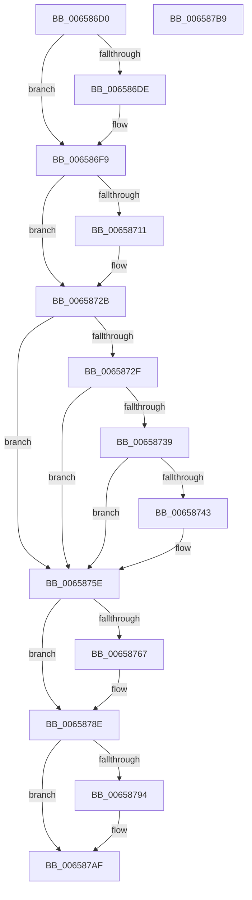

# ExReleaseDisownedFastResourceExclusive

- RVA: `0x006586D0`–`0x006587BA` (길이 `234` bytes)
- VA: `0x00000001406586D0`
- 실행 섹션: `.text`
- PDB 이름 있음: `예`; PDB Function 태그: `아니요`
- unwind 정보 RVA: `0x0005D2F4`
- 디코드: `62`개 명령, `234/234` bytes 표시
- 미해석 바이트: `0` (있으면 어셈블리에 `.byte`로 보존)

> 이 문서는 커널 이미지의 기계어와 PDB 기호를 분석해 생성했습니다. 4번과 5번은 함수 원형과 자료형을 바이너리 사용 방식에서 추정한 C 해석이며 원본 소스 복구 결과는 아닙니다.

## 1. Dependencies

- 직접 호출 지점: **6**; 고유 호출 대상: **2**
- 직접 호출자로 확인된 함수: **1**
- RIP 상대 이미지 참조: **0**

### Outgoing calls
- `0x006586F3` → [KeBugCheckEx](../4F/KeBugCheckEx_function_004FD660.md) (function, `0x004FD660`)
- `0x00658725` → [KeBugCheckEx](../4F/KeBugCheckEx_function_004FD660.md) (function, `0x004FD660`)
- `0x00658758` → [KeBugCheckEx](../4F/KeBugCheckEx_function_004FD660.md) (function, `0x004FD660`)
- `0x00658788` → [KeBugCheckEx](../4F/KeBugCheckEx_function_004FD660.md) (function, `0x004FD660`)
- `0x006587A9` → [KeBugCheckEx](../4F/KeBugCheckEx_function_004FD660.md) (function, `0x004FD660`)
- `0x006587AF` → [ExpReleaseDisownedFastResourceExclusive](../41/ExpReleaseDisownedFastResourceExclusive_function_00416470.md) (function, `0x00416470`)

### Direct callers
- [DifExReleaseDisownedFastResourceExclusiveWrapper](../62/DifExReleaseDisownedFastResourceExclusiveWrapper_function_00621FF0.md) at `0x006220C7`

### Static image references
- 디코드된 RIP-relative 메모리 참조가 없습니다.

## 2. Other-region calls and transfers

- 다른 실행 섹션으로 향하는 call: **0**
- 별도 외부 분기/꼬리 이동을 확인하지 못했습니다.

## 3. Assembly (complete function range)

```asm
006586D0  48 83 EC 38                     sub rsp, 0x38
006586D4  F6 41 1A 01                     test byte ptr [rcx + 0x1a], 1
006586D8  48 8D 51 40                     lea rdx, [rcx + 0x40]
006586DC  75 1B                           jne 0x1406586f9
006586DE  48 83 64 24 20 00               and qword ptr [rsp + 0x20], 0
006586E4  45 33 C9                        xor r9d, r9d
006586E7  4C 8B C1                        mov r8, rcx
006586EA  B9 C6 01 00 00                  mov ecx, 0x1c6
006586EF  41 8D 51 03                     lea edx, [r9 + 3]
006586F3  E8 68 4F EA FF                  call 0x1404fd660
006586F8  CC                              int3
006586F9  44 0F 20 C0                     mov rax, cr8
006586FD  65 4C 8B 04 25 88 01 00 00      mov r8, qword ptr gs:[0x188]
00658706  41 BA 02 00 00 00               mov r10d, 2
0065870C  41 3A C2                        cmp al, r10b
0065870F  76 1A                           jbe 0x14065872b
00658711  48 83 64 24 20 00               and qword ptr [rsp + 0x20], 0
00658717  45 8B CA                        mov r9d, r10d
0065871A  44 0F B6 C0                     movzx r8d, al
0065871E  33 D2                           xor edx, edx
00658720  B9 C6 01 00 00                  mov ecx, 0x1c6
00658725  E8 36 4F EA FF                  call 0x1404fd660
0065872A  CC                              int3
0065872B  3C 01                           cmp al, 1
0065872D  73 2F                           jae 0x14065875e
0065872F  41 F7 40 74 00 04 00 00         test dword ptr [r8 + 0x74], 0x400
00658737  75 25                           jne 0x14065875e
00658739  41 83 B8 E4 01 00 00 00         cmp dword ptr [r8 + 0x1e4], 0
00658741  75 1B                           jne 0x14065875e
00658743  48 83 64 24 20 00               and qword ptr [rsp + 0x20], 0
00658749  45 33 C9                        xor r9d, r9d
0065874C  45 33 C0                        xor r8d, r8d
0065874F  B9 C6 01 00 00                  mov ecx, 0x1c6
00658754  41 8D 51 07                     lea edx, [r9 + 7]
00658758  E8 03 4F EA FF                  call 0x1404fd660
0065875D  CC                              int3
0065875E  0F B6 42 25                     movzx eax, byte ptr [rdx + 0x25]
00658762  41 84 C2                        test r10b, al
00658765  75 27                           jne 0x14065878e
00658767  48 83 64 24 20 00               and qword ptr [rsp + 0x20], 0
0065876D  44 8B C8                        mov r9d, eax
00658770  4D 23 CA                        and r9, r10
00658773  4C 8B C2                        mov r8, rdx
00658776  49 C1 E1 0F                     shl r9, 0xf
0065877A  BA 0B 00 00 00                  mov edx, 0xb
0065877F  49 83 C9 01                     or r9, 1
00658783  B9 C6 01 00 00                  mov ecx, 0x1c6
00658788  E8 D3 4E EA FF                  call 0x1404fd660
0065878D  CC                              int3
0065878E  F6 42 10 01                     test byte ptr [rdx + 0x10], 1
00658792  75 1B                           jne 0x1406587af
00658794  48 83 64 24 20 00               and qword ptr [rsp + 0x20], 0
0065879A  45 33 C9                        xor r9d, r9d
0065879D  4C 8B C2                        mov r8, rdx
006587A0  B9 C6 01 00 00                  mov ecx, 0x1c6
006587A5  41 8D 51 0D                     lea edx, [r9 + 0xd]
006587A9  E8 B2 4E EA FF                  call 0x1404fd660
006587AE  CC                              int3
006587AF  E8 BC DC DB FF                  call 0x140416470
006587B4  48 83 C4 38                     add rsp, 0x38
006587B8  C3                              ret
006587B9  CC                              int3
```

## 4. C-style interpretation (structured pseudocode)

```c
__int64 __fastcall ExReleaseDisownedFastResourceExclusive(__int64 a1, __int64 a2, __int64 a3, int a4)
{
    __int64 result;
    __int64 v_rsp;
    unsigned __int64 v_stack_m18;

    v_rsp = (v_rsp) - (56);
    if (((*(unsigned __int8 *)(a1 + 26)) & (1)) == 0) {
        a4 = 0;
        a3 = a1;
        a1 = 454;
        a2 = a4 + 3;
        result = KeBugCheckEx(a1, a2, a3, a4);
    }
    result = v_cr8;
    if (((unsigned __int8)(v_cr8)) >= = 2) {
        a4 = 2;
        a3 = (unsigned __int8)(v_cr8);
        a2 = 0;
        a1 = 454;
        result = KeBugCheckEx(a1, a2, a3, a4);
    }
    if (((unsigned __int8)(result)) >= 1) goto loc_0065875E;
    if (((*(unsigned int *)(a3 + 116)) & (0x400ULL)) != 0) goto loc_0065875E;
    if ((*(unsigned int *)(a3 + 484)) == 0) {
        a4 = 0;
        a3 = 0;
        a1 = 454;
        a2 = a4 + 7;
        result = KeBugCheckEx(a1, a2, a3, a4);
    }
    result = *(unsigned __int8 *)(a2 + 37);
    if (((2) & ((unsigned __int8)(*(unsigned __int8 *)(a2 + 37)))) == 0) {
        a4 = (unsigned int)(*(unsigned __int8 *)(a2 + 37));
        a4 = (a4) & (2);
        a3 = a2;
        a4 = (a4) << (15);
        a2 = 11;
        a4 = (a4) | (1);
        a1 = 454;
        result = KeBugCheckEx(a1, a2, a3, a4);
    }
    if (((*(unsigned __int8 *)(a2 + 16)) & (1)) == 0) {
        a4 = 0;
        a3 = a2;
        a1 = 454;
        a2 = a4 + 13;
        result = KeBugCheckEx(a1, a2, a3, a4);
    }
    result = ExpReleaseDisownedFastResourceExclusive(a1, a2, a3, a4);
    v_rsp = (v_rsp) + (56);
    return result;
}
```

## 5. (Beta) C Style

```c
int64_t ExReleaseDisownedFastResourceExclusive(void *Arg1, int64_t Arg2, int64_t Arg3, int32_t Arg4)
{
    uint8_t *arg1 = (uint8_t *)Arg1;

    int64_t result;
    int64_t local_rsp;
    uint64_t v_stack_m18;

    local_rsp = (local_rsp) - (56);
    if (((*(uint8_t *)(arg1 + 0x1A)) & (1)) == 0) {
        Arg4 = 0;
        Arg3 = Arg1;
        Arg1 = 454;
        Arg2 = Arg4 + 3;
        result = KeBugCheckEx(Arg1, Arg2, Arg3, Arg4);
    }
    result = v_cr8;
    if (((uint8_t)(v_cr8)) >= = 2) {
        Arg4 = 2;
        Arg3 = (uint8_t)(v_cr8);
        Arg2 = 0;
        Arg1 = 454;
        result = KeBugCheckEx(Arg1, Arg2, Arg3, Arg4);
    }
    if (((uint8_t)(result)) >= 1) goto loc_0065875E;
    if (((*(uint32_t *)(Arg3 + 0x74)) & (0x400ULL)) != 0) goto loc_0065875E;
    if ((*(uint32_t *)(Arg3 + 0x1E4)) == 0) {
        Arg4 = 0;
        Arg3 = 0;
        Arg1 = 454;
        Arg2 = Arg4 + 7;
        result = KeBugCheckEx(Arg1, Arg2, Arg3, Arg4);
    }
    result = *(uint8_t *)(Arg2 + 0x25);
    if (((2) & ((uint8_t)(*(uint8_t *)(Arg2 + 0x25)))) == 0) {
        Arg4 = (uint32_t)(*(uint8_t *)(Arg2 + 0x25));
        Arg4 = (Arg4) & (2);
        Arg3 = Arg2;
        Arg4 = (Arg4) << (15);
        Arg2 = 11;
        Arg4 = (Arg4) | (1);
        Arg1 = 454;
        result = KeBugCheckEx(Arg1, Arg2, Arg3, Arg4);
    }
    if (((*(uint8_t *)(Arg2 + 0x10)) & (1)) == 0) {
        Arg4 = 0;
        Arg3 = Arg2;
        Arg1 = 454;
        Arg2 = Arg4 + 13;
        result = KeBugCheckEx(Arg1, Arg2, Arg3, Arg4);
    }
    result = ExpReleaseDisownedFastResourceExclusive(Arg1, Arg2, Arg3, Arg4);
    local_rsp = (local_rsp) + (56);
    return result;
}
```

### 관측된 메모리 오프셋

구조체 형식이 확인되지 않은 접근은 인자 기준의 오프셋으로만 기록했습니다.

| 기준 인자 | 오프셋 표현 | 폭 (bit) | 접근 |
|---|---:|---:|---|
| `Arg1` | `+ 0x1A` | `8` | `R` |
| `Arg1` | `+ 0x40` | `64` | `R` |

## 6. Execution-region graph

[열기: 2D/3D 그래프와 함수 탐색 컨트롤 패널](../../../control-panel.html?section=text&rva=0x006586D0&view=graph)

- 2D 그래프는 위에서 아래로 흐르고, 3D 그래프는 빈 공간을 드래그해 회전합니다. Shift+드래그는 이동, 휠은 확대·축소, 함수 노드 선택은 대상 보고서 이동입니다.

### Static fallback


